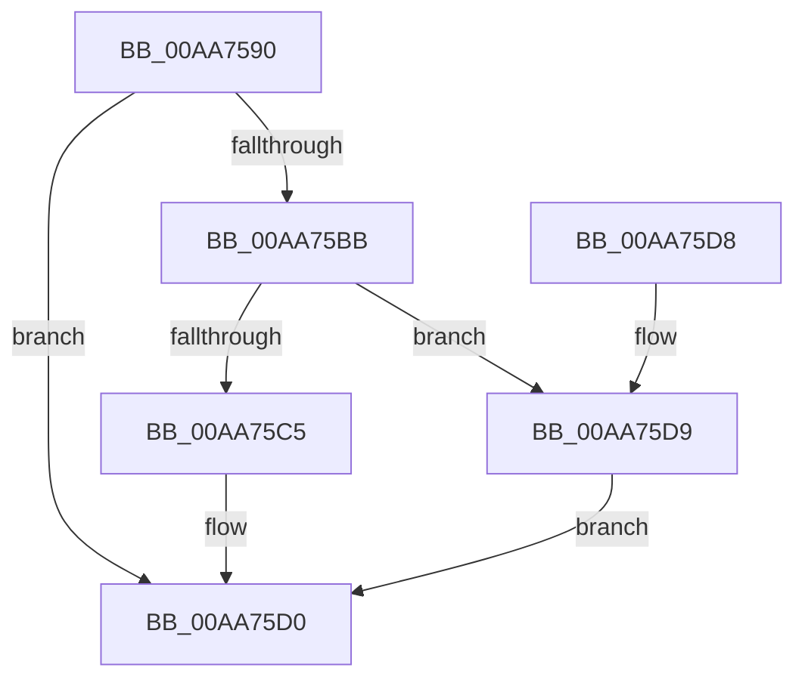

# EtwpInitializeLoggerSecurityDescriptor

- RVA: `0x00AA7590`–`0x00AA75E3` (길이 `83` bytes)
- VA: `0x0000000140AA7590`
- 실행 섹션: `PAGE`
- PDB 이름 있음: `예`; PDB Function 태그: `아니요`
- unwind 정보 RVA: `0x00064CA8`
- 디코드: `24`개 명령, `83/83` bytes 표시
- 미해석 바이트: `0` (있으면 어셈블리에 `.byte`로 보존)

> 이 문서는 커널 이미지의 기계어와 PDB 기호를 분석해 생성했습니다. 4번과 5번은 함수 원형과 자료형을 바이너리 사용 방식에서 추정한 C 해석이며 원본 소스 복구 결과는 아닙니다.

## 1. Dependencies

- 직접 호출 지점: **1**; 고유 호출 대상: **1**
- 직접 호출자로 확인된 함수: **2**
- RIP 상대 이미지 참조: **0**

### Outgoing calls
- `0x00AA75B0` → [ObLogSecurityDescriptor](../8C/ObLogSecurityDescriptor_function_008C0020.md) (function, `0x008C0020`)

### Direct callers
- [EtwpStartLogger](../A9/EtwpStartLogger_function_00A99D80.md) at `0x00A9AC6F`
- [EtwpFixBootLoggers](../../init/C4/EtwpFixBootLoggers_function_00C4F09C.md) at `0x00C4F12E`

### Static image references
- 디코드된 RIP-relative 메모리 참조가 없습니다.

## 2. Other-region calls and transfers

- 다른 실행 섹션으로 향하는 call: **0**
- 별도 외부 분기/꼬리 이동을 확인하지 못했습니다.

## 3. Assembly (complete function range)

```asm
00AA7590  40 53                           push rbx
00AA7592  48 83 EC 20                     sub rsp, 0x20
00AA7596  48 83 64 24 40 00               and qword ptr [rsp + 0x40], 0
00AA759C  48 8B C2                        mov rax, rdx
00AA759F  48 8B D9                        mov rbx, rcx
00AA75A2  48 8D 54 24 40                  lea rdx, [rsp + 0x40]
00AA75A7  48 8B C8                        mov rcx, rax
00AA75AA  41 B8 10 00 00 00               mov r8d, 0x10
00AA75B0  E8 6B 8A E1 FF                  call 0x1408c0020
00AA75B5  8B C8                           mov ecx, eax
00AA75B7  85 C0                           test eax, eax
00AA75B9  78 15                           js 0x140aa75d0
00AA75BB  48 8B 44 24 40                  mov rax, qword ptr [rsp + 0x40]
00AA75C0  48 85 C0                        test rax, rax
00AA75C3  74 14                           je 0x140aa75d9
00AA75C5  48 83 C0 0F                     add rax, 0xf
00AA75C9  48 89 83 10 03 00 00            mov qword ptr [rbx + 0x310], rax
00AA75D0  8B C1                           mov eax, ecx
00AA75D2  48 83 C4 20                     add rsp, 0x20
00AA75D6  5B                              pop rbx
00AA75D7  C3                              ret
00AA75D8  CC                              int3
00AA75D9  48 83 A3 10 03 00 00 00         and qword ptr [rbx + 0x310], 0
00AA75E1  EB ED                           jmp 0x140aa75d0
```

## 4. C-style interpretation (structured pseudocode)

```c
__int64 __fastcall EtwpInitializeLoggerSecurityDescriptor(__int64 a1, __int64 a2)
{
    __int64 result;
    __int64 v_rsp;
    unsigned __int64 v_stack_p18;

    v_rsp = (v_rsp) - (32);
    result = ObLogSecurityDescriptor(a2, v_stack_p18, 16, a4);
    if (sign_flag) goto loc_00AA75D0;
    if (v_stack_p18 == 0) goto loc_00AA75D9;
    result = (v_stack_p18) + (15);
    *(unsigned __int64 *)(a1 + 784) = result;
loc_00AA75D0:
    v_rsp = (v_rsp) + (32);
    return (unsigned int)((unsigned int)((unsigned int)((unsigned int)(result))));
loc_00AA75D9:
    goto loc_00AA75D0;
}
```

## 5. (Beta) C Style

```c
int64_t EtwpInitializeLoggerSecurityDescriptor(void *Arg1, int64_t Arg2)
{
    uint8_t *arg1 = (uint8_t *)Arg1;

    int64_t result;
    int64_t local_rsp;
    uint64_t v_stack_p18;

    local_rsp = (local_rsp) - (32);
    result = ObLogSecurityDescriptor(Arg2, v_stack_p18, 16, a4);
    if (sign_flag) goto loc_00AA75D0;
    if (v_stack_p18 == 0) goto loc_00AA75D9;
    result = (v_stack_p18) + (15);
    *(uint64_t *)(arg1 + 0x310) = result;
loc_00AA75D0:
    local_rsp = (local_rsp) + (32);
    return (uint32_t)((uint32_t)((uint32_t)((uint32_t)(result))));
loc_00AA75D9:
    goto loc_00AA75D0;
}
```

### 관측된 메모리 오프셋

구조체 형식이 확인되지 않은 접근은 인자 기준의 오프셋으로만 기록했습니다.

| 기준 인자 | 오프셋 표현 | 폭 (bit) | 접근 |
|---|---:|---:|---|
| `Arg1` | `+ 0x310` | `64` | `R/W` |
| `Arg1` | `+ 0x310` | `64` | `W` |

## 6. Execution-region graph

[열기: 2D/3D 그래프와 함수 탐색 컨트롤 패널](../../../control-panel.html?section=page&rva=0x00AA7590&view=graph)

- 2D 그래프는 위에서 아래로 흐르고, 3D 그래프는 빈 공간을 드래그해 회전합니다. Shift+드래그는 이동, 휠은 확대·축소, 함수 노드 선택은 대상 보고서 이동입니다.

### Static fallback


