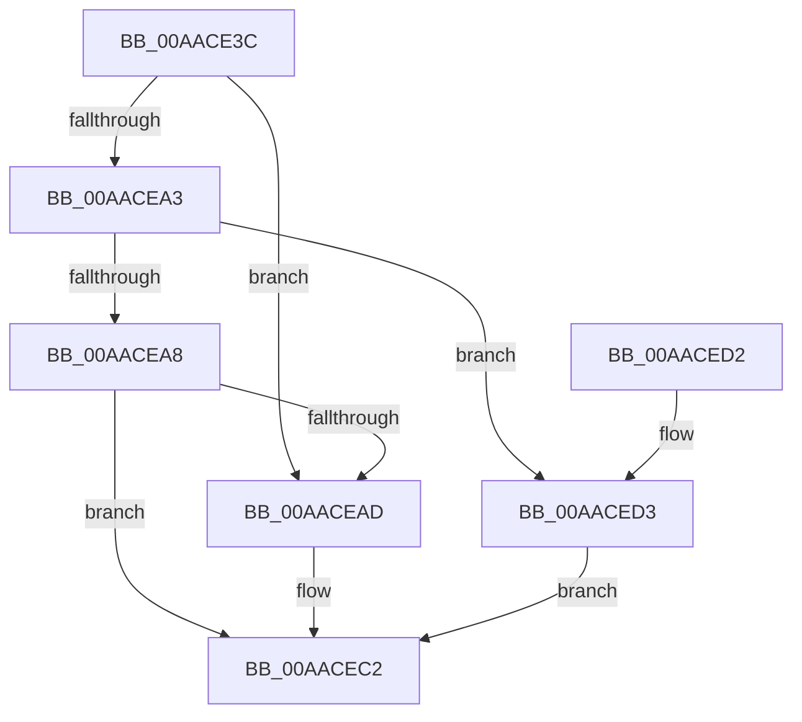

# EtwpInitializeProviderInfoBuffer

- RVA: `0x00AACE3C`–`0x00AACEE9` (길이 `173` bytes)
- VA: `0x0000000140AACE3C`
- 실행 섹션: `PAGE`
- PDB 이름 있음: `예`; PDB Function 태그: `아니요`
- unwind 정보 RVA: `0x0005C774`
- 디코드: `46`개 명령, `173/173` bytes 표시
- 미해석 바이트: `0` (있으면 어셈블리에 `.byte`로 보존)

> 이 문서는 커널 이미지의 기계어와 PDB 기호를 분석해 생성했습니다. 4번과 5번은 함수 원형과 자료형을 바이너리 사용 방식에서 추정한 C 해석이며 원본 소스 복구 결과는 아닙니다.

## 1. Dependencies

- 직접 호출 지점: **2**; 고유 호출 대상: **2**
- 직접 호출자로 확인된 함수: **2**
- RIP 상대 이미지 참조: **2**

### Outgoing calls
- `0x00AACE54` → [EtwpInitializeBufferHeader](../../text/3E/EtwpInitializeBufferHeader_function_003EB010.md) (function, `0x003EB010`)
- `0x00AACE63` → [EtwpResetBufferHeader](../../text/3E/EtwpResetBufferHeader_function_003EB558.md) (function, `0x003EB558`)

### Direct callers
- [EtwpSendDbgId](../7B/EtwpSendDbgId_function_007BC1C0.md) at `0x007BC27A`
- [EtwpRealtimeNotifyConsumers](../9C/EtwpRealtimeNotifyConsumers_function_009C019C.md) at `0x009C0278`

### Static image references
- `0x00AACEAD` → RVA `0x00EFF258` (`.data`; read)
- `0x00AACED3` → RVA `0x00EFF288` (`.data`; read)

## 2. Other-region calls and transfers

- 다른 실행 섹션으로 향하는 call: **2**
  - `0x00AACE54` → [EtwpInitializeBufferHeader](../../text/3E/EtwpInitializeBufferHeader_function_003EB010.md) (`PAGE` → `.text`)
  - `0x00AACE63` → [EtwpResetBufferHeader](../../text/3E/EtwpResetBufferHeader_function_003EB558.md) (`PAGE` → `.text`)
- 별도 외부 분기/꼬리 이동을 확인하지 못했습니다.

## 3. Assembly (complete function range)

```asm
00AACE3C  48 89 5C 24 08                  mov qword ptr [rsp + 8], rbx
00AACE41  48 89 74 24 10                  mov qword ptr [rsp + 0x10], rsi
00AACE46  57                              push rdi
00AACE47  48 83 EC 20                     sub rsp, 0x20
00AACE4B  41 8B D8                        mov ebx, r8d
00AACE4E  48 8B F2                        mov rsi, rdx
00AACE51  48 8B F9                        mov rdi, rcx
00AACE54  E8 B7 E1 93 FF                  call 0x1403eb010
00AACE59  BA 07 00 00 00                  mov edx, 7
00AACE5E  89 1E                           mov dword ptr [rsi], ebx
00AACE60  48 8B CE                        mov rcx, rsi
00AACE63  E8 F0 E6 93 FF                  call 0x1403eb558
00AACE68  C7 46 2C 03 00 00 00            mov dword ptr [rsi + 0x2c], 3
00AACE6F  66 C7 46 34 01 00               mov word ptr [rsi + 0x34], 1
00AACE75  0F 10 87 30 01 00 00            movups xmm0, xmmword ptr [rdi + 0x130]
00AACE7C  F3 0F 7F 46 38                  movdqu xmmword ptr [rsi + 0x38], xmm0
00AACE81  8B 87 C8 00 00 00               mov eax, dword ptr [rdi + 0xc8]
00AACE87  8B C8                           mov ecx, eax
00AACE89  48 33 4E 20                     xor rcx, qword ptr [rsi + 0x20]
00AACE8D  48 83 E1 F8                     and rcx, 0xfffffffffffffff8
00AACE91  48 33 C8                        xor rcx, rax
00AACE94  48 89 4E 20                     mov qword ptr [rsi + 0x20], rcx
00AACE98  8B 97 C8 00 00 00               mov edx, dword ptr [rdi + 0xc8]
00AACE9E  83 EA 01                        sub edx, 1
00AACEA1  74 0A                           je 0x140aacead
00AACEA3  83 EA 02                        sub edx, 2
00AACEA6  74 2B                           je 0x140aaced3
00AACEA8  83 FA 01                        cmp edx, 1
00AACEAB  75 15                           jne 0x140aacec2
00AACEAD  48 8B 05 A4 23 45 00            mov rax, qword ptr [rip + 0x4523a4]
00AACEB4  83 E1 07                        and ecx, 7
00AACEB7  48 C1 E0 03                     shl rax, 3
00AACEBB  48 0B C8                        or rcx, rax
00AACEBE  48 89 4E 20                     mov qword ptr [rsi + 0x20], rcx
00AACEC2  48 8B 5C 24 30                  mov rbx, qword ptr [rsp + 0x30]
00AACEC7  48 8B 74 24 38                  mov rsi, qword ptr [rsp + 0x38]
00AACECC  48 83 C4 20                     add rsp, 0x20
00AACED0  5F                              pop rdi
00AACED1  C3                              ret
00AACED2  CC                              int3
00AACED3  8B 05 AF 23 45 00               mov eax, dword ptr [rip + 0x4523af]
00AACED9  83 E1 07                        and ecx, 7
00AACEDC  48 C1 E0 03                     shl rax, 3
00AACEE0  48 0B C1                        or rax, rcx
00AACEE3  48 89 46 20                     mov qword ptr [rsi + 0x20], rax
00AACEE7  EB D9                           jmp 0x140aacec2
```

## 4. C-style interpretation (structured pseudocode)

```c
__int64 __fastcall EtwpInitializeProviderInfoBuffer(__int64 a1, __int64 a2, int a3)
{
    __int64 result;
    __int64 v_rsp;
    unsigned __int64 v_stack_p10;
    unsigned __int64 v_stack_p8;

    v_stack_p8 = v_rbx;
    v_stack_p10 = v_rsi;
    v_rsp = (v_rsp) - (32);
    result = EtwpInitializeBufferHeader(a1, a2, a3, a4);
    *(unsigned int *)(a2) = (unsigned int)((unsigned int)(a3));
    result = EtwpResetBufferHeader(a2, 7, a3, a4);
    *(unsigned int *)(a2 + 44) = 3;
    *(unsigned __int16 *)(a2 + 52) = 1;
    *(unsigned __int64 *)(a2 + 56) = v_xmm0;
    a1 = ((unsigned int)((unsigned int)((unsigned int)(*(unsigned int *)(a1 + 200))))) ^ (*(unsigned __int64 *)(a2 + 32));
    a1 = (a1) & (-8);
    a1 = (a1) ^ ((unsigned int)(*(unsigned int *)(a1 + 200)));
    *(unsigned __int64 *)(a2 + 32) = a1;
    a2 = (unsigned int)(((unsigned int)(*(unsigned int *)(a1 + 200))) - (1));
    if (condition_is_equal) goto loc_00AACEAD;
    a2 = (unsigned int)((a2) - (2));
    if (condition_is_equal) goto loc_00AACED3;
    result = (unsigned int)(*(unsigned int *)(a1 + 200));
    if (((unsigned int)(a2)) == 1) {
        result = *(unsigned __int64 *)(v_rip + 4531108);
        a1 = (unsigned int)((a1) & (7));
        result = (result) << (3);
        a1 = (a1) | (result);
        *(unsigned __int64 *)(a2 + 32) = a1;
    }
    v_rsp = (v_rsp) + (32);
    return result;
loc_00AACED3:
    a1 = (unsigned int)((a1) & (7));
    result = ((unsigned int)(*(unsigned int *)(v_rip + 4531119))) << (3);
    result = (result) | (a1);
    *(unsigned __int64 *)(v_stack_p10 + 32) = result;
    goto loc_00AACEC2;
}
```

## 5. (Beta) C Style

```c
int64_t EtwpInitializeProviderInfoBuffer(void *Arg1, void *Arg2, int32_t Arg3)
{
    uint8_t *arg1 = (uint8_t *)Arg1;
    uint8_t *arg2 = (uint8_t *)Arg2;

    int64_t result;
    int64_t local_rsp;
    uint64_t v_stack_p10;
    uint64_t v_stack_p8;

    v_stack_p8 = local_rbx;
    v_stack_p10 = local_rsi;
    local_rsp = (local_rsp) - (32);
    result = EtwpInitializeBufferHeader(Arg1, Arg2, Arg3, a4);
    *(uint32_t *)(arg2) = (uint32_t)((uint32_t)(Arg3));
    result = EtwpResetBufferHeader(Arg2, 7, Arg3, a4);
    *(uint32_t *)(arg2 + 0x2C) = 3;
    *(uint16_t *)(arg2 + 0x34) = 1;
    *(uint64_t *)(arg2 + 0x38) = v_xmm0;
    Arg1 = ((uint32_t)((uint32_t)((uint32_t)(*(uint32_t *)(arg1 + 0xC8))))) ^ (*(uint64_t *)(arg2 + 0x20));
    Arg1 = (Arg1) & (-8);
    Arg1 = (Arg1) ^ ((uint32_t)(*(uint32_t *)(arg1 + 0xC8)));
    *(void **)(arg2 + 0x20) = Arg1;
    Arg2 = (uint32_t)(((uint32_t)(*(uint32_t *)(arg1 + 0xC8))) - (1));
    if (condition_is_equal) goto loc_00AACEAD;
    Arg2 = (uint32_t)((Arg2) - (2));
    if (condition_is_equal) goto loc_00AACED3;
    result = (uint32_t)(*(uint32_t *)(arg1 + 0xC8));
    if (((uint32_t)(Arg2)) == 1) {
        result = *(uint64_t *)(v_rip + 0x4523A4);
        Arg1 = (uint32_t)((Arg1) & (7));
        result = (result) << (3);
        Arg1 = (Arg1) | (result);
        *(void **)(arg2 + 0x20) = Arg1;
    }
    local_rsp = (local_rsp) + (32);
    return result;
loc_00AACED3:
    Arg1 = (uint32_t)((Arg1) & (7));
    result = ((uint32_t)(*(uint32_t *)(v_rip + 0x4523AF))) << (3);
    result = (result) | (Arg1);
    *(uint64_t *)(v_stack_p10 + 0x20) = result;
    goto loc_00AACEC2;
}
```

### 관측된 메모리 오프셋

구조체 형식이 확인되지 않은 접근은 인자 기준의 오프셋으로만 기록했습니다.

| 기준 인자 | 오프셋 표현 | 폭 (bit) | 접근 |
|---|---:|---:|---|
| `Arg1` | `+ 0xC8` | `32` | `R` |
| `Arg1` | `+ 0x130` | `128` | `R` |
| `Arg2` | `+ 0x0` | `32` | `W` |
| `Arg2` | `+ 0x20` | `64` | `R` |
| `Arg2` | `+ 0x20` | `64` | `W` |
| `Arg2` | `+ 0x2C` | `32` | `W` |
| `Arg2` | `+ 0x34` | `16` | `W` |
| `Arg2` | `+ 0x38` | `128` | `W` |

## 6. Execution-region graph

[열기: 2D/3D 그래프와 함수 탐색 컨트롤 패널](../../../control-panel.html?section=page&rva=0x00AACE3C&view=graph)

- 2D 그래프는 위에서 아래로 흐르고, 3D 그래프는 빈 공간을 드래그해 회전합니다. Shift+드래그는 이동, 휠은 확대·축소, 함수 노드 선택은 대상 보고서 이동입니다.

### Static fallback


