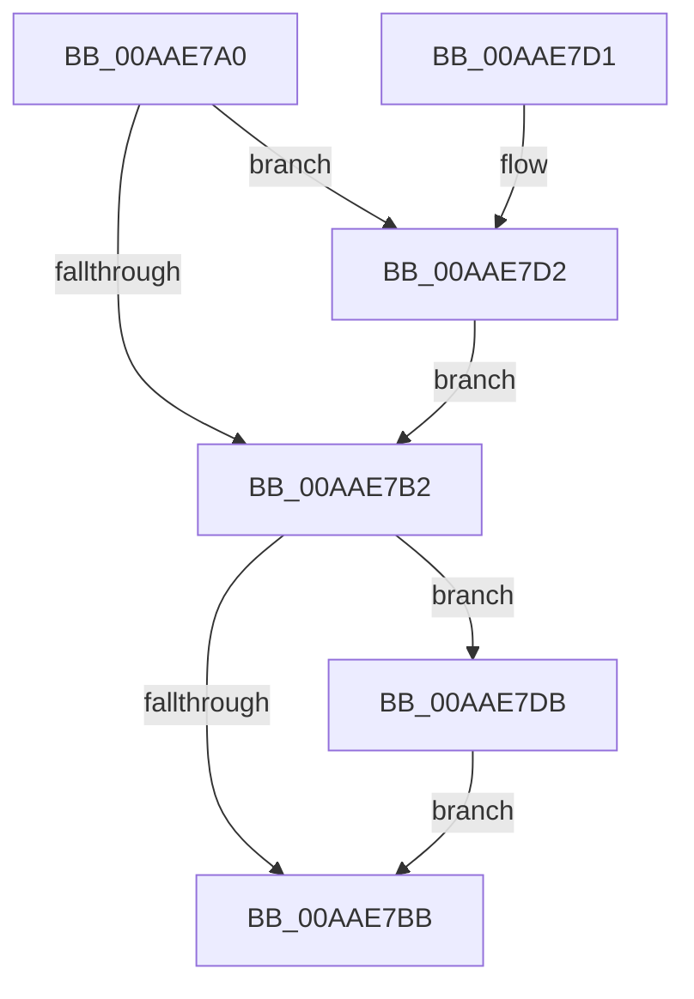

# EtwpTiFreeTokenIdentity

- RVA: `0x00AAE7A0`–`0x00AAE7E4` (길이 `68` bytes)
- VA: `0x0000000140AAE7A0`
- 실행 섹션: `PAGE`
- PDB 이름 있음: `예`; PDB Function 태그: `아니요`
- unwind 정보 RVA: `0x0006F13C`
- 디코드: `24`개 명령, `68/68` bytes 표시
- 미해석 바이트: `0` (있으면 어셈블리에 `.byte`로 보존)

> 이 문서는 커널 이미지의 기계어와 PDB 기호를 분석해 생성했습니다. 4번과 5번은 함수 원형과 자료형을 바이너리 사용 방식에서 추정한 C 해석이며 원본 소스 복구 결과는 아닙니다.

## 1. Dependencies

- 직접 호출 지점: **2**; 고유 호출 대상: **1**
- 직접 호출자로 확인된 함수: **1**
- RIP 상대 이미지 참조: **0**

### Outgoing calls
- `0x00AAE7D4` → [ExFreePoolWithTag](../../poolcode/B8/ExFreePoolWithTag_function_00B82870.md) (function, `0x00B82870`)
- `0x00AAE7DD` → [ExFreePoolWithTag](../../poolcode/B8/ExFreePoolWithTag_function_00B82870.md) (function, `0x00B82870`)

### Direct callers
- [EtwTiLogImpersonateClient](../8C/EtwTiLogImpersonateClient_function_008CC9D0.md) at `0x008CCBD9`
- [EtwTiLogImpersonateClient](../8C/EtwTiLogImpersonateClient_function_008CC9D0.md) at `0x008CCBE3`

### Static image references
- 디코드된 RIP-relative 메모리 참조가 없습니다.

## 2. Other-region calls and transfers

- 다른 실행 섹션으로 향하는 call: **2**
  - `0x00AAE7D4` → [ExFreePoolWithTag](../../poolcode/B8/ExFreePoolWithTag_function_00B82870.md) (`PAGE` → `POOLCODE`)
  - `0x00AAE7DD` → [ExFreePoolWithTag](../../poolcode/B8/ExFreePoolWithTag_function_00B82870.md) (`PAGE` → `POOLCODE`)
- 별도 외부 분기/꼬리 이동을 확인하지 못했습니다.

## 3. Assembly (complete function range)

```asm
00AAE7A0  40 53                           push rbx
00AAE7A2  48 83 EC 20                     sub rsp, 0x20
00AAE7A6  48 8B D9                        mov rbx, rcx
00AAE7A9  48 8B 49 08                     mov rcx, qword ptr [rcx + 8]
00AAE7AD  48 85 C9                        test rcx, rcx
00AAE7B0  75 20                           jne 0x140aae7d2
00AAE7B2  48 8B 4B 18                     mov rcx, qword ptr [rbx + 0x18]
00AAE7B6  48 85 C9                        test rcx, rcx
00AAE7B9  75 20                           jne 0x140aae7db
00AAE7BB  0F 57 C0                        xorps xmm0, xmm0
00AAE7BE  33 C0                           xor eax, eax
00AAE7C0  0F 11 03                        movups xmmword ptr [rbx], xmm0
00AAE7C3  0F 11 43 10                     movups xmmword ptr [rbx + 0x10], xmm0
00AAE7C7  48 89 43 20                     mov qword ptr [rbx + 0x20], rax
00AAE7CB  48 83 C4 20                     add rsp, 0x20
00AAE7CF  5B                              pop rbx
00AAE7D0  C3                              ret
00AAE7D1  CC                              int3
00AAE7D2  33 D2                           xor edx, edx
00AAE7D4  E8 97 40 0D 00                  call 0x140b82870
00AAE7D9  EB D7                           jmp 0x140aae7b2
00AAE7DB  33 D2                           xor edx, edx
00AAE7DD  E8 8E 40 0D 00                  call 0x140b82870
00AAE7E2  EB D7                           jmp 0x140aae7bb
```

## 4. C-style interpretation (structured pseudocode)

```c
__int64 __fastcall EtwpTiFreeTokenIdentity(__int64 a1, int a2)
{
    __int64 result;
    __int64 v_rsp;

    v_rsp = (v_rsp) - (32);
    if (*(unsigned __int64 *)(a1 + 8) != 0) goto loc_00AAE7D2;
loc_00AAE7B2:
    if (*(unsigned __int64 *)(a1 + 24) != 0) goto loc_00AAE7DB;
loc_00AAE7BB:
    result = 0;
    *(unsigned __int64 *)(a1) = v_xmm0;
    *(unsigned __int64 *)(a1 + 16) = v_xmm0;
    *(unsigned __int64 *)(a1 + 32) = 0;
    v_rsp = (v_rsp) + (32);
    return result;
loc_00AAE7D2:
    a2 = 0;
    result = ExFreePoolWithTag(*(unsigned __int64 *)(a1 + 24), a2, a3, a4);
    goto loc_00AAE7B2;
loc_00AAE7DB:
    a2 = 0;
    result = ExFreePoolWithTag(*(unsigned __int64 *)(a1 + 24), a2, a3, a4);
    goto loc_00AAE7BB;
}
```

## 5. (Beta) C Style

```c
int64_t EtwpTiFreeTokenIdentity(void *Arg1, int32_t Arg2)
{
    uint8_t *arg1 = (uint8_t *)Arg1;

    int64_t result;
    int64_t local_rsp;

    local_rsp = (local_rsp) - (32);
    if (*(uint64_t *)(arg1 + 0x8) != 0) goto loc_00AAE7D2;
loc_00AAE7B2:
    if (*(uint64_t *)(arg1 + 0x18) != 0) goto loc_00AAE7DB;
loc_00AAE7BB:
    result = 0;
    *(uint64_t *)(arg1) = v_xmm0;
    *(uint64_t *)(arg1 + 0x10) = v_xmm0;
    *(uint64_t *)(arg1 + 0x20) = 0;
    local_rsp = (local_rsp) + (32);
    return result;
loc_00AAE7D2:
    Arg2 = 0;
    result = ExFreePoolWithTag(*(uint64_t *)(arg1 + 0x18), Arg2, a3, a4);
    goto loc_00AAE7B2;
loc_00AAE7DB:
    Arg2 = 0;
    result = ExFreePoolWithTag(*(uint64_t *)(arg1 + 0x18), Arg2, a3, a4);
    goto loc_00AAE7BB;
}
```

### 관측된 메모리 오프셋

구조체 형식이 확인되지 않은 접근은 인자 기준의 오프셋으로만 기록했습니다.

| 기준 인자 | 오프셋 표현 | 폭 (bit) | 접근 |
|---|---:|---:|---|
| `Arg1` | `+ 0x0` | `128` | `R` |
| `Arg1` | `+ 0x8` | `64` | `R` |
| `Arg1` | `+ 0x10` | `128` | `R` |
| `Arg1` | `+ 0x18` | `64` | `R` |
| `Arg1` | `+ 0x20` | `64` | `W` |

## 6. Execution-region graph

[열기: 2D/3D 그래프와 함수 탐색 컨트롤 패널](../../../control-panel.html?section=page&rva=0x00AAE7A0&view=graph)

- 2D 그래프는 위에서 아래로 흐르고, 3D 그래프는 빈 공간을 드래그해 회전합니다. Shift+드래그는 이동, 휠은 확대·축소, 함수 노드 선택은 대상 보고서 이동입니다.

### Static fallback


