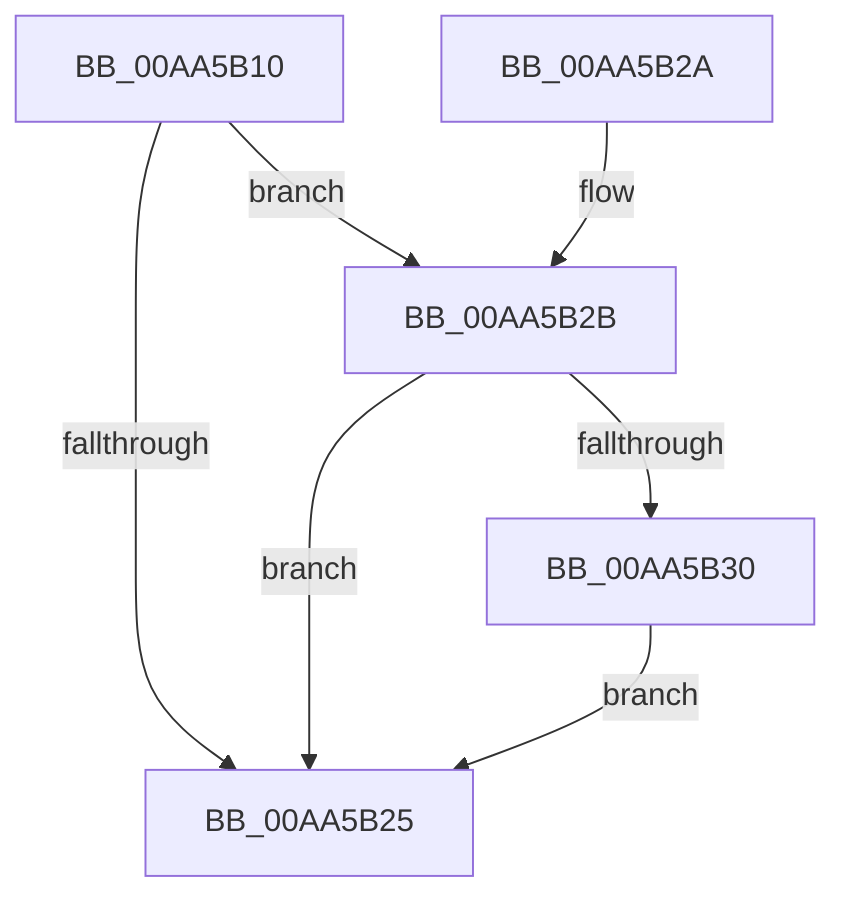

# EtwpTraceLoggingProvEnableCallback

- RVA: `0x00AA5B10`–`0x00AA5B3A` (길이 `42` bytes)
- VA: `0x0000000140AA5B10`
- 실행 섹션: `PAGE`
- PDB 이름 있음: `예`; PDB Function 태그: `아니요`
- unwind 정보 RVA: `0x0005D35C`
- 디코드: `13`개 명령, `42/42` bytes 표시
- 미해석 바이트: `0` (있으면 어셈블리에 `.byte`로 보존)

> 이 문서는 커널 이미지의 기계어와 PDB 기호를 분석해 생성했습니다. 4번과 5번은 함수 원형과 자료형을 바이너리 사용 방식에서 추정한 C 해석이며 원본 소스 복구 결과는 아닙니다.

## 1. Dependencies

- 직접 호출 지점: **1**; 고유 호출 대상: **1**
- 직접 호출자로 확인된 함수: **0**
- RIP 상대 이미지 참조: **1**

### Outgoing calls
- `0x00AA5B33` → [EtwpPsProvCaptureState](../7C/EtwpPsProvCaptureState_function_007C0AD4.md) (function, `0x007C0AD4`)

### Direct callers
- 이 함수 시작 RVA로 연결되는 직접 call은 확인되지 않았습니다. 간접 호출은 완전히 역산할 수 없습니다.

### Static image references
- `0x00AA5B19` → RVA `0x0001C850` (`.rdata`; read)

## 2. Other-region calls and transfers

- 다른 실행 섹션으로 향하는 call: **0**
- 별도 외부 분기/꼬리 이동을 확인하지 못했습니다.

## 3. Assembly (complete function range)

```asm
00AA5B10  48 83 EC 28                     sub rsp, 0x28
00AA5B14  48 8B 4C 24 60                  mov rcx, qword ptr [rsp + 0x60]
00AA5B19  48 8D 05 30 6D 57 FF            lea rax, [rip - 0xa892d0]
00AA5B20  48 3B C8                        cmp rcx, rax
00AA5B23  74 06                           je 0x140aa5b2b
00AA5B25  48 83 C4 28                     add rsp, 0x28
00AA5B29  C3                              ret
00AA5B2A  CC                              int3
00AA5B2B  83 FA 02                        cmp edx, 2
00AA5B2E  75 F5                           jne 0x140aa5b25
00AA5B30  49 8B D1                        mov rdx, r9
00AA5B33  E8 9C AF D1 FF                  call 0x1407c0ad4
00AA5B38  EB EB                           jmp 0x140aa5b25
```

## 4. C-style interpretation (structured pseudocode)

```c
__int64 __fastcall EtwpTraceLoggingProvEnableCallback(__int64 a1, int a2, __int64 a3, __int64 a4, __int64 a5, __int64 a6, __int64 a7)
{
    __int64 result;
    __int64 v_rsp;

    v_rsp = (v_rsp) - (40);
    if (a7 == (v_rip - 11047632)) goto loc_00AA5B2B;
loc_00AA5B25:
    v_rsp = (v_rsp) + (40);
    return v_rip - 11047632;
loc_00AA5B2B:
    if (a2 != 2) goto loc_00AA5B25;
    result = EtwpPsProvCaptureState(a7, a4, a3, a4);
    goto loc_00AA5B25;
}
```

## 5. (Beta) C Style

```c
int64_t EtwpTraceLoggingProvEnableCallback(int64_t Arg1, int32_t Arg2, int64_t Arg3, int64_t Arg4, uint64_t Arg5, uint64_t Arg6, int64_t Arg7)
{
    int64_t result;
    int64_t local_rsp;

    local_rsp = (local_rsp) - (40);
    if (Arg7 == (v_rip - 11047632)) goto loc_00AA5B2B;
loc_00AA5B25:
    local_rsp = (local_rsp) + (40);
    return v_rip - 11047632;
loc_00AA5B2B:
    if (Arg2 != 2) goto loc_00AA5B25;
    result = EtwpPsProvCaptureState(Arg7, Arg4, Arg3, Arg4);
    goto loc_00AA5B25;
}
```

## 6. Execution-region graph

[열기: 2D/3D 그래프와 함수 탐색 컨트롤 패널](../../../control-panel.html?section=page&rva=0x00AA5B10&view=graph)

- 2D 그래프는 위에서 아래로 흐르고, 3D 그래프는 빈 공간을 드래그해 회전합니다. Shift+드래그는 이동, 휠은 확대·축소, 함수 노드 선택은 대상 보고서 이동입니다.

### Static fallback


