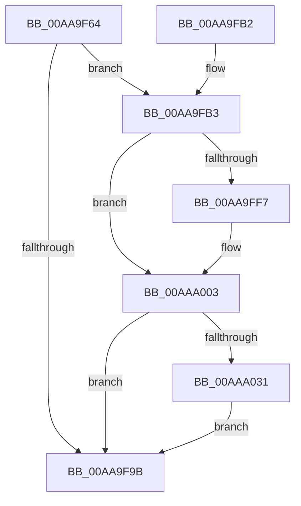

# EtwpUpdateLoggerSecurityDescriptor

- RVA: `0x00AA9F64`–`0x00AAA045` (길이 `225` bytes)
- VA: `0x0000000140AA9F64`
- 실행 섹션: `PAGE`
- PDB 이름 있음: `예`; PDB Function 태그: `아니요`
- unwind 정보 RVA: `0x000BBC58`
- 디코드: `56`개 명령, `225/225` bytes 표시
- 미해석 바이트: `0` (있으면 어셈블리에 `.byte`로 보존)

> 이 문서는 커널 이미지의 기계어와 PDB 기호를 분석해 생성했습니다. 4번과 5번은 함수 원형과 자료형을 바이너리 사용 방식에서 추정한 C 해석이며 원본 소스 복구 결과는 아닙니다.

## 1. Dependencies

- 직접 호출 지점: **6**; 고유 호출 대상: **6**
- 직접 호출자로 확인된 함수: **1**
- RIP 상대 이미지 참조: **3**

### Outgoing calls
- `0x00AA9F90` → [ObLogSecurityDescriptor](../8C/ObLogSecurityDescriptor_function_008C0020.md) (function, `0x008C0020`)
- `0x00AA9FFE` → [ExfAcquireReleasePushLockExclusive](../../text/41/ExfAcquireReleasePushLockExclusive_function_00419C2C.md) (function, `0x00419C2C`)
- `0x00AAA003` → [KeLeaveCriticalRegion](../../text/25/KeLeaveCriticalRegion_function_0025D8B0.md) (function, `0x0025D8B0`)
- `0x00AAA011` → [ObDereferenceSecurityDescriptor](../87/ObDereferenceSecurityDescriptor_function_008740A0.md) (function, `0x008740A0`)
- `0x00AAA024` → [EtwEventEnabled](../../text/39/EtwEventEnabled_function_00392450.md) (function, `0x00392450`)
- `0x00AAA03B` → [EtwpEventWriteTemplateSession](../9B/EtwpEventWriteTemplateSession_function_009BD120.md) (function, `0x009BD120`)

### Direct callers
- [EtwpUpdateTrace](../AB/EtwpUpdateTrace_function_00ABCC7C.md) at `0x00ABD085`

### Static image references
- `0x00AA9FEC` → RVA `0x00EFF510` (`.data`; read)
- `0x00AAA016` → RVA `0x00EFF840` (`.data`; read)
- `0x00AAA01D` → RVA `0x0001E090` (`.rdata`; read)

## 2. Other-region calls and transfers

- 다른 실행 섹션으로 향하는 call: **3**
  - `0x00AA9FFE` → [ExfAcquireReleasePushLockExclusive](../../text/41/ExfAcquireReleasePushLockExclusive_function_00419C2C.md) (`PAGE` → `.text`)
  - `0x00AAA003` → [KeLeaveCriticalRegion](../../text/25/KeLeaveCriticalRegion_function_0025D8B0.md) (`PAGE` → `.text`)
  - `0x00AAA024` → [EtwEventEnabled](../../text/39/EtwEventEnabled_function_00392450.md) (`PAGE` → `.text`)
- 별도 외부 분기/꼬리 이동을 확인하지 못했습니다.

## 3. Assembly (complete function range)

```asm
00AA9F64  4C 8B DC                        mov r11, rsp
00AA9F67  49 89 5B 08                     mov qword ptr [r11 + 8], rbx
00AA9F6B  49 89 6B 10                     mov qword ptr [r11 + 0x10], rbp
00AA9F6F  49 89 73 20                     mov qword ptr [r11 + 0x20], rsi
00AA9F73  57                              push rdi
00AA9F74  48 83 EC 20                     sub rsp, 0x20
00AA9F78  49 83 63 18 00                  and qword ptr [r11 + 0x18], 0
00AA9F7D  48 8B C2                        mov rax, rdx
00AA9F80  48 8B F1                        mov rsi, rcx
00AA9F83  49 8D 53 18                     lea rdx, [r11 + 0x18]
00AA9F87  48 8B C8                        mov rcx, rax
00AA9F8A  41 B8 10 00 00 00               mov r8d, 0x10
00AA9F90  E8 8B 60 E1 FF                  call 0x1408c0020
00AA9F95  8B F8                           mov edi, eax
00AA9F97  85 C0                           test eax, eax
00AA9F99  79 18                           jns 0x140aa9fb3
00AA9F9B  48 8B 5C 24 30                  mov rbx, qword ptr [rsp + 0x30]
00AA9FA0  8B C7                           mov eax, edi
00AA9FA2  48 8B 6C 24 38                  mov rbp, qword ptr [rsp + 0x38]
00AA9FA7  48 8B 74 24 48                  mov rsi, qword ptr [rsp + 0x48]
00AA9FAC  48 83 C4 20                     add rsp, 0x20
00AA9FB0  5F                              pop rdi
00AA9FB1  C3                              ret
00AA9FB2  CC                              int3
00AA9FB3  48 8B 54 24 40                  mov rdx, qword ptr [rsp + 0x40]
00AA9FB8  48 8B CA                        mov rcx, rdx
00AA9FBB  48 83 C9 0F                     or rcx, 0xf
00AA9FBF  48 F7 DA                        neg rdx
00AA9FC2  48 1B DB                        sbb rbx, rbx
00AA9FC5  48 23 D9                        and rbx, rcx
00AA9FC8  48 87 9E 10 03 00 00            xchg qword ptr [rsi + 0x310], rbx
00AA9FCF  65 48 8B 04 25 88 01 00 00      mov rax, qword ptr gs:[0x188]
00AA9FD8  48 8B EB                        mov rbp, rbx
00AA9FDB  48 83 E5 F0                     and rbp, 0xfffffffffffffff0
00AA9FDF  66 FF 88 E4 01 00 00            dec word ptr [rax + 0x1e4]
00AA9FE6  90                              nop
00AA9FE7  F0 83 0C 24 00                  lock or dword ptr [rsp], 0
00AA9FEC  48 8B 05 1D 55 45 00            mov rax, qword ptr [rip + 0x45551d]
00AA9FF3  A8 01                           test al, 1
00AA9FF5  74 0C                           je 0x140aaa003
00AA9FF7  48 8D 0D 12 55 45 00            lea rcx, [rip + 0x455512]
00AA9FFE  E8 29 FC 96 FF                  call 0x140419c2c
00AAA003  E8 A8 38 7B FF                  call 0x14025d8b0
00AAA008  83 E3 0F                        and ebx, 0xf
00AAA00B  48 8B CD                        mov rcx, rbp
00AAA00E  8D 53 01                        lea edx, [rbx + 1]
00AAA011  E8 8A A0 DC FF                  call 0x1408740a0
00AAA016  48 8B 0D 23 58 45 00            mov rcx, qword ptr [rip + 0x455823]
00AAA01D  48 8D 15 6C 40 57 FF            lea rdx, [rip - 0xa8bf94]
00AAA024  E8 27 84 8E FF                  call 0x140392450
00AAA029  84 C0                           test al, al
00AAA02B  0F 84 6A FF FF FF               je 0x140aa9f9b
00AAA031  4C 8B C6                        mov r8, rsi
00AAA034  48 8D 15 55 40 57 FF            lea rdx, [rip - 0xa8bfab]
00AAA03B  E8 E0 30 F1 FF                  call 0x1409bd120
00AAA040  E9 56 FF FF FF                  jmp 0x140aa9f9b
```

## 4. C-style interpretation (structured pseudocode)

```c
__int64 __fastcall EtwpUpdateLoggerSecurityDescriptor(__int64 a1, __int64 a2)
{
    __int64 result;
    __int64 v_rbp;
    __int64 v_rbx;
    __int64 v_rsp;
    unsigned int v_stack_p0;
    unsigned __int64 v_stack_p10;
    unsigned __int64 v_stack_p20;
    unsigned __int64 v_stack_p40;
    unsigned __int64 v_stack_p8;

    *(unsigned __int64 *)(v_rsp + 8) = v_rbx;
    *(unsigned __int64 *)(v_rsp + 16) = v_rbp;
    *(unsigned __int64 *)(v_rsp + 32) = v_rsi;
    v_rsp = (v_rsp) - (32);
    result = ObLogSecurityDescriptor(a2, v_rsp + 24, 16, a4);
    if (!sign_flag) goto loc_00AA9FB3;
loc_00AA9F9B:
    v_rsp = (v_rsp) + (32);
    return (unsigned int)((unsigned int)((unsigned int)((unsigned int)(result))));
loc_00AA9FB3:
    a1 = (v_stack_p40) | (15);
    a2 = -(v_stack_p40);
    v_rbx = (v_stack_p8) & (a1);
    v_rbp = (v_rbx) & (-16);
    result = *(unsigned __int64 *)(v_rip + 4543773);
    if ((((unsigned __int8)(*(unsigned __int64 *)(v_rip + 4543773))) & (1)) != 0) {
        a1 = v_rip + 4543762;
        result = ExfAcquireReleasePushLockExclusive(a1, a2, 16, a4);
    }
    result = KeLeaveCriticalRegion(a1, a2, 16, a4);
    v_rbx = (unsigned int)((v_rbx) & (15));
    result = ObDereferenceSecurityDescriptor(v_rbp, v_rbx + 1, 16, a4);
    result = EtwEventEnabled(*(unsigned __int64 *)(v_rip + 4544547), v_rip - 11059092, 16, a4);
    if ((unsigned __int8)(result) == 0) goto loc_00AA9F9B;
    result = EtwpEventWriteTemplateSession(*(unsigned __int64 *)(v_rip + 4544547), v_rip - 11059115, v_stack_p20, a4);
    goto loc_00AA9F9B;
}
```

## 5. (Beta) C Style

```c
int64_t EtwpUpdateLoggerSecurityDescriptor(void *Arg1, int64_t Arg2)
{
    uint8_t *arg1 = (uint8_t *)Arg1;

    int64_t result;
    int64_t local_rbp;
    int64_t local_rbx;
    int64_t local_rsp;
    uint32_t v_stack_p0;
    uint64_t v_stack_p10;
    uint64_t v_stack_p20;
    uint64_t v_stack_p40;
    uint64_t v_stack_p8;

    *(uint64_t *)(local_rsp + 0x8) = local_rbx;
    *(uint64_t *)(local_rsp + 0x10) = local_rbp;
    *(uint64_t *)(local_rsp + 0x20) = local_rsi;
    local_rsp = (local_rsp) - (32);
    result = ObLogSecurityDescriptor(Arg2, local_rsp + 24, 16, a4);
    if (!sign_flag) goto loc_00AA9FB3;
loc_00AA9F9B:
    local_rsp = (local_rsp) + (32);
    return (uint32_t)((uint32_t)((uint32_t)((uint32_t)(result))));
loc_00AA9FB3:
    Arg1 = (v_stack_p40) | (15);
    Arg2 = -(v_stack_p40);
    local_rbx = (v_stack_p8) & (Arg1);
    local_rbp = (local_rbx) & (-16);
    result = *(uint64_t *)(v_rip + 0x45551D);
    if ((((uint8_t)(*(uint64_t *)(v_rip + 0x45551D))) & (1)) != 0) {
        Arg1 = v_rip + 4543762;
        result = ExfAcquireReleasePushLockExclusive(Arg1, Arg2, 16, a4);
    }
    result = KeLeaveCriticalRegion(Arg1, Arg2, 16, a4);
    local_rbx = (uint32_t)((local_rbx) & (15));
    result = ObDereferenceSecurityDescriptor(local_rbp, local_rbx + 1, 16, a4);
    result = EtwEventEnabled(*(uint64_t *)(v_rip + 0x455823), v_rip - 11059092, 16, a4);
    if ((uint8_t)(result) == 0) goto loc_00AA9F9B;
    result = EtwpEventWriteTemplateSession(*(uint64_t *)(v_rip + 0x455823), v_rip - 11059115, v_stack_p20, a4);
    goto loc_00AA9F9B;
}
```

### 관측된 메모리 오프셋

구조체 형식이 확인되지 않은 접근은 인자 기준의 오프셋으로만 기록했습니다.

| 기준 인자 | 오프셋 표현 | 폭 (bit) | 접근 |
|---|---:|---:|---|
| `Arg1` | `+ 0x310` | `64` | `R/W` |

## 6. Execution-region graph

[열기: 2D/3D 그래프와 함수 탐색 컨트롤 패널](../../../control-panel.html?section=page&rva=0x00AA9F64&view=graph)

- 2D 그래프는 위에서 아래로 흐르고, 3D 그래프는 빈 공간을 드래그해 회전합니다. Shift+드래그는 이동, 휠은 확대·축소, 함수 노드 선택은 대상 보고서 이동입니다.

### Static fallback


