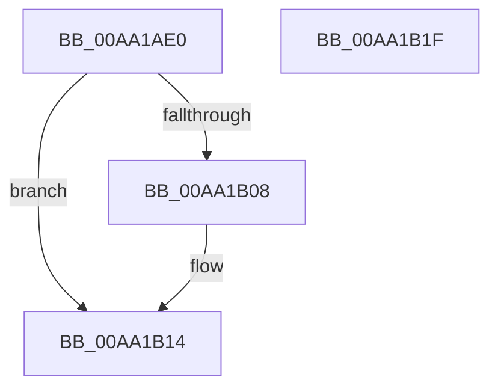

# ExAllocateCallBack

- RVA: `0x00AA1AE0`–`0x00AA1B20` (길이 `64` bytes)
- VA: `0x0000000140AA1AE0`
- 실행 섹션: `PAGE`
- PDB 이름 있음: `예`; PDB Function 태그: `아니요`
- unwind 정보 RVA: `0x0005CAAC`
- 디코드: `19`개 명령, `64/64` bytes 표시
- 미해석 바이트: `0` (있으면 어셈블리에 `.byte`로 보존)

> 이 문서는 커널 이미지의 기계어와 PDB 기호를 분석해 생성했습니다. 4번과 5번은 함수 원형과 자료형을 바이너리 사용 방식에서 추정한 C 해석이며 원본 소스 복구 결과는 아닙니다.

## 1. Dependencies

- 직접 호출 지점: **1**; 고유 호출 대상: **1**
- 직접 호출자로 확인된 함수: **6**
- RIP 상대 이미지 참조: **0**

### Outgoing calls
- `0x00AA1AFE` → [ExAllocatePool2](../../poolcode/B8/ExAllocatePool2_function_00B820F0.md) (function, `0x00B820F0`)

### Direct callers
- [KeRegisterBoundCallback](../../text/5B/KeRegisterBoundCallback_function_005B1B70.md) at `0x005B1B92`
- [DbgkLkmdRegisterCallback](../71/DbgkLkmdRegisterCallback_function_00711570.md) at `0x007115F0`
- [PsEstablishWin32Callouts](../78/PsEstablishWin32Callouts_function_00781B20.md) at `0x00781B28`
- [PspSetCreateThreadNotifyRoutine](../78/PspSetCreateThreadNotifyRoutine_function_00787868.md) at `0x0078787B`
- [PsSetLoadImageNotifyRoutineEx](PsSetLoadImageNotifyRoutineEx_function_00AA19A0.md) at `0x00AA19C0`
- [PspSetCreateProcessNotifyRoutine](PspSetCreateProcessNotifyRoutine_function_00AA75EC.md) at `0x00AA76C5`

### Static image references
- 디코드된 RIP-relative 메모리 참조가 없습니다.

## 2. Other-region calls and transfers

- 다른 실행 섹션으로 향하는 call: **1**
  - `0x00AA1AFE` → [ExAllocatePool2](../../poolcode/B8/ExAllocatePool2_function_00B820F0.md) (`PAGE` → `POOLCODE`)
- 별도 외부 분기/꼬리 이동을 확인하지 못했습니다.

## 3. Assembly (complete function range)

```asm
00AA1AE0  48 89 5C 24 08                  mov qword ptr [rsp + 8], rbx
00AA1AE5  57                              push rdi
00AA1AE6  48 83 EC 20                     sub rsp, 0x20
00AA1AEA  48 8B DA                        mov rbx, rdx
00AA1AED  48 8B F9                        mov rdi, rcx
00AA1AF0  BA 18 00 00 00                  mov edx, 0x18
00AA1AF5  41 B8 43 62 72 62               mov r8d, 0x62726243
00AA1AFB  8D 4A 28                        lea ecx, [rdx + 0x28]
00AA1AFE  E8 ED 05 0E 00                  call 0x140b820f0
00AA1B03  48 85 C0                        test rax, rax
00AA1B06  74 0C                           je 0x140aa1b14
00AA1B08  48 83 20 00                     and qword ptr [rax], 0
00AA1B0C  48 89 78 08                     mov qword ptr [rax + 8], rdi
00AA1B10  48 89 58 10                     mov qword ptr [rax + 0x10], rbx
00AA1B14  48 8B 5C 24 30                  mov rbx, qword ptr [rsp + 0x30]
00AA1B19  48 83 C4 20                     add rsp, 0x20
00AA1B1D  5F                              pop rdi
00AA1B1E  C3                              ret
00AA1B1F  CC                              int3
```

## 4. C-style interpretation (structured pseudocode)

```c
__int64 __fastcall ExAllocateCallBack(__int64 a1, __int64 a2)
{
    __int64 result;
    __int64 v_rsp;
    unsigned __int64 v_stack_p8;

    v_stack_p8 = v_rbx;
    v_rsp = (v_rsp) - (32);
    result = ExAllocatePool2(24 + 40, 24, (unsigned int)(0x62726243ULL), a4);
    if (result != 0) {
        *(unsigned __int64 *)(result + 8) = a1;
        *(unsigned __int64 *)(result + 16) = a2;
    }
    v_rsp = (v_rsp) + (32);
    return result;
}
```

## 5. (Beta) C Style

```c
int64_t ExAllocateCallBack(int64_t Arg1, int64_t Arg2)
{
    int64_t result;
    int64_t local_rsp;
    uint64_t v_stack_p8;

    v_stack_p8 = local_rbx;
    local_rsp = (local_rsp) - (32);
    result = ExAllocatePool2(24 + 40, 24, (uint32_t)(0x62726243ULL), a4);
    if (result != 0) {
        *(uint64_t *)(result + 0x8) = Arg1;
        *(uint64_t *)(result + 0x10) = Arg2;
    }
    local_rsp = (local_rsp) + (32);
    return result;
}
```

## 6. Execution-region graph

[열기: 2D/3D 그래프와 함수 탐색 컨트롤 패널](../../../control-panel.html?section=page&rva=0x00AA1AE0&view=graph)

- 2D 그래프는 위에서 아래로 흐르고, 3D 그래프는 빈 공간을 드래그해 회전합니다. Shift+드래그는 이동, 휠은 확대·축소, 함수 노드 선택은 대상 보고서 이동입니다.

### Static fallback


