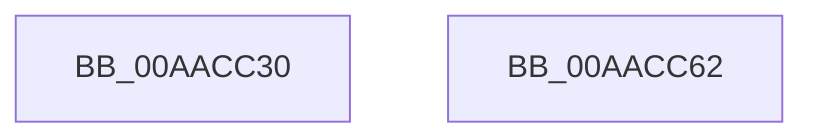

# ExInitializePagedLookasideList

- RVA: `0x00AACC30`–`0x00AACC63` (길이 `51` bytes)
- VA: `0x0000000140AACC30`
- 실행 섹션: `PAGE`
- PDB 이름 있음: `예`; PDB Function 태그: `아니요`
- unwind 정보 RVA: `0x00063458`
- 디코드: `12`개 명령, `51/51` bytes 표시
- 미해석 바이트: `0` (있으면 어셈블리에 `.byte`로 보존)

> 이 문서는 커널 이미지의 기계어와 PDB 기호를 분석해 생성했습니다. 4번과 5번은 함수 원형과 자료형을 바이너리 사용 방식에서 추정한 C 해석이며 원본 소스 복구 결과는 아닙니다.

## 1. Dependencies

- 직접 호출 지점: **1**; 고유 호출 대상: **1**
- 직접 호출자로 확인된 함수: **6**
- RIP 상대 이미지 참조: **0**

### Outgoing calls
- `0x00AACC58` → [ExInitializePagedLookasideListInternal](../../text/46/ExInitializePagedLookasideListInternal_function_00468040.md) (function, `0x00468040`)

### Direct callers
- [Phase1InitializationDiscard](../../init/C1/Phase1InitializationDiscard_function_00C1C728.md) at `0x00C1D7CB`
- [FsRtlInitSystem](../../init/C2/FsRtlInitSystem_function_00C28EEC.md) at `0x00C28F73`
- [FsRtlInitializeLargeMcbs](../../init/C2/FsRtlInitializeLargeMcbs_function_00C29128.md) at `0x00C29158`
- [FsRtlInitializeTunnels](../../init/C2/FsRtlInitializeTunnels_function_00C291D0.md) at `0x00C292AD`
- [FsRtlInitializeFileLocks](../../init/C2/FsRtlInitializeFileLocks_function_00C292C0.md) at `0x00C293E4`
- [WmipInitializeAllocs](../../init/C4/WmipInitializeAllocs_function_00C4D3C4.md) at `0x00C4D3F1`
- [WmipInitializeAllocs](../../init/C4/WmipInitializeAllocs_function_00C4D3C4.md) at `0x00C4D41B`
- [WmipInitializeAllocs](../../init/C4/WmipInitializeAllocs_function_00C4D3C4.md) at `0x00C4D445`
- [WmipInitializeAllocs](../../init/C4/WmipInitializeAllocs_function_00C4D3C4.md) at `0x00C4D46F`

### Static image references
- 디코드된 RIP-relative 메모리 참조가 없습니다.

## 2. Other-region calls and transfers

- 다른 실행 섹션으로 향하는 call: **1**
  - `0x00AACC58` → [ExInitializePagedLookasideListInternal](../../text/46/ExInitializePagedLookasideListInternal_function_00468040.md) (`PAGE` → `.text`)
- 별도 외부 분기/꼬리 이동을 확인하지 못했습니다.

## 3. Assembly (complete function range)

```asm
00AACC30  48 83 EC 48                     sub rsp, 0x48
00AACC34  83 64 24 38 00                  and dword ptr [rsp + 0x38], 0
00AACC39  0F B7 84 24 80 00 00 00         movzx eax, word ptr [rsp + 0x80]
00AACC41  66 89 44 24 30                  mov word ptr [rsp + 0x30], ax
00AACC46  8B 44 24 78                     mov eax, dword ptr [rsp + 0x78]
00AACC4A  89 44 24 28                     mov dword ptr [rsp + 0x28], eax
00AACC4E  48 8B 44 24 70                  mov rax, qword ptr [rsp + 0x70]
00AACC53  48 89 44 24 20                  mov qword ptr [rsp + 0x20], rax
00AACC58  E8 E3 B3 9B FF                  call 0x140468040
00AACC5D  48 83 C4 48                     add rsp, 0x48
00AACC61  C3                              ret
00AACC62  CC                              int3
```

## 4. C-style interpretation (structured pseudocode)

```c
__int64 __fastcall ExInitializePagedLookasideList(__int64 a1, __int64 a2, __int64 a3, __int64 a4, __int64 a5, unsigned int a6, unsigned __int16 a7)
{
    __int64 result;
    __int64 v_rsp;
    unsigned int v_stack_m10;
    unsigned __int16 v_stack_m18;
    unsigned int v_stack_m20;
    unsigned __int64 v_stack_m28;

    v_rsp = (v_rsp) - (72);
    v_stack_m18 = a7;
    v_stack_m20 = (unsigned int)((unsigned int)(a6));
    v_stack_m28 = a5;
    result = ExInitializePagedLookasideListInternal(a1, a2, a3, a4);
    v_rsp = (v_rsp) + (72);
    return result;
}
```

## 5. (Beta) C Style

```c
int64_t ExInitializePagedLookasideList(int64_t Arg1, int64_t Arg2, int64_t Arg3, int64_t Arg4, int64_t Arg5, uint32_t Arg6, uint16_t Arg7)
{
    int64_t result;
    int64_t local_rsp;
    uint32_t v_stack_m10;
    uint16_t v_stack_m18;
    uint32_t v_stack_m20;
    uint64_t v_stack_m28;

    local_rsp = (local_rsp) - (72);
    v_stack_m18 = Arg7;
    v_stack_m20 = (uint32_t)((uint32_t)(Arg6));
    v_stack_m28 = Arg5;
    result = ExInitializePagedLookasideListInternal(Arg1, Arg2, Arg3, Arg4);
    local_rsp = (local_rsp) + (72);
    return result;
}
```

## 6. Execution-region graph

[열기: 2D/3D 그래프와 함수 탐색 컨트롤 패널](../../../control-panel.html?section=page&rva=0x00AACC30&view=graph)

- 2D 그래프는 위에서 아래로 흐르고, 3D 그래프는 빈 공간을 드래그해 회전합니다. Shift+드래그는 이동, 휠은 확대·축소, 함수 노드 선택은 대상 보고서 이동입니다.

### Static fallback


