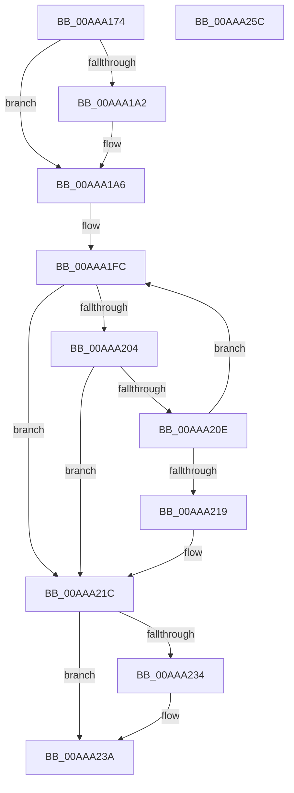

# ExpConvertLdrEntryToModuleInfo

- RVA: `0x00AAA174`–`0x00AAA25D` (길이 `233` bytes)
- VA: `0x0000000140AAA174`
- 실행 섹션: `PAGE`
- PDB 이름 있음: `예`; PDB Function 태그: `아니요`
- unwind 정보 RVA: `0x00066400`
- 디코드: `66`개 명령, `233/233` bytes 표시
- 미해석 바이트: `0` (있으면 어셈블리에 `.byte`로 보존)

> 이 문서는 커널 이미지의 기계어와 PDB 기호를 분석해 생성했습니다. 4번과 5번은 함수 원형과 자료형을 바이너리 사용 방식에서 추정한 C 해석이며 원본 소스 복구 결과는 아닙니다.

## 1. Dependencies

- 직접 호출 지점: **1**; 고유 호출 대상: **1**
- 직접 호출자로 확인된 함수: **2**
- RIP 상대 이미지 참조: **0**

### Outgoing calls
- `0x00AAA1E4` → [RtlUnicodeStringToAnsiString](../90/RtlUnicodeStringToAnsiString_function_0090D1F0.md) (function, `0x0090D1F0`)

### Direct callers
- [ExpQuerySingleModuleInformation](../7C/ExpQuerySingleModuleInformation_function_007C4FB0.md) at `0x007C5018`
- [ExpQueryModuleInformationImageEx](ExpQueryModuleInformationImageEx_function_00AAA0D0.md) at `0x00AAA11E`

### Static image references
- 디코드된 RIP-relative 메모리 참조가 없습니다.

## 2. Other-region calls and transfers

- 다른 실행 섹션으로 향하는 call: **0**
- 별도 외부 분기/꼬리 이동을 확인하지 못했습니다.

## 3. Assembly (complete function range)

```asm
00AAA174  48 8B C4                        mov rax, rsp
00AAA177  48 89 58 08                     mov qword ptr [rax + 8], rbx
00AAA17B  48 89 68 10                     mov qword ptr [rax + 0x10], rbp
00AAA17F  48 89 70 18                     mov qword ptr [rax + 0x18], rsi
00AAA183  57                              push rdi
00AAA184  48 83 EC 30                     sub rsp, 0x30
00AAA188  48 8B 5C 24 60                  mov rbx, qword ptr [rsp + 0x60]
00AAA18D  33 ED                           xor ebp, ebp
00AAA18F  89 68 EC                        mov dword ptr [rax - 0x14], ebp
00AAA192  41 8B F1                        mov esi, r9d
00AAA195  48 8B FA                        mov rdi, rdx
00AAA198  8B C5                           mov eax, ebp
00AAA19A  48 89 6B 10                     mov qword ptr [rbx + 0x10], rbp
00AAA19E  85 C9                           test ecx, ecx
00AAA1A0  75 04                           jne 0x140aaa1a6
00AAA1A2  48 8B 42 30                     mov rax, qword ptr [rdx + 0x30]
00AAA1A6  48 89 43 18                     mov qword ptr [rbx + 0x18], rax
00AAA1AA  48 8D 4C 24 20                  lea rcx, [rsp + 0x20]
00AAA1AF  8B 42 40                        mov eax, dword ptr [rdx + 0x40]
00AAA1B2  89 43 20                        mov dword ptr [rbx + 0x20], eax
00AAA1B5  8B 42 68                        mov eax, dword ptr [rdx + 0x68]
00AAA1B8  89 43 24                        mov dword ptr [rbx + 0x24], eax
00AAA1BB  0F B7 42 6C                     movzx eax, word ptr [rdx + 0x6c]
00AAA1BF  48 83 C2 48                     add rdx, 0x48
00AAA1C3  66 89 43 2C                     mov word ptr [rbx + 0x2c], ax
00AAA1C7  48 8D 43 30                     lea rax, [rbx + 0x30]
00AAA1CB  66 44 89 43 28                  mov word ptr [rbx + 0x28], r8w
00AAA1D0  45 33 C0                        xor r8d, r8d
00AAA1D3  48 89 44 24 28                  mov qword ptr [rsp + 0x28], rax
00AAA1D8  66 89 6B 2A                     mov word ptr [rbx + 0x2a], bp
00AAA1DC  C7 44 24 20 00 00 00 01         mov dword ptr [rsp + 0x20], 0x1000000
00AAA1E4  E8 07 30 E6 FF                  call 0x14090d1f0
00AAA1E9  0F B7 4C 24 20                  movzx ecx, word ptr [rsp + 0x20]
00AAA1EE  4C 8B 54 24 28                  mov r10, qword ptr [rsp + 0x28]
00AAA1F3  49 03 CA                        add rcx, r10
00AAA1F6  4C 8B C1                        mov r8, rcx
00AAA1F9  48 8B C1                        mov rax, rcx
00AAA1FC  4C 8B C8                        mov r9, rax
00AAA1FF  4D 3B C2                        cmp r8, r10
00AAA202  76 18                           jbe 0x140aaa21c
00AAA204  48 8D 48 FF                     lea rcx, [rax - 1]
00AAA208  8A 11                           mov dl, byte ptr [rcx]
00AAA20A  84 D2                           test dl, dl
00AAA20C  74 0E                           je 0x140aaa21c
00AAA20E  4C 8B C1                        mov r8, rcx
00AAA211  48 8B C1                        mov rax, rcx
00AAA214  80 FA 5C                        cmp dl, 0x5c
00AAA217  75 E3                           jne 0x140aaa1fc
00AAA219  49 8B C9                        mov rcx, r9
00AAA21C  66 2B 4C 24 28                  sub cx, word ptr [rsp + 0x28]
00AAA221  66 89 4B 2E                     mov word ptr [rbx + 0x2e], cx
00AAA225  8B 47 78                        mov eax, dword ptr [rdi + 0x78]
00AAA228  89 83 30 01 00 00               mov dword ptr [rbx + 0x130], eax
00AAA22E  8B C5                           mov eax, ebp
00AAA230  85 F6                           test esi, esi
00AAA232  75 06                           jne 0x140aaa23a
00AAA234  8B 87 9C 00 00 00               mov eax, dword ptr [rdi + 0x9c]
00AAA23A  89 83 34 01 00 00               mov dword ptr [rbx + 0x134], eax
00AAA240  48 8B 74 24 50                  mov rsi, qword ptr [rsp + 0x50]
00AAA245  48 89 AB 38 01 00 00            mov qword ptr [rbx + 0x138], rbp
00AAA24C  48 8B 5C 24 40                  mov rbx, qword ptr [rsp + 0x40]
00AAA251  48 8B 6C 24 48                  mov rbp, qword ptr [rsp + 0x48]
00AAA256  48 83 C4 30                     add rsp, 0x30
00AAA25A  5F                              pop rdi
00AAA25B  C3                              ret
00AAA25C  CC                              int3
```

## 4. C-style interpretation (structured pseudocode)

```c
__int64 __fastcall ExpConvertLdrEntryToModuleInfo(int a1, __int64 a2, int a3, int a4, __int64 a5)
{
    __int64 result;
    __int64 v_rbp;
    __int64 v_rsp;
    unsigned __int64 v_stack_m10;
    unsigned __int64 v_stack_m18;
    unsigned __int64 v_stack_p10;
    unsigned __int64 v_stack_p18;
    unsigned __int64 v_stack_p8;

    *(unsigned __int64 *)(v_rsp + 8) = v_rbx;
    *(unsigned __int64 *)(v_rsp + 16) = v_rbp;
    *(unsigned __int64 *)(v_rsp + 24) = v_rsi;
    v_rsp = (v_rsp) - (48);
    v_rbp = 0;
    *(unsigned int *)(v_rsp - 20) = 0;
    *(unsigned __int64 *)(a5 + 16) = 0;
    result = 0;
    if (a1 == 0) {
        result = *(unsigned __int64 *)(a2 + 48);
    }
    *(unsigned __int64 *)(a5 + 24) = result;
    *(unsigned int *)(a5 + 32) = (unsigned int)((unsigned int)(*(unsigned int *)(a2 + 64)));
    *(unsigned int *)(a5 + 36) = (unsigned int)((unsigned int)(*(unsigned int *)(a2 + 104)));
    a2 = (a2) + (72);
    *(unsigned __int16 *)(a5 + 44) = (unsigned __int16)(*(unsigned __int16 *)(a2 + 108));
    *(unsigned __int16 *)(a5 + 40) = (unsigned __int16)(a3);
    a3 = 0;
    v_stack_m10 = a5 + 48;
    *(unsigned __int16 *)(a5 + 42) = 0;
    v_stack_m18 = 0x1000000ULL;
    result = RtlUnicodeStringToAnsiString(v_stack_m18, a2, a3, a4);
    a1 = (v_stack_m18) + (v_stack_m10);
loc_00AAA1FC:
    if (a1 <= v_stack_m10) goto loc_00AAA21C;
    if ((unsigned __int8)(*(unsigned __int8 *)(a1 - 1)) == 0) goto loc_00AAA21C;
    if (((unsigned __int8)(*(unsigned __int8 *)(a1 - 1))) != 92) goto loc_00AAA1FC;
loc_00AAA21C:
    a1 = (unsigned __int16)((a1) - (v_stack_m10));
    *(unsigned __int16 *)(a5 + 46) = (unsigned __int16)(a1);
    *(unsigned int *)(a5 + 304) = (unsigned int)((unsigned int)(*(unsigned int *)(a2 + 120)));
    result = 0;
    if ((unsigned int)((unsigned int)(a4)) == 0) {
        result = *(unsigned int *)(a2 + 156);
    }
    *(unsigned int *)(a5 + 308) = (unsigned int)(result);
    *(unsigned __int64 *)(a5 + 312) = 0;
    v_rsp = (v_rsp) + (48);
    return result;
}
```

## 5. (Beta) C Style

```c
int64_t ExpConvertLdrEntryToModuleInfo(int32_t Arg1, void *Arg2, int32_t Arg3, int32_t Arg4, void *Arg5)
{
    uint8_t *arg2 = (uint8_t *)Arg2;
    uint8_t *arg5 = (uint8_t *)Arg5;

    int64_t result;
    int64_t local_rbp;
    int64_t local_rsp;
    uint64_t v_stack_m10;
    uint64_t v_stack_m18;
    uint64_t v_stack_p10;
    uint64_t v_stack_p18;
    uint64_t v_stack_p8;

    *(uint64_t *)(local_rsp + 0x8) = local_rbx;
    *(uint64_t *)(local_rsp + 0x10) = local_rbp;
    *(uint64_t *)(local_rsp + 0x18) = local_rsi;
    local_rsp = (local_rsp) - (48);
    local_rbp = 0;
    *(uint32_t *)(local_rsp - 0x14) = 0;
    *(uint64_t *)(arg5 + 0x10) = 0;
    result = 0;
    if (Arg1 == 0) {
        result = *(uint64_t *)(arg2 + 0x30);
    }
    *(uint64_t *)(arg5 + 0x18) = result;
    *(uint32_t *)(arg5 + 0x20) = (uint32_t)((uint32_t)(*(uint32_t *)(arg2 + 0x40)));
    *(uint32_t *)(arg5 + 0x24) = (uint32_t)((uint32_t)(*(uint32_t *)(arg2 + 0x68)));
    Arg2 = (Arg2) + (72);
    *(uint16_t *)(arg5 + 0x2C) = (uint16_t)(*(uint16_t *)(arg2 + 0x6C));
    *(uint16_t *)(arg5 + 0x28) = (uint16_t)(Arg3);
    Arg3 = 0;
    v_stack_m10 = Arg5 + 48;
    *(uint16_t *)(arg5 + 0x2A) = 0;
    v_stack_m18 = 0x1000000ULL;
    result = RtlUnicodeStringToAnsiString(v_stack_m18, Arg2, Arg3, Arg4);
    Arg1 = (v_stack_m18) + (v_stack_m10);
loc_00AAA1FC:
    if (Arg1 <= v_stack_m10) goto loc_00AAA21C;
    if ((uint8_t)(*(uint8_t *)(Arg1 - 0x1)) == 0) goto loc_00AAA21C;
    if (((uint8_t)(*(uint8_t *)(Arg1 - 0x1))) != 92) goto loc_00AAA1FC;
loc_00AAA21C:
    Arg1 = (uint16_t)((Arg1) - (v_stack_m10));
    *(uint16_t *)(arg5 + 0x2E) = (uint16_t)(Arg1);
    *(uint32_t *)(arg5 + 0x130) = (uint32_t)((uint32_t)(*(uint32_t *)(arg2 + 0x78)));
    result = 0;
    if ((uint32_t)((uint32_t)(Arg4)) == 0) {
        result = *(uint32_t *)(arg2 + 0x9C);
    }
    *(uint32_t *)(arg5 + 0x134) = (uint32_t)(result);
    *(uint64_t *)(arg5 + 0x138) = 0;
    local_rsp = (local_rsp) + (48);
    return result;
}
```

### 관측된 메모리 오프셋

구조체 형식이 확인되지 않은 접근은 인자 기준의 오프셋으로만 기록했습니다.

| 기준 인자 | 오프셋 표현 | 폭 (bit) | 접근 |
|---|---:|---:|---|
| `Arg2` | `+ 0x30` | `64` | `R` |
| `Arg2` | `+ 0x40` | `32` | `R` |
| `Arg2` | `+ 0x68` | `32` | `R` |
| `Arg2` | `+ 0x6C` | `16` | `R` |
| `Arg2` | `+ 0x78` | `32` | `R` |
| `Arg2` | `+ 0x9C` | `32` | `R` |
| `Arg5` | `+ 0x10` | `64` | `W` |
| `Arg5` | `+ 0x18` | `64` | `W` |
| `Arg5` | `+ 0x20` | `32` | `W` |
| `Arg5` | `+ 0x24` | `32` | `W` |
| `Arg5` | `+ 0x28` | `16` | `W` |
| `Arg5` | `+ 0x2A` | `16` | `W` |
| `Arg5` | `+ 0x2C` | `16` | `W` |
| `Arg5` | `+ 0x2E` | `16` | `W` |
| `Arg5` | `+ 0x30` | `64` | `R` |
| `Arg5` | `+ 0x130` | `32` | `W` |
| `Arg5` | `+ 0x134` | `32` | `W` |
| `Arg5` | `+ 0x138` | `64` | `W` |

## 6. Execution-region graph

[열기: 2D/3D 그래프와 함수 탐색 컨트롤 패널](../../../control-panel.html?section=page&rva=0x00AAA174&view=graph)

- 2D 그래프는 위에서 아래로 흐르고, 3D 그래프는 빈 공간을 드래그해 회전합니다. Shift+드래그는 이동, 휠은 확대·축소, 함수 노드 선택은 대상 보고서 이동입니다.

### Static fallback


