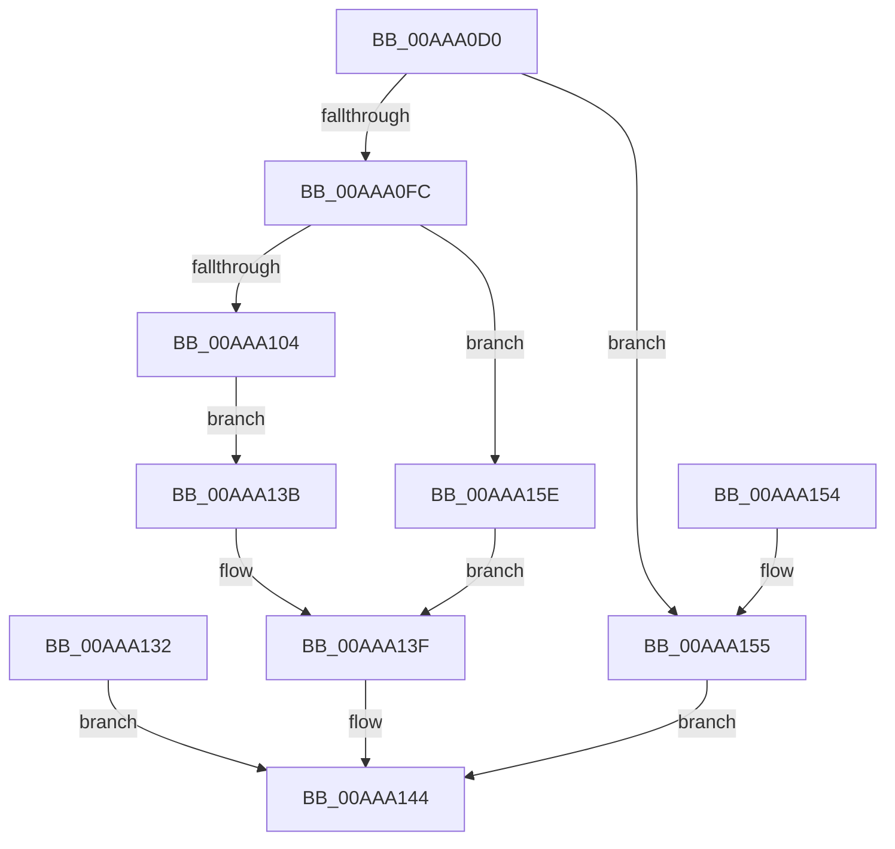

# ExpQueryModuleInformationImageEx

- RVA: `0x00AAA0D0`–`0x00AAA16C` (길이 `156` bytes)
- VA: `0x0000000140AAA0D0`
- 실행 섹션: `PAGE`
- PDB 이름 있음: `예`; PDB Function 태그: `아니요`
- unwind 정보 RVA: `0x000BBCF4`
- 디코드: `48`개 명령, `156/156` bytes 표시
- 미해석 바이트: `0` (있으면 어셈블리에 `.byte`로 보존)

> 이 문서는 커널 이미지의 기계어와 PDB 기호를 분석해 생성했습니다. 4번과 5번은 함수 원형과 자료형을 바이너리 사용 방식에서 추정한 C 해석이며 원본 소스 복구 결과는 아닙니다.

## 1. Dependencies

- 직접 호출 지점: **1**; 고유 호출 대상: **1**
- 직접 호출자로 확인된 함수: **0**
- RIP 상대 이미지 참조: **0**

### Outgoing calls
- `0x00AAA11E` → [ExpConvertLdrEntryToModuleInfo](ExpConvertLdrEntryToModuleInfo_function_00AAA174.md) (function, `0x00AAA174`)

### Direct callers
- 이 함수 시작 RVA로 연결되는 직접 call은 확인되지 않았습니다. 간접 호출은 완전히 역산할 수 없습니다.

### Static image references
- 디코드된 RIP-relative 메모리 참조가 없습니다.

## 2. Other-region calls and transfers

- 다른 실행 섹션으로 향하는 call: **0**
- 별도 외부 분기/꼬리 이동을 확인하지 못했습니다.

## 3. Assembly (complete function range)

```asm
00AAA0D0  4C 8B DC                        mov r11, rsp
00AAA0D3  49 89 5B 08                     mov qword ptr [r11 + 8], rbx
00AAA0D7  49 89 73 18                     mov qword ptr [r11 + 0x18], rsi
00AAA0DB  49 89 53 10                     mov qword ptr [r11 + 0x10], rdx
00AAA0DF  57                              push rdi
00AAA0E0  48 83 EC 50                     sub rsp, 0x50
00AAA0E4  48 8B DA                        mov rbx, rdx
00AAA0E7  48 8B 7A 08                     mov rdi, qword ptr [rdx + 8]
00AAA0EB  49 89 7B E0                     mov qword ptr [r11 - 0x20], rdi
00AAA0EF  8B 42 14                        mov eax, dword ptr [rdx + 0x14]
00AAA0F2  8D 90 40 01 00 00               lea edx, [rax + 0x140]
00AAA0F8  3B D0                           cmp edx, eax
00AAA0FA  72 59                           jb 0x140aaa155
00AAA0FC  89 53 14                        mov dword ptr [rbx + 0x14], edx
00AAA0FF  39 53 10                        cmp dword ptr [rbx + 0x10], edx
00AAA102  72 5A                           jb 0x140aaa15e
00AAA104  BE 40 01 00 00                  mov esi, 0x140
00AAA109  66 89 37                        mov word ptr [rdi], si
00AAA10C  49 89 7B C8                     mov qword ptr [r11 - 0x38], rdi
00AAA110  44 8B 4B 28                     mov r9d, dword ptr [rbx + 0x28]
00AAA114  44 8B 43 24                     mov r8d, dword ptr [rbx + 0x24]
00AAA118  48 8B D1                        mov rdx, rcx
00AAA11B  8B 4B 20                        mov ecx, dword ptr [rbx + 0x20]
00AAA11E  E8 51 00 00 00                  call 0x140aaa174
00AAA123  48 03 FE                        add rdi, rsi
00AAA126  48 89 7C 24 38                  mov qword ptr [rsp + 0x38], rdi
00AAA12B  33 C0                           xor eax, eax
00AAA12D  66 89 07                        mov word ptr [rdi], ax
00AAA130  EB 09                           jmp 0x140aaa13b
00AAA132  48 8B 4C 24 68                  mov rcx, qword ptr [rsp + 0x68]
00AAA137  89 01                           mov dword ptr [rcx], eax
00AAA139  EB 09                           jmp 0x140aaa144
00AAA13B  48 89 7B 08                     mov qword ptr [rbx + 8], rdi
00AAA13F  FF 43 24                        inc dword ptr [rbx + 0x24]
00AAA142  33 C0                           xor eax, eax
00AAA144  48 8B 5C 24 60                  mov rbx, qword ptr [rsp + 0x60]
00AAA149  48 8B 74 24 70                  mov rsi, qword ptr [rsp + 0x70]
00AAA14E  48 83 C4 50                     add rsp, 0x50
00AAA152  5F                              pop rdi
00AAA153  C3                              ret
00AAA154  CC                              int3
00AAA155  B8 01 00 00 C0                  mov eax, 0xc0000001
00AAA15A  89 03                           mov dword ptr [rbx], eax
00AAA15C  EB E6                           jmp 0x140aaa144
00AAA15E  48 8B 43 18                     mov rax, qword ptr [rbx + 0x18]
00AAA162  89 10                           mov dword ptr [rax], edx
00AAA164  C7 03 04 00 00 C0               mov dword ptr [rbx], 0xc0000004
00AAA16A  EB D3                           jmp 0x140aaa13f
```

## 4. C-style interpretation (structured pseudocode)

```c
__int64 __fastcall ExpQueryModuleInformationImageEx(__int64 a1, __int64 a2)
{
    __int64 result;
    __int64 v_rdi;
    __int64 v_rsp;
    unsigned __int64 v_stack_m20;
    unsigned __int64 v_stack_p10;
    unsigned __int64 v_stack_p18;
    unsigned __int64 v_stack_p8;

    *(unsigned __int64 *)(v_rsp + 8) = v_rbx;
    *(unsigned __int64 *)(v_rsp + 24) = v_rsi;
    *(unsigned __int64 *)(v_rsp + 16) = a2;
    v_rsp = (v_rsp) - (80);
    *(unsigned __int64 *)(v_rsp - 32) = *(unsigned __int64 *)(a2 + 8);
    if (((unsigned int)((unsigned int)(*(unsigned int *)(a2 + 20)) + 320)) < ((unsigned int)((unsigned int)(*(unsigned int *)(a2 + 20))))) goto loc_00AAA155;
    *(unsigned int *)(a2 + 20) = (unsigned int)((unsigned int)(*(unsigned int *)(a2 + 20)) + 320);
    if ((*(unsigned int *)(a2 + 16)) < ((unsigned int)((unsigned int)(*(unsigned int *)(a2 + 20)) + 320))) goto loc_00AAA15E;
    *(unsigned __int16 *)(*(unsigned __int64 *)(a2 + 8)) = 320;
    *(unsigned __int64 *)(v_rsp - 56) = *(unsigned __int64 *)(a2 + 8);
    result = ExpConvertLdrEntryToModuleInfo((unsigned int)(*(unsigned int *)(a2 + 32)), a1, (unsigned int)(*(unsigned int *)(a2 + 36)), (unsigned int)(*(unsigned int *)(a2 + 40)));
    v_rdi = (*(unsigned __int64 *)(a2 + 8)) + (320);
    v_stack_m20 = v_rdi;
    result = 0;
    *(unsigned __int16 *)(v_rdi) = 0;
    goto loc_00AAA13B;
loc_00AAA13B:
    *(unsigned __int64 *)(a2 + 8) = v_rdi;
loc_00AAA13F:
    result = 0;
loc_00AAA144:
    v_rsp = (v_rsp) + (80);
    return result;
loc_00AAA155:
    *(unsigned int *)(v_stack_p8) = (unsigned int)((unsigned int)(0xC0000001ULL));
    goto loc_00AAA144;
loc_00AAA15E:
    *(unsigned int *)(*(unsigned __int64 *)(v_stack_p8 + 24)) = (unsigned int)(a1);
    *(unsigned int *)(v_stack_p8) = 0xC0000004ULL;
    goto loc_00AAA13F;
}
```

## 5. (Beta) C Style

```c
int64_t ExpQueryModuleInformationImageEx(int64_t Arg1, void *Arg2)
{
    uint8_t *arg2 = (uint8_t *)Arg2;

    int64_t result;
    int64_t local_rdi;
    int64_t local_rsp;
    uint64_t v_stack_m20;
    uint64_t v_stack_p10;
    uint64_t v_stack_p18;
    uint64_t v_stack_p8;

    *(uint64_t *)(local_rsp + 0x8) = local_rbx;
    *(uint64_t *)(local_rsp + 0x18) = local_rsi;
    *(void **)(local_rsp + 0x10) = Arg2;
    local_rsp = (local_rsp) - (80);
    *(uint64_t *)(local_rsp - 0x20) = *(uint64_t *)(arg2 + 0x8);
    if (((uint32_t)((uint32_t)(*(uint32_t *)(arg2 + 0x14)) + 320)) < ((uint32_t)((uint32_t)(*(uint32_t *)(arg2 + 0x14))))) goto loc_00AAA155;
    *(uint32_t *)(arg2 + 0x14) = (uint32_t)((uint32_t)(*(uint32_t *)(arg2 + 0x14)) + 320);
    if ((*(uint32_t *)(arg2 + 0x10)) < ((uint32_t)((uint32_t)(*(uint32_t *)(arg2 + 0x14)) + 320))) goto loc_00AAA15E;
    *(uint16_t *)(*(uint64_t *)(arg2 + 0x8)) = 320;
    *(uint64_t *)(local_rsp - 0x38) = *(uint64_t *)(arg2 + 0x8);
    result = ExpConvertLdrEntryToModuleInfo((uint32_t)(*(uint32_t *)(arg2 + 0x20)), Arg1, (uint32_t)(*(uint32_t *)(arg2 + 0x24)), (uint32_t)(*(uint32_t *)(arg2 + 0x28)));
    local_rdi = (*(uint64_t *)(arg2 + 0x8)) + (320);
    v_stack_m20 = local_rdi;
    result = 0;
    *(uint16_t *)(local_rdi) = 0;
    goto loc_00AAA13B;
loc_00AAA13B:
    *(uint64_t *)(arg2 + 0x8) = local_rdi;
loc_00AAA13F:
    result = 0;
loc_00AAA144:
    local_rsp = (local_rsp) + (80);
    return result;
loc_00AAA155:
    *(uint32_t *)(v_stack_p8) = (uint32_t)((uint32_t)(0xC0000001ULL));
    goto loc_00AAA144;
loc_00AAA15E:
    *(uint32_t *)(*(uint64_t *)(v_stack_p8 + 0x18)) = (uint32_t)(Arg1);
    *(uint32_t *)(v_stack_p8) = 0xC0000004ULL;
    goto loc_00AAA13F;
}
```

### 관측된 메모리 오프셋

구조체 형식이 확인되지 않은 접근은 인자 기준의 오프셋으로만 기록했습니다.

| 기준 인자 | 오프셋 표현 | 폭 (bit) | 접근 |
|---|---:|---:|---|
| `Arg2` | `+ 0x0` | `32` | `W` |
| `Arg2` | `+ 0x8` | `64` | `R` |
| `Arg2` | `+ 0x8` | `64` | `W` |
| `Arg2` | `+ 0x10` | `32` | `R` |
| `Arg2` | `+ 0x14` | `32` | `R` |
| `Arg2` | `+ 0x14` | `32` | `W` |
| `Arg2` | `+ 0x18` | `64` | `R` |
| `Arg2` | `+ 0x20` | `32` | `R` |
| `Arg2` | `+ 0x24` | `32` | `R` |
| `Arg2` | `+ 0x24` | `32` | `R/W` |
| `Arg2` | `+ 0x28` | `32` | `R` |

## 6. Execution-region graph

[열기: 2D/3D 그래프와 함수 탐색 컨트롤 패널](../../../control-panel.html?section=page&rva=0x00AAA0D0&view=graph)

- 2D 그래프는 위에서 아래로 흐르고, 3D 그래프는 빈 공간을 드래그해 회전합니다. Shift+드래그는 이동, 휠은 확대·축소, 함수 노드 선택은 대상 보고서 이동입니다.

### Static fallback


