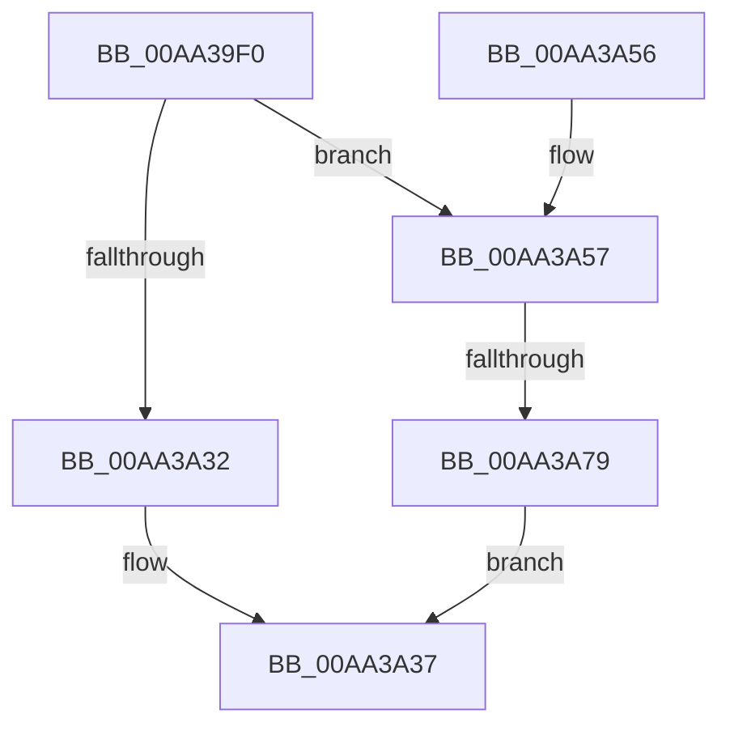

# ExpWnfGetPermanentDataStore

- RVA: `0x00AA39F0`–`0x00AA3A80` (길이 `144` bytes)
- VA: `0x0000000140AA39F0`
- 실행 섹션: `PAGE`
- PDB 이름 있음: `예`; PDB Function 태그: `예`
- unwind 정보 RVA: `0x000BB3A8`
- 디코드: `43`개 명령, `144/144` bytes 표시
- 미해석 바이트: `0` (있으면 어셈블리에 `.byte`로 보존)

> 이 문서는 커널 이미지의 기계어와 PDB 기호를 분석해 생성했습니다. 4번과 5번은 함수 원형과 자료형을 바이너리 사용 방식에서 추정한 C 해석이며 원본 소스 복구 결과는 아닙니다.

## 1. Dependencies

- 직접 호출 지점: **1**; 고유 호출 대상: **1**
- 직접 호출자로 확인된 함수: **2**
- RIP 상대 이미지 참조: **0**

### Outgoing calls
- `0x00AA3A68` → [ExAllocatePool2](../../poolcode/B8/ExAllocatePool2_function_00B820F0.md) (function, `0x00B820F0`)

### Direct callers
- [ExpWnfDeletePermanentStateData](../7D/ExpWnfDeletePermanentStateData_function_007D6254.md) at `0x007D62E0`
- [ExpWnfCreateNameInstance](../8B/ExpWnfCreateNameInstance_function_008BF590.md) at `0x008BF830`

### Static image references
- 디코드된 RIP-relative 메모리 참조가 없습니다.

## 2. Other-region calls and transfers

- 다른 실행 섹션으로 향하는 call: **1**
  - `0x00AA3A68` → [ExAllocatePool2](../../poolcode/B8/ExAllocatePool2_function_00B820F0.md) (`PAGE` → `POOLCODE`)
- call이 아닌 외부 분기/꼬리 이동: **1**
  - `0x00AA3A73` → [sub_00B49AA2](../B4/Unknown_function_00B49AA2.md) (`tail-transfer`)

## 3. Assembly (complete function range)

```asm
00AA39F0  48 8B C4                        mov rax, rsp
00AA39F3  48 89 58 08                     mov qword ptr [rax + 8], rbx
00AA39F7  48 89 68 10                     mov qword ptr [rax + 0x10], rbp
00AA39FB  48 89 70 18                     mov qword ptr [rax + 0x18], rsi
00AA39FF  48 89 78 20                     mov qword ptr [rax + 0x20], rdi
00AA3A03  41 54                           push r12
00AA3A05  41 56                           push r14
00AA3A07  41 57                           push r15
00AA3A09  48 83 EC 40                     sub rsp, 0x40
00AA3A0D  45 33 D2                        xor r10d, r10d
00AA3A10  8D 42 FE                        lea eax, [rdx - 2]
00AA3A13  83 F8 01                        cmp eax, 1
00AA3A16  4D 8B F9                        mov r15, r9
00AA3A19  45 8B E0                        mov r12d, r8d
00AA3A1C  8B EA                           mov ebp, edx
00AA3A1E  41 0F 96 C2                     setbe r10b
00AA3A22  48 8B D9                        mov rbx, rcx
00AA3A25  41 8B F2                        mov esi, r10d
00AA3A28  48 8B 44 F1 40                  mov rax, qword ptr [rcx + rsi*8 + 0x40]
00AA3A2D  48 85 C0                        test rax, rax
00AA3A30  74 25                           je 0x140aa3a57
00AA3A32  49 89 01                        mov qword ptr [r9], rax
00AA3A35  33 C0                           xor eax, eax
00AA3A37  48 8B 5C 24 60                  mov rbx, qword ptr [rsp + 0x60]
00AA3A3C  48 8B 6C 24 68                  mov rbp, qword ptr [rsp + 0x68]
00AA3A41  48 8B 74 24 70                  mov rsi, qword ptr [rsp + 0x70]
00AA3A46  48 8B 7C 24 78                  mov rdi, qword ptr [rsp + 0x78]
00AA3A4B  48 83 C4 40                     add rsp, 0x40
00AA3A4F  41 5F                           pop r15
00AA3A51  41 5E                           pop r14
00AA3A53  41 5C                           pop r12
00AA3A55  C3                              ret
00AA3A56  CC                              int3
00AA3A57  8B 51 14                        mov edx, dword ptr [rcx + 0x14]
00AA3A5A  41 B8 57 6E 66 20               mov r8d, 0x20666e57
00AA3A60  83 C2 30                        add edx, 0x30
00AA3A63  B9 00 01 00 00                  mov ecx, 0x100
00AA3A68  E8 83 E6 0D 00                  call 0x140b820f0
00AA3A6D  48 8B F8                        mov rdi, rax
00AA3A70  48 85 C0                        test rax, rax
00AA3A73  0F 85 29 60 0A 00               jne 0x140b49aa2
00AA3A79  B8 9A 00 00 C0                  mov eax, 0xc000009a
00AA3A7E  EB B7                           jmp 0x140aa3a37
```

## 4. C-style interpretation (structured pseudocode)

```c
__int64 __fastcall ExpWnfGetPermanentDataStore(__int64 a1, __int64 a2, int a3, __int64 a4)
{
    __int64 result;
    __int64 v_r10;
    __int64 v_rsp;
    unsigned __int64 v_stack_p10;
    unsigned __int64 v_stack_p18;
    unsigned __int64 v_stack_p20;
    unsigned __int64 v_stack_p8;

    *(unsigned __int64 *)(v_rsp + 8) = v_rbx;
    *(unsigned __int64 *)(v_rsp + 16) = v_rbp;
    *(unsigned __int64 *)(v_rsp + 24) = v_rsi;
    *(unsigned __int64 *)(v_rsp + 32) = v_rdi;
    v_rsp = (v_rsp) - (64);
    v_r10 = 0;
    v_r10 = (((unsigned int)(a2 - 2)) <= 1) ? 1 : 0;
    if (*(unsigned __int64 *)(a1 + (unsigned int)((unsigned int)(v_r10)) * 8 + 64) == 0) goto loc_00AA3A57;
    *(unsigned __int64 *)(a4) = *(unsigned __int64 *)(a1 + (unsigned int)((unsigned int)(v_r10)) * 8 + 64);
    result = 0;
loc_00AA3A37:
    v_rsp = (v_rsp) + (64);
    return result;
loc_00AA3A57:
    a2 = (unsigned int)(((unsigned int)(*(unsigned int *)(a1 + 20))) + (48));
    result = ExAllocatePool2(256, a2, (unsigned int)(0x20666E57ULL), a4);
    goto loc_00AA3A37;
}
```

## 5. (Beta) C Style

```c
int64_t ExpWnfGetPermanentDataStore(void *Arg1, void *Arg2, int32_t Arg3, void *Arg4)
{
    uint8_t *arg1 = (uint8_t *)Arg1;
    uint8_t *arg2 = (uint8_t *)Arg2;
    uint8_t *arg4 = (uint8_t *)Arg4;

    int64_t result;
    int64_t local_r10;
    int64_t local_rsp;
    uint64_t v_stack_p10;
    uint64_t v_stack_p18;
    uint64_t v_stack_p20;
    uint64_t v_stack_p8;

    *(uint64_t *)(local_rsp + 0x8) = local_rbx;
    *(uint64_t *)(local_rsp + 0x10) = local_rbp;
    *(uint64_t *)(local_rsp + 0x18) = local_rsi;
    *(uint64_t *)(local_rsp + 0x20) = local_rdi;
    local_rsp = (local_rsp) - (64);
    local_r10 = 0;
    local_r10 = (((uint32_t)(Arg2 - 2)) <= 1) ? 1 : 0;
    if (*(uint64_t *)(arg1 + (uint32_t)((uint32_t)(local_r10)) * 8 + 0x40) == 0) goto loc_00AA3A57;
    *(uint64_t *)(arg4) = *(uint64_t *)(arg1 + (uint32_t)((uint32_t)(local_r10)) * 8 + 0x40);
    result = 0;
loc_00AA3A37:
    local_rsp = (local_rsp) + (64);
    return result;
loc_00AA3A57:
    Arg2 = (uint32_t)(((uint32_t)(*(uint32_t *)(arg1 + 0x14))) + (48));
    result = ExAllocatePool2(256, Arg2, (uint32_t)(0x20666E57ULL), Arg4);
    goto loc_00AA3A37;
}
```

### 관측된 메모리 오프셋

구조체 형식이 확인되지 않은 접근은 인자 기준의 오프셋으로만 기록했습니다.

| 기준 인자 | 오프셋 표현 | 폭 (bit) | 접근 |
|---|---:|---:|---|
| `Arg1` | `+ 0x14` | `32` | `R` |
| `Arg1` | `+ 0x40 + rsi*8` | `64` | `R` |
| `Arg2` | `- 0x2` | `32` | `R` |
| `Arg4` | `+ 0x0` | `64` | `W` |

## 6. Execution-region graph

[열기: 2D/3D 그래프와 함수 탐색 컨트롤 패널](../../../control-panel.html?section=page&rva=0x00AA39F0&view=graph)

- 2D 그래프는 위에서 아래로 흐르고, 3D 그래프는 빈 공간을 드래그해 회전합니다. Shift+드래그는 이동, 휠은 확대·축소, 함수 노드 선택은 대상 보고서 이동입니다.

### Static fallback


