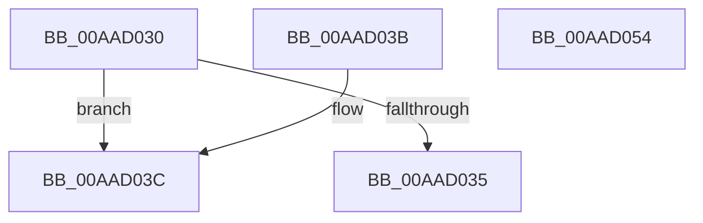

# FsRtlInitializeExtraCreateParameterList

- RVA: `0x00AAD030`–`0x00AAD055` (길이 `37` bytes)
- VA: `0x0000000140AAD030`
- 실행 섹션: `PAGE`
- PDB 이름 있음: `예`; PDB Function 태그: `아니요`
- unwind 정보 RVA: `0x000DB714`
- 디코드: `13`개 명령, `37/37` bytes 표시
- 미해석 바이트: `0` (있으면 어셈블리에 `.byte`로 보존)

> 이 문서는 커널 이미지의 기계어와 PDB 기호를 분석해 생성했습니다. 4번과 5번은 함수 원형과 자료형을 바이너리 사용 방식에서 추정한 C 해석이며 원본 소스 복구 결과는 아닙니다.

## 1. Dependencies

- 직접 호출 지점: **0**; 고유 호출 대상: **0**
- 직접 호출자로 확인된 함수: **0**
- RIP 상대 이미지 참조: **0**

### Outgoing calls
- 직접 디코드된 call 명령이 없습니다.

### Direct callers
- 이 함수 시작 RVA로 연결되는 직접 call은 확인되지 않았습니다. 간접 호출은 완전히 역산할 수 없습니다.

### Static image references
- 디코드된 RIP-relative 메모리 참조가 없습니다.

## 2. Other-region calls and transfers

- 다른 실행 섹션으로 향하는 call: **0**
- 별도 외부 분기/꼬리 이동을 확인하지 못했습니다.

## 3. Assembly (complete function range)

```asm
00AAD030  48 85 C9                        test rcx, rcx
00AAD033  75 07                           jne 0x140aad03c
00AAD035  B8 0D 00 00 C0                  mov eax, 0xc000000d
00AAD03A  C3                              ret
00AAD03B  CC                              int3
00AAD03C  48 8D 41 08                     lea rax, [rcx + 8]
00AAD040  48 89 40 08                     mov qword ptr [rax + 8], rax
00AAD044  48 89 00                        mov qword ptr [rax], rax
00AAD047  33 C0                           xor eax, eax
00AAD049  83 61 04 00                     and dword ptr [rcx + 4], 0
00AAD04D  C7 01 45 63 70 4C               mov dword ptr [rcx], 0x4c706345
00AAD053  C3                              ret
00AAD054  CC                              int3
```

## 4. C-style interpretation (structured pseudocode)

```c
__int64 __fastcall FsRtlInitializeExtraCreateParameterList(__int64 a1)
{
    __int64 result;

    if (a1 != 0) goto loc_00AAD03C;
    return (unsigned int)(0xC000000DULL);
loc_00AAD03C:
    *(unsigned __int64 *)(a1 + 8 + 8) = a1 + 8;
    *(unsigned __int64 *)(a1 + 8) = a1 + 8;
    result = 0;
    *(unsigned int *)(a1) = 0x4C706345ULL;
    return result;
}
```

## 5. (Beta) C Style

```c
int64_t FsRtlInitializeExtraCreateParameterList(int64_t Arg1)
{
    int64_t result;

    if (Arg1 != 0) goto loc_00AAD03C;
    return (uint32_t)(0xC000000DULL);
loc_00AAD03C:
    *(uint64_t *)(Arg1 + 0x8 + 0x8) = Arg1 + 8;
    *(uint64_t *)(Arg1 + 0x8) = Arg1 + 8;
    result = 0;
    *(uint32_t *)(Arg1) = 0x4C706345ULL;
    return result;
}
```

## 6. Execution-region graph

[열기: 2D/3D 그래프와 함수 탐색 컨트롤 패널](../../../control-panel.html?section=page&rva=0x00AAD030&view=graph)

- 2D 그래프는 위에서 아래로 흐르고, 3D 그래프는 빈 공간을 드래그해 회전합니다. Shift+드래그는 이동, 휠은 확대·축소, 함수 노드 선택은 대상 보고서 이동입니다.

### Static fallback


