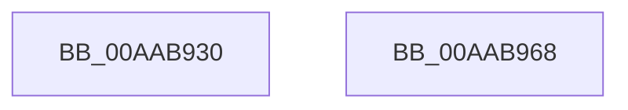

# FsRtlInitializeExtraCreateParameter

- RVA: `0x00AAB930`–`0x00AAB969` (길이 `57` bytes)
- VA: `0x0000000140AAB930`
- 실행 섹션: `PAGE`
- PDB 이름 있음: `예`; PDB Function 태그: `아니요`
- unwind 정보 RVA: `0x000DB714`
- 디코드: `15`개 명령, `57/57` bytes 표시
- 미해석 바이트: `0` (있으면 어셈블리에 `.byte`로 보존)

> 이 문서는 커널 이미지의 기계어와 PDB 기호를 분석해 생성했습니다. 4번과 5번은 함수 원형과 자료형을 바이너리 사용 방식에서 추정한 C 해석이며 원본 소스 복구 결과는 아닙니다.

## 1. Dependencies

- 직접 호출 지점: **0**; 고유 호출 대상: **0**
- 직접 호출자로 확인된 함수: **0**
- RIP 상대 이미지 참조: **0**

### Outgoing calls
- 직접 디코드된 call 명령이 없습니다.

### Direct callers
- 이 함수 시작 RVA로 연결되는 직접 call은 확인되지 않았습니다. 간접 호출은 완전히 역산할 수 없습니다.

### Static image references
- 디코드된 RIP-relative 메모리 참조가 없습니다.

## 2. Other-region calls and transfers

- 다른 실행 섹션으로 향하는 call: **0**
- 별도 외부 분기/꼬리 이동을 확인하지 못했습니다.

## 3. Assembly (complete function range)

```asm
00AAB930  48 8B 44 24 28                  mov rax, qword ptr [rsp + 0x28]
00AAB935  45 33 D2                        xor r10d, r10d
00AAB938  48 C7 01 45 63 70 48            mov qword ptr [rcx], 0x48706345
00AAB93F  4C 89 51 10                     mov qword ptr [rcx + 0x10], r10
00AAB943  4C 89 51 08                     mov qword ptr [rcx + 8], r10
00AAB947  0F 10 00                        movups xmm0, xmmword ptr [rax]
00AAB94A  48 8B 44 24 30                  mov rax, qword ptr [rsp + 0x30]
00AAB94F  4C 89 41 28                     mov qword ptr [rcx + 0x28], r8
00AAB953  F3 0F 7F 41 18                  movdqu xmmword ptr [rcx + 0x18], xmm0
00AAB958  89 51 30                        mov dword ptr [rcx + 0x30], edx
00AAB95B  44 89 49 34                     mov dword ptr [rcx + 0x34], r9d
00AAB95F  48 89 41 38                     mov qword ptr [rcx + 0x38], rax
00AAB963  4C 89 51 40                     mov qword ptr [rcx + 0x40], r10
00AAB967  C3                              ret
00AAB968  CC                              int3
```

## 4. C-style interpretation (structured pseudocode)

```c
__int64 __fastcall FsRtlInitializeExtraCreateParameter(__int64 a1, int a2, __int64 a3, int a4, __int64 a5, __int64 a6)
{
    __int64 v_r10;

    v_r10 = 0;
    *(unsigned __int64 *)(a1) = 0x48706345ULL;
    *(unsigned __int64 *)(a1 + 16) = 0;
    *(unsigned __int64 *)(a1 + 8) = 0;
    *(unsigned __int64 *)(a1 + 40) = a3;
    *(unsigned __int64 *)(a1 + 24) = v_xmm0;
    *(unsigned int *)(a1 + 48) = a2;
    *(unsigned int *)(a1 + 52) = a4;
    *(unsigned __int64 *)(a1 + 56) = a6;
    *(unsigned __int64 *)(a1 + 64) = 0;
    return a6;
}
```

## 5. (Beta) C Style

```c
int64_t FsRtlInitializeExtraCreateParameter(void *Arg1, int32_t Arg2, int64_t Arg3, int32_t Arg4, void *Arg5, int64_t Arg6)
{
    uint8_t *arg1 = (uint8_t *)Arg1;
    uint8_t *arg5 = (uint8_t *)Arg5;

    int64_t local_r10;

    local_r10 = 0;
    *(uint64_t *)(arg1) = 0x48706345ULL;
    *(uint64_t *)(arg1 + 0x10) = 0;
    *(uint64_t *)(arg1 + 0x8) = 0;
    *(uint64_t *)(arg1 + 0x28) = Arg3;
    *(uint64_t *)(arg1 + 0x18) = v_xmm0;
    *(uint32_t *)(arg1 + 0x30) = Arg2;
    *(uint32_t *)(arg1 + 0x34) = Arg4;
    *(uint64_t *)(arg1 + 0x38) = Arg6;
    *(uint64_t *)(arg1 + 0x40) = 0;
    return Arg6;
}
```

### 관측된 메모리 오프셋

구조체 형식이 확인되지 않은 접근은 인자 기준의 오프셋으로만 기록했습니다.

| 기준 인자 | 오프셋 표현 | 폭 (bit) | 접근 |
|---|---:|---:|---|
| `Arg1` | `+ 0x0` | `64` | `W` |
| `Arg1` | `+ 0x8` | `64` | `W` |
| `Arg1` | `+ 0x10` | `64` | `W` |
| `Arg1` | `+ 0x18` | `128` | `W` |
| `Arg1` | `+ 0x28` | `64` | `W` |
| `Arg1` | `+ 0x30` | `32` | `W` |
| `Arg1` | `+ 0x34` | `32` | `W` |
| `Arg1` | `+ 0x38` | `64` | `W` |
| `Arg1` | `+ 0x40` | `64` | `W` |
| `Arg5` | `+ 0x0` | `128` | `R` |

## 6. Execution-region graph

[열기: 2D/3D 그래프와 함수 탐색 컨트롤 패널](../../../control-panel.html?section=page&rva=0x00AAB930&view=graph)

- 2D 그래프는 위에서 아래로 흐르고, 3D 그래프는 빈 공간을 드래그해 회전합니다. Shift+드래그는 이동, 휠은 확대·축소, 함수 노드 선택은 대상 보고서 이동입니다.

### Static fallback


