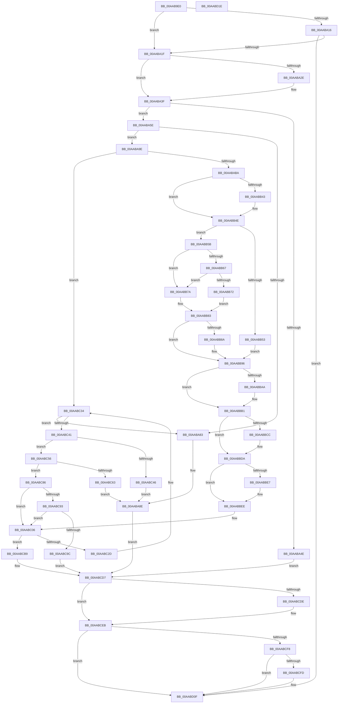

# FsRtlNotifyFilterChangeDirectory

- RVA: `0x00AAB9E0`–`0x00AABD1F` (길이 `831` bytes)
- VA: `0x0000000140AAB9E0`
- 실행 섹션: `PAGE`
- PDB 이름 있음: `예`; PDB Function 태그: `아니요`
- unwind 정보 RVA: `0x000BBE38`
- 디코드: `204`개 명령, `831/831` bytes 표시
- 미해석 바이트: `0` (있으면 어셈블리에 `.byte`로 보존)

> 이 문서는 커널 이미지의 기계어와 PDB 기호를 분석해 생성했습니다. 4번과 5번은 함수 원형과 자료형을 바이너리 사용 방식에서 추정한 C 해석이며 원본 소스 복구 결과는 아닙니다.

## 1. Dependencies

- 직접 호출 지점: **12**; 고유 호출 대상: **12**
- 직접 호출자로 확인된 함수: **2**
- RIP 상대 이미지 참조: **0**

### Outgoing calls
- `0x00AABA2E` → [ExAcquireFastMutexUnsafe](../../text/3F/ExAcquireFastMutexUnsafe_function_003F3720.md) (function, `0x003F3720`)
- `0x00AABA54` → [FsRtlCheckNotifyForDelete](../AD/FsRtlCheckNotifyForDelete_function_00AD2ACC.md) (function, `0x00AD2ACC`)
- `0x00AABA94` → [IofCompleteRequest](../../text/29/IofCompleteRequest_function_0029B5C0.md) (function, `0x0029B5C0`)
- `0x00AABAA4` → [FsRtlIsNotifyOnList](../A3/FsRtlIsNotifyOnList_function_00A328E0.md) (function, `0x00A328E0`)
- `0x00AABACA` → [ExAllocatePool2](../../poolcode/B8/ExAllocatePool2_function_00B820F0.md) (function, `0x00B820F0`)
- `0x00AABBC3` → [Feature_4131803451__private_IsEnabledDeviceUsageNoInline](../../text/58/Feature_4131803451__private_IsEnabledDeviceUsageNoInline_function_0058336C.md) (function, `0x0058336C`)
- `0x00AABBD5` → [ObfReferenceObjectWithTag](../../text/21/ObfReferenceObjectWithTag_function_00210710.md) (function, `0x00210710`)
- `0x00AABCB2` → [FsRtlNotifyCompleteIrp](../A1/FsRtlNotifyCompleteIrp_function_00A1FA28.md) (function, `0x00A1FA28`)
- `0x00AABCD1` → [FsRtlNotifySetCancelRoutine](../../text/27/FsRtlNotifySetCancelRoutine_function_0027239C.md) (function, `0x0027239C`)
- `0x00AABCE6` → [ExReleaseFastMutexUnsafe](../../text/25/ExReleaseFastMutexUnsafe_function_002503A0.md) (function, `0x002503A0`)
- `0x00AABD00` → [SeReleaseSubjectContext](../86/SeReleaseSubjectContext_function_0086B710.md) (function, `0x0086B710`)
- `0x00AABD0A` → [ExFreePoolWithTag](../../poolcode/B8/ExFreePoolWithTag_function_00B82870.md) (function, `0x00B82870`)

### Direct callers
- [FsRtlNotifyChangeDirectory](../71/FsRtlNotifyChangeDirectory_function_00716D30.md) at `0x00716D78`
- [FsRtlNotifyFullChangeDirectory](FsRtlNotifyFullChangeDirectory_function_00AAB970.md) at `0x00AAB9C1`

### Static image references
- 디코드된 RIP-relative 메모리 참조가 없습니다.

## 2. Other-region calls and transfers

- 다른 실행 섹션으로 향하는 call: **8**
  - `0x00AABA2E` → [ExAcquireFastMutexUnsafe](../../text/3F/ExAcquireFastMutexUnsafe_function_003F3720.md) (`PAGE` → `.text`)
  - `0x00AABA94` → [IofCompleteRequest](../../text/29/IofCompleteRequest_function_0029B5C0.md) (`PAGE` → `.text`)
  - `0x00AABACA` → [ExAllocatePool2](../../poolcode/B8/ExAllocatePool2_function_00B820F0.md) (`PAGE` → `POOLCODE`)
  - `0x00AABBC3` → [Feature_4131803451__private_IsEnabledDeviceUsageNoInline](../../text/58/Feature_4131803451__private_IsEnabledDeviceUsageNoInline_function_0058336C.md) (`PAGE` → `.text`)
  - `0x00AABBD5` → [ObfReferenceObjectWithTag](../../text/21/ObfReferenceObjectWithTag_function_00210710.md) (`PAGE` → `.text`)
  - `0x00AABCD1` → [FsRtlNotifySetCancelRoutine](../../text/27/FsRtlNotifySetCancelRoutine_function_0027239C.md) (`PAGE` → `.text`)
  - `0x00AABCE6` → [ExReleaseFastMutexUnsafe](../../text/25/ExReleaseFastMutexUnsafe_function_002503A0.md) (`PAGE` → `.text`)
  - `0x00AABD0A` → [ExFreePoolWithTag](../../poolcode/B8/ExFreePoolWithTag_function_00B82870.md) (`PAGE` → `POOLCODE`)
- 별도 외부 분기/꼬리 이동을 확인하지 못했습니다.

## 3. Assembly (complete function range)

```asm
00AAB9E0  4C 89 4C 24 20                  mov qword ptr [rsp + 0x20], r9
00AAB9E5  4C 89 44 24 18                  mov qword ptr [rsp + 0x18], r8
00AAB9EA  48 89 4C 24 08                  mov qword ptr [rsp + 8], rcx
00AAB9EF  53                              push rbx
00AAB9F0  56                              push rsi
00AAB9F1  41 54                           push r12
00AAB9F3  41 55                           push r13
00AAB9F5  41 56                           push r14
00AAB9F7  41 57                           push r15
00AAB9F9  48 83 EC 48                     sub rsp, 0x48
00AAB9FD  4D 8B E1                        mov r12, r9
00AABA00  4D 8B C8                        mov r9, r8
00AABA03  4C 8B EA                        mov r13, rdx
00AABA06  4C 8B F1                        mov r14, rcx
00AABA09  48 8B B4 24 B8 00 00 00         mov rsi, qword ptr [rsp + 0xb8]
00AABA11  48 39 12                        cmp qword ptr [rdx], rdx
00AABA14  75 09                           jne 0x140aaba1f
00AABA16  48 85 F6                        test rsi, rsi
00AABA19  0F 84 F0 02 00 00               je 0x140aabd0f
00AABA1F  65 48 8B 1C 25 88 01 00 00      mov rbx, qword ptr gs:[0x188]
00AABA28  48 3B 59 38                     cmp rbx, qword ptr [rcx + 0x38]
00AABA2C  74 11                           je 0x140aaba3f
00AABA2E  E8 ED 7C 94 FF                  call 0x1403f3720
00AABA33  49 89 5E 38                     mov qword ptr [r14 + 0x38], rbx
00AABA37  4C 8B 8C 24 90 00 00 00         mov r9, qword ptr [rsp + 0x90]
00AABA3F  41 BA 01 00 00 00               mov r10d, 1
00AABA45  45 01 56 40                     add dword ptr [r14 + 0x40], r10d
00AABA49  48 85 F6                        test rsi, rsi
00AABA4C  75 10                           jne 0x140aaba5e
00AABA4E  49 8B D1                        mov rdx, r9
00AABA51  49 8B CD                        mov rcx, r13
00AABA54  E8 73 70 02 00                  call 0x140ad2acc
00AABA59  E9 79 02 00 00                  jmp 0x140aabcd7
00AABA5E  4C 8B BE B8 00 00 00            mov r15, qword ptr [rsi + 0xb8]
00AABA65  4C 89 BC 24 88 00 00 00         mov qword ptr [rsp + 0x88], r15
00AABA6D  83 66 30 00                     and dword ptr [rsi + 0x30], 0
00AABA71  48 83 66 38 00                  and qword ptr [rsi + 0x38], 0
00AABA76  49 8B 47 30                     mov rax, qword ptr [r15 + 0x30]
00AABA7A  F7 40 50 00 40 00 00            test dword ptr [rax + 0x50], 0x4000
00AABA81  74 1B                           je 0x140aaba9e
00AABA83  45 08 57 03                     or byte ptr [r15 + 3], r10b
00AABA87  C7 46 30 0B 01 00 00            mov dword ptr [rsi + 0x30], 0x10b
00AABA8E  41 8A D2                        mov dl, r10b
00AABA91  48 8B CE                        mov rcx, rsi
00AABA94  E8 27 FB 7E FF                  call 0x14029b5c0
00AABA99  E9 39 02 00 00                  jmp 0x140aabcd7
00AABA9E  49 8B D1                        mov rdx, r9
00AABAA1  49 8B CD                        mov rcx, r13
00AABAA4  E8 37 6E F8 FF                  call 0x140a328e0
00AABAA9  48 8B D8                        mov rbx, rax
00AABAAC  48 89 44 24 30                  mov qword ptr [rsp + 0x30], rax
00AABAB1  48 85 C0                        test rax, rax
00AABAB4  0F 85 7A 01 00 00               jne 0x140aabc34
00AABABA  BA 98 00 00 00                  mov edx, 0x98
00AABABF  B9 20 01 00 00                  mov ecx, 0x120
00AABAC4  41 B8 46 53 72 4E               mov r8d, 0x4e725346
00AABACA  E8 21 66 0D 00                  call 0x140b820f0
00AABACF  48 8B D8                        mov rbx, rax
00AABAD2  48 89 44 24 30                  mov qword ptr [rsp + 0x30], rax
00AABAD7  4C 89 30                        mov qword ptr [rax], r14
00AABADA  48 8B 84 24 90 00 00 00         mov rax, qword ptr [rsp + 0x90]
00AABAE2  48 89 43 08                     mov qword ptr [rbx + 8], rax
00AABAE6  49 8B 47 30                     mov rax, qword ptr [r15 + 0x30]
00AABAEA  48 8B 48 18                     mov rcx, qword ptr [rax + 0x18]
00AABAEE  48 89 8B 80 00 00 00            mov qword ptr [rbx + 0x80], rcx
00AABAF5  48 8B 84 24 C0 00 00 00         mov rax, qword ptr [rsp + 0xc0]
00AABAFD  48 89 43 10                     mov qword ptr [rbx + 0x10], rax
00AABB01  48 8B 84 24 C8 00 00 00         mov rax, qword ptr [rsp + 0xc8]
00AABB09  48 89 43 18                     mov qword ptr [rbx + 0x18], rax
00AABB0D  48 83 A4 24 C8 00 00 00 00      and qword ptr [rsp + 0xc8], 0
00AABB16  48 8B 84 24 D0 00 00 00         mov rax, qword ptr [rsp + 0xd0]
00AABB1E  48 89 43 40                     mov qword ptr [rbx + 0x40], rax
00AABB22  4C 89 A3 88 00 00 00            mov qword ptr [rbx + 0x88], r12
00AABB29  48 8D 43 30                     lea rax, [rbx + 0x30]
00AABB2D  48 89 40 08                     mov qword ptr [rax + 8], rax
00AABB31  48 89 00                        mov qword ptr [rax], rax
00AABB34  BA 01 00 00 00                  mov edx, 1
00AABB39  80 BC 24 A0 00 00 00 00         cmp byte ptr [rsp + 0xa0], 0
00AABB41  74 0B                           je 0x140aabb4e
00AABB43  0F B7 43 48                     movzx eax, word ptr [rbx + 0x48]
00AABB47  66 0B C2                        or ax, dx
00AABB4A  66 89 43 48                     mov word ptr [rbx + 0x48], ax
00AABB4E  4D 85 E4                        test r12, r12
00AABB51  75 08                           jne 0x140aabb5b
00AABB53  88 93 90 00 00 00               mov byte ptr [rbx + 0x90], dl
00AABB59  EB 3B                           jmp 0x140aabb96
00AABB5B  B9 02 00 00 00                  mov ecx, 2
00AABB60  66 41 39 0C 24                  cmp word ptr [r12], cx
00AABB65  72 13                           jb 0x140aabb7a
00AABB67  49 8B 44 24 08                  mov rax, qword ptr [r12 + 8]
00AABB6C  80 78 01 00                     cmp byte ptr [rax + 1], 0
00AABB70  75 08                           jne 0x140aabb7a
00AABB72  88 8B 90 00 00 00               mov byte ptr [rbx + 0x90], cl
00AABB78  EB 09                           jmp 0x140aabb83
00AABB7A  88 93 90 00 00 00               mov byte ptr [rbx + 0x90], dl
00AABB80  0F B7 CA                        movzx ecx, dx
00AABB83  66 41 39 0C 24                  cmp word ptr [r12], cx
00AABB88  75 0C                           jne 0x140aabb96
00AABB8A  0F B7 43 48                     movzx eax, word ptr [rbx + 0x48]
00AABB8E  66 83 C8 10                     or ax, 0x10
00AABB92  66 89 43 48                     mov word ptr [rbx + 0x48], ax
00AABB96  8B 84 24 B0 00 00 00            mov eax, dword ptr [rsp + 0xb0]
00AABB9D  89 43 4C                        mov dword ptr [rbx + 0x4c], eax
00AABBA0  80 BC 24 A8 00 00 00 00         cmp byte ptr [rsp + 0xa8], 0
00AABBA8  75 07                           jne 0x140aabbb1
00AABBAA  41 8B 47 08                     mov eax, dword ptr [r15 + 8]
00AABBAE  89 43 60                        mov dword ptr [rbx + 0x60], eax
00AABBB1  48 8B 86 98 00 00 00            mov rax, qword ptr [rsi + 0x98]
00AABBB8  48 8B 88 20 02 00 00            mov rcx, qword ptr [rax + 0x220]
00AABBBF  48 89 4B 78                     mov qword ptr [rbx + 0x78], rcx
00AABBC3  E8 A4 77 AD FF                  call 0x14058336c
00AABBC8  85 C0                           test eax, eax
00AABBCA  74 0E                           je 0x140aabbda
00AABBCC  BA 46 73 4E 74                  mov edx, 0x744e7346
00AABBD1  48 8B 4B 78                     mov rcx, qword ptr [rbx + 0x78]
00AABBD5  E8 36 4B 76 FF                  call 0x140210710
00AABBDA  48 8D 43 20                     lea rax, [rbx + 0x20]
00AABBDE  49 8B 4D 08                     mov rcx, qword ptr [r13 + 8]
00AABBE2  4C 39 29                        cmp qword ptr [rcx], r13
00AABBE5  74 07                           je 0x140aabbee
00AABBE7  B9 03 00 00 00                  mov ecx, 3
00AABBEC  CD 29                           int 0x29
00AABBEE  4C 89 28                        mov qword ptr [rax], r13
00AABBF1  48 89 48 08                     mov qword ptr [rax + 8], rcx
00AABBF5  48 89 01                        mov qword ptr [rcx], rax
00AABBF8  49 89 45 08                     mov qword ptr [r13 + 8], rax
00AABBFC  41 BA 01 00 00 00               mov r10d, 1
00AABC02  44 89 53 70                     mov dword ptr [rbx + 0x70], r10d
00AABC06  48 89 5E 38                     mov qword ptr [rsi + 0x38], rbx
00AABC0A  48 8B 86 B8 00 00 00            mov rax, qword ptr [rsi + 0xb8]
00AABC11  44 08 50 03                     or byte ptr [rax + 3], r10b
00AABC15  48 8D 86 A8 00 00 00            lea rax, [rsi + 0xa8]
00AABC1C  48 8D 4B 30                     lea rcx, [rbx + 0x30]
00AABC20  48 8B 51 08                     mov rdx, qword ptr [rcx + 8]
00AABC24  48 39 0A                        cmp qword ptr [rdx], rcx
00AABC27  0F 84 8C 00 00 00               je 0x140aabcb9
00AABC2D  B9 03 00 00 00                  mov ecx, 3
00AABC32  CD 29                           int 0x29
00AABC34  0F B7 50 48                     movzx edx, word ptr [rax + 0x48]
00AABC38  F6 C2 04                        test dl, 4
00AABC3B  0F 85 42 FE FF FF               jne 0x140aaba83
00AABC41  F6 C2 20                        test dl, 0x20
00AABC44  74 10                           je 0x140aabc56
00AABC46  45 08 57 03                     or byte ptr [r15 + 3], r10b
00AABC4A  C7 46 30 56 00 00 C0            mov dword ptr [rsi + 0x30], 0xc0000056
00AABC51  E9 38 FE FF FF                  jmp 0x140aaba8e
00AABC56  8A C2                           mov al, dl
00AABC58  24 0A                           and al, 0xa
00AABC5A  B9 02 00 00 00                  mov ecx, 2
00AABC5F  3A C1                           cmp al, cl
00AABC61  75 23                           jne 0x140aabc86
00AABC63  B8 FD FF 00 00                  mov eax, 0xfffd
00AABC68  66 23 D0                        and dx, ax
00AABC6B  66 89 53 48                     mov word ptr [rbx + 0x48], dx
00AABC6F  48 8B 86 B8 00 00 00            mov rax, qword ptr [rsi + 0xb8]
00AABC76  44 08 50 03                     or byte ptr [rax + 3], r10b
00AABC7A  C7 46 30 0C 01 00 00            mov dword ptr [rsi + 0x30], 0x10c
00AABC81  E9 08 FE FF FF                  jmp 0x140aaba8e
00AABC86  44 8B 43 68                     mov r8d, dword ptr [rbx + 0x68]
00AABC8A  45 85 C0                        test r8d, r8d
00AABC8D  0F 84 73 FF FF FF               je 0x140aabc06
00AABC93  F6 C2 08                        test dl, 8
00AABC96  0F 85 6A FF FF FF               jne 0x140aabc06
00AABC9C  83 63 68 00                     and dword ptr [rbx + 0x68], 0
00AABCA0  83 63 6C 00                     and dword ptr [rbx + 0x6c], 0
00AABCA4  83 64 24 20 00                  and dword ptr [rsp + 0x20], 0
00AABCA9  45 33 C9                        xor r9d, r9d
00AABCAC  48 8B D3                        mov rdx, rbx
00AABCAF  48 8B CE                        mov rcx, rsi
00AABCB2  E8 71 3D F7 FF                  call 0x140a1fa28
00AABCB7  EB 1E                           jmp 0x140aabcd7
00AABCB9  48 89 08                        mov qword ptr [rax], rcx
00AABCBC  48 89 50 08                     mov qword ptr [rax + 8], rdx
00AABCC0  48 89 02                        mov qword ptr [rdx], rax
00AABCC3  48 89 41 08                     mov qword ptr [rcx + 8], rax
00AABCC7  F0 44 01 53 70                  lock add dword ptr [rbx + 0x70], r10d
00AABCCC  33 D2                           xor edx, edx
00AABCCE  48 8B CE                        mov rcx, rsi
00AABCD1  E8 C6 66 7C FF                  call 0x14027239c
00AABCD6  90                              nop
00AABCD7  41 83 6E 40 01                  sub dword ptr [r14 + 0x40], 1
00AABCDC  75 0D                           jne 0x140aabceb
00AABCDE  49 83 66 38 00                  and qword ptr [r14 + 0x38], 0
00AABCE3  49 8B CE                        mov rcx, r14
00AABCE6  E8 B5 46 7A FF                  call 0x1402503a0
00AABCEB  48 8B 9C 24 C8 00 00 00         mov rbx, qword ptr [rsp + 0xc8]
00AABCF3  48 85 DB                        test rbx, rbx
00AABCF6  74 17                           je 0x140aabd0f
00AABCF8  4D 85 E4                        test r12, r12
00AABCFB  74 12                           je 0x140aabd0f
00AABCFD  48 8B CB                        mov rcx, rbx
00AABD00  E8 0B FA DB FF                  call 0x14086b710
00AABD05  33 D2                           xor edx, edx
00AABD07  48 8B CB                        mov rcx, rbx
00AABD0A  E8 61 6B 0D 00                  call 0x140b82870
00AABD0F  48 83 C4 48                     add rsp, 0x48
00AABD13  41 5F                           pop r15
00AABD15  41 5E                           pop r14
00AABD17  41 5D                           pop r13
00AABD19  41 5C                           pop r12
00AABD1B  5E                              pop rsi
00AABD1C  5B                              pop rbx
00AABD1D  C3                              ret
00AABD1E  CC                              int3
```

## 4. C-style interpretation (structured pseudocode)

```c
__int64 __fastcall FsRtlNotifyFilterChangeDirectory(__int64 a1, __int64 a2, __int64 a3, __int64 a4, unsigned __int8 a5, unsigned __int8 a6, unsigned int a7, __int64 a8, __int64 a9, __int64 a10, __int64 a11)
{
    __int64 result;
    __int64 v_rsp;
    unsigned __int64 v_stack_m48;
    unsigned int v_stack_m58;
    unsigned __int64 v_stack_p10;
    unsigned __int64 v_stack_p18;
    unsigned __int64 v_stack_p20;
    unsigned __int64 v_stack_p8;

    v_stack_p20 = a4;
    v_stack_p18 = a3;
    v_stack_p8 = a1;
    v_rsp = (v_rsp) - (72);
    if ((*(unsigned __int64 *)(a2)) != a2) goto loc_00AABA1F;
    if (a8 == 0) goto loc_00AABD0F;
loc_00AABA1F:
    if ((*(unsigned __int64 *)(gs_base + (0 + 392))) != (*(unsigned __int64 *)(a1 + 56))) {
        result = ExAcquireFastMutexUnsafe(a1, a2, a3, a3);
        *(unsigned __int64 *)(a1 + 56) = *(unsigned __int64 *)(gs_base + (0 + 392));
        a4 = v_stack_p18;
    }
    if (a8 != 0) goto loc_00AABA5E;
    result = FsRtlCheckNotifyForDelete(a2, a4, a3, a4);
    goto loc_00AABCD7;
loc_00AABA5E:
    v_stack_p10 = *(unsigned __int64 *)(a8 + 184);
    if (((*(unsigned int *)(*(unsigned __int64 *)(*(unsigned __int64 *)(a8 + 184) + 48) + 80)) & (0x4000ULL)) == 0) goto loc_00AABA9E;
loc_00AABA83:
    *(unsigned int *)(a8 + 48) = 267;
loc_00AABA8E:
    result = IofCompleteRequest(a8, 1, a3, a4);
    goto loc_00AABCD7;
loc_00AABA9E:
    result = FsRtlIsNotifyOnList(a2, a4, a3, a4);
    v_stack_m48 = result;
    if (result != 0) goto loc_00AABC34;
    result = ExAllocatePool2(288, 152, (unsigned int)(0x4E725346ULL), a4);
    v_stack_m48 = result;
    *(unsigned __int64 *)(result) = a1;
    *(unsigned __int64 *)(result + 8) = v_stack_p18;
    *(unsigned __int64 *)(result + 128) = *(unsigned __int64 *)(*(unsigned __int64 *)(*(unsigned __int64 *)(a8 + 184) + 48) + 24);
    *(unsigned __int64 *)(result + 16) = a9;
    *(unsigned __int64 *)(result + 24) = a10;
    *(unsigned __int64 *)(result + 64) = a11;
    *(unsigned __int64 *)(result + 136) = a4;
    *(unsigned __int64 *)(result + 48 + 8) = result + 48;
    *(unsigned __int64 *)(result + 48) = result + 48;
    result = result + 48;
    if (a5 != 0) {
        result = *(unsigned __int16 *)(result + 72);
        result = (unsigned __int16)((result) | (1));
        *(unsigned __int16 *)(result + 72) = (unsigned __int16)(result);
    }
    if (a4 != 0) goto loc_00AABB5B;
    *(unsigned __int8 *)(result + 144) = 1;
    goto loc_00AABB96;
loc_00AABB5B:
    if ((*(unsigned __int16 *)(a4)) < 2) goto loc_00AABB7A;
    if ((*(unsigned __int8 *)(*(unsigned __int64 *)(a4 + 8) + 1)) != 0) goto loc_00AABB7A;
    *(unsigned __int8 *)(result + 144) = 2;
    goto loc_00AABB83;
loc_00AABB7A:
    *(unsigned __int8 *)(result + 144) = 1;
loc_00AABB83:
    result = *(unsigned __int64 *)(a4 + 8);
    if ((*(unsigned __int16 *)(a4)) == 1) {
        result = *(unsigned __int16 *)(result + 72);
        result = (unsigned __int16)((result) | (16));
        *(unsigned __int16 *)(result + 72) = (unsigned __int16)(result);
    }
    *(unsigned int *)(result + 76) = (unsigned int)((unsigned int)(a7));
    result = (unsigned int)(a7);
    if (a6 == 0) {
        result = *(unsigned int *)(*(unsigned __int64 *)(a8 + 184) + 8);
        *(unsigned int *)(result + 96) = (unsigned int)(result);
    }
    *(unsigned __int64 *)(result + 120) = *(unsigned __int64 *)(*(unsigned __int64 *)(a8 + 152) + 544);
    result = Feature_4131803451__private_IsEnabledDeviceUsageNoInline(*(unsigned __int64 *)(*(unsigned __int64 *)(a8 + 152) + 544), 1, (unsigned int)(0x4E725346ULL), a4);
    if ((unsigned int)(result) != 0) {
        a2 = 0x744E7346ULL;
        a1 = *(unsigned __int64 *)(result + 120);
        result = ObfReferenceObjectWithTag(a1, a2, (unsigned int)(0x4E725346ULL), a4);
    }
    if ((*(unsigned __int64 *)(*(unsigned __int64 *)(a2 + 8))) != a2) {
        a1 = 3;
    }
    *(unsigned __int64 *)(result + 32) = a2;
    *(unsigned __int64 *)(result + 32 + 8) = a1;
    *(unsigned __int64 *)(a1) = result + 32;
    *(unsigned __int64 *)(a2 + 8) = result + 32;
    *(unsigned int *)(result + 112) = 1;
loc_00AABC06:
    *(unsigned __int64 *)(a8 + 56) = result;
    if ((*(unsigned __int64 *)(*(unsigned __int64 *)(result + 48 + 8))) == (result + 48)) goto loc_00AABCB9;
loc_00AABC34:
    if ((((unsigned __int8)(*(unsigned __int16 *)(a8 + 168 + 72))) & (4)) != 0) goto loc_00AABA83;
    if ((((unsigned __int8)(*(unsigned __int16 *)(a8 + 168 + 72))) & (32)) == 0) goto loc_00AABC56;
    *(unsigned int *)(a8 + 48) = 0xC0000056ULL;
    goto loc_00AABA8E;
loc_00AABC56:
    result = (unsigned __int8)(((unsigned __int8)(*(unsigned __int16 *)(a8 + 168 + 72))) & (10));
    if (((unsigned __int8)(result)) != 2) goto loc_00AABC86;
    a2 = (unsigned __int16)((*(unsigned __int16 *)(a8 + 168 + 72)) & ((unsigned __int16)((unsigned int)(0xFFFDULL))));
    *(unsigned __int16 *)(result + 72) = (unsigned __int16)(a2);
    *(unsigned int *)(a8 + 48) = 268;
    goto loc_00AABA8E;
loc_00AABC86:
    if ((unsigned int)((unsigned int)(*(unsigned int *)(result + 104))) == 0) goto loc_00AABC06;
    if ((((unsigned __int8)(a2)) & (8)) != 0) goto loc_00AABC06;
    a4 = 0;
    result = FsRtlNotifyCompleteIrp(a8, result, (unsigned int)(*(unsigned int *)(result + 104)), a4);
    goto loc_00AABCD7;
loc_00AABCB9:
    *(unsigned __int64 *)(result) = a8;
    *(unsigned __int64 *)(result + 8) = result;
    *(unsigned __int64 *)(result) = result;
    *(unsigned __int64 *)(a8 + 8) = result;
    a2 = 0;
    result = FsRtlNotifySetCancelRoutine(a8, a2, (unsigned int)(*(unsigned int *)(result + 104)), a4);
loc_00AABCD7:
    if (!(condition_is_not_equal)) {
        a1 = a1;
        result = ExReleaseFastMutexUnsafe(a1, a2, (unsigned int)(*(unsigned int *)(result + 104)), a4);
    }
    if (a10 == 0) goto loc_00AABD0F;
    if (0 != 0) {
        a1 = a10;
        result = SeReleaseSubjectContext(a1, a2, (unsigned int)(*(unsigned int *)(result + 104)), a4);
        a2 = 0;
        a1 = a10;
        result = ExFreePoolWithTag(a1, a2, (unsigned int)(*(unsigned int *)(result + 104)), a4);
    }
    v_rsp = (v_rsp) + (72);
    return result;
}
```

## 5. (Beta) C Style

```c
int64_t FsRtlNotifyFilterChangeDirectory(void *Arg1, void *Arg2, int64_t Arg3, int64_t Arg4, uint8_t Arg5, uint8_t Arg6, uint32_t Arg7, int64_t Arg8, int64_t Arg9, int64_t Arg10, int64_t Arg11)
{
    uint8_t *arg1 = (uint8_t *)Arg1;
    uint8_t *arg2 = (uint8_t *)Arg2;

    int64_t result;
    int64_t local_rsp;
    uint64_t v_stack_m48;
    uint32_t v_stack_m58;
    uint64_t v_stack_p10;
    uint64_t v_stack_p18;
    uint64_t v_stack_p20;
    uint64_t v_stack_p8;

    v_stack_p20 = Arg4;
    v_stack_p18 = Arg3;
    v_stack_p8 = Arg1;
    local_rsp = (local_rsp) - (72);
    if ((*(uint64_t *)(arg2)) != Arg2) goto loc_00AABA1F;
    if (Arg8 == 0) goto loc_00AABD0F;
loc_00AABA1F:
    if ((*(uint64_t *)(gs_base + (0 + 0x188))) != (*(uint64_t *)(arg1 + 0x38))) {
        result = ExAcquireFastMutexUnsafe(Arg1, Arg2, Arg3, Arg3);
        *(uint64_t *)(arg1 + 0x38) = *(uint64_t *)(gs_base + (0 + 0x188));
        Arg4 = v_stack_p18;
    }
    if (Arg8 != 0) goto loc_00AABA5E;
    result = FsRtlCheckNotifyForDelete(Arg2, Arg4, Arg3, Arg4);
    goto loc_00AABCD7;
loc_00AABA5E:
    v_stack_p10 = *(uint64_t *)(Arg8 + 0xB8);
    if (((*(uint32_t *)(*(uint64_t *)(*(uint64_t *)(Arg8 + 0xB8) + 0x30) + 0x50)) & (0x4000ULL)) == 0) goto loc_00AABA9E;
loc_00AABA83:
    *(uint32_t *)(Arg8 + 0x30) = 267;
loc_00AABA8E:
    result = IofCompleteRequest(Arg8, 1, Arg3, Arg4);
    goto loc_00AABCD7;
loc_00AABA9E:
    result = FsRtlIsNotifyOnList(Arg2, Arg4, Arg3, Arg4);
    v_stack_m48 = result;
    if (result != 0) goto loc_00AABC34;
    result = ExAllocatePool2(288, 152, (uint32_t)(0x4E725346ULL), Arg4);
    v_stack_m48 = result;
    *(void **)(result) = Arg1;
    *(uint64_t *)(result + 0x8) = v_stack_p18;
    *(uint64_t *)(result + 0x80) = *(uint64_t *)(*(uint64_t *)(*(uint64_t *)(Arg8 + 0xB8) + 0x30) + 0x18);
    *(uint64_t *)(result + 0x10) = Arg9;
    *(uint64_t *)(result + 0x18) = Arg10;
    *(uint64_t *)(result + 0x40) = Arg11;
    *(uint64_t *)(result + 0x88) = Arg4;
    *(uint64_t *)(result + 0x30 + 0x8) = result + 48;
    *(uint64_t *)(result + 0x30) = result + 48;
    result = result + 48;
    if (Arg5 != 0) {
        result = *(uint16_t *)(result + 0x48);
        result = (uint16_t)((result) | (1));
        *(uint16_t *)(result + 0x48) = (uint16_t)(result);
    }
    if (Arg4 != 0) goto loc_00AABB5B;
    *(uint8_t *)(result + 0x90) = 1;
    goto loc_00AABB96;
loc_00AABB5B:
    if ((*(uint16_t *)(Arg4)) < 2) goto loc_00AABB7A;
    if ((*(uint8_t *)(*(uint64_t *)(Arg4 + 0x8) + 0x1)) != 0) goto loc_00AABB7A;
    *(uint8_t *)(result + 0x90) = 2;
    goto loc_00AABB83;
loc_00AABB7A:
    *(uint8_t *)(result + 0x90) = 1;
loc_00AABB83:
    result = *(uint64_t *)(Arg4 + 0x8);
    if ((*(uint16_t *)(Arg4)) == 1) {
        result = *(uint16_t *)(result + 0x48);
        result = (uint16_t)((result) | (16));
        *(uint16_t *)(result + 0x48) = (uint16_t)(result);
    }
    *(uint32_t *)(result + 0x4C) = (uint32_t)((uint32_t)(Arg7));
    result = (uint32_t)(Arg7);
    if (Arg6 == 0) {
        result = *(uint32_t *)(*(uint64_t *)(Arg8 + 0xB8) + 0x8);
        *(uint32_t *)(result + 0x60) = (uint32_t)(result);
    }
    *(uint64_t *)(result + 0x78) = *(uint64_t *)(*(uint64_t *)(Arg8 + 0x98) + 0x220);
    result = Feature_4131803451__private_IsEnabledDeviceUsageNoInline(*(uint64_t *)(*(uint64_t *)(Arg8 + 0x98) + 0x220), 1, (uint32_t)(0x4E725346ULL), Arg4);
    if ((uint32_t)(result) != 0) {
        Arg2 = 0x744E7346ULL;
        Arg1 = *(uint64_t *)(result + 0x78);
        result = ObfReferenceObjectWithTag(Arg1, Arg2, (uint32_t)(0x4E725346ULL), Arg4);
    }
    if ((*(uint64_t *)(*(uint64_t *)(arg2 + 0x8))) != Arg2) {
        Arg1 = 3;
    }
    *(void **)(result + 0x20) = Arg2;
    *(void **)(result + 0x20 + 0x8) = Arg1;
    *(uint64_t *)(arg1) = result + 32;
    *(uint64_t *)(arg2 + 0x8) = result + 32;
    *(uint32_t *)(result + 0x70) = 1;
loc_00AABC06:
    *(uint64_t *)(Arg8 + 0x38) = result;
    if ((*(uint64_t *)(*(uint64_t *)(result + 0x30 + 0x8))) == (result + 48)) goto loc_00AABCB9;
loc_00AABC34:
    if ((((uint8_t)(*(uint16_t *)(Arg8 + 0xA8 + 0x48))) & (4)) != 0) goto loc_00AABA83;
    if ((((uint8_t)(*(uint16_t *)(Arg8 + 0xA8 + 0x48))) & (32)) == 0) goto loc_00AABC56;
    *(uint32_t *)(Arg8 + 0x30) = 0xC0000056ULL;
    goto loc_00AABA8E;
loc_00AABC56:
    result = (uint8_t)(((uint8_t)(*(uint16_t *)(Arg8 + 0xA8 + 0x48))) & (10));
    if (((uint8_t)(result)) != 2) goto loc_00AABC86;
    Arg2 = (uint16_t)((*(uint16_t *)(Arg8 + 0xA8 + 0x48)) & ((uint16_t)((uint32_t)(0xFFFDULL))));
    *(uint16_t *)(result + 0x48) = (uint16_t)(Arg2);
    *(uint32_t *)(Arg8 + 0x30) = 268;
    goto loc_00AABA8E;
loc_00AABC86:
    if ((uint32_t)((uint32_t)(*(uint32_t *)(result + 0x68))) == 0) goto loc_00AABC06;
    if ((((uint8_t)(Arg2)) & (8)) != 0) goto loc_00AABC06;
    Arg4 = 0;
    result = FsRtlNotifyCompleteIrp(Arg8, result, (uint32_t)(*(uint32_t *)(result + 0x68)), Arg4);
    goto loc_00AABCD7;
loc_00AABCB9:
    *(uint64_t *)(result) = Arg8;
    *(uint64_t *)(result + 0x8) = result;
    *(uint64_t *)(result) = result;
    *(uint64_t *)(Arg8 + 0x8) = result;
    Arg2 = 0;
    result = FsRtlNotifySetCancelRoutine(Arg8, Arg2, (uint32_t)(*(uint32_t *)(result + 0x68)), Arg4);
loc_00AABCD7:
    if (!(condition_is_not_equal)) {
        Arg1 = Arg1;
        result = ExReleaseFastMutexUnsafe(Arg1, Arg2, (uint32_t)(*(uint32_t *)(result + 0x68)), Arg4);
    }
    if (Arg10 == 0) goto loc_00AABD0F;
    if (0 != 0) {
        Arg1 = Arg10;
        result = SeReleaseSubjectContext(Arg1, Arg2, (uint32_t)(*(uint32_t *)(result + 0x68)), Arg4);
        Arg2 = 0;
        Arg1 = Arg10;
        result = ExFreePoolWithTag(Arg1, Arg2, (uint32_t)(*(uint32_t *)(result + 0x68)), Arg4);
    }
    local_rsp = (local_rsp) + (72);
    return result;
}
```

### 관측된 메모리 오프셋

구조체 형식이 확인되지 않은 접근은 인자 기준의 오프셋으로만 기록했습니다.

| 기준 인자 | 오프셋 표현 | 폭 (bit) | 접근 |
|---|---:|---:|---|
| `Arg1` | `+ 0x38` | `64` | `R` |
| `Arg1` | `+ 0x38` | `64` | `R/W` |
| `Arg1` | `+ 0x38` | `64` | `W` |
| `Arg1` | `+ 0x40` | `32` | `R/W` |
| `Arg2` | `+ 0x0` | `64` | `R` |
| `Arg2` | `+ 0x8` | `64` | `R` |
| `Arg2` | `+ 0x8` | `64` | `W` |

## 6. Execution-region graph

[열기: 2D/3D 그래프와 함수 탐색 컨트롤 패널](../../../control-panel.html?section=page&rva=0x00AAB9E0&view=graph)

- 2D 그래프는 위에서 아래로 흐르고, 3D 그래프는 빈 공간을 드래그해 회전합니다. Shift+드래그는 이동, 휠은 확대·축소, 함수 노드 선택은 대상 보고서 이동입니다.

### Static fallback


