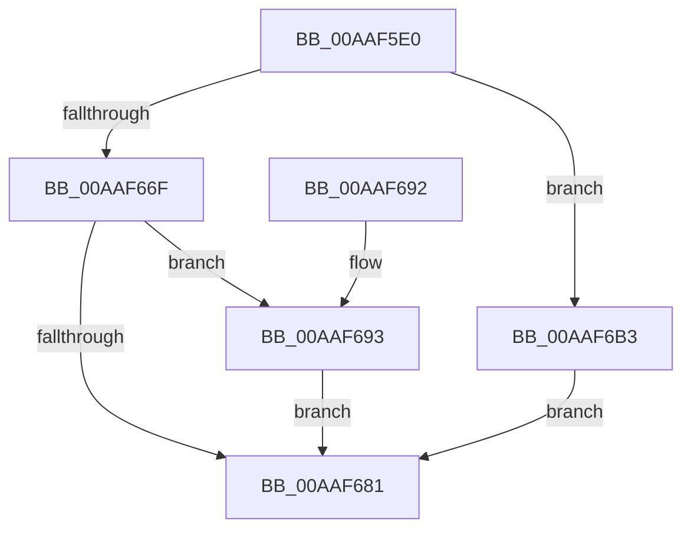

# HalpCallWakeAlarmDriver

- RVA: `0x00AAF5E0`–`0x00AAF6BA` (길이 `218` bytes)
- VA: `0x0000000140AAF5E0`
- 실행 섹션: `PAGE`
- PDB 이름 있음: `예`; PDB Function 태그: `아니요`
- unwind 정보 RVA: `0x000BC3E8`
- 디코드: `57`개 명령, `218/218` bytes 표시
- 미해석 바이트: `0` (있으면 어셈블리에 `.byte`로 보존)

> 이 문서는 커널 이미지의 기계어와 PDB 기호를 분석해 생성했습니다. 4번과 5번은 함수 원형과 자료형을 바이너리 사용 방식에서 추정한 C 해석이며 원본 소스 복구 결과는 아닙니다.

## 1. Dependencies

- 직접 호출 지점: **4**; 고유 호출 대상: **4**
- 직접 호출자로 확인된 함수: **1**
- RIP 상대 이미지 참조: **0**

### Outgoing calls
- `0x00AAF621` → [KeInitializeEvent](../../text/40/KeInitializeEvent_function_0040DD10.md) (function, `0x0040DD10`)
- `0x00AAF665` → [IoBuildDeviceIoControlRequest](../../text/20/IoBuildDeviceIoControlRequest_function_00204FD0.md) (function, `0x00204FD0`)
- `0x00AAF675` → [IofCallDriver](../../text/29/IofCallDriver_function_0029B4B0.md) (function, `0x0029B4B0`)
- `0x00AAF6A8` → [KeWaitForSingleObject](../../text/20/KeWaitForSingleObject_function_0020E6B0.md) (function, `0x0020E6B0`)

### Direct callers
- [HalpArmAcpiWakeAlarm](../A9/HalpArmAcpiWakeAlarm_function_00A9802C.md) at `0x00A98066`
- [HalpArmAcpiWakeAlarm](../A9/HalpArmAcpiWakeAlarm_function_00A9802C.md) at `0x00A9807C`
- [HalpArmAcpiWakeAlarm](../A9/HalpArmAcpiWakeAlarm_function_00A9802C.md) at `0x00A98092`
- [HalpArmAcpiWakeAlarm](../A9/HalpArmAcpiWakeAlarm_function_00A9802C.md) at `0x00A980A8`

### Static image references
- 디코드된 RIP-relative 메모리 참조가 없습니다.

## 2. Other-region calls and transfers

- 다른 실행 섹션으로 향하는 call: **4**
  - `0x00AAF621` → [KeInitializeEvent](../../text/40/KeInitializeEvent_function_0040DD10.md) (`PAGE` → `.text`)
  - `0x00AAF665` → [IoBuildDeviceIoControlRequest](../../text/20/IoBuildDeviceIoControlRequest_function_00204FD0.md) (`PAGE` → `.text`)
  - `0x00AAF675` → [IofCallDriver](../../text/29/IofCallDriver_function_0029B4B0.md) (`PAGE` → `.text`)
  - `0x00AAF6A8` → [KeWaitForSingleObject](../../text/20/KeWaitForSingleObject_function_0020E6B0.md) (`PAGE` → `.text`)
- 별도 외부 분기/꼬리 이동을 확인하지 못했습니다.

## 3. Assembly (complete function range)

```asm
00AAF5E0  4C 8B DC                        mov r11, rsp
00AAF5E3  49 89 5B 08                     mov qword ptr [r11 + 8], rbx
00AAF5E7  57                              push rdi
00AAF5E8  48 81 EC 80 00 00 00            sub rsp, 0x80
00AAF5EF  33 C0                           xor eax, eax
00AAF5F1  0F 57 C9                        xorps xmm1, xmm1
00AAF5F4  84 D2                           test dl, dl
00AAF5F6  41 8A D8                        mov bl, r8b
00AAF5F9  0F 11 4C 24 68                  movups xmmword ptr [rsp + 0x68], xmm1
00AAF5FE  49 89 43 F0                     mov qword ptr [r11 - 0x10], rax
00AAF602  48 8B F9                        mov rdi, rcx
00AAF605  0F 94 C0                        sete al
00AAF608  49 8D 4B E0                     lea rcx, [r11 - 0x20]
00AAF60C  0F 57 C0                        xorps xmm0, xmm0
00AAF60F  89 44 24 50                     mov dword ptr [rsp + 0x50], eax
00AAF613  45 33 C0                        xor r8d, r8d
00AAF616  45 89 4B CC                     mov dword ptr [r11 - 0x34], r9d
00AAF61A  33 D2                           xor edx, edx
00AAF61C  0F 11 44 24 58                  movups xmmword ptr [rsp + 0x58], xmm0
00AAF621  E8 EA E6 95 FF                  call 0x14040dd10
00AAF626  48 8D 44 24 58                  lea rax, [rsp + 0x58]
00AAF62B  F6 DB                           neg bl
00AAF62D  48 89 44 24 40                  mov qword ptr [rsp + 0x40], rax
00AAF632  4C 8D 44 24 50                  lea r8, [rsp + 0x50]
00AAF637  1B C9                           sbb ecx, ecx
00AAF639  48 8D 44 24 68                  lea rax, [rsp + 0x68]
00AAF63E  48 89 44 24 38                  mov qword ptr [rsp + 0x38], rax
00AAF643  83 E1 FC                        and ecx, 0xfffffffc
00AAF646  C6 44 24 30 00                  mov byte ptr [rsp + 0x30], 0
00AAF64B  81 C1 04 82 29 00               add ecx, 0x298204
00AAF651  83 64 24 28 00                  and dword ptr [rsp + 0x28], 0
00AAF656  41 B9 08 00 00 00               mov r9d, 8
00AAF65C  48 83 64 24 20 00               and qword ptr [rsp + 0x20], 0
00AAF662  48 8B D7                        mov rdx, rdi
00AAF665  E8 66 59 75 FF                  call 0x140204fd0
00AAF66A  48 85 C0                        test rax, rax
00AAF66D  74 44                           je 0x140aaf6b3
00AAF66F  48 8B D0                        mov rdx, rax
00AAF672  48 8B CF                        mov rcx, rdi
00AAF675  E8 36 BE 7E FF                  call 0x14029b4b0
00AAF67A  3D 03 01 00 00                  cmp eax, 0x103
00AAF67F  74 12                           je 0x140aaf693
00AAF681  48 8B 9C 24 90 00 00 00         mov rbx, qword ptr [rsp + 0x90]
00AAF689  48 81 C4 80 00 00 00            add rsp, 0x80
00AAF690  5F                              pop rdi
00AAF691  C3                              ret
00AAF692  CC                              int3
00AAF693  48 83 64 24 20 00               and qword ptr [rsp + 0x20], 0
00AAF699  48 8D 4C 24 68                  lea rcx, [rsp + 0x68]
00AAF69E  45 33 C9                        xor r9d, r9d
00AAF6A1  45 33 C0                        xor r8d, r8d
00AAF6A4  41 8D 51 05                     lea edx, [r9 + 5]
00AAF6A8  E8 03 F0 75 FF                  call 0x14020e6b0
00AAF6AD  8B 44 24 58                     mov eax, dword ptr [rsp + 0x58]
00AAF6B1  EB CE                           jmp 0x140aaf681
00AAF6B3  B8 9A 00 00 C0                  mov eax, 0xc000009a
00AAF6B8  EB C7                           jmp 0x140aaf681
```

## 4. C-style interpretation (structured pseudocode)

```c
__int64 __fastcall HalpCallWakeAlarmDriver(__int64 a1, int a2, int a3, int a4)
{
    __int64 result;
    __int64 v_rbx;
    __int64 v_rsp;
    unsigned __int64 v_stack_m20;
    unsigned __int64 v_stack_m30;
    unsigned int v_stack_m38;
    unsigned __int64 v_stack_m48;
    unsigned __int64 v_stack_m50;
    unsigned __int8 v_stack_m58;
    unsigned int v_stack_m60;
    unsigned __int64 v_stack_m68;
    unsigned __int64 v_stack_p20;
    unsigned int v_stack_p58;
    unsigned __int64 v_stack_p68;
    unsigned __int64 v_stack_p8;

    *(unsigned __int64 *)(v_rsp + 8) = v_rbx;
    v_rsp = (v_rsp) - (128);
    result = 0;
    v_stack_m20 = v_xmm1;
    *(unsigned __int64 *)(v_rsp - 16) = 0;
    result = ((unsigned __int8)(a2) == 0) ? 1 : 0;
    v_stack_m38 = (unsigned int)(result);
    a3 = 0;
    *(unsigned int *)(v_rsp - 52) = a4;
    a2 = 0;
    v_stack_m30 = v_xmm0;
    result = KeInitializeEvent(v_rsp - 32, a2, a3, a4);
    v_rbx = (unsigned __int8)(-((unsigned __int8)(a3)));
    v_stack_m48 = v_stack_m30;
    v_stack_m50 = v_stack_m20;
    a1 = (unsigned int)((v_rsp - 32) & (0xFFFFFFFCULL));
    v_stack_m58 = 0;
    a1 = (unsigned int)((a1) + (0x298204ULL));
    result = IoBuildDeviceIoControlRequest(a1, a1, v_stack_m38, 8);
    if (result == 0) goto loc_00AAF6B3;
    result = IofCallDriver(a1, result, v_stack_m38, 8);
    if (((unsigned int)(result)) == 259) goto loc_00AAF693;
loc_00AAF681:
    v_rsp = (v_rsp) + (128);
    return result;
loc_00AAF693:
    a4 = 0;
    a3 = 0;
    result = KeWaitForSingleObject(v_stack_p68, a4 + 5, a3, a4);
    goto loc_00AAF681;
loc_00AAF6B3:
    goto loc_00AAF681;
}
```

## 5. (Beta) C Style

```c
int64_t HalpCallWakeAlarmDriver(int64_t Arg1, int32_t Arg2, int32_t Arg3, int32_t Arg4)
{
    int64_t result;
    int64_t local_rbx;
    int64_t local_rsp;
    uint64_t v_stack_m20;
    uint64_t v_stack_m30;
    uint32_t v_stack_m38;
    uint64_t v_stack_m48;
    uint64_t v_stack_m50;
    uint8_t v_stack_m58;
    uint32_t v_stack_m60;
    uint64_t v_stack_m68;
    uint64_t v_stack_p20;
    uint32_t v_stack_p58;
    uint64_t v_stack_p68;
    uint64_t v_stack_p8;

    *(uint64_t *)(local_rsp + 0x8) = local_rbx;
    local_rsp = (local_rsp) - (128);
    result = 0;
    v_stack_m20 = v_xmm1;
    *(uint64_t *)(local_rsp - 0x10) = 0;
    result = ((uint8_t)(Arg2) == 0) ? 1 : 0;
    v_stack_m38 = (uint32_t)(result);
    Arg3 = 0;
    *(uint32_t *)(local_rsp - 0x34) = Arg4;
    Arg2 = 0;
    v_stack_m30 = v_xmm0;
    result = KeInitializeEvent(local_rsp - 32, Arg2, Arg3, Arg4);
    local_rbx = (uint8_t)(-((uint8_t)(Arg3)));
    v_stack_m48 = v_stack_m30;
    v_stack_m50 = v_stack_m20;
    Arg1 = (uint32_t)((local_rsp - 32) & (0xFFFFFFFCULL));
    v_stack_m58 = 0;
    Arg1 = (uint32_t)((Arg1) + (0x298204ULL));
    result = IoBuildDeviceIoControlRequest(Arg1, Arg1, v_stack_m38, 8);
    if (result == 0) goto loc_00AAF6B3;
    result = IofCallDriver(Arg1, result, v_stack_m38, 8);
    if (((uint32_t)(result)) == 259) goto loc_00AAF693;
loc_00AAF681:
    local_rsp = (local_rsp) + (128);
    return result;
loc_00AAF693:
    Arg4 = 0;
    Arg3 = 0;
    result = KeWaitForSingleObject(v_stack_p68, Arg4 + 5, Arg3, Arg4);
    goto loc_00AAF681;
loc_00AAF6B3:
    goto loc_00AAF681;
}
```

## 6. Execution-region graph

[열기: 2D/3D 그래프와 함수 탐색 컨트롤 패널](../../../control-panel.html?section=page&rva=0x00AAF5E0&view=graph)

- 2D 그래프는 위에서 아래로 흐르고, 3D 그래프는 빈 공간을 드래그해 회전합니다. Shift+드래그는 이동, 휠은 확대·축소, 함수 노드 선택은 대상 보고서 이동입니다.

### Static fallback


