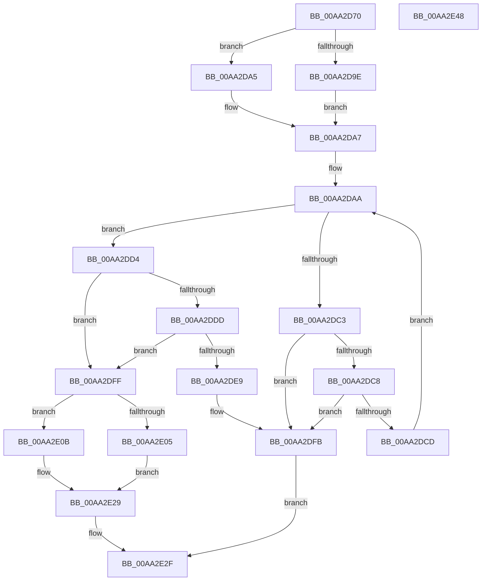

# HalpDmaAllocateScatterMemory

- RVA: `0x00AA2D70`–`0x00AA2E49` (길이 `217` bytes)
- VA: `0x0000000140AA2D70`
- 실행 섹션: `PAGE`
- PDB 이름 있음: `예`; PDB Function 태그: `아니요`
- unwind 정보 RVA: `0x00084C9C`
- 디코드: `67`개 명령, `217/217` bytes 표시
- 미해석 바이트: `0` (있으면 어셈블리에 `.byte`로 보존)

> 이 문서는 커널 이미지의 기계어와 PDB 기호를 분석해 생성했습니다. 4번과 5번은 함수 원형과 자료형을 바이너리 사용 방식에서 추정한 C 해석이며 원본 소스 복구 결과는 아닙니다.

## 1. Dependencies

- 직접 호출 지점: **5**; 고유 호출 대상: **5**
- 직접 호출자로 확인된 함수: **2**
- RIP 상대 이미지 참조: **1**

### Outgoing calls
- `0x00AA2DB6` → [MmAllocatePagesForMdl](../../text/3E/MmAllocatePagesForMdl_function_003EA840.md) (function, `0x003EA840`)
- `0x00AA2DE0` → [HalpDmaCvmMakeMdlDeviceShared](../70/HalpDmaCvmMakeMdlDeviceShared_function_00709634.md) (function, `0x00709634`)
- `0x00AA2DEC` → [MmFreePagesFromMdl](../../text/3F/MmFreePagesFromMdl_function_003F82E0.md) (function, `0x003F82E0`)
- `0x00AA2DF6` → [ExFreePoolWithTag](../../poolcode/B8/ExFreePoolWithTag_function_00B82870.md) (function, `0x00B82870`)
- `0x00AA2E24` → [MmMapLockedPagesSpecifyCache](../../text/31/MmMapLockedPagesSpecifyCache_function_00318800.md) (function, `0x00318800`)

### Direct callers
- [HalpDmaAllocateLocalScatterPool](../70/HalpDmaAllocateLocalScatterPool_function_007091D4.md) at `0x007091FF`
- [HalpDmaGrowScatterMapBuffers](HalpDmaGrowScatterMapBuffers_function_00AA2CF0.md) at `0x00AA2D08`

### Static image references
- `0x00AA2DD4` → RVA `0x00FC18A0` (`.data`; read)

## 2. Other-region calls and transfers

- 다른 실행 섹션으로 향하는 call: **4**
  - `0x00AA2DB6` → [MmAllocatePagesForMdl](../../text/3E/MmAllocatePagesForMdl_function_003EA840.md) (`PAGE` → `.text`)
  - `0x00AA2DEC` → [MmFreePagesFromMdl](../../text/3F/MmFreePagesFromMdl_function_003F82E0.md) (`PAGE` → `.text`)
  - `0x00AA2DF6` → [ExFreePoolWithTag](../../poolcode/B8/ExFreePoolWithTag_function_00B82870.md) (`PAGE` → `POOLCODE`)
  - `0x00AA2E24` → [MmMapLockedPagesSpecifyCache](../../text/31/MmMapLockedPagesSpecifyCache_function_00318800.md) (`PAGE` → `.text`)
- 별도 외부 분기/꼬리 이동을 확인하지 못했습니다.

## 3. Assembly (complete function range)

```asm
00AA2D70  48 89 5C 24 08                  mov qword ptr [rsp + 8], rbx
00AA2D75  48 89 6C 24 10                  mov qword ptr [rsp + 0x10], rbp
00AA2D7A  48 89 74 24 18                  mov qword ptr [rsp + 0x18], rsi
00AA2D7F  57                              push rdi
00AA2D80  41 56                           push r14
00AA2D82  41 57                           push r15
00AA2D84  48 83 EC 30                     sub rsp, 0x30
00AA2D88  48 8B B9 90 00 00 00            mov rdi, qword ptr [rcx + 0x90]
00AA2D8F  4D 8B F8                        mov r15, r8
00AA2D92  44 8B F2                        mov r14d, edx
00AA2D95  49 C1 E6 0C                     shl r14, 0xc
00AA2D99  83 FF FF                        cmp edi, -1
00AA2D9C  75 07                           jne 0x140aa2da5
00AA2D9E  BB 00 00 00 01                  mov ebx, 0x1000000
00AA2DA3  EB 02                           jmp 0x140aa2da7
00AA2DA5  33 DB                           xor ebx, ebx
00AA2DA7  40 32 ED                        xor bpl, bpl
00AA2DAA  4D 8B CE                        mov r9, r14
00AA2DAD  45 33 C0                        xor r8d, r8d
00AA2DB0  48 8B D7                        mov rdx, rdi
00AA2DB3  48 8B CB                        mov rcx, rbx
00AA2DB6  E8 85 7A 94 FF                  call 0x1403ea840
00AA2DBB  48 8B F0                        mov rsi, rax
00AA2DBE  48 85 C0                        test rax, rax
00AA2DC1  75 11                           jne 0x140aa2dd4
00AA2DC3  40 84 ED                        test bpl, bpl
00AA2DC6  75 33                           jne 0x140aa2dfb
00AA2DC8  48 85 DB                        test rbx, rbx
00AA2DCB  74 2E                           je 0x140aa2dfb
00AA2DCD  40 B5 01                        mov bpl, 1
00AA2DD0  33 DB                           xor ebx, ebx
00AA2DD2  EB D6                           jmp 0x140aa2daa
00AA2DD4  80 3D C5 EA 51 00 00            cmp byte ptr [rip + 0x51eac5], 0
00AA2DDB  74 22                           je 0x140aa2dff
00AA2DDD  48 8B CE                        mov rcx, rsi
00AA2DE0  E8 4F 68 C6 FF                  call 0x140709634
00AA2DE5  85 C0                           test eax, eax
00AA2DE7  79 16                           jns 0x140aa2dff
00AA2DE9  48 8B CE                        mov rcx, rsi
00AA2DEC  E8 EF 54 95 FF                  call 0x1403f82e0
00AA2DF1  33 D2                           xor edx, edx
00AA2DF3  48 8B CE                        mov rcx, rsi
00AA2DF6  E8 75 FA 0D 00                  call 0x140b82870
00AA2DFB  33 C0                           xor eax, eax
00AA2DFD  EB 30                           jmp 0x140aa2e2f
00AA2DFF  F6 46 0A 05                     test byte ptr [rsi + 0xa], 5
00AA2E03  74 06                           je 0x140aa2e0b
00AA2E05  48 8B 46 18                     mov rax, qword ptr [rsi + 0x18]
00AA2E09  EB 1E                           jmp 0x140aa2e29
00AA2E0B  45 33 C9                        xor r9d, r9d
00AA2E0E  C7 44 24 28 20 00 00 40         mov dword ptr [rsp + 0x28], 0x40000020
00AA2E16  83 64 24 20 00                  and dword ptr [rsp + 0x20], 0
00AA2E1B  33 D2                           xor edx, edx
00AA2E1D  48 8B CE                        mov rcx, rsi
00AA2E20  45 8D 41 01                     lea r8d, [r9 + 1]
00AA2E24  E8 D7 59 87 FF                  call 0x140318800
00AA2E29  49 89 07                        mov qword ptr [r15], rax
00AA2E2C  48 8B C6                        mov rax, rsi
00AA2E2F  48 8B 5C 24 50                  mov rbx, qword ptr [rsp + 0x50]
00AA2E34  48 8B 6C 24 58                  mov rbp, qword ptr [rsp + 0x58]
00AA2E39  48 8B 74 24 60                  mov rsi, qword ptr [rsp + 0x60]
00AA2E3E  48 83 C4 30                     add rsp, 0x30
00AA2E42  41 5F                           pop r15
00AA2E44  41 5E                           pop r14
00AA2E46  5F                              pop rdi
00AA2E47  C3                              ret
00AA2E48  CC                              int3
```

## 4. C-style interpretation (structured pseudocode)

```c
__int64 __fastcall HalpDmaAllocateScatterMemory(__int64 a1, int a2, __int64 a3)
{
    __int64 result;
    __int64 v_r14;
    __int64 v_rbp;
    __int64 v_rbx;
    __int64 v_rsp;
    unsigned int v_stack_m20;
    unsigned int v_stack_m28;
    unsigned __int64 v_stack_p10;
    unsigned __int64 v_stack_p18;
    unsigned __int64 v_stack_p8;

    v_stack_p8 = v_rbx;
    v_stack_p10 = v_rbp;
    v_stack_p18 = v_rsi;
    v_rsp = (v_rsp) - (48);
    v_r14 = ((unsigned int)(a2)) << (12);
    if (((unsigned int)(*(unsigned __int64 *)(a1 + 144))) != -1) goto loc_00AA2DA5;
    goto loc_00AA2DA7;
loc_00AA2DA5:
    v_rbx = 0;
loc_00AA2DA7:
    v_rbp = 0;
loc_00AA2DAA:
    a3 = 0;
    result = MmAllocatePagesForMdl(0, *(unsigned __int64 *)(a1 + 144), a3, v_r14);
    if (result != 0) goto loc_00AA2DD4;
    if (0 != 0) goto loc_00AA2DFB;
    if (0 == 0) goto loc_00AA2DFB;
    v_rbx = 0;
    goto loc_00AA2DAA;
loc_00AA2DD4:
    if ((*(unsigned __int8 *)(v_rip + 5368517)) == 0) goto loc_00AA2DFF;
    result = HalpDmaCvmMakeMdlDeviceShared(result, *(unsigned __int64 *)(a1 + 144), a3, v_r14);
    if (!sign_flag) goto loc_00AA2DFF;
    result = MmFreePagesFromMdl(result, *(unsigned __int64 *)(a1 + 144), a3, v_r14);
    a2 = 0;
    result = ExFreePoolWithTag(result, a2, a3, v_r14);
loc_00AA2DFB:
    result = 0;
    goto loc_00AA2E2F;
loc_00AA2DFF:
    if (((*(unsigned __int8 *)(result + 10)) & (5)) == 0) goto loc_00AA2E0B;
    goto loc_00AA2E29;
loc_00AA2E0B:
    a4 = 0;
    v_stack_m20 = 0x40000020ULL;
    a2 = 0;
    result = MmMapLockedPagesSpecifyCache(0, a2, a4 + 1, a4);
loc_00AA2E29:
    *(unsigned __int64 *)(a3) = result;
loc_00AA2E2F:
    v_rsp = (v_rsp) + (48);
    return result;
}
```

## 5. (Beta) C Style

```c
int64_t HalpDmaAllocateScatterMemory(void *Arg1, int32_t Arg2, void *Arg3)
{
    uint8_t *arg1 = (uint8_t *)Arg1;
    uint8_t *arg3 = (uint8_t *)Arg3;

    int64_t result;
    int64_t local_r14;
    int64_t local_rbp;
    int64_t local_rbx;
    int64_t local_rsp;
    uint32_t v_stack_m20;
    uint32_t v_stack_m28;
    uint64_t v_stack_p10;
    uint64_t v_stack_p18;
    uint64_t v_stack_p8;

    v_stack_p8 = local_rbx;
    v_stack_p10 = local_rbp;
    v_stack_p18 = local_rsi;
    local_rsp = (local_rsp) - (48);
    local_r14 = ((uint32_t)(Arg2)) << (12);
    if (((uint32_t)(*(uint64_t *)(arg1 + 0x90))) != -1) goto loc_00AA2DA5;
    goto loc_00AA2DA7;
loc_00AA2DA5:
    local_rbx = 0;
loc_00AA2DA7:
    local_rbp = 0;
loc_00AA2DAA:
    Arg3 = 0;
    result = MmAllocatePagesForMdl(0, *(uint64_t *)(arg1 + 0x90), Arg3, local_r14);
    if (result != 0) goto loc_00AA2DD4;
    if (0 != 0) goto loc_00AA2DFB;
    if (0 == 0) goto loc_00AA2DFB;
    local_rbx = 0;
    goto loc_00AA2DAA;
loc_00AA2DD4:
    if ((*(uint8_t *)(v_rip + 0x51EAC5)) == 0) goto loc_00AA2DFF;
    result = HalpDmaCvmMakeMdlDeviceShared(result, *(uint64_t *)(arg1 + 0x90), Arg3, local_r14);
    if (!sign_flag) goto loc_00AA2DFF;
    result = MmFreePagesFromMdl(result, *(uint64_t *)(arg1 + 0x90), Arg3, local_r14);
    Arg2 = 0;
    result = ExFreePoolWithTag(result, Arg2, Arg3, local_r14);
loc_00AA2DFB:
    result = 0;
    goto loc_00AA2E2F;
loc_00AA2DFF:
    if (((*(uint8_t *)(result + 0xA)) & (5)) == 0) goto loc_00AA2E0B;
    goto loc_00AA2E29;
loc_00AA2E0B:
    a4 = 0;
    v_stack_m20 = 0x40000020ULL;
    Arg2 = 0;
    result = MmMapLockedPagesSpecifyCache(0, Arg2, a4 + 1, a4);
loc_00AA2E29:
    *(uint64_t *)(arg3) = result;
loc_00AA2E2F:
    local_rsp = (local_rsp) + (48);
    return result;
}
```

### 관측된 메모리 오프셋

구조체 형식이 확인되지 않은 접근은 인자 기준의 오프셋으로만 기록했습니다.

| 기준 인자 | 오프셋 표현 | 폭 (bit) | 접근 |
|---|---:|---:|---|
| `Arg1` | `+ 0x90` | `64` | `R` |
| `Arg3` | `+ 0x0` | `64` | `W` |

## 6. Execution-region graph

[열기: 2D/3D 그래프와 함수 탐색 컨트롤 패널](../../../control-panel.html?section=page&rva=0x00AA2D70&view=graph)

- 2D 그래프는 위에서 아래로 흐르고, 3D 그래프는 빈 공간을 드래그해 회전합니다. Shift+드래그는 이동, 휠은 확대·축소, 함수 노드 선택은 대상 보고서 이동입니다.

### Static fallback


