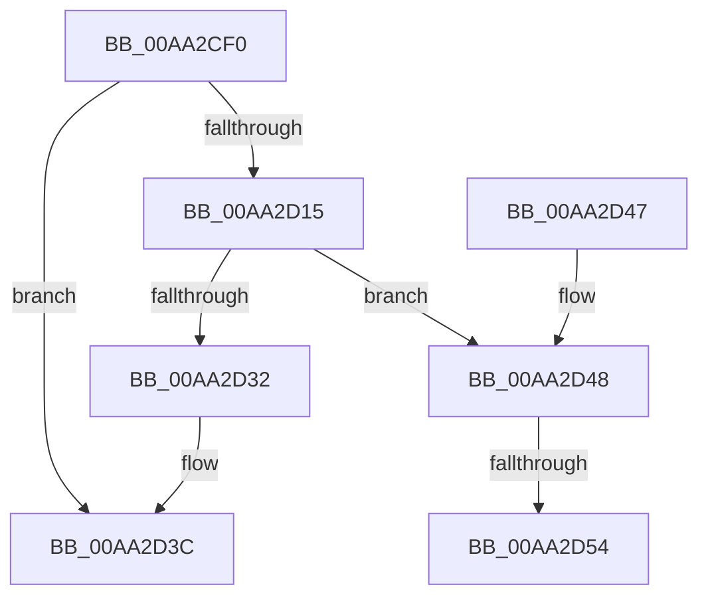

# HalpDmaGrowScatterMapBuffers

- RVA: `0x00AA2CF0`–`0x00AA2D67` (길이 `119` bytes)
- VA: `0x0000000140AA2CF0`
- 실행 섹션: `PAGE`
- PDB 이름 있음: `예`; PDB Function 태그: `예`
- unwind 정보 RVA: `0x000BB248`
- 디코드: `33`개 명령, `119/119` bytes 표시
- 미해석 바이트: `0` (있으면 어셈블리에 `.byte`로 보존)

> 이 문서는 커널 이미지의 기계어와 PDB 기호를 분석해 생성했습니다. 4번과 5번은 함수 원형과 자료형을 바이너리 사용 방식에서 추정한 C 해석이며 원본 소스 복구 결과는 아닙니다.

## 1. Dependencies

- 직접 호출 지점: **4**; 고유 호출 대상: **4**
- 직접 호출자로 확인된 함수: **2**
- RIP 상대 이미지 참조: **0**

### Outgoing calls
- `0x00AA2D08` → [HalpDmaAllocateScatterMemory](HalpDmaAllocateScatterMemory_function_00AA2D70.md) (function, `0x00AA2D70`)
- `0x00AA2D28` → [HalpDmaCommitScatterMapBuffers](../../text/49/HalpDmaCommitScatterMapBuffers_function_0049A9D0.md) (function, `0x0049A9D0`)
- `0x00AA2D37` → [ExFreePoolWithTag](../../poolcode/B8/ExFreePoolWithTag_function_00B82870.md) (function, `0x00B82870`)
- `0x00AA2D5C` → [MmUnmapLockedPages](../../text/24/MmUnmapLockedPages_function_00246E60.md) (function, `0x00246E60`)

### Direct callers
- [HalpGrowMapBufferWorker](../../text/4C/HalpGrowMapBufferWorker_function_004C09B0.md) at `0x004C09E7`
- [HalpAllocateMapRegisters](../70/HalpAllocateMapRegisters_function_00707640.md) at `0x007076FC`

### Static image references
- 디코드된 RIP-relative 메모리 참조가 없습니다.

## 2. Other-region calls and transfers

- 다른 실행 섹션으로 향하는 call: **3**
  - `0x00AA2D28` → [HalpDmaCommitScatterMapBuffers](../../text/49/HalpDmaCommitScatterMapBuffers_function_0049A9D0.md) (`PAGE` → `.text`)
  - `0x00AA2D37` → [ExFreePoolWithTag](../../poolcode/B8/ExFreePoolWithTag_function_00B82870.md) (`PAGE` → `POOLCODE`)
  - `0x00AA2D5C` → [MmUnmapLockedPages](../../text/24/MmUnmapLockedPages_function_00246E60.md) (`PAGE` → `.text`)
- call이 아닌 외부 분기/꼬리 이동: **2**
  - `0x00AA2D4E` → [sub_00B49968](../B4/Unknown_function_00B49968.md) (`tail-transfer`)
  - `0x00AA2D62` → [sub_00B49968](../B4/Unknown_function_00B49968.md) (`tail-transfer`)

## 3. Assembly (complete function range)

```asm
00AA2CF0  48 89 5C 24 08                  mov qword ptr [rsp + 8], rbx
00AA2CF5  56                              push rsi
00AA2CF6  48 83 EC 30                     sub rsp, 0x30
00AA2CFA  48 83 64 24 50 00               and qword ptr [rsp + 0x50], 0
00AA2D00  4C 8D 44 24 50                  lea r8, [rsp + 0x50]
00AA2D05  48 8B F1                        mov rsi, rcx
00AA2D08  E8 63 00 00 00                  call 0x140aa2d70
00AA2D0D  48 8B D8                        mov rbx, rax
00AA2D10  48 85 C0                        test rax, rax
00AA2D13  74 27                           je 0x140aa2d3c
00AA2D15  48 8B 54 24 50                  mov rdx, qword ptr [rsp + 0x50]
00AA2D1A  45 33 C9                        xor r9d, r9d
00AA2D1D  45 33 C0                        xor r8d, r8d
00AA2D20  48 89 44 24 20                  mov qword ptr [rsp + 0x20], rax
00AA2D25  48 8B CE                        mov rcx, rsi
00AA2D28  E8 A3 7C 9F FF                  call 0x14049a9d0
00AA2D2D  48 85 C0                        test rax, rax
00AA2D30  74 16                           je 0x140aa2d48
00AA2D32  33 D2                           xor edx, edx
00AA2D34  48 8B CB                        mov rcx, rbx
00AA2D37  E8 34 FB 0D 00                  call 0x140b82870
00AA2D3C  48 8B 5C 24 40                  mov rbx, qword ptr [rsp + 0x40]
00AA2D41  48 83 C4 30                     add rsp, 0x30
00AA2D45  5E                              pop rsi
00AA2D46  C3                              ret
00AA2D47  CC                              int3
00AA2D48  48 83 7C 24 50 00               cmp qword ptr [rsp + 0x50], 0
00AA2D4E  0F 84 14 6C 0A 00               je 0x140b49968
00AA2D54  48 8B 4C 24 50                  mov rcx, qword ptr [rsp + 0x50]
00AA2D59  48 8B D3                        mov rdx, rbx
00AA2D5C  E8 FF 40 7A FF                  call 0x140246e60
00AA2D61  90                              nop
00AA2D62  E9 01 6C 0A 00                  jmp 0x140b49968
```

## 4. C-style interpretation (structured pseudocode)

```c
__int64 __fastcall HalpDmaGrowScatterMapBuffers(__int64 a1, __int64 a2, __int64 a3, int a4)
{
    __int64 result;
    __int64 v_rsp;
    unsigned __int64 v_stack_m18;
    unsigned __int64 v_stack_p18;
    unsigned __int64 v_stack_p50;
    unsigned __int64 v_stack_p8;

    v_stack_p8 = v_rbx;
    v_rsp = (v_rsp) - (48);
    result = HalpDmaAllocateScatterMemory(a1, a2, v_stack_p18, a4);
    if (result == 0) goto loc_00AA2D3C;
    a4 = 0;
    a3 = 0;
    v_stack_m18 = result;
    result = HalpDmaCommitScatterMapBuffers(a1, v_stack_p18, a3, a4);
    if (result == 0) goto loc_00AA2D48;
    a2 = 0;
    result = ExFreePoolWithTag(result, a2, a3, a4);
loc_00AA2D3C:
    v_rsp = (v_rsp) + (48);
    return result;
loc_00AA2D48:
    result = MmUnmapLockedPages(v_stack_p50, v_stack_p8, a3, a4);
}
```

## 5. (Beta) C Style

```c
int64_t HalpDmaGrowScatterMapBuffers(int64_t Arg1, int64_t Arg2, int64_t Arg3, int32_t Arg4)
{
    int64_t result;
    int64_t local_rsp;
    uint64_t v_stack_m18;
    uint64_t v_stack_p18;
    uint64_t v_stack_p50;
    uint64_t v_stack_p8;

    v_stack_p8 = local_rbx;
    local_rsp = (local_rsp) - (48);
    result = HalpDmaAllocateScatterMemory(Arg1, Arg2, v_stack_p18, Arg4);
    if (result == 0) goto loc_00AA2D3C;
    Arg4 = 0;
    Arg3 = 0;
    v_stack_m18 = result;
    result = HalpDmaCommitScatterMapBuffers(Arg1, v_stack_p18, Arg3, Arg4);
    if (result == 0) goto loc_00AA2D48;
    Arg2 = 0;
    result = ExFreePoolWithTag(result, Arg2, Arg3, Arg4);
loc_00AA2D3C:
    local_rsp = (local_rsp) + (48);
    return result;
loc_00AA2D48:
    result = MmUnmapLockedPages(v_stack_p50, v_stack_p8, Arg3, Arg4);
}
```

## 6. Execution-region graph

[열기: 2D/3D 그래프와 함수 탐색 컨트롤 패널](../../../control-panel.html?section=page&rva=0x00AA2CF0&view=graph)

- 2D 그래프는 위에서 아래로 흐르고, 3D 그래프는 빈 공간을 드래그해 회전합니다. Shift+드래그는 이동, 휠은 확대·축소, 함수 노드 선택은 대상 보고서 이동입니다.

### Static fallback


