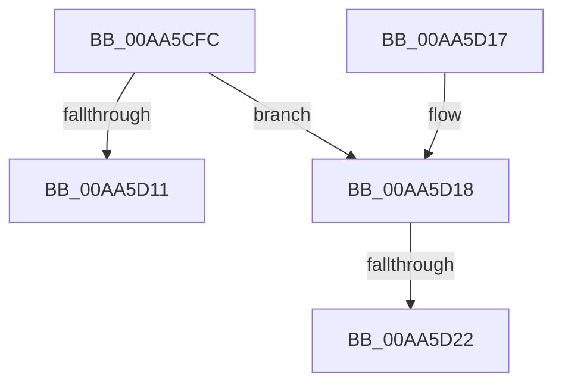

# HvUnlockHiveFilePages

- RVA: `0x00AA5CFC`–`0x00AA5D3B` (길이 `63` bytes)
- VA: `0x0000000140AA5CFC`
- 실행 섹션: `PAGE`
- PDB 이름 있음: `예`; PDB Function 태그: `예`
- unwind 정보 RVA: `0x000795DC`
- 디코드: `18`개 명령, `63/63` bytes 표시
- 미해석 바이트: `0` (있으면 어셈블리에 `.byte`로 보존)

> 이 문서는 커널 이미지의 기계어와 PDB 기호를 분석해 생성했습니다. 4번과 5번은 함수 원형과 자료형을 바이너리 사용 방식에서 추정한 C 해석이며 원본 소스 복구 결과는 아닙니다.

## 1. Dependencies

- 직접 호출 지점: **1**; 고유 호출 대상: **1**
- 직접 호출자로 확인된 함수: **1**
- RIP 상대 이미지 참조: **0**

### Outgoing calls
- `0x00AA5D30` → [HvpViewMapAdjustFlag](../AC/HvpViewMapAdjustFlag_function_00ACDDA4.md) (function, `0x00ACDDA4`)

### Direct callers
- [sub_006F34C4](../../text/6F/Unknown_function_006F34C4.md) at `0x006F3517`

### Static image references
- 디코드된 RIP-relative 메모리 참조가 없습니다.

## 2. Other-region calls and transfers

- 다른 실행 섹션으로 향하는 call: **0**
- call이 아닌 외부 분기/꼬리 이동: **2**
  - `0x00AA5D1C` → [sub_00B49E0E](../B4/Unknown_function_00B49E0E.md) (`tail-transfer`)
  - `0x00AA5D36` → [sub_00B49E0E](../B4/Unknown_function_00B49E0E.md) (`tail-transfer`)

## 3. Assembly (complete function range)

```asm
00AA5CFC  40 53                           push rbx
00AA5CFE  48 83 EC 20                     sub rsp, 0x20
00AA5D02  8B 81 A0 00 00 00               mov eax, dword ptr [rcx + 0xa0]
00AA5D08  48 8B D9                        mov rbx, rcx
00AA5D0B  0F BA E0 17                     bt eax, 0x17
00AA5D0F  72 07                           jb 0x140aa5d18
00AA5D11  48 83 C4 20                     add rsp, 0x20
00AA5D15  5B                              pop rbx
00AA5D16  C3                              ret
00AA5D17  CC                              int3
00AA5D18  0F BA E0 11                     bt eax, 0x11
00AA5D1C  0F 83 EC 40 0A 00               jae 0x140b49e0e
00AA5D22  45 33 C0                        xor r8d, r8d
00AA5D25  48 81 C1 E0 00 00 00            add rcx, 0xe0
00AA5D2C  41 8D 50 02                     lea edx, [r8 + 2]
00AA5D30  E8 6F 80 02 00                  call 0x140acdda4
00AA5D35  90                              nop
00AA5D36  E9 D3 40 0A 00                  jmp 0x140b49e0e
```

## 4. C-style interpretation (structured pseudocode)

```c
__int64 __fastcall HvUnlockHiveFilePages(__int64 a1, __int64 a2, int a3)
{
    __int64 result;
    __int64 v_rsp;

    v_rsp = (v_rsp) - (32);
    if (condition_is_below) goto loc_00AA5D18;
    v_rsp = (v_rsp) + (32);
    return (unsigned int)(*(unsigned int *)(a1 + 160));
loc_00AA5D18:
    a3 = 0;
    a1 = (a1) + (224);
    result = HvpViewMapAdjustFlag(a1, a3 + 2, a3, a4);
}
```

## 5. (Beta) C Style

```c
int64_t HvUnlockHiveFilePages(void *Arg1, int64_t Arg2, int32_t Arg3)
{
    uint8_t *arg1 = (uint8_t *)Arg1;

    int64_t result;
    int64_t local_rsp;

    local_rsp = (local_rsp) - (32);
    if (condition_is_below) goto loc_00AA5D18;
    local_rsp = (local_rsp) + (32);
    return (uint32_t)(*(uint32_t *)(arg1 + 0xA0));
loc_00AA5D18:
    Arg3 = 0;
    Arg1 = (Arg1) + (224);
    result = HvpViewMapAdjustFlag(Arg1, Arg3 + 2, Arg3, a4);
}
```

### 관측된 메모리 오프셋

구조체 형식이 확인되지 않은 접근은 인자 기준의 오프셋으로만 기록했습니다.

| 기준 인자 | 오프셋 표현 | 폭 (bit) | 접근 |
|---|---:|---:|---|
| `Arg1` | `+ 0xA0` | `32` | `R` |

## 6. Execution-region graph

[열기: 2D/3D 그래프와 함수 탐색 컨트롤 패널](../../../control-panel.html?section=page&rva=0x00AA5CFC&view=graph)

- 2D 그래프는 위에서 아래로 흐르고, 3D 그래프는 빈 공간을 드래그해 회전합니다. Shift+드래그는 이동, 휠은 확대·축소, 함수 노드 선택은 대상 보고서 이동입니다.

### Static fallback


