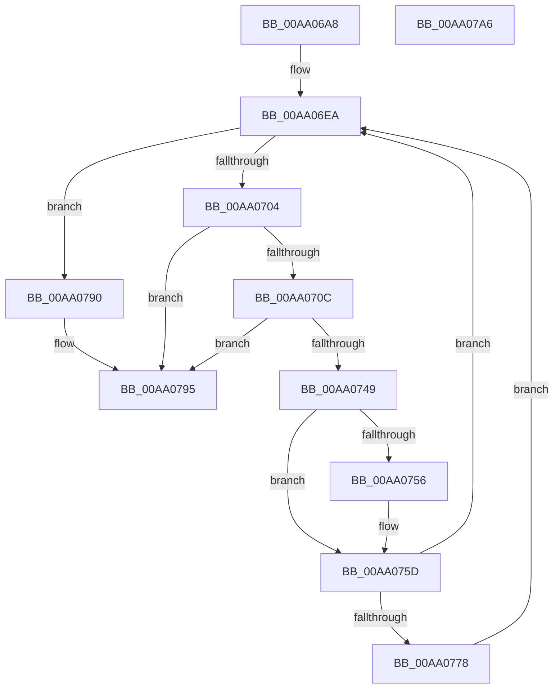

# HvpApplyIncrementalLogFile

- RVA: `0x00AA06A8`–`0x00AA07A7` (길이 `255` bytes)
- VA: `0x0000000140AA06A8`
- 실행 섹션: `PAGE`
- PDB 이름 있음: `예`; PDB Function 태그: `아니요`
- unwind 정보 RVA: `0x000BAB60`
- 디코드: `62`개 명령, `255/255` bytes 표시
- 미해석 바이트: `0` (있으면 어셈블리에 `.byte`로 보존)

> 이 문서는 커널 이미지의 기계어와 PDB 기호를 분석해 생성했습니다. 4번과 5번은 함수 원형과 자료형을 바이너리 사용 방식에서 추정한 C 해석이며 원본 소스 복구 결과는 아닙니다.

## 1. Dependencies

- 직접 호출 지점: **4**; 고유 호출 대상: **4**
- 직접 호출자로 확인된 함수: **1**
- RIP 상대 이미지 참조: **0**

### Outgoing calls
- `0x00AA06F4` → [HvpIncrementalLogFileEnumeratorAdvance](HvpIncrementalLogFileEnumeratorAdvance_function_00AA07B0.md) (function, `0x00AA07B0`)
- `0x00AA0740` → [HvpApplyLogEntryDataToFileBackedHive](../9B/HvpApplyLogEntryDataToFileBackedHive_function_009B6FF8.md) (function, `0x009B6FF8`)
- `0x00AA0764` → [CmpTraceHiveMountLogEntryApplied](../7E/CmpTraceHiveMountLogEntryApplied_function_007E6588.md) (function, `0x007E6588`)
- `0x00AA0786` → [HvpUpdateRecoveryVector](../AB/HvpUpdateRecoveryVector_function_00AB5E70.md) (function, `0x00AB5E70`)

### Direct callers
- [HvApplyLogFiles](../7F/HvApplyLogFiles_function_007F65E8.md) at `0x007F667C`

### Static image references
- 디코드된 RIP-relative 메모리 참조가 없습니다.

## 2. Other-region calls and transfers

- 다른 실행 섹션으로 향하는 call: **0**
- 별도 외부 분기/꼬리 이동을 확인하지 못했습니다.

## 3. Assembly (complete function range)

```asm
00AA06A8  4C 8B DC                        mov r11, rsp
00AA06AB  49 89 5B 08                     mov qword ptr [r11 + 8], rbx
00AA06AF  49 89 7B 18                     mov qword ptr [r11 + 0x18], rdi
00AA06B3  4D 89 4B 20                     mov qword ptr [r11 + 0x20], r9
00AA06B7  41 56                           push r14
00AA06B9  48 83 EC 50                     sub rsp, 0x50
00AA06BD  48 8B 42 08                     mov rax, qword ptr [rdx + 8]
00AA06C1  48 8B F9                        mov rdi, rcx
00AA06C4  83 64 24 78 00                  and dword ptr [rsp + 0x78], 0
00AA06C9  49 83 63 10 00                  and qword ptr [r11 + 0x10], 0
00AA06CE  49 89 43 E0                     mov qword ptr [r11 - 0x20], rax
00AA06D2  48 8B 42 10                     mov rax, qword ptr [rdx + 0x10]
00AA06D6  49 89 43 E8                     mov qword ptr [r11 - 0x18], rax
00AA06DA  41 8B 40 08                     mov eax, dword ptr [r8 + 8]
00AA06DE  89 44 24 34                     mov dword ptr [rsp + 0x34], eax
00AA06E2  C7 44 24 30 00 02 00 00         mov dword ptr [rsp + 0x30], 0x200
00AA06EA  48 8D 54 24 68                  lea rdx, [rsp + 0x68]
00AA06EF  48 8D 4C 24 30                  lea rcx, [rsp + 0x30]
00AA06F4  E8 B7 00 00 00                  call 0x140aa07b0
00AA06F9  3D 1A 00 00 80                  cmp eax, 0x8000001a
00AA06FE  0F 84 8C 00 00 00               je 0x140aa0790
00AA0704  85 C0                           test eax, eax
00AA0706  0F 88 89 00 00 00               js 0x140aa0795
00AA070C  48 8B 5C 24 68                  mov rbx, qword ptr [rsp + 0x68]
00AA0711  48 8D 4C 24 78                  lea rcx, [rsp + 0x78]
00AA0716  48 89 4C 24 28                  mov qword ptr [rsp + 0x28], rcx
00AA071B  48 8B D3                        mov rdx, rbx
00AA071E  48 8B 8C 24 80 00 00 00         mov rcx, qword ptr [rsp + 0x80]
00AA0726  8B 43 14                        mov eax, dword ptr [rbx + 0x14]
00AA0729  4C 8D 73 28                     lea r14, [rbx + 0x28]
00AA072D  4D 8B C6                        mov r8, r14
00AA0730  4D 8D 0C C6                     lea r9, [r14 + rax*8]
00AA0734  8B 43 04                        mov eax, dword ptr [rbx + 4]
00AA0737  41 2B C1                        sub eax, r9d
00AA073A  03 C3                           add eax, ebx
00AA073C  89 44 24 20                     mov dword ptr [rsp + 0x20], eax
00AA0740  E8 B3 68 F1 FF                  call 0x1409b6ff8
00AA0745  85 C0                           test eax, eax
00AA0747  78 4C                           js 0x140aa0795
00AA0749  8B 43 10                        mov eax, dword ptr [rbx + 0x10]
00AA074C  89 47 28                        mov dword ptr [rdi + 0x28], eax
00AA074F  8B 43 08                        mov eax, dword ptr [rbx + 8]
00AA0752  A8 01                           test al, 1
00AA0754  74 07                           je 0x140aa075d
00AA0756  83 8F 90 00 00 00 01            or dword ptr [rdi + 0x90], 1
00AA075D  8B 54 24 78                     mov edx, dword ptr [rsp + 0x78]
00AA0761  8B 4B 04                        mov ecx, dword ptr [rbx + 4]
00AA0764  E8 1F 5E D4 FF                  call 0x1407e6588
00AA0769  48 83 BC 24 88 00 00 00 00      cmp qword ptr [rsp + 0x88], 0
00AA0772  0F 84 72 FF FF FF               je 0x140aa06ea
00AA0778  4C 8B 84 24 88 00 00 00         mov r8, qword ptr [rsp + 0x88]
00AA0780  49 8B CE                        mov rcx, r14
00AA0783  8B 53 14                        mov edx, dword ptr [rbx + 0x14]
00AA0786  E8 E5 56 01 00                  call 0x140ab5e70
00AA078B  E9 5A FF FF FF                  jmp 0x140aa06ea
00AA0790  B8 09 00 00 40                  mov eax, 0x40000009
00AA0795  48 8B 5C 24 60                  mov rbx, qword ptr [rsp + 0x60]
00AA079A  48 8B 7C 24 70                  mov rdi, qword ptr [rsp + 0x70]
00AA079F  48 83 C4 50                     add rsp, 0x50
00AA07A3  41 5E                           pop r14
00AA07A5  C3                              ret
00AA07A6  CC                              int3
```

## 4. C-style interpretation (structured pseudocode)

```c
__int64 __fastcall HvpApplyIncrementalLogFile(__int64 a1, __int64 a2, __int64 a3, __int64 a4, __int64 a5, __int64 a6)
{
    __int64 result;
    __int64 v_rsp;
    unsigned int v_stack_m24;
    unsigned int v_stack_m28;
    unsigned __int64 v_stack_m30;
    unsigned int v_stack_m38;
    unsigned __int64 v_stack_p10;
    unsigned __int64 v_stack_p18;
    unsigned int v_stack_p20;
    unsigned __int64 v_stack_p8;

    *(unsigned __int64 *)(v_rsp + 8) = v_rbx;
    *(unsigned __int64 *)(v_rsp + 24) = v_rdi;
    *(unsigned __int64 *)(v_rsp + 32) = a4;
    v_rsp = (v_rsp) - (80);
    *(unsigned __int64 *)(v_rsp - 32) = *(unsigned __int64 *)(a2 + 8);
    *(unsigned __int64 *)(v_rsp - 24) = *(unsigned __int64 *)(a2 + 16);
    v_stack_m24 = (unsigned int)((unsigned int)(*(unsigned int *)(a3 + 8)));
    v_stack_m28 = 512;
loc_00AA06EA:
    result = HvpIncrementalLogFileEnumeratorAdvance(v_stack_m28, v_stack_p10, a3, a4);
    if (((unsigned int)(result)) == 0x8000001AULL) goto loc_00AA0790;
    if (sign_flag) goto loc_00AA0795;
    v_stack_m30 = v_stack_p20;
    result = (unsigned int)(((unsigned int)(*(unsigned int *)(v_stack_p10 + 4))) - ((unsigned int)(v_stack_p10 + 40 + (unsigned int)(*(unsigned int *)(v_stack_p10 + 20)) * 8)));
    result = (unsigned int)((result) + ((unsigned int)(v_stack_p10)));
    v_stack_m38 = (unsigned int)(result);
    result = HvpApplyLogEntryDataToFileBackedHive(a5, v_stack_p10, v_stack_p10 + 40, v_stack_p10 + 40 + (unsigned int)(*(unsigned int *)(v_stack_p10 + 20)) * 8);
    if (sign_flag) goto loc_00AA0795;
    *(unsigned int *)(a1 + 40) = (unsigned int)((unsigned int)(*(unsigned int *)(v_stack_p10 + 16)));
    if ((((unsigned __int8)((unsigned int)(*(unsigned int *)(v_stack_p10 + 8)))) & (1)) != 0) {
    }
    result = CmpTraceHiveMountLogEntryApplied((unsigned int)(*(unsigned int *)(v_stack_p10 + 4)), (unsigned int)(v_stack_p20), v_stack_p10 + 40, v_stack_p10 + 40 + (unsigned int)(*(unsigned int *)(v_stack_p10 + 20)) * 8);
    if (a6 == 0) goto loc_00AA06EA;
    result = HvpUpdateRecoveryVector(v_stack_p10 + 40, (unsigned int)(*(unsigned int *)(v_stack_p10 + 20)), a6, v_stack_p10 + 40 + (unsigned int)(*(unsigned int *)(v_stack_p10 + 20)) * 8);
    goto loc_00AA06EA;
loc_00AA0790:
loc_00AA0795:
    v_rsp = (v_rsp) + (80);
    return (unsigned int)(0x40000009ULL);
}
```

## 5. (Beta) C Style

```c
int64_t HvpApplyIncrementalLogFile(void *Arg1, void *Arg2, void *Arg3, int64_t Arg4, int64_t Arg5, int64_t Arg6)
{
    uint8_t *arg1 = (uint8_t *)Arg1;
    uint8_t *arg2 = (uint8_t *)Arg2;
    uint8_t *arg3 = (uint8_t *)Arg3;

    int64_t result;
    int64_t local_rsp;
    uint32_t v_stack_m24;
    uint32_t v_stack_m28;
    uint64_t v_stack_m30;
    uint32_t v_stack_m38;
    uint64_t v_stack_p10;
    uint64_t v_stack_p18;
    uint32_t v_stack_p20;
    uint64_t v_stack_p8;

    *(uint64_t *)(local_rsp + 0x8) = local_rbx;
    *(uint64_t *)(local_rsp + 0x18) = local_rdi;
    *(uint64_t *)(local_rsp + 0x20) = Arg4;
    local_rsp = (local_rsp) - (80);
    *(uint64_t *)(local_rsp - 0x20) = *(uint64_t *)(arg2 + 0x8);
    *(uint64_t *)(local_rsp - 0x18) = *(uint64_t *)(arg2 + 0x10);
    v_stack_m24 = (uint32_t)((uint32_t)(*(uint32_t *)(arg3 + 0x8)));
    v_stack_m28 = 512;
loc_00AA06EA:
    result = HvpIncrementalLogFileEnumeratorAdvance(v_stack_m28, v_stack_p10, Arg3, Arg4);
    if (((uint32_t)(result)) == 0x8000001AULL) goto loc_00AA0790;
    if (sign_flag) goto loc_00AA0795;
    v_stack_m30 = v_stack_p20;
    result = (uint32_t)(((uint32_t)(*(uint32_t *)(v_stack_p10 + 0x4))) - ((uint32_t)(v_stack_p10 + 40 + (uint32_t)(*(uint32_t *)(v_stack_p10 + 0x14)) * 8)));
    result = (uint32_t)((result) + ((uint32_t)(v_stack_p10)));
    v_stack_m38 = (uint32_t)(result);
    result = HvpApplyLogEntryDataToFileBackedHive(Arg5, v_stack_p10, v_stack_p10 + 40, v_stack_p10 + 40 + (uint32_t)(*(uint32_t *)(v_stack_p10 + 0x14)) * 8);
    if (sign_flag) goto loc_00AA0795;
    *(uint32_t *)(arg1 + 0x28) = (uint32_t)((uint32_t)(*(uint32_t *)(v_stack_p10 + 0x10)));
    if ((((uint8_t)((uint32_t)(*(uint32_t *)(v_stack_p10 + 0x8)))) & (1)) != 0) {
    }
    result = CmpTraceHiveMountLogEntryApplied((uint32_t)(*(uint32_t *)(v_stack_p10 + 0x4)), (uint32_t)(v_stack_p20), v_stack_p10 + 40, v_stack_p10 + 40 + (uint32_t)(*(uint32_t *)(v_stack_p10 + 0x14)) * 8);
    if (Arg6 == 0) goto loc_00AA06EA;
    result = HvpUpdateRecoveryVector(v_stack_p10 + 40, (uint32_t)(*(uint32_t *)(v_stack_p10 + 0x14)), Arg6, v_stack_p10 + 40 + (uint32_t)(*(uint32_t *)(v_stack_p10 + 0x14)) * 8);
    goto loc_00AA06EA;
loc_00AA0790:
loc_00AA0795:
    local_rsp = (local_rsp) + (80);
    return (uint32_t)(0x40000009ULL);
}
```

### 관측된 메모리 오프셋

구조체 형식이 확인되지 않은 접근은 인자 기준의 오프셋으로만 기록했습니다.

| 기준 인자 | 오프셋 표현 | 폭 (bit) | 접근 |
|---|---:|---:|---|
| `Arg1` | `+ 0x28` | `32` | `W` |
| `Arg1` | `+ 0x90` | `32` | `R/W` |
| `Arg2` | `+ 0x8` | `64` | `R` |
| `Arg2` | `+ 0x10` | `64` | `R` |
| `Arg3` | `+ 0x8` | `32` | `R` |

## 6. Execution-region graph

[열기: 2D/3D 그래프와 함수 탐색 컨트롤 패널](../../../control-panel.html?section=page&rva=0x00AA06A8&view=graph)

- 2D 그래프는 위에서 아래로 흐르고, 3D 그래프는 빈 공간을 드래그해 회전합니다. Shift+드래그는 이동, 휠은 확대·축소, 함수 노드 선택은 대상 보고서 이동입니다.

### Static fallback


