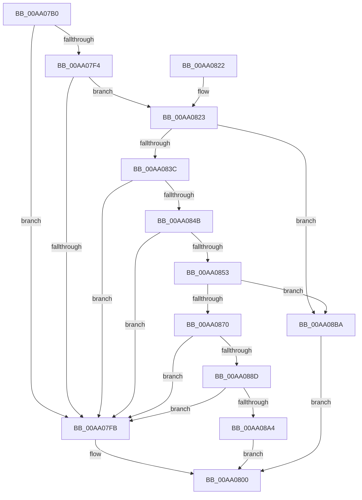

# HvpIncrementalLogFileEnumeratorAdvance

- RVA: `0x00AA07B0`–`0x00AA08D2` (길이 `290` bytes)
- VA: `0x0000000140AA07B0`
- 실행 섹션: `PAGE`
- PDB 이름 있음: `예`; PDB Function 태그: `아니요`
- unwind 정보 RVA: `0x000BAB74`
- 디코드: `90`개 명령, `290/290` bytes 표시
- 미해석 바이트: `0` (있으면 어셈블리에 `.byte`로 보존)

> 이 문서는 커널 이미지의 기계어와 PDB 기호를 분석해 생성했습니다. 4번과 5번은 함수 원형과 자료형을 바이너리 사용 방식에서 추정한 C 해석이며 원본 소스 복구 결과는 아닙니다.

## 1. Dependencies

- 직접 호출 지점: **6**; 고유 호출 대상: **6**
- 직접 호출자로 확인된 함수: **2**
- RIP 상대 이미지 참조: **1**

### Outgoing calls
- `0x00AA0809` → [_security_check_cookie](../../text/6A/_security_check_cookie_function_006AC640.md) (function, `0x006AC640`)
- `0x00AA0831` → [HvpReadLogEntryHeader](HvpReadLogEntryHeader_function_00AA08D8.md) (function, `0x00AA08D8`)
- `0x00AA0842` → [HvpIsLogEntryHeaderCoherent](HvpIsLogEntryHeaderCoherent_function_00AA0934.md) (function, `0x00AA0934`)
- `0x00AA0865` → [guard_dispatch_icall](../../text/6B/guard_dispatch_icall_function_006BAAD0.md) (function, `0x006BAAD0`)
- `0x00AA0880` → [HvpIsMetadataArrayCoherent](HvpIsMetadataArrayCoherent_function_00AA09A4.md) (function, `0x00AA09A4`)
- `0x00AA0897` → [HvpLogEntryCheckDataChecksum](../AC/HvpLogEntryCheckDataChecksum_function_00AC5BD8.md) (function, `0x00AC5BD8`)

### Direct callers
- [HvpAnalyzeSingleLogFile](../9B/HvpAnalyzeSingleLogFile_function_009BA7E4.md) at `0x009BA856`
- [HvpApplyIncrementalLogFile](HvpApplyIncrementalLogFile_function_00AA06A8.md) at `0x00AA06F4`

### Static image references
- `0x00AA07C3` → RVA `0x00E0A740` (`.data`; read)

## 2. Other-region calls and transfers

- 다른 실행 섹션으로 향하는 call: **2**
  - `0x00AA0809` → [_security_check_cookie](../../text/6A/_security_check_cookie_function_006AC640.md) (`PAGE` → `.text`)
  - `0x00AA0865` → [guard_dispatch_icall](../../text/6B/guard_dispatch_icall_function_006BAAD0.md) (`PAGE` → `.text`)
- 별도 외부 분기/꼬리 이동을 확인하지 못했습니다.

## 3. Assembly (complete function range)

```asm
00AA07B0  48 89 5C 24 18                  mov qword ptr [rsp + 0x18], rbx
00AA07B5  55                              push rbp
00AA07B6  56                              push rsi
00AA07B7  57                              push rdi
00AA07B8  41 56                           push r14
00AA07BA  41 57                           push r15
00AA07BC  48 8B EC                        mov rbp, rsp
00AA07BF  48 83 EC 70                     sub rsp, 0x70
00AA07C3  48 8B 05 76 9F 36 00            mov rax, qword ptr [rip + 0x369f76]
00AA07CA  48 33 C4                        xor rax, rsp
00AA07CD  48 89 45 F0                     mov qword ptr [rbp - 0x10], rax
00AA07D1  8B 31                           mov esi, dword ptr [rcx]
00AA07D3  33 C0                           xor eax, eax
00AA07D5  33 DB                           xor ebx, ebx
00AA07D7  48 89 45 E8                     mov qword ptr [rbp - 0x18], rax
00AA07DB  48 89 5D C0                     mov qword ptr [rbp - 0x40], rbx
00AA07DF  0F 57 C0                        xorps xmm0, xmm0
00AA07E2  4C 8B FA                        mov r15, rdx
00AA07E5  48 8B F9                        mov rdi, rcx
00AA07E8  0F 11 45 C8                     movups xmmword ptr [rbp - 0x38], xmm0
00AA07EC  0F 11 45 D8                     movups xmmword ptr [rbp - 0x28], xmm0
00AA07F0  85 F6                           test esi, esi
00AA07F2  74 07                           je 0x140aa07fb
00AA07F4  8D 46 28                        lea eax, [rsi + 0x28]
00AA07F7  3B C6                           cmp eax, esi
00AA07F9  73 28                           jae 0x140aa0823
00AA07FB  BB 1A 00 00 80                  mov ebx, 0x8000001a
00AA0800  8B C3                           mov eax, ebx
00AA0802  48 8B 4D F0                     mov rcx, qword ptr [rbp - 0x10]
00AA0806  48 33 CC                        xor rcx, rsp
00AA0809  E8 32 BE C0 FF                  call 0x1406ac640
00AA080E  48 8B 9C 24 B0 00 00 00         mov rbx, qword ptr [rsp + 0xb0]
00AA0816  48 83 C4 70                     add rsp, 0x70
00AA081A  41 5F                           pop r15
00AA081C  41 5E                           pop r14
00AA081E  5F                              pop rdi
00AA081F  5E                              pop rsi
00AA0820  5D                              pop rbp
00AA0821  C3                              ret
00AA0822  CC                              int3
00AA0823  4C 8B 41 10                     mov r8, qword ptr [rcx + 0x10]
00AA0827  4C 8D 4D C8                     lea r9, [rbp - 0x38]
00AA082B  48 8B 51 08                     mov rdx, qword ptr [rcx + 8]
00AA082F  8B CE                           mov ecx, esi
00AA0831  E8 A2 00 00 00                  call 0x140aa08d8
00AA0836  8B C8                           mov ecx, eax
00AA0838  85 C0                           test eax, eax
00AA083A  78 7E                           js 0x140aa08ba
00AA083C  8B D6                           mov edx, esi
00AA083E  48 8D 4D C8                     lea rcx, [rbp - 0x38]
00AA0842  E8 ED 00 00 00                  call 0x140aa0934
00AA0847  84 C0                           test al, al
00AA0849  74 B0                           je 0x140aa07fb
00AA084B  8B 47 04                        mov eax, dword ptr [rdi + 4]
00AA084E  39 45 D4                        cmp dword ptr [rbp - 0x2c], eax
00AA0851  75 A8                           jne 0x140aa07fb
00AA0853  48 8B 4F 10                     mov rcx, qword ptr [rdi + 0x10]
00AA0857  4C 8D 4D C0                     lea r9, [rbp - 0x40]
00AA085B  48 8B 47 08                     mov rax, qword ptr [rdi + 8]
00AA085F  8B D6                           mov edx, esi
00AA0861  44 8B 45 CC                     mov r8d, dword ptr [rbp - 0x34]
00AA0865  E8 66 A2 C1 FF                  call 0x1406baad0
00AA086A  8B C8                           mov ecx, eax
00AA086C  85 C0                           test eax, eax
00AA086E  78 4A                           js 0x140aa08ba
00AA0870  4C 8B 75 C0                     mov r14, qword ptr [rbp - 0x40]
00AA0874  48 8D 4D C8                     lea rcx, [rbp - 0x38]
00AA0878  44 8B 45 DC                     mov r8d, dword ptr [rbp - 0x24]
00AA087C  49 8D 56 28                     lea rdx, [r14 + 0x28]
00AA0880  E8 1F 01 00 00                  call 0x140aa09a4
00AA0885  84 C0                           test al, al
00AA0887  0F 84 6E FF FF FF               je 0x140aa07fb
00AA088D  8B 55 CC                        mov edx, dword ptr [rbp - 0x34]
00AA0890  4C 8D 45 C8                     lea r8, [rbp - 0x38]
00AA0894  49 8B CE                        mov rcx, r14
00AA0897  E8 3C 53 02 00                  call 0x140ac5bd8
00AA089C  85 C0                           test eax, eax
00AA089E  0F 84 57 FF FF FF               je 0x140aa07fb
00AA08A4  FF 47 04                        inc dword ptr [rdi + 4]
00AA08A7  8B 4D CC                        mov ecx, dword ptr [rbp - 0x34]
00AA08AA  48 8B 45 C0                     mov rax, qword ptr [rbp - 0x40]
00AA08AE  03 CE                           add ecx, esi
00AA08B0  89 0F                           mov dword ptr [rdi], ecx
00AA08B2  49 89 07                        mov qword ptr [r15], rax
00AA08B5  E9 46 FF FF FF                  jmp 0x140aa0800
00AA08BA  81 F9 11 00 00 C0               cmp ecx, 0xc0000011
00AA08C0  BB 1A 00 00 80                  mov ebx, 0x8000001a
00AA08C5  B8 4D 01 00 C0                  mov eax, 0xc000014d
00AA08CA  0F 45 D8                        cmovne ebx, eax
00AA08CD  E9 2E FF FF FF                  jmp 0x140aa0800
```

## 4. C-style interpretation (structured pseudocode)

```c
__int64 __fastcall HvpIncrementalLogFileEnumeratorAdvance(__int64 a1, __int64 a2)
{
    __int64 result;
    __int64 v_rbx;
    __int64 v_rsp;
    unsigned __int64 v_stack_m38;
    unsigned __int64 v_stack_m40;
    unsigned int v_stack_m4C;
    unsigned __int64 v_stack_m50;
    unsigned int v_stack_m54;
    unsigned int v_stack_m5C;
    unsigned __int64 v_stack_m60;
    unsigned __int64 v_stack_m68;
    unsigned __int64 v_stack_p18;

    v_stack_p18 = v_rbx;
    v_rsp = (v_rsp) - (112);
    result = (*(unsigned __int64 *)(v_rip + 3579766)) ^ (v_rsp);
    v_stack_m38 = result;
    result = 0;
    v_rbx = 0;
    v_stack_m40 = 0;
    v_stack_m68 = 0;
    v_stack_m60 = v_xmm0;
    v_stack_m50 = v_xmm0;
    if ((unsigned int)((unsigned int)(*(unsigned int *)(a1))) == 0) goto loc_00AA07FB;
    if (((unsigned int)((unsigned int)(*(unsigned int *)(a1)) + 40)) >= ((unsigned int)((unsigned int)(*(unsigned int *)(a1))))) goto loc_00AA0823;
loc_00AA07FB:
loc_00AA0800:
    a1 = (v_stack_m38) ^ (v_rsp);
    result = _security_check_cookie(a1, a2, a3, a4);
    v_rsp = (v_rsp) + (112);
    return result;
loc_00AA0823:
    result = HvpReadLogEntryHeader((unsigned int)((unsigned int)((unsigned int)(*(unsigned int *)(a1)))), *(unsigned __int64 *)(a1 + 8), *(unsigned __int64 *)(a1 + 16), v_stack_m60);
    if (sign_flag) goto loc_00AA08BA;
    result = HvpIsLogEntryHeaderCoherent(v_stack_m60, (unsigned int)((unsigned int)((unsigned int)(*(unsigned int *)(a1)))), *(unsigned __int64 *)(a1 + 16), v_stack_m60);
    if ((unsigned __int8)(result) == 0) goto loc_00AA07FB;
    if (v_stack_m54 != ((unsigned int)((unsigned int)(*(unsigned int *)(a1 + 4))))) goto loc_00AA07FB;
    result = guard_dispatch_icall(*(unsigned __int64 *)(a1 + 16), (unsigned int)((unsigned int)((unsigned int)(*(unsigned int *)(a1)))), (unsigned int)(v_stack_m5C), v_stack_m68);
    if (sign_flag) goto loc_00AA08BA;
    result = HvpIsMetadataArrayCoherent(v_stack_m60, v_stack_m68 + 40, (unsigned int)(v_stack_m4C), v_stack_m68);
    if ((unsigned __int8)(result) == 0) goto loc_00AA07FB;
    result = HvpLogEntryCheckDataChecksum(v_stack_m68, (unsigned int)(v_stack_m5C), v_stack_m60, v_stack_m68);
    if ((unsigned int)(result) == 0) goto loc_00AA07FB;
    a1 = (unsigned int)(((unsigned int)(v_stack_m5C)) + ((unsigned int)((unsigned int)(*(unsigned int *)(a1)))));
    *(unsigned int *)(a1) = (unsigned int)(a1);
    *(unsigned __int64 *)(a2) = v_stack_m68;
    goto loc_00AA0800;
loc_00AA08BA:
    v_rbx = (unsigned int)(0x8000001AULL);
    if (((unsigned int)(a1)) != 0xC0000011ULL) { v_rbx = (unsigned int)((unsigned int)(0xC000014DULL)); }
    goto loc_00AA0800;
}
```

## 5. (Beta) C Style

```c
int64_t HvpIncrementalLogFileEnumeratorAdvance(void *Arg1, void *Arg2)
{
    uint8_t *arg1 = (uint8_t *)Arg1;
    uint8_t *arg2 = (uint8_t *)Arg2;

    int64_t result;
    int64_t local_rbx;
    int64_t local_rsp;
    uint64_t v_stack_m38;
    uint64_t v_stack_m40;
    uint32_t v_stack_m4C;
    uint64_t v_stack_m50;
    uint32_t v_stack_m54;
    uint32_t v_stack_m5C;
    uint64_t v_stack_m60;
    uint64_t v_stack_m68;
    uint64_t v_stack_p18;

    v_stack_p18 = local_rbx;
    local_rsp = (local_rsp) - (112);
    result = (*(uint64_t *)(v_rip + 0x369F76)) ^ (local_rsp);
    v_stack_m38 = result;
    result = 0;
    local_rbx = 0;
    v_stack_m40 = 0;
    v_stack_m68 = 0;
    v_stack_m60 = v_xmm0;
    v_stack_m50 = v_xmm0;
    if ((uint32_t)((uint32_t)(*(uint32_t *)(arg1))) == 0) goto loc_00AA07FB;
    if (((uint32_t)((uint32_t)(*(uint32_t *)(arg1)) + 40)) >= ((uint32_t)((uint32_t)(*(uint32_t *)(arg1))))) goto loc_00AA0823;
loc_00AA07FB:
loc_00AA0800:
    Arg1 = (v_stack_m38) ^ (local_rsp);
    result = _security_check_cookie(Arg1, Arg2, a3, a4);
    local_rsp = (local_rsp) + (112);
    return result;
loc_00AA0823:
    result = HvpReadLogEntryHeader((uint32_t)((uint32_t)((uint32_t)(*(uint32_t *)(arg1)))), *(uint64_t *)(arg1 + 0x8), *(uint64_t *)(arg1 + 0x10), v_stack_m60);
    if (sign_flag) goto loc_00AA08BA;
    result = HvpIsLogEntryHeaderCoherent(v_stack_m60, (uint32_t)((uint32_t)((uint32_t)(*(uint32_t *)(arg1)))), *(uint64_t *)(arg1 + 0x10), v_stack_m60);
    if ((uint8_t)(result) == 0) goto loc_00AA07FB;
    if (v_stack_m54 != ((uint32_t)((uint32_t)(*(uint32_t *)(arg1 + 0x4))))) goto loc_00AA07FB;
    result = guard_dispatch_icall(*(uint64_t *)(arg1 + 0x10), (uint32_t)((uint32_t)((uint32_t)(*(uint32_t *)(arg1)))), (uint32_t)(v_stack_m5C), v_stack_m68);
    if (sign_flag) goto loc_00AA08BA;
    result = HvpIsMetadataArrayCoherent(v_stack_m60, v_stack_m68 + 40, (uint32_t)(v_stack_m4C), v_stack_m68);
    if ((uint8_t)(result) == 0) goto loc_00AA07FB;
    result = HvpLogEntryCheckDataChecksum(v_stack_m68, (uint32_t)(v_stack_m5C), v_stack_m60, v_stack_m68);
    if ((uint32_t)(result) == 0) goto loc_00AA07FB;
    Arg1 = (uint32_t)(((uint32_t)(v_stack_m5C)) + ((uint32_t)((uint32_t)(*(uint32_t *)(arg1)))));
    *(uint32_t *)(arg1) = (uint32_t)(Arg1);
    *(uint64_t *)(arg2) = v_stack_m68;
    goto loc_00AA0800;
loc_00AA08BA:
    local_rbx = (uint32_t)(0x8000001AULL);
    if (((uint32_t)(Arg1)) != 0xC0000011ULL) { local_rbx = (uint32_t)((uint32_t)(0xC000014DULL)); }
    goto loc_00AA0800;
}
```

### 관측된 메모리 오프셋

구조체 형식이 확인되지 않은 접근은 인자 기준의 오프셋으로만 기록했습니다.

| 기준 인자 | 오프셋 표현 | 폭 (bit) | 접근 |
|---|---:|---:|---|
| `Arg1` | `+ 0x0` | `32` | `R` |
| `Arg1` | `+ 0x0` | `32` | `W` |
| `Arg1` | `+ 0x4` | `32` | `R` |
| `Arg1` | `+ 0x4` | `32` | `R/W` |
| `Arg1` | `+ 0x8` | `64` | `R` |
| `Arg1` | `+ 0x10` | `64` | `R` |
| `Arg2` | `+ 0x0` | `64` | `W` |

## 6. Execution-region graph

[열기: 2D/3D 그래프와 함수 탐색 컨트롤 패널](../../../control-panel.html?section=page&rva=0x00AA07B0&view=graph)

- 2D 그래프는 위에서 아래로 흐르고, 3D 그래프는 빈 공간을 드래그해 회전합니다. Shift+드래그는 이동, 휠은 확대·축소, 함수 노드 선택은 대상 보고서 이동입니다.

### Static fallback


