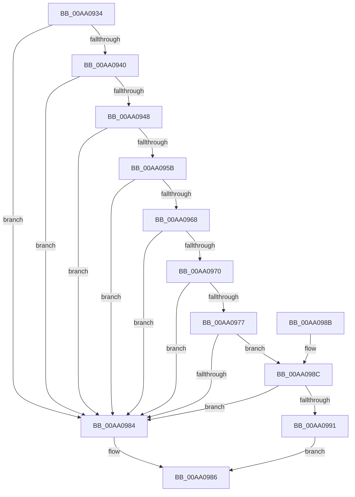

# HvpIsLogEntryHeaderCoherent

- RVA: `0x00AA0934`–`0x00AA099D` (길이 `105` bytes)
- VA: `0x0000000140AA0934`
- 실행 섹션: `PAGE`
- PDB 이름 있음: `예`; PDB Function 태그: `아니요`
- unwind 정보 RVA: `0x00063CEC`
- 디코드: `34`개 명령, `105/105` bytes 표시
- 미해석 바이트: `0` (있으면 어셈블리에 `.byte`로 보존)

> 이 문서는 커널 이미지의 기계어와 PDB 기호를 분석해 생성했습니다. 4번과 5번은 함수 원형과 자료형을 바이너리 사용 방식에서 추정한 C 해석이며 원본 소스 복구 결과는 아닙니다.

## 1. Dependencies

- 직접 호출 지점: **1**; 고유 호출 대상: **1**
- 직접 호출자로 확인된 함수: **1**
- RIP 상대 이미지 참조: **0**

### Outgoing calls
- `0x00AA0991` → [HvpLogEntryCheckHeaderChecksum](../AB/HvpLogEntryCheckHeaderChecksum_function_00ABEA18.md) (function, `0x00ABEA18`)

### Direct callers
- [HvpIncrementalLogFileEnumeratorAdvance](HvpIncrementalLogFileEnumeratorAdvance_function_00AA07B0.md) at `0x00AA0842`

### Static image references
- 디코드된 RIP-relative 메모리 참조가 없습니다.

## 2. Other-region calls and transfers

- 다른 실행 섹션으로 향하는 call: **0**
- 별도 외부 분기/꼬리 이동을 확인하지 못했습니다.

## 3. Assembly (complete function range)

```asm
00AA0934  48 83 EC 28                     sub rsp, 0x28
00AA0938  81 39 48 76 4C 45               cmp dword ptr [rcx], 0x454c7648
00AA093E  75 44                           jne 0x140aa0984
00AA0940  8B 41 04                        mov eax, dword ptr [rcx + 4]
00AA0943  83 F8 28                        cmp eax, 0x28
00AA0946  76 3C                           jbe 0x140aa0984
00AA0948  44 8B C0                        mov r8d, eax
00AA094B  41 B9 FF FF FF FF               mov r9d, 0xffffffff
00AA0951  8B C2                           mov eax, edx
00AA0953  49 03 C0                        add rax, r8
00AA0956  49 3B C1                        cmp rax, r9
00AA0959  77 29                           ja 0x140aa0984
00AA095B  8B 51 10                        mov edx, dword ptr [rcx + 0x10]
00AA095E  8D 42 FF                        lea eax, [rdx - 1]
00AA0961  3D FF DF FF 7F                  cmp eax, 0x7fffdfff
00AA0966  77 1C                           ja 0x140aa0984
00AA0968  F7 C2 FF 0F 00 00               test edx, 0xfff
00AA096E  75 14                           jne 0x140aa0984
00AA0970  8B 41 14                        mov eax, dword ptr [rcx + 0x14]
00AA0973  85 C0                           test eax, eax
00AA0975  74 0D                           je 0x140aa0984
00AA0977  48 8D 04 C5 28 00 00 00         lea rax, [rax*8 + 0x28]
00AA097F  49 3B C1                        cmp rax, r9
00AA0982  76 08                           jbe 0x140aa098c
00AA0984  32 C0                           xor al, al
00AA0986  48 83 C4 28                     add rsp, 0x28
00AA098A  C3                              ret
00AA098B  CC                              int3
00AA098C  4C 3B C0                        cmp r8, rax
00AA098F  72 F3                           jb 0x140aa0984
00AA0991  E8 82 E0 01 00                  call 0x140abea18
00AA0996  85 C0                           test eax, eax
00AA0998  0F 95 C0                        setne al
00AA099B  EB E9                           jmp 0x140aa0986
```

## 4. C-style interpretation (structured pseudocode)

```c
__int64 __fastcall HvpIsLogEntryHeaderCoherent(__int64 a1, int a2)
{
    __int64 result;
    __int64 v_rsp;

    v_rsp = (v_rsp) - (40);
    if ((*(unsigned int *)(a1)) != 0x454C7648ULL) goto loc_00AA0984;
    if (((unsigned int)((unsigned int)(*(unsigned int *)(a1 + 4)))) <= 40) goto loc_00AA0984;
    result = ((unsigned int)(a2)) + ((unsigned int)((unsigned int)((unsigned int)(*(unsigned int *)(a1 + 4)))));
    if (result > ((unsigned int)(0xFFFFFFFFULL))) goto loc_00AA0984;
    if (((unsigned int)((unsigned int)(*(unsigned int *)(a1 + 16)) - 1)) > 0x7FFFDFFFULL) goto loc_00AA0984;
    if ((((unsigned int)((unsigned int)(*(unsigned int *)(a1 + 16)))) & (0xFFFULL)) != 0) goto loc_00AA0984;
    if ((unsigned int)((unsigned int)(*(unsigned int *)(a1 + 20))) == 0) goto loc_00AA0984;
    if (((unsigned int)(*(unsigned int *)(a1 + 20)) * 8 + 40) <= ((unsigned int)(0xFFFFFFFFULL))) goto loc_00AA098C;
loc_00AA0984:
    result = 0;
loc_00AA0986:
    v_rsp = (v_rsp) + (40);
    return result;
loc_00AA098C:
    if (((unsigned int)((unsigned int)((unsigned int)(*(unsigned int *)(a1 + 4))))) < 0) goto loc_00AA0984;
    result = HvpLogEntryCheckHeaderChecksum(a1, (unsigned int)(*(unsigned int *)(a1 + 16)), (unsigned int)((unsigned int)((unsigned int)(*(unsigned int *)(a1 + 4)))), (unsigned int)(0xFFFFFFFFULL));
    result = ((unsigned int)(result) != 0) ? 1 : 0;
    goto loc_00AA0986;
}
```

## 5. (Beta) C Style

```c
int64_t HvpIsLogEntryHeaderCoherent(void *Arg1, int32_t Arg2)
{
    uint8_t *arg1 = (uint8_t *)Arg1;

    int64_t result;
    int64_t local_rsp;

    local_rsp = (local_rsp) - (40);
    if ((*(uint32_t *)(arg1)) != 0x454C7648ULL) goto loc_00AA0984;
    if (((uint32_t)((uint32_t)(*(uint32_t *)(arg1 + 0x4)))) <= 40) goto loc_00AA0984;
    result = ((uint32_t)(Arg2)) + ((uint32_t)((uint32_t)((uint32_t)(*(uint32_t *)(arg1 + 0x4)))));
    if (result > ((uint32_t)(0xFFFFFFFFULL))) goto loc_00AA0984;
    if (((uint32_t)((uint32_t)(*(uint32_t *)(arg1 + 0x10)) - 1)) > 0x7FFFDFFFULL) goto loc_00AA0984;
    if ((((uint32_t)((uint32_t)(*(uint32_t *)(arg1 + 0x10)))) & (0xFFFULL)) != 0) goto loc_00AA0984;
    if ((uint32_t)((uint32_t)(*(uint32_t *)(arg1 + 0x14))) == 0) goto loc_00AA0984;
    if (((uint32_t)(*(uint32_t *)(arg1 + 0x14)) * 8 + 40) <= ((uint32_t)(0xFFFFFFFFULL))) goto loc_00AA098C;
loc_00AA0984:
    result = 0;
loc_00AA0986:
    local_rsp = (local_rsp) + (40);
    return result;
loc_00AA098C:
    if (((uint32_t)((uint32_t)((uint32_t)(*(uint32_t *)(arg1 + 0x4))))) < 0) goto loc_00AA0984;
    result = HvpLogEntryCheckHeaderChecksum(Arg1, (uint32_t)(*(uint32_t *)(arg1 + 0x10)), (uint32_t)((uint32_t)((uint32_t)(*(uint32_t *)(arg1 + 0x4)))), (uint32_t)(0xFFFFFFFFULL));
    result = ((uint32_t)(result) != 0) ? 1 : 0;
    goto loc_00AA0986;
}
```

### 관측된 메모리 오프셋

구조체 형식이 확인되지 않은 접근은 인자 기준의 오프셋으로만 기록했습니다.

| 기준 인자 | 오프셋 표현 | 폭 (bit) | 접근 |
|---|---:|---:|---|
| `Arg1` | `+ 0x0` | `32` | `R` |
| `Arg1` | `+ 0x4` | `32` | `R` |
| `Arg1` | `+ 0x10` | `32` | `R` |
| `Arg1` | `+ 0x14` | `32` | `R` |

## 6. Execution-region graph

[열기: 2D/3D 그래프와 함수 탐색 컨트롤 패널](../../../control-panel.html?section=page&rva=0x00AA0934&view=graph)

- 2D 그래프는 위에서 아래로 흐르고, 3D 그래프는 빈 공간을 드래그해 회전합니다. Shift+드래그는 이동, 휠은 확대·축소, 함수 노드 선택은 대상 보고서 이동입니다.

### Static fallback


