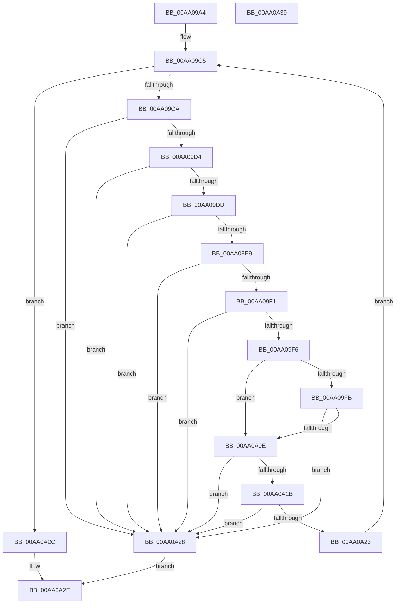

# HvpIsMetadataArrayCoherent

- RVA: `0x00AA09A4`–`0x00AA0A3A` (길이 `150` bytes)
- VA: `0x0000000140AA09A4`
- 실행 섹션: `PAGE`
- PDB 이름 있음: `예`; PDB Function 태그: `아니요`
- unwind 정보 RVA: `0x000950EC`
- 디코드: `47`개 명령, `150/150` bytes 표시
- 미해석 바이트: `0` (있으면 어셈블리에 `.byte`로 보존)

> 이 문서는 커널 이미지의 기계어와 PDB 기호를 분석해 생성했습니다. 4번과 5번은 함수 원형과 자료형을 바이너리 사용 방식에서 추정한 C 해석이며 원본 소스 복구 결과는 아닙니다.

## 1. Dependencies

- 직접 호출 지점: **0**; 고유 호출 대상: **0**
- 직접 호출자로 확인된 함수: **2**
- RIP 상대 이미지 참조: **0**

### Outgoing calls
- 직접 디코드된 call 명령이 없습니다.

### Direct callers
- [HvpApplyLegacyLogFile](../7F/HvpApplyLegacyLogFile_function_007F66D0.md) at `0x007F6838`
- [HvpIncrementalLogFileEnumeratorAdvance](HvpIncrementalLogFileEnumeratorAdvance_function_00AA07B0.md) at `0x00AA0880`

### Static image references
- 디코드된 RIP-relative 메모리 참조가 없습니다.

## 2. Other-region calls and transfers

- 다른 실행 섹션으로 향하는 call: **0**
- 별도 외부 분기/꼬리 이동을 확인하지 못했습니다.

## 3. Assembly (complete function range)

```asm
00AA09A4  48 89 5C 24 08                  mov qword ptr [rsp + 8], rbx
00AA09A9  48 89 7C 24 10                  mov qword ptr [rsp + 0x10], rdi
00AA09AE  8B 41 14                        mov eax, dword ptr [rcx + 0x14]
00AA09B1  41 8B F8                        mov edi, r8d
00AA09B4  4C 8B DA                        mov r11, rdx
00AA09B7  48 8B D9                        mov rbx, rcx
00AA09BA  45 33 C9                        xor r9d, r9d
00AA09BD  4C 8D 14 C5 28 00 00 00         lea r10, [rax*8 + 0x28]
00AA09C5  44 3B CF                        cmp r9d, edi
00AA09C8  73 62                           jae 0x140aa0a2c
00AA09CA  47 8B 44 CB 04                  mov r8d, dword ptr [r11 + r9*8 + 4]
00AA09CF  45 85 C0                        test r8d, r8d
00AA09D2  74 54                           je 0x140aa0a28
00AA09D4  41 F7 C0 FF 0F 00 00            test r8d, 0xfff
00AA09DB  75 4B                           jne 0x140aa0a28
00AA09DD  43 8B 14 CB                     mov edx, dword ptr [r11 + r9*8]
00AA09E1  F7 C2 FF 0F 00 00               test edx, 0xfff
00AA09E7  75 3F                           jne 0x140aa0a28
00AA09E9  42 8D 04 02                     lea eax, [rdx + r8]
00AA09ED  3B C2                           cmp eax, edx
00AA09EF  72 37                           jb 0x140aa0a28
00AA09F1  3B 43 10                        cmp eax, dword ptr [rbx + 0x10]
00AA09F4  77 32                           ja 0x140aa0a28
00AA09F6  45 85 C9                        test r9d, r9d
00AA09F9  74 13                           je 0x140aa0a0e
00AA09FB  41 8D 41 FF                     lea eax, [r9 - 1]
00AA09FF  8B C8                           mov ecx, eax
00AA0A01  41 8B 44 C3 04                  mov eax, dword ptr [r11 + rax*8 + 4]
00AA0A06  41 03 04 CB                     add eax, dword ptr [r11 + rcx*8]
00AA0A0A  3B D0                           cmp edx, eax
00AA0A0C  76 1A                           jbe 0x140aa0a28
00AA0A0E  4D 03 D0                        add r10, r8
00AA0A11  B8 FF FF FF FF                  mov eax, 0xffffffff
00AA0A16  4C 3B D0                        cmp r10, rax
00AA0A19  77 0D                           ja 0x140aa0a28
00AA0A1B  8B 43 04                        mov eax, dword ptr [rbx + 4]
00AA0A1E  4C 3B D0                        cmp r10, rax
00AA0A21  77 05                           ja 0x140aa0a28
00AA0A23  41 FF C1                        inc r9d
00AA0A26  EB 9D                           jmp 0x140aa09c5
00AA0A28  32 C0                           xor al, al
00AA0A2A  EB 02                           jmp 0x140aa0a2e
00AA0A2C  B0 01                           mov al, 1
00AA0A2E  48 8B 5C 24 08                  mov rbx, qword ptr [rsp + 8]
00AA0A33  48 8B 7C 24 10                  mov rdi, qword ptr [rsp + 0x10]
00AA0A38  C3                              ret
00AA0A39  CC                              int3
```

## 4. C-style interpretation (structured pseudocode)

```c
__int64 __fastcall HvpIsMetadataArrayCoherent(__int64 a1, __int64 a2, int a3, int a4)
{
    __int64 result;
    __int64 v_r10;
    unsigned __int64 v_stack_p10;
    unsigned __int64 v_stack_p8;

    v_stack_p8 = v_rbx;
    v_stack_p10 = v_rdi;
    a4 = 0;
loc_00AA09C5:
    if (0 >= ((unsigned int)((unsigned int)(a3)))) goto loc_00AA0A2C;
    if ((unsigned int)((unsigned int)(*(unsigned int *)(a2 + a4 * 8 + 4))) == 0) goto loc_00AA0A28;
    if ((((unsigned int)((unsigned int)(*(unsigned int *)(a2 + a4 * 8 + 4)))) & (0xFFFULL)) != 0) goto loc_00AA0A28;
    if ((((unsigned int)((unsigned int)(*(unsigned int *)(a2 + a4 * 8)))) & (0xFFFULL)) != 0) goto loc_00AA0A28;
    if (((unsigned int)((unsigned int)(*(unsigned int *)(a2 + a4 * 8)) + (unsigned int)(*(unsigned int *)(a2 + a4 * 8 + 4)) * 1)) < ((unsigned int)((unsigned int)(*(unsigned int *)(a2 + a4 * 8))))) goto loc_00AA0A28;
    if (((unsigned int)((unsigned int)(*(unsigned int *)(a2 + a4 * 8)) + (unsigned int)(*(unsigned int *)(a2 + a4 * 8 + 4)) * 1)) > (*(unsigned int *)(a1 + 16))) goto loc_00AA0A28;
    if (0 == 0) goto loc_00AA0A0E;
    result = (unsigned int)(((unsigned int)(*(unsigned int *)(a2 + a4 - 1 * 8 + 4))) + (*(unsigned int *)(a2 + (unsigned int)((unsigned int)(a4 - 1)) * 8)));
    if (((unsigned int)((unsigned int)(*(unsigned int *)(a2 + a4 * 8)))) <= ((unsigned int)(result))) goto loc_00AA0A28;
loc_00AA0A0E:
    v_r10 = ((unsigned int)(*(unsigned int *)(a1 + 20)) * 8 + 40) + ((unsigned int)(*(unsigned int *)(a2 + a4 * 8 + 4)));
    if (v_r10 > ((unsigned int)(0xFFFFFFFFULL))) goto loc_00AA0A28;
    if (v_r10 > ((unsigned int)(*(unsigned int *)(a1 + 4)))) goto loc_00AA0A28;
    a4 = (unsigned int)((a4) + 1);
    goto loc_00AA09C5;
loc_00AA0A28:
    result = 0;
    goto loc_00AA0A2E;
loc_00AA0A2C:
loc_00AA0A2E:
    return 1;
}
```

## 5. (Beta) C Style

```c
int64_t HvpIsMetadataArrayCoherent(void *Arg1, void *Arg2, int32_t Arg3, int32_t Arg4)
{
    uint8_t *arg1 = (uint8_t *)Arg1;
    uint8_t *arg2 = (uint8_t *)Arg2;

    int64_t result;
    int64_t local_r10;
    uint64_t v_stack_p10;
    uint64_t v_stack_p8;

    v_stack_p8 = local_rbx;
    v_stack_p10 = local_rdi;
    Arg4 = 0;
loc_00AA09C5:
    if (0 >= ((uint32_t)((uint32_t)(Arg3)))) goto loc_00AA0A2C;
    if ((uint32_t)((uint32_t)(*(uint32_t *)(arg2 + Arg4 * 8 + 0x4))) == 0) goto loc_00AA0A28;
    if ((((uint32_t)((uint32_t)(*(uint32_t *)(arg2 + Arg4 * 8 + 0x4)))) & (0xFFFULL)) != 0) goto loc_00AA0A28;
    if ((((uint32_t)((uint32_t)(*(uint32_t *)(arg2 + Arg4 * 8)))) & (0xFFFULL)) != 0) goto loc_00AA0A28;
    if (((uint32_t)((uint32_t)(*(uint32_t *)(arg2 + Arg4 * 8)) + (uint32_t)(*(uint32_t *)(arg2 + Arg4 * 8 + 0x4)) * 1)) < ((uint32_t)((uint32_t)(*(uint32_t *)(arg2 + Arg4 * 8))))) goto loc_00AA0A28;
    if (((uint32_t)((uint32_t)(*(uint32_t *)(arg2 + Arg4 * 8)) + (uint32_t)(*(uint32_t *)(arg2 + Arg4 * 8 + 0x4)) * 1)) > (*(uint32_t *)(arg1 + 0x10))) goto loc_00AA0A28;
    if (0 == 0) goto loc_00AA0A0E;
    result = (uint32_t)(((uint32_t)(*(uint32_t *)(arg2 + Arg4 - 0x1 * 8 + 0x4))) + (*(uint32_t *)(arg2 + (uint32_t)((uint32_t)(Arg4 - 0x1)) * 8)));
    if (((uint32_t)((uint32_t)(*(uint32_t *)(arg2 + Arg4 * 8)))) <= ((uint32_t)(result))) goto loc_00AA0A28;
loc_00AA0A0E:
    local_r10 = ((uint32_t)(*(uint32_t *)(arg1 + 0x14)) * 8 + 40) + ((uint32_t)(*(uint32_t *)(arg2 + Arg4 * 8 + 0x4)));
    if (local_r10 > ((uint32_t)(0xFFFFFFFFULL))) goto loc_00AA0A28;
    if (local_r10 > ((uint32_t)(*(uint32_t *)(arg1 + 0x4)))) goto loc_00AA0A28;
    Arg4 = (uint32_t)((Arg4) + 1);
    goto loc_00AA09C5;
loc_00AA0A28:
    result = 0;
    goto loc_00AA0A2E;
loc_00AA0A2C:
loc_00AA0A2E:
    return 1;
}
```

### 관측된 메모리 오프셋

구조체 형식이 확인되지 않은 접근은 인자 기준의 오프셋으로만 기록했습니다.

| 기준 인자 | 오프셋 표현 | 폭 (bit) | 접근 |
|---|---:|---:|---|
| `Arg1` | `+ 0x4` | `32` | `R` |
| `Arg1` | `+ 0x10` | `32` | `R` |
| `Arg1` | `+ 0x14` | `32` | `R` |
| `Arg2` | `+ 0x0 + r9*8` | `32` | `R` |
| `Arg2` | `+ 0x0 + rcx*8` | `32` | `R` |
| `Arg2` | `+ 0x4 + r9*8` | `32` | `R` |
| `Arg2` | `+ 0x4 + rax*8` | `32` | `R` |

## 6. Execution-region graph

[열기: 2D/3D 그래프와 함수 탐색 컨트롤 패널](../../../control-panel.html?section=page&rva=0x00AA09A4&view=graph)

- 2D 그래프는 위에서 아래로 흐르고, 3D 그래프는 빈 공간을 드래그해 회전합니다. Shift+드래그는 이동, 휠은 확대·축소, 함수 노드 선택은 대상 보고서 이동입니다.

### Static fallback


