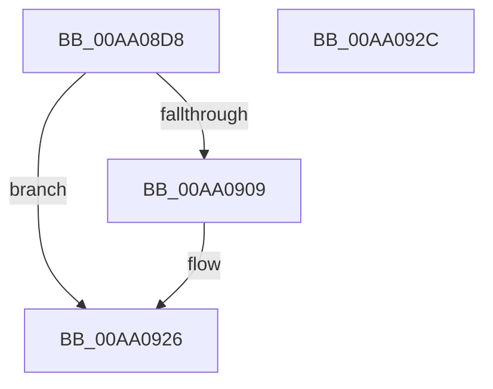

# HvpReadLogEntryHeader

- RVA: `0x00AA08D8`–`0x00AA092D` (길이 `85` bytes)
- VA: `0x0000000140AA08D8`
- 실행 섹션: `PAGE`
- PDB 이름 있음: `예`; PDB Function 태그: `아니요`
- unwind 정보 RVA: `0x00064C80`
- 디코드: `25`개 명령, `85/85` bytes 표시
- 미해석 바이트: `0` (있으면 어셈블리에 `.byte`로 보존)

> 이 문서는 커널 이미지의 기계어와 PDB 기호를 분석해 생성했습니다. 4번과 5번은 함수 원형과 자료형을 바이너리 사용 방식에서 추정한 C 해석이며 원본 소스 복구 결과는 아닙니다.

## 1. Dependencies

- 직접 호출 지점: **1**; 고유 호출 대상: **1**
- 직접 호출자로 확인된 함수: **1**
- RIP 상대 이미지 참조: **0**

### Outgoing calls
- `0x00AA0900` → [guard_dispatch_icall](../../text/6B/guard_dispatch_icall_function_006BAAD0.md) (function, `0x006BAAD0`)

### Direct callers
- [HvpIncrementalLogFileEnumeratorAdvance](HvpIncrementalLogFileEnumeratorAdvance_function_00AA07B0.md) at `0x00AA0831`

### Static image references
- 디코드된 RIP-relative 메모리 참조가 없습니다.

## 2. Other-region calls and transfers

- 다른 실행 섹션으로 향하는 call: **1**
  - `0x00AA0900` → [guard_dispatch_icall](../../text/6B/guard_dispatch_icall_function_006BAAD0.md) (`PAGE` → `.text`)
- 별도 외부 분기/꼬리 이동을 확인하지 못했습니다.

## 3. Assembly (complete function range)

```asm
00AA08D8  40 53                           push rbx
00AA08DA  48 83 EC 30                     sub rsp, 0x30
00AA08DE  48 83 64 24 48 00               and qword ptr [rsp + 0x48], 0
00AA08E4  49 8B C0                        mov rax, r8
00AA08E7  4C 8B D2                        mov r10, rdx
00AA08EA  49 8B D9                        mov rbx, r9
00AA08ED  8B D1                           mov edx, ecx
00AA08EF  4C 8D 4C 24 48                  lea r9, [rsp + 0x48]
00AA08F4  48 8B C8                        mov rcx, rax
00AA08F7  41 B8 28 00 00 00               mov r8d, 0x28
00AA08FD  49 8B C2                        mov rax, r10
00AA0900  E8 CB A1 C1 FF                  call 0x1406baad0
00AA0905  85 C0                           test eax, eax
00AA0907  78 1D                           js 0x140aa0926
00AA0909  48 8B 4C 24 48                  mov rcx, qword ptr [rsp + 0x48]
00AA090E  0F 10 01                        movups xmm0, xmmword ptr [rcx]
00AA0911  0F 11 03                        movups xmmword ptr [rbx], xmm0
00AA0914  0F 10 49 10                     movups xmm1, xmmword ptr [rcx + 0x10]
00AA0918  0F 11 4B 10                     movups xmmword ptr [rbx + 0x10], xmm1
00AA091C  F2 0F 10 41 20                  movsd xmm0, qword ptr [rcx + 0x20]
00AA0921  F2 0F 11 43 20                  movsd qword ptr [rbx + 0x20], xmm0
00AA0926  48 83 C4 30                     add rsp, 0x30
00AA092A  5B                              pop rbx
00AA092B  C3                              ret
00AA092C  CC                              int3
```

## 4. C-style interpretation (structured pseudocode)

```c
__int64 __fastcall HvpReadLogEntryHeader(int a1, __int64 a2, __int64 a3, __int64 a4)
{
    __int64 result;
    __int64 v_rsp;
    unsigned __int64 v_stack_p10;

    v_rsp = (v_rsp) - (48);
    result = guard_dispatch_icall(a3, (unsigned int)(a1), 40, v_stack_p10);
    if (!(sign_flag)) {
        a1 = v_stack_p10;
        *(unsigned __int64 *)(a4) = v_xmm0;
        *(unsigned __int64 *)(a4 + 16) = v_xmm1;
        *(unsigned __int64 *)(a4 + 32) = v_xmm0;
    }
    v_rsp = (v_rsp) + (48);
    return result;
}
```

## 5. (Beta) C Style

```c
int64_t HvpReadLogEntryHeader(int32_t Arg1, int64_t Arg2, int64_t Arg3, void *Arg4)
{
    uint8_t *arg4 = (uint8_t *)Arg4;

    int64_t result;
    int64_t local_rsp;
    uint64_t v_stack_p10;

    local_rsp = (local_rsp) - (48);
    result = guard_dispatch_icall(Arg3, (uint32_t)(Arg1), 40, v_stack_p10);
    if (!(sign_flag)) {
        Arg1 = v_stack_p10;
        *(uint64_t *)(arg4) = v_xmm0;
        *(uint64_t *)(arg4 + 0x10) = v_xmm1;
        *(uint64_t *)(arg4 + 0x20) = v_xmm0;
    }
    local_rsp = (local_rsp) + (48);
    return result;
}
```

### 관측된 메모리 오프셋

구조체 형식이 확인되지 않은 접근은 인자 기준의 오프셋으로만 기록했습니다.

| 기준 인자 | 오프셋 표현 | 폭 (bit) | 접근 |
|---|---:|---:|---|
| `Arg4` | `+ 0x0` | `128` | `R` |
| `Arg4` | `+ 0x10` | `128` | `R` |
| `Arg4` | `+ 0x20` | `64` | `W` |

## 6. Execution-region graph

[열기: 2D/3D 그래프와 함수 탐색 컨트롤 패널](../../../control-panel.html?section=page&rva=0x00AA08D8&view=graph)

- 2D 그래프는 위에서 아래로 흐르고, 3D 그래프는 빈 공간을 드래그해 회전합니다. Shift+드래그는 이동, 휠은 확대·축소, 함수 노드 선택은 대상 보고서 이동입니다.

### Static fallback


