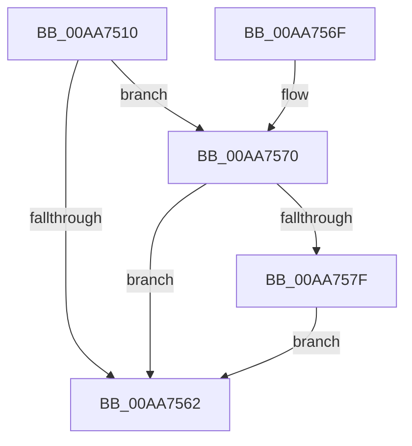

# IoDeleteSymbolicLink

- RVA: `0x00AA7510`–`0x00AA758A` (길이 `122` bytes)
- VA: `0x0000000140AA7510`
- 실행 섹션: `PAGE`
- PDB 이름 있음: `예`; PDB Function 태그: `아니요`
- unwind 정보 RVA: `0x000BBA2C`
- 디코드: `34`개 명령, `122/122` bytes 표시
- 미해석 바이트: `0` (있으면 어셈블리에 `.byte`로 보존)

> 이 문서는 커널 이미지의 기계어와 PDB 기호를 분석해 생성했습니다. 4번과 5번은 함수 원형과 자료형을 바이너리 사용 방식에서 추정한 C 해석이며 원본 소스 복구 결과는 아닙니다.

## 1. Dependencies

- 직접 호출 지점: **3**; 고유 호출 대상: **3**
- 직접 호출자로 확인된 함수: **1**
- RIP 상대 이미지 참조: **0**

### Outgoing calls
- `0x00AA7557` → [ZwOpenSymbolicLinkObject](../../text/6A/ZwOpenSymbolicLinkObject_function_006AF7F0.md) (function, `0x006AF7F0`)
- `0x00AA7574` → [ZwMakeTemporaryObject](../../text/6A/ZwMakeTemporaryObject_function_006AF3F0.md) (function, `0x006AF3F0`)
- `0x00AA7583` → [ZwClose](../../text/6A/ZwClose_function_006AD2B0.md) (function, `0x006AD2B0`)

### Direct callers
- [DifIoDeleteSymbolicLinkWrapper](../../text/62/DifIoDeleteSymbolicLinkWrapper_function_00629D80.md) at `0x00629E4D`

### Static image references
- 디코드된 RIP-relative 메모리 참조가 없습니다.

## 2. Other-region calls and transfers

- 다른 실행 섹션으로 향하는 call: **3**
  - `0x00AA7557` → [ZwOpenSymbolicLinkObject](../../text/6A/ZwOpenSymbolicLinkObject_function_006AF7F0.md) (`PAGE` → `.text`)
  - `0x00AA7574` → [ZwMakeTemporaryObject](../../text/6A/ZwMakeTemporaryObject_function_006AF3F0.md) (`PAGE` → `.text`)
  - `0x00AA7583` → [ZwClose](../../text/6A/ZwClose_function_006AD2B0.md) (`PAGE` → `.text`)
- 별도 외부 분기/꼬리 이동을 확인하지 못했습니다.

## 3. Assembly (complete function range)

```asm
00AA7510  48 89 5C 24 10                  mov qword ptr [rsp + 0x10], rbx
00AA7515  55                              push rbp
00AA7516  48 8B EC                        mov rbp, rsp
00AA7519  48 83 EC 50                     sub rsp, 0x50
00AA751D  83 65 EC 00                     and dword ptr [rbp - 0x14], 0
00AA7521  4C 8D 45 D0                     lea r8, [rbp - 0x30]
00AA7525  48 83 65 10 00                  and qword ptr [rbp + 0x10], 0
00AA752A  0F 57 C0                        xorps xmm0, xmm0
00AA752D  48 83 65 D8 00                  and qword ptr [rbp - 0x28], 0
00AA7532  BA 00 00 01 00                  mov edx, 0x10000
00AA7537  48 89 4D E0                     mov qword ptr [rbp - 0x20], rcx
00AA753B  48 8D 4D 10                     lea rcx, [rbp + 0x10]
00AA753F  48 C7 45 D0 30 00 00 00         mov qword ptr [rbp - 0x30], 0x30
00AA7547  83 65 D4 00                     and dword ptr [rbp - 0x2c], 0
00AA754B  F3 0F 7F 45 F0                  movdqu xmmword ptr [rbp - 0x10], xmm0
00AA7550  C7 45 E8 40 02 00 00            mov dword ptr [rbp - 0x18], 0x240
00AA7557  E8 94 82 C0 FF                  call 0x1406af7f0
00AA755C  8B D8                           mov ebx, eax
00AA755E  85 C0                           test eax, eax
00AA7560  79 0E                           jns 0x140aa7570
00AA7562  8B C3                           mov eax, ebx
00AA7564  48 8B 5C 24 68                  mov rbx, qword ptr [rsp + 0x68]
00AA7569  48 83 C4 50                     add rsp, 0x50
00AA756D  5D                              pop rbp
00AA756E  C3                              ret
00AA756F  CC                              int3
00AA7570  48 8B 4D 10                     mov rcx, qword ptr [rbp + 0x10]
00AA7574  E8 77 7E C0 FF                  call 0x1406af3f0
00AA7579  8B D8                           mov ebx, eax
00AA757B  85 C0                           test eax, eax
00AA757D  78 E3                           js 0x140aa7562
00AA757F  48 8B 4D 10                     mov rcx, qword ptr [rbp + 0x10]
00AA7583  E8 28 5D C0 FF                  call 0x1406ad2b0
00AA7588  EB D8                           jmp 0x140aa7562
```

## 4. C-style interpretation (structured pseudocode)

```c
__int64 __fastcall IoDeleteSymbolicLink(__int64 a1)
{
    __int64 result;
    __int64 v_rsp;
    unsigned __int64 v_stack_m18;
    unsigned int v_stack_m1C;
    unsigned int v_stack_m20;
    unsigned __int64 v_stack_m28;
    unsigned __int64 v_stack_m30;
    unsigned int v_stack_m34;
    unsigned __int64 v_stack_m38;
    unsigned __int64 v_stack_p10;
    unsigned __int64 v_stack_p8;

    v_stack_p10 = v_rbx;
    v_rsp = (v_rsp) - (80);
    v_stack_m28 = a1;
    v_stack_m38 = 48;
    v_stack_m18 = v_xmm0;
    v_stack_m20 = 576;
    result = ZwOpenSymbolicLinkObject(v_stack_p8, (unsigned int)(0x10000ULL), v_stack_m38, a4);
    if (!sign_flag) goto loc_00AA7570;
loc_00AA7562:
    v_rsp = (v_rsp) + (80);
    return (unsigned int)((unsigned int)((unsigned int)((unsigned int)(result))));
loc_00AA7570:
    result = ZwMakeTemporaryObject(v_stack_p8, (unsigned int)(0x10000ULL), v_stack_m38, a4);
    if (sign_flag) goto loc_00AA7562;
    result = ZwClose(v_stack_p8, (unsigned int)(0x10000ULL), v_stack_m38, a4);
    goto loc_00AA7562;
}
```

## 5. (Beta) C Style

```c
int64_t IoDeleteSymbolicLink(int64_t Arg1)
{
    int64_t result;
    int64_t local_rsp;
    uint64_t v_stack_m18;
    uint32_t v_stack_m1C;
    uint32_t v_stack_m20;
    uint64_t v_stack_m28;
    uint64_t v_stack_m30;
    uint32_t v_stack_m34;
    uint64_t v_stack_m38;
    uint64_t v_stack_p10;
    uint64_t v_stack_p8;

    v_stack_p10 = local_rbx;
    local_rsp = (local_rsp) - (80);
    v_stack_m28 = Arg1;
    v_stack_m38 = 48;
    v_stack_m18 = v_xmm0;
    v_stack_m20 = 576;
    result = ZwOpenSymbolicLinkObject(v_stack_p8, (uint32_t)(0x10000ULL), v_stack_m38, a4);
    if (!sign_flag) goto loc_00AA7570;
loc_00AA7562:
    local_rsp = (local_rsp) + (80);
    return (uint32_t)((uint32_t)((uint32_t)((uint32_t)(result))));
loc_00AA7570:
    result = ZwMakeTemporaryObject(v_stack_p8, (uint32_t)(0x10000ULL), v_stack_m38, a4);
    if (sign_flag) goto loc_00AA7562;
    result = ZwClose(v_stack_p8, (uint32_t)(0x10000ULL), v_stack_m38, a4);
    goto loc_00AA7562;
}
```

## 6. Execution-region graph

[열기: 2D/3D 그래프와 함수 탐색 컨트롤 패널](../../../control-panel.html?section=page&rva=0x00AA7510&view=graph)

- 2D 그래프는 위에서 아래로 흐르고, 3D 그래프는 빈 공간을 드래그해 회전합니다. Shift+드래그는 이동, 휠은 확대·축소, 함수 노드 선택은 대상 보고서 이동입니다.

### Static fallback


