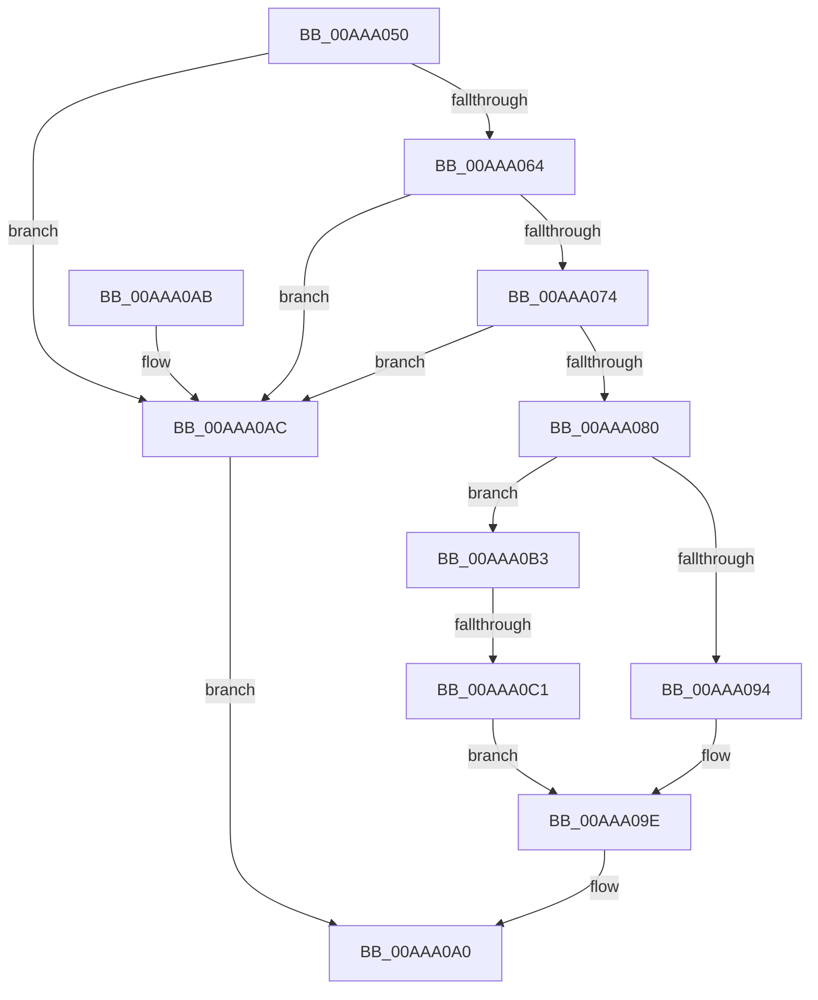

# IoGetDeviceNumaNode

- RVA: `0x00AAA050`–`0x00AAA0C6` (길이 `118` bytes)
- VA: `0x0000000140AAA050`
- 실행 섹션: `PAGE`
- PDB 이름 있음: `예`; PDB Function 태그: `예`
- unwind 정보 RVA: `0x000682BC`
- 디코드: `32`개 명령, `118/118` bytes 표시
- 미해석 바이트: `0` (있으면 어셈블리에 `.byte`로 보존)

> 이 문서는 커널 이미지의 기계어와 PDB 기호를 분석해 생성했습니다. 4번과 5번은 함수 원형과 자료형을 바이너리 사용 방식에서 추정한 C 해석이며 원본 소스 복구 결과는 아닙니다.

## 1. Dependencies

- 직접 호출 지점: **1**; 고유 호출 대상: **1**
- 직접 호출자로 확인된 함수: **1**
- RIP 상대 이미지 참조: **0**

### Outgoing calls
- `0x00AAA0B3` → [KeQueryHighestNodeNumber](../../text/45/KeQueryHighestNodeNumber_function_0045CEC0.md) (function, `0x0045CEC0`)

### Direct callers
- [IopGetNumaNodeInformation](../72/IopGetNumaNodeInformation_function_00720F68.md) at `0x00720FA5`

### Static image references
- 디코드된 RIP-relative 메모리 참조가 없습니다.

## 2. Other-region calls and transfers

- 다른 실행 섹션으로 향하는 call: **1**
  - `0x00AAA0B3` → [KeQueryHighestNodeNumber](../../text/45/KeQueryHighestNodeNumber_function_0045CEC0.md) (`PAGE` → `.text`)
- call이 아닌 외부 분기/꼬리 이동: **1**
  - `0x00AAA0BB` → [sub_00B4A562](../B4/Unknown_function_00B4A562.md) (`tail-transfer`)

## 3. Assembly (complete function range)

```asm
00AAA050  48 89 5C 24 08                  mov qword ptr [rsp + 8], rbx
00AAA055  57                              push rdi
00AAA056  48 83 EC 20                     sub rsp, 0x20
00AAA05A  33 FF                           xor edi, edi
00AAA05C  48 8B DA                        mov rbx, rdx
00AAA05F  48 85 C9                        test rcx, rcx
00AAA062  74 48                           je 0x140aaa0ac
00AAA064  48 8B 81 38 01 00 00            mov rax, qword ptr [rcx + 0x138]
00AAA06B  48 8B 40 28                     mov rax, qword ptr [rax + 0x28]
00AAA06F  48 85 C0                        test rax, rax
00AAA072  74 38                           je 0x140aaa0ac
00AAA074  F7 80 8C 01 00 00 00 00 02 00   test dword ptr [rax + 0x18c], 0x20000
00AAA07E  75 2C                           jne 0x140aaa0ac
00AAA080  48 8B 81 38 01 00 00            mov rax, qword ptr [rcx + 0x138]
00AAA087  48 8B 40 28                     mov rax, qword ptr [rax + 0x28]
00AAA08B  83 B8 94 02 00 00 FD            cmp dword ptr [rax + 0x294], -3
00AAA092  77 1F                           ja 0x140aaa0b3
00AAA094  0F B7 80 94 02 00 00            movzx eax, word ptr [rax + 0x294]
00AAA09B  66 89 02                        mov word ptr [rdx], ax
00AAA09E  33 C0                           xor eax, eax
00AAA0A0  48 8B 5C 24 30                  mov rbx, qword ptr [rsp + 0x30]
00AAA0A5  48 83 C4 20                     add rsp, 0x20
00AAA0A9  5F                              pop rdi
00AAA0AA  C3                              ret
00AAA0AB  CC                              int3
00AAA0AC  B8 0D 00 00 C0                  mov eax, 0xc000000d
00AAA0B1  EB ED                           jmp 0x140aaa0a0
00AAA0B3  E8 08 2E 9B FF                  call 0x14045cec0
00AAA0B8  66 85 C0                        test ax, ax
00AAA0BB  0F 85 A1 04 0A 00               jne 0x140b4a562
00AAA0C1  66 89 3B                        mov word ptr [rbx], di
00AAA0C4  EB D8                           jmp 0x140aaa09e
```

## 4. C-style interpretation (structured pseudocode)

```c
__int64 __fastcall IoGetDeviceNumaNode(__int64 a1, __int64 a2)
{
    __int64 result;
    __int64 v_rdi;
    __int64 v_rsp;
    unsigned __int64 v_stack_p8;

    v_stack_p8 = v_rbx;
    v_rsp = (v_rsp) - (32);
    v_rdi = 0;
    if (a1 == 0) goto loc_00AAA0AC;
    if (*(unsigned __int64 *)(*(unsigned __int64 *)(a1 + 312) + 40) == 0) goto loc_00AAA0AC;
    if (((*(unsigned int *)(*(unsigned __int64 *)(*(unsigned __int64 *)(a1 + 312) + 40) + 396)) & (0x20000ULL)) != 0) goto loc_00AAA0AC;
    if ((*(unsigned int *)(*(unsigned __int64 *)(*(unsigned __int64 *)(a1 + 312) + 40) + 660)) > -3) goto loc_00AAA0B3;
    *(unsigned __int16 *)(a2) = (unsigned __int16)(*(unsigned __int16 *)(*(unsigned __int64 *)(*(unsigned __int64 *)(a1 + 312) + 40) + 660));
loc_00AAA09E:
    result = 0;
loc_00AAA0A0:
    v_rsp = (v_rsp) + (32);
    return result;
loc_00AAA0AC:
    goto loc_00AAA0A0;
loc_00AAA0B3:
    result = KeQueryHighestNodeNumber(a1, a2, a3, a4);
    *(unsigned __int16 *)(v_stack_p8) = 0;
    goto loc_00AAA09E;
}
```

## 5. (Beta) C Style

```c
int64_t IoGetDeviceNumaNode(int64_t Arg1, void *Arg2)
{
    uint8_t *arg2 = (uint8_t *)Arg2;

    int64_t result;
    int64_t local_rdi;
    int64_t local_rsp;
    uint64_t v_stack_p8;

    v_stack_p8 = local_rbx;
    local_rsp = (local_rsp) - (32);
    local_rdi = 0;
    if (Arg1 == 0) goto loc_00AAA0AC;
    if (*(uint64_t *)(*(uint64_t *)(Arg1 + 0x138) + 0x28) == 0) goto loc_00AAA0AC;
    if (((*(uint32_t *)(*(uint64_t *)(*(uint64_t *)(Arg1 + 0x138) + 0x28) + 0x18C)) & (0x20000ULL)) != 0) goto loc_00AAA0AC;
    if ((*(uint32_t *)(*(uint64_t *)(*(uint64_t *)(Arg1 + 0x138) + 0x28) + 0x294)) > -3) goto loc_00AAA0B3;
    *(uint16_t *)(arg2) = (uint16_t)(*(uint16_t *)(*(uint64_t *)(*(uint64_t *)(Arg1 + 0x138) + 0x28) + 0x294));
loc_00AAA09E:
    result = 0;
loc_00AAA0A0:
    local_rsp = (local_rsp) + (32);
    return result;
loc_00AAA0AC:
    goto loc_00AAA0A0;
loc_00AAA0B3:
    result = KeQueryHighestNodeNumber(Arg1, Arg2, a3, a4);
    *(uint16_t *)(v_stack_p8) = 0;
    goto loc_00AAA09E;
}
```

### 관측된 메모리 오프셋

구조체 형식이 확인되지 않은 접근은 인자 기준의 오프셋으로만 기록했습니다.

| 기준 인자 | 오프셋 표현 | 폭 (bit) | 접근 |
|---|---:|---:|---|
| `Arg2` | `+ 0x0` | `16` | `W` |

## 6. Execution-region graph

[열기: 2D/3D 그래프와 함수 탐색 컨트롤 패널](../../../control-panel.html?section=page&rva=0x00AAA050&view=graph)

- 2D 그래프는 위에서 아래로 흐르고, 3D 그래프는 빈 공간을 드래그해 회전합니다. Shift+드래그는 이동, 휠은 확대·축소, 함수 노드 선택은 대상 보고서 이동입니다.

### Static fallback


