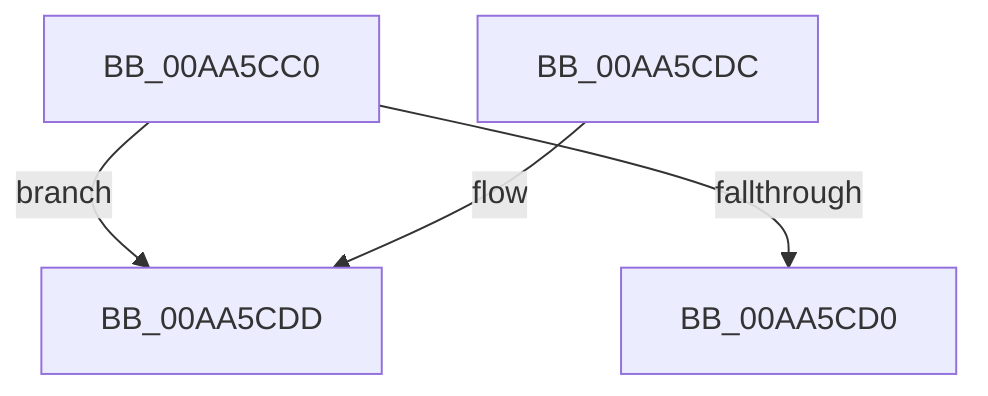

# IoUnregisterPlugPlayNotification

- RVA: `0x00AA5CC0`–`0x00AA5CF6` (길이 `54` bytes)
- VA: `0x0000000140AA5CC0`
- 실행 섹션: `PAGE`
- PDB 이름 있음: `예`; PDB Function 태그: `아니요`
- unwind 정보 RVA: `0x0006886C`
- 디코드: `15`개 명령, `54/54` bytes 표시
- 미해석 바이트: `0` (있으면 어셈블리에 `.byte`로 보존)

> 이 문서는 커널 이미지의 기계어와 PDB 기호를 분석해 생성했습니다. 4번과 5번은 함수 원형과 자료형을 바이너리 사용 방식에서 추정한 C 해석이며 원본 소스 복구 결과는 아닙니다.

## 1. Dependencies

- 직접 호출 지점: **2**; 고유 호출 대상: **2**
- 직접 호출자로 확인된 함수: **3**
- RIP 상대 이미지 참조: **0**

### Outgoing calls
- `0x00AA5CD2` → [PnpUnregisterPlugPlayNotification](../../text/47/PnpUnregisterPlugPlayNotification_function_0047AFAC.md) (function, `0x0047AFAC`)
- `0x00AA5CF0` → [KeBugCheckEx](../../text/4F/KeBugCheckEx_function_004FD660.md) (function, `0x004FD660`)

### Direct callers
- [ExpPrmTargetDeviceChangeCallback](../7C/ExpPrmTargetDeviceChangeCallback_function_007CEED0.md) at `0x007CEFF7`
- [SmKmFileInfoCleanup](../AC/SmKmFileInfoCleanup_function_00AC9A90.md) at `0x00AC9AB0`
- [SbpWaitForVmbus](../../init/C6/SbpWaitForVmbus_function_00C6F8D8.md) at `0x00C6F978`

### Static image references
- 디코드된 RIP-relative 메모리 참조가 없습니다.

## 2. Other-region calls and transfers

- 다른 실행 섹션으로 향하는 call: **2**
  - `0x00AA5CD2` → [PnpUnregisterPlugPlayNotification](../../text/47/PnpUnregisterPlugPlayNotification_function_0047AFAC.md) (`PAGE` → `.text`)
  - `0x00AA5CF0` → [KeBugCheckEx](../../text/4F/KeBugCheckEx_function_004FD660.md) (`PAGE` → `.text`)
- 별도 외부 분기/꼬리 이동을 확인하지 못했습니다.

## 3. Assembly (complete function range)

```asm
00AA5CC0  48 83 EC 38                     sub rsp, 0x38
00AA5CC4  41 B9 04 00 00 00               mov r9d, 4
00AA5CCA  44 39 49 10                     cmp dword ptr [rcx + 0x10], r9d
00AA5CCE  74 0D                           je 0x140aa5cdd
00AA5CD0  33 D2                           xor edx, edx
00AA5CD2  E8 D5 52 9D FF                  call 0x14047afac
00AA5CD7  48 83 C4 38                     add rsp, 0x38
00AA5CDB  C3                              ret
00AA5CDC  CC                              int3
00AA5CDD  48 83 64 24 20 00               and qword ptr [rsp + 0x20], 0
00AA5CE3  4C 8B C1                        mov r8, rcx
00AA5CE6  B9 CA 00 00 00                  mov ecx, 0xca
00AA5CEB  BA 0A 00 00 00                  mov edx, 0xa
00AA5CF0  E8 6B 79 A5 FF                  call 0x1404fd660
00AA5CF5  CC                              int3
```

## 4. C-style interpretation (structured pseudocode)

```c
__int64 __fastcall IoUnregisterPlugPlayNotification(__int64 a1, int a2)
{
    __int64 result;
    __int64 v_rsp;
    unsigned __int64 v_stack_p20;

    v_rsp = (v_rsp) - (56);
    if ((*(unsigned int *)(a1 + 16)) == 4) goto loc_00AA5CDD;
    a2 = 0;
    result = PnpUnregisterPlugPlayNotification(a1, a2, a3, 4);
    v_rsp = (v_rsp) + (56);
    return result;
loc_00AA5CDD:
    result = KeBugCheckEx(202, 10, a1, 4);
    return result;
}
```

## 5. (Beta) C Style

```c
int64_t IoUnregisterPlugPlayNotification(void *Arg1, int32_t Arg2)
{
    uint8_t *arg1 = (uint8_t *)Arg1;

    int64_t result;
    int64_t local_rsp;
    uint64_t v_stack_p20;

    local_rsp = (local_rsp) - (56);
    if ((*(uint32_t *)(arg1 + 0x10)) == 4) goto loc_00AA5CDD;
    Arg2 = 0;
    result = PnpUnregisterPlugPlayNotification(Arg1, Arg2, a3, 4);
    local_rsp = (local_rsp) + (56);
    return result;
loc_00AA5CDD:
    result = KeBugCheckEx(202, 10, Arg1, 4);
    return result;
}
```

### 관측된 메모리 오프셋

구조체 형식이 확인되지 않은 접근은 인자 기준의 오프셋으로만 기록했습니다.

| 기준 인자 | 오프셋 표현 | 폭 (bit) | 접근 |
|---|---:|---:|---|
| `Arg1` | `+ 0x10` | `32` | `R` |

## 6. Execution-region graph

[열기: 2D/3D 그래프와 함수 탐색 컨트롤 패널](../../../control-panel.html?section=page&rva=0x00AA5CC0&view=graph)

- 2D 그래프는 위에서 아래로 흐르고, 3D 그래프는 빈 공간을 드래그해 회전합니다. Shift+드래그는 이동, 휠은 확대·축소, 함수 노드 선택은 대상 보고서 이동입니다.

### Static fallback


