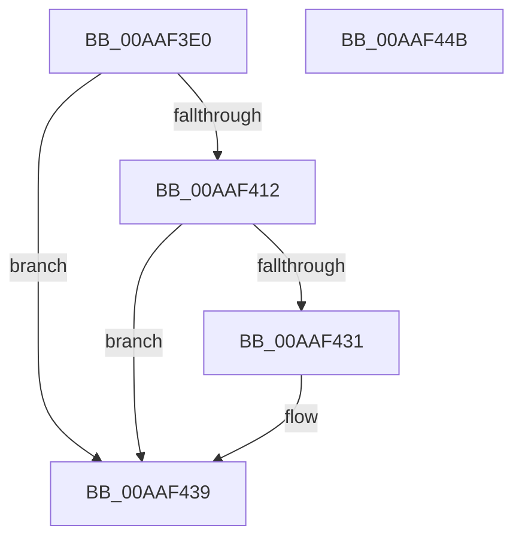

# IoWMIHandleToInstanceName

- RVA: `0x00AAF3E0`–`0x00AAF44C` (길이 `108` bytes)
- VA: `0x0000000140AAF3E0`
- 실행 섹션: `PAGE`
- PDB 이름 있음: `예`; PDB Function 태그: `아니요`
- unwind 정보 RVA: `0x000BC3A0`
- 디코드: `35`개 명령, `108/108` bytes 표시
- 미해석 바이트: `0` (있으면 어셈블리에 `.byte`로 보존)

> 이 문서는 커널 이미지의 기계어와 PDB 기호를 분석해 생성했습니다. 4번과 5번은 함수 원형과 자료형을 바이너리 사용 방식에서 추정한 C 해석이며 원본 소스 복구 결과는 아닙니다.

## 1. Dependencies

- 직접 호출 지점: **3**; 고유 호출 대상: **3**
- 직접 호출자로 확인된 함수: **0**
- RIP 상대 이미지 참조: **0**

### Outgoing calls
- `0x00AAF407` → [WmipGetFilePDO](WmipGetFilePDO_function_00AAF454.md) (function, `0x00AAF454`)
- `0x00AAF420` → [IoWMIDeviceObjectToInstanceName](../A8/IoWMIDeviceObjectToInstanceName_function_00A873C0.md) (function, `0x00A873C0`)
- `0x00AAF434` → [ObfDereferenceObject](../../text/2F/ObfDereferenceObject_function_002F9350.md) (function, `0x002F9350`)

### Direct callers
- 이 함수 시작 RVA로 연결되는 직접 call은 확인되지 않았습니다. 간접 호출은 완전히 역산할 수 없습니다.

### Static image references
- 디코드된 RIP-relative 메모리 참조가 없습니다.

## 2. Other-region calls and transfers

- 다른 실행 섹션으로 향하는 call: **1**
  - `0x00AAF434` → [ObfDereferenceObject](../../text/2F/ObfDereferenceObject_function_002F9350.md) (`PAGE` → `.text`)
- 별도 외부 분기/꼬리 이동을 확인하지 못했습니다.

## 3. Assembly (complete function range)

```asm
00AAF3E0  4C 8B DC                        mov r11, rsp
00AAF3E3  49 89 5B 08                     mov qword ptr [r11 + 8], rbx
00AAF3E7  49 89 73 10                     mov qword ptr [r11 + 0x10], rsi
00AAF3EB  57                              push rdi
00AAF3EC  48 83 EC 20                     sub rsp, 0x20
00AAF3F0  49 83 63 20 00                  and qword ptr [r11 + 0x20], 0
00AAF3F5  48 8B C2                        mov rax, rdx
00AAF3F8  49 8B F8                        mov rdi, r8
00AAF3FB  48 8B F1                        mov rsi, rcx
00AAF3FE  48 8B C8                        mov rcx, rax
00AAF401  4D 8D 43 20                     lea r8, [r11 + 0x20]
00AAF405  33 D2                           xor edx, edx
00AAF407  E8 48 00 00 00                  call 0x140aaf454
00AAF40C  8B D8                           mov ebx, eax
00AAF40E  85 C0                           test eax, eax
00AAF410  78 27                           js 0x140aaf439
00AAF412  4C 8B C7                        mov r8, rdi
00AAF415  48 8B CE                        mov rcx, rsi
00AAF418  48 8B 7C 24 48                  mov rdi, qword ptr [rsp + 0x48]
00AAF41D  48 8B D7                        mov rdx, rdi
00AAF420  E8 9B 7F FD FF                  call 0x140a873c0
00AAF425  33 DB                           xor ebx, ebx
00AAF427  85 C0                           test eax, eax
00AAF429  0F 48 D8                        cmovs ebx, eax
00AAF42C  48 85 FF                        test rdi, rdi
00AAF42F  74 08                           je 0x140aaf439
00AAF431  48 8B CF                        mov rcx, rdi
00AAF434  E8 17 9F 84 FF                  call 0x1402f9350
00AAF439  48 8B 74 24 38                  mov rsi, qword ptr [rsp + 0x38]
00AAF43E  8B C3                           mov eax, ebx
00AAF440  48 8B 5C 24 30                  mov rbx, qword ptr [rsp + 0x30]
00AAF445  48 83 C4 20                     add rsp, 0x20
00AAF449  5F                              pop rdi
00AAF44A  C3                              ret
00AAF44B  CC                              int3
```

## 4. C-style interpretation (structured pseudocode)

```c
__int64 __fastcall IoWMIHandleToInstanceName(__int64 a1, __int64 a2, __int64 a3)
{
    __int64 result;
    __int64 v_rbx;
    __int64 v_rsp;
    unsigned __int64 v_stack_p10;
    unsigned __int64 v_stack_p20;
    unsigned __int64 v_stack_p8;

    *(unsigned __int64 *)(v_rsp + 8) = v_rbx;
    *(unsigned __int64 *)(v_rsp + 16) = v_rsi;
    v_rsp = (v_rsp) - (32);
    a2 = 0;
    result = WmipGetFilePDO(a2, a2, v_rsp + 32, a4);
    if (sign_flag) goto loc_00AAF439;
    result = IoWMIDeviceObjectToInstanceName(a1, v_stack_p20, a3, a4);
    v_rbx = 0;
    if (sign_flag) { v_rbx = (unsigned int)(result); }
    if (v_stack_p20 != 0) {
        a1 = v_stack_p20;
        result = ObfDereferenceObject(a1, v_stack_p20, a3, a4);
    }
    v_rsp = (v_rsp) + (32);
    return (unsigned int)((unsigned int)(v_rbx));
}
```

## 5. (Beta) C Style

```c
int64_t IoWMIHandleToInstanceName(int64_t Arg1, int64_t Arg2, int64_t Arg3)
{
    int64_t result;
    int64_t local_rbx;
    int64_t local_rsp;
    uint64_t v_stack_p10;
    uint64_t v_stack_p20;
    uint64_t v_stack_p8;

    *(uint64_t *)(local_rsp + 0x8) = local_rbx;
    *(uint64_t *)(local_rsp + 0x10) = local_rsi;
    local_rsp = (local_rsp) - (32);
    Arg2 = 0;
    result = WmipGetFilePDO(Arg2, Arg2, local_rsp + 32, a4);
    if (sign_flag) goto loc_00AAF439;
    result = IoWMIDeviceObjectToInstanceName(Arg1, v_stack_p20, Arg3, a4);
    local_rbx = 0;
    if (sign_flag) { local_rbx = (uint32_t)(result); }
    if (v_stack_p20 != 0) {
        Arg1 = v_stack_p20;
        result = ObfDereferenceObject(Arg1, v_stack_p20, Arg3, a4);
    }
    local_rsp = (local_rsp) + (32);
    return (uint32_t)((uint32_t)(local_rbx));
}
```

## 6. Execution-region graph

[열기: 2D/3D 그래프와 함수 탐색 컨트롤 패널](../../../control-panel.html?section=page&rva=0x00AAF3E0&view=graph)

- 2D 그래프는 위에서 아래로 흐르고, 3D 그래프는 빈 공간을 드래그해 회전합니다. Shift+드래그는 이동, 휠은 확대·축소, 함수 노드 선택은 대상 보고서 이동입니다.

### Static fallback


