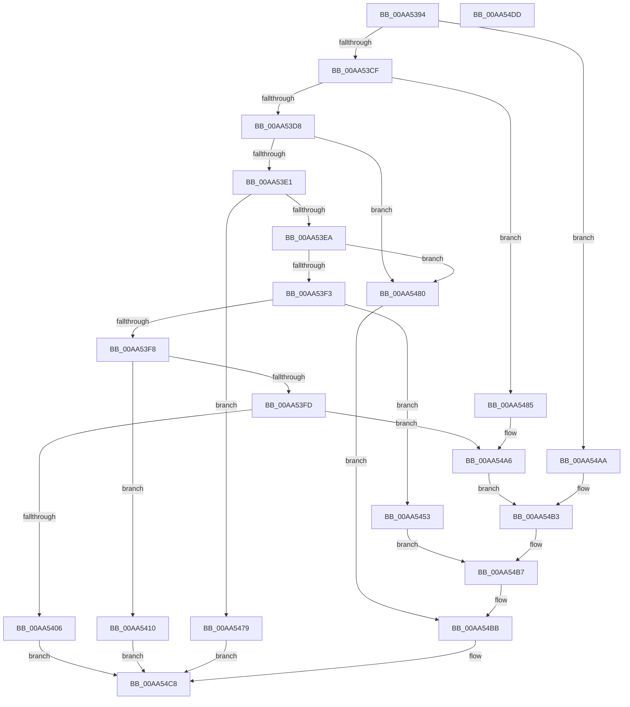

# IopCallArbiter

- RVA: `0x00AA5394`–`0x00AA54DE` (길이 `330` bytes)
- VA: `0x0000000140AA5394`
- 실행 섹션: `PAGE`
- PDB 이름 있음: `예`; PDB Function 태그: `아니요`
- unwind 정보 RVA: `0x000BB674`
- 디코드: `88`개 명령, `330/330` bytes 표시
- 미해석 바이트: `0` (있으면 어셈블리에 `.byte`로 보존)

> 이 문서는 커널 이미지의 기계어와 PDB 기호를 분석해 생성했습니다. 4번과 5번은 함수 원형과 자료형을 바이너리 사용 방식에서 추정한 C 해석이며 원본 소스 복구 결과는 아닙니다.

## 1. Dependencies

- 직접 호출 지점: **3**; 고유 호출 대상: **1**
- 직접 호출자로 확인된 함수: **3**
- RIP 상대 이미지 참조: **0**

### Outgoing calls
- `0x00AA5443` → [guard_dispatch_icall](../../text/6B/guard_dispatch_icall_function_006BAAD0.md) (function, `0x006BAAD0`)
- `0x00AA54A1` → [guard_dispatch_icall](../../text/6B/guard_dispatch_icall_function_006BAAD0.md) (function, `0x006BAAD0`)
- `0x00AA54C3` → [guard_dispatch_icall](../../text/6B/guard_dispatch_icall_function_006BAAD0.md) (function, `0x006BAAD0`)

### Direct callers
- [PnpReleaseBootResourcesForFilteredRequirements](../../text/5A/PnpReleaseBootResourcesForFilteredRequirements_function_005A79D4.md) at `0x005A7B7E`
- [PnpReleaseBootResourcesForFilteredRequirements](../../text/5A/PnpReleaseBootResourcesForFilteredRequirements_function_005A79D4.md) at `0x005A7BB9`
- [PnpReleaseResourcesInternal](PnpReleaseResourcesInternal_function_00AA5140.md) at `0x00AA528D`
- [sub_00B43B26](../B4/Unknown_function_00B43B26.md) at `0x00B43C84`

### Static image references
- 디코드된 RIP-relative 메모리 참조가 없습니다.

## 2. Other-region calls and transfers

- 다른 실행 섹션으로 향하는 call: **3**
  - `0x00AA5443` → [guard_dispatch_icall](../../text/6B/guard_dispatch_icall_function_006BAAD0.md) (`PAGE` → `.text`)
  - `0x00AA54A1` → [guard_dispatch_icall](../../text/6B/guard_dispatch_icall_function_006BAAD0.md) (`PAGE` → `.text`)
  - `0x00AA54C3` → [guard_dispatch_icall](../../text/6B/guard_dispatch_icall_function_006BAAD0.md) (`PAGE` → `.text`)
- 별도 외부 분기/꼬리 이동을 확인하지 못했습니다.

## 3. Assembly (complete function range)

```asm
00AA5394  48 89 5C 24 08                  mov qword ptr [rsp + 8], rbx
00AA5399  48 89 74 24 10                  mov qword ptr [rsp + 0x10], rsi
00AA539E  48 89 7C 24 18                  mov qword ptr [rsp + 0x18], rdi
00AA53A3  55                              push rbp
00AA53A4  48 8B EC                        mov rbp, rsp
00AA53A7  48 83 EC 50                     sub rsp, 0x50
00AA53AB  48 8B 59 18                     mov rbx, qword ptr [rcx + 0x18]
00AA53AF  0F 57 C0                        xorps xmm0, xmm0
00AA53B2  33 C0                           xor eax, eax
00AA53B4  49 8B F8                        mov rdi, r8
00AA53B7  8B F2                           mov esi, edx
00AA53B9  8B CA                           mov ecx, edx
00AA53BB  0F 11 45 E0                     movups xmmword ptr [rbp - 0x20], xmm0
00AA53BF  0F 11 45 F0                     movups xmmword ptr [rbp - 0x10], xmm0
00AA53C3  0F 11 45 D0                     movups xmmword ptr [rbp - 0x30], xmm0
00AA53C7  85 D2                           test edx, edx
00AA53C9  0F 84 DB 00 00 00               je 0x140aa54aa
00AA53CF  83 E9 01                        sub ecx, 1
00AA53D2  0F 84 AD 00 00 00               je 0x140aa5485
00AA53D8  83 E9 01                        sub ecx, 1
00AA53DB  0F 84 9F 00 00 00               je 0x140aa5480
00AA53E1  83 E9 02                        sub ecx, 2
00AA53E4  0F 84 8F 00 00 00               je 0x140aa5479
00AA53EA  83 E9 01                        sub ecx, 1
00AA53ED  0F 84 8D 00 00 00               je 0x140aa5480
00AA53F3  83 E9 01                        sub ecx, 1
00AA53F6  74 5B                           je 0x140aa5453
00AA53F8  83 E9 01                        sub ecx, 1
00AA53FB  74 13                           je 0x140aa5410
00AA53FD  83 F9 02                        cmp ecx, 2
00AA5400  0F 84 A0 00 00 00               je 0x140aa54a6
00AA5406  B8 0D 00 00 C0                  mov eax, 0xc000000d
00AA540B  E9 B8 00 00 00                  jmp 0x140aa54c8
00AA5410  41 0F 10 40 28                  movups xmm0, xmmword ptr [r8 + 0x28]
00AA5415  48 8D 45 D0                     lea rax, [rbp - 0x30]
00AA5419  BA 07 00 00 00                  mov edx, 7
00AA541E  49 89 40 30                     mov qword ptr [r8 + 0x30], rax
00AA5422  48 8D 45 D0                     lea rax, [rbp - 0x30]
00AA5426  49 89 40 28                     mov qword ptr [r8 + 0x28], rax
00AA542A  48 8D 45 D0                     lea rax, [rbp - 0x30]
00AA542E  48 89 45 E0                     mov qword ptr [rbp - 0x20], rax
00AA5432  4C 8D 45 E0                     lea r8, [rbp - 0x20]
00AA5436  F3 0F 7F 45 D0                  movdqu xmmword ptr [rbp - 0x30], xmm0
00AA543B  48 8B 43 20                     mov rax, qword ptr [rbx + 0x20]
00AA543F  48 8B 4B 08                     mov rcx, qword ptr [rbx + 8]
00AA5443  E8 88 56 C1 FF                  call 0x1406baad0
00AA5448  0F 10 45 D0                     movups xmm0, xmmword ptr [rbp - 0x30]
00AA544C  F3 0F 7F 47 28                  movdqu xmmword ptr [rdi + 0x28], xmm0
00AA5451  EB 75                           jmp 0x140aa54c8
00AA5453  49 8B 00                        mov rax, qword ptr [r8]
00AA5456  BA 06 00 00 00                  mov edx, 6
00AA545B  48 89 45 E0                     mov qword ptr [rbp - 0x20], rax
00AA545F  49 8B 40 08                     mov rax, qword ptr [r8 + 8]
00AA5463  48 89 45 E8                     mov qword ptr [rbp - 0x18], rax
00AA5467  49 8B 40 10                     mov rax, qword ptr [r8 + 0x10]
00AA546B  48 89 45 F0                     mov qword ptr [rbp - 0x10], rax
00AA546F  49 8B 40 18                     mov rax, qword ptr [r8 + 0x18]
00AA5473  48 89 45 F8                     mov qword ptr [rbp - 8], rax
00AA5477  EB 3E                           jmp 0x140aa54b7
00AA5479  B8 02 00 00 C0                  mov eax, 0xc0000002
00AA547E  EB 48                           jmp 0x140aa54c8
00AA5480  45 33 C0                        xor r8d, r8d
00AA5483  EB 36                           jmp 0x140aa54bb
00AA5485  48 89 7D E0                     mov qword ptr [rbp - 0x20], rdi
00AA5489  4C 8D 45 E0                     lea r8, [rbp - 0x20]
00AA548D  89 45 E8                        mov dword ptr [rbp - 0x18], eax
00AA5490  BA 01 00 00 00                  mov edx, 1
00AA5495  48 89 45 F0                     mov qword ptr [rbp - 0x10], rax
00AA5499  48 8B 43 20                     mov rax, qword ptr [rbx + 0x20]
00AA549D  48 8B 4B 08                     mov rcx, qword ptr [rbx + 8]
00AA54A1  E8 2A 56 C1 FF                  call 0x1406baad0
00AA54A6  8B D6                           mov edx, esi
00AA54A8  EB 09                           jmp 0x140aa54b3
00AA54AA  89 45 E8                        mov dword ptr [rbp - 0x18], eax
00AA54AD  33 D2                           xor edx, edx
00AA54AF  48 89 45 F0                     mov qword ptr [rbp - 0x10], rax
00AA54B3  48 89 7D E0                     mov qword ptr [rbp - 0x20], rdi
00AA54B7  4C 8D 45 E0                     lea r8, [rbp - 0x20]
00AA54BB  48 8B 4B 08                     mov rcx, qword ptr [rbx + 8]
00AA54BF  48 8B 43 20                     mov rax, qword ptr [rbx + 0x20]
00AA54C3  E8 08 56 C1 FF                  call 0x1406baad0
00AA54C8  48 8B 5C 24 60                  mov rbx, qword ptr [rsp + 0x60]
00AA54CD  48 8B 74 24 68                  mov rsi, qword ptr [rsp + 0x68]
00AA54D2  48 8B 7C 24 70                  mov rdi, qword ptr [rsp + 0x70]
00AA54D7  48 83 C4 50                     add rsp, 0x50
00AA54DB  5D                              pop rbp
00AA54DC  C3                              ret
00AA54DD  CC                              int3
```

## 4. C-style interpretation (structured pseudocode)

```c
__int64 __fastcall IopCallArbiter(__int64 a1, int a2, __int64 a3)
{
    __int64 result;
    __int64 v_rsp;
    unsigned __int64 v_stack_m10;
    unsigned __int64 v_stack_m18;
    unsigned __int64 v_stack_m20;
    unsigned __int64 v_stack_m28;
    unsigned __int64 v_stack_m38;
    unsigned __int64 v_stack_p10;
    unsigned __int64 v_stack_p18;
    unsigned __int64 v_stack_p8;

    v_stack_p8 = v_rbx;
    v_stack_p10 = v_rsi;
    v_stack_p18 = v_rdi;
    v_rsp = (v_rsp) - (80);
    result = 0;
    v_stack_m28 = v_xmm0;
    v_stack_m18 = v_xmm0;
    v_stack_m38 = v_xmm0;
    if (a2 == 0) goto loc_00AA54AA;
    a1 = (unsigned int)(((unsigned int)(a2)) - (1));
    if (condition_is_equal) goto loc_00AA5485;
    a1 = (unsigned int)((a1) - (1));
    if (condition_is_equal) goto loc_00AA5480;
    a1 = (unsigned int)((a1) - (2));
    if (condition_is_equal) goto loc_00AA5479;
    a1 = (unsigned int)((a1) - (1));
    if (condition_is_equal) goto loc_00AA5480;
    a1 = (unsigned int)((a1) - (1));
    if (condition_is_equal) goto loc_00AA5453;
    a1 = (unsigned int)((a1) - (1));
    if (condition_is_equal) goto loc_00AA5410;
    if (((unsigned int)(a1)) == 2) goto loc_00AA54A6;
    goto loc_00AA54C8;
loc_00AA5410:
    *(unsigned __int64 *)(a3 + 48) = v_stack_m38;
    *(unsigned __int64 *)(a3 + 40) = v_stack_m38;
    v_stack_m28 = v_stack_m38;
    v_stack_m38 = v_xmm0;
    result = guard_dispatch_icall(*(unsigned __int64 *)(*(unsigned __int64 *)(a1 + 24) + 8), 7, v_stack_m28, a4);
    *(unsigned __int64 *)(a3 + 40) = v_xmm0;
    goto loc_00AA54C8;
loc_00AA5453:
    v_stack_m28 = *(unsigned __int64 *)(v_stack_m28);
    v_stack_m20 = *(unsigned __int64 *)(v_stack_m28 + 8);
    v_stack_m18 = *(unsigned __int64 *)(v_stack_m28 + 16);
    v_stack_m10 = *(unsigned __int64 *)(v_stack_m28 + 24);
    goto loc_00AA54B7;
loc_00AA5479:
    goto loc_00AA54C8;
loc_00AA5480:
    a3 = 0;
    goto loc_00AA54BB;
loc_00AA5485:
    v_stack_m28 = 0;
    v_stack_m20 = (unsigned int)((unsigned int)(0xC0000002ULL));
    v_stack_m18 = (unsigned int)(0xC0000002ULL);
    result = guard_dispatch_icall(*(unsigned __int64 *)(*(unsigned __int64 *)(a1 + 24) + 8), 1, v_stack_m28, a4);
loc_00AA54A6:
    goto loc_00AA54B3;
loc_00AA54AA:
    v_stack_m20 = (unsigned int)(result);
    a2 = 0;
    v_stack_m18 = result;
loc_00AA54B3:
    v_stack_m28 = 0;
loc_00AA54B7:
loc_00AA54BB:
    result = guard_dispatch_icall(*(unsigned __int64 *)(*(unsigned __int64 *)(a1 + 24) + 8), a2, v_stack_m28, a4);
loc_00AA54C8:
    v_rsp = (v_rsp) + (80);
    return result;
}
```

## 5. (Beta) C Style

```c
int64_t IopCallArbiter(void *Arg1, int32_t Arg2, void *Arg3)
{
    uint8_t *arg1 = (uint8_t *)Arg1;
    uint8_t *arg3 = (uint8_t *)Arg3;

    int64_t result;
    int64_t local_rsp;
    uint64_t v_stack_m10;
    uint64_t v_stack_m18;
    uint64_t v_stack_m20;
    uint64_t v_stack_m28;
    uint64_t v_stack_m38;
    uint64_t v_stack_p10;
    uint64_t v_stack_p18;
    uint64_t v_stack_p8;

    v_stack_p8 = local_rbx;
    v_stack_p10 = local_rsi;
    v_stack_p18 = local_rdi;
    local_rsp = (local_rsp) - (80);
    result = 0;
    v_stack_m28 = v_xmm0;
    v_stack_m18 = v_xmm0;
    v_stack_m38 = v_xmm0;
    if (Arg2 == 0) goto loc_00AA54AA;
    Arg1 = (uint32_t)(((uint32_t)(Arg2)) - (1));
    if (condition_is_equal) goto loc_00AA5485;
    Arg1 = (uint32_t)((Arg1) - (1));
    if (condition_is_equal) goto loc_00AA5480;
    Arg1 = (uint32_t)((Arg1) - (2));
    if (condition_is_equal) goto loc_00AA5479;
    Arg1 = (uint32_t)((Arg1) - (1));
    if (condition_is_equal) goto loc_00AA5480;
    Arg1 = (uint32_t)((Arg1) - (1));
    if (condition_is_equal) goto loc_00AA5453;
    Arg1 = (uint32_t)((Arg1) - (1));
    if (condition_is_equal) goto loc_00AA5410;
    if (((uint32_t)(Arg1)) == 2) goto loc_00AA54A6;
    goto loc_00AA54C8;
loc_00AA5410:
    *(uint64_t *)(arg3 + 0x30) = v_stack_m38;
    *(uint64_t *)(arg3 + 0x28) = v_stack_m38;
    v_stack_m28 = v_stack_m38;
    v_stack_m38 = v_xmm0;
    result = guard_dispatch_icall(*(uint64_t *)(*(uint64_t *)(arg1 + 0x18) + 0x8), 7, v_stack_m28, a4);
    *(uint64_t *)(arg3 + 0x28) = v_xmm0;
    goto loc_00AA54C8;
loc_00AA5453:
    v_stack_m28 = *(uint64_t *)(v_stack_m28);
    v_stack_m20 = *(uint64_t *)(v_stack_m28 + 0x8);
    v_stack_m18 = *(uint64_t *)(v_stack_m28 + 0x10);
    v_stack_m10 = *(uint64_t *)(v_stack_m28 + 0x18);
    goto loc_00AA54B7;
loc_00AA5479:
    goto loc_00AA54C8;
loc_00AA5480:
    Arg3 = 0;
    goto loc_00AA54BB;
loc_00AA5485:
    v_stack_m28 = 0;
    v_stack_m20 = (uint32_t)((uint32_t)(0xC0000002ULL));
    v_stack_m18 = (uint32_t)(0xC0000002ULL);
    result = guard_dispatch_icall(*(uint64_t *)(*(uint64_t *)(arg1 + 0x18) + 0x8), 1, v_stack_m28, a4);
loc_00AA54A6:
    goto loc_00AA54B3;
loc_00AA54AA:
    v_stack_m20 = (uint32_t)(result);
    Arg2 = 0;
    v_stack_m18 = result;
loc_00AA54B3:
    v_stack_m28 = 0;
loc_00AA54B7:
loc_00AA54BB:
    result = guard_dispatch_icall(*(uint64_t *)(*(uint64_t *)(arg1 + 0x18) + 0x8), Arg2, v_stack_m28, a4);
loc_00AA54C8:
    local_rsp = (local_rsp) + (80);
    return result;
}
```

### 관측된 메모리 오프셋

구조체 형식이 확인되지 않은 접근은 인자 기준의 오프셋으로만 기록했습니다.

| 기준 인자 | 오프셋 표현 | 폭 (bit) | 접근 |
|---|---:|---:|---|
| `Arg1` | `+ 0x18` | `64` | `R` |
| `Arg3` | `+ 0x0` | `64` | `R` |
| `Arg3` | `+ 0x8` | `64` | `R` |
| `Arg3` | `+ 0x10` | `64` | `R` |
| `Arg3` | `+ 0x18` | `64` | `R` |
| `Arg3` | `+ 0x28` | `64` | `W` |
| `Arg3` | `+ 0x28` | `128` | `R` |
| `Arg3` | `+ 0x28` | `128` | `W` |
| `Arg3` | `+ 0x30` | `64` | `W` |

## 6. Execution-region graph

[열기: 2D/3D 그래프와 함수 탐색 컨트롤 패널](../../../control-panel.html?section=page&rva=0x00AA5394&view=graph)

- 2D 그래프는 위에서 아래로 흐르고, 3D 그래프는 빈 공간을 드래그해 회전합니다. Shift+드래그는 이동, 휠은 확대·축소, 함수 노드 선택은 대상 보고서 이동입니다.

### Static fallback


