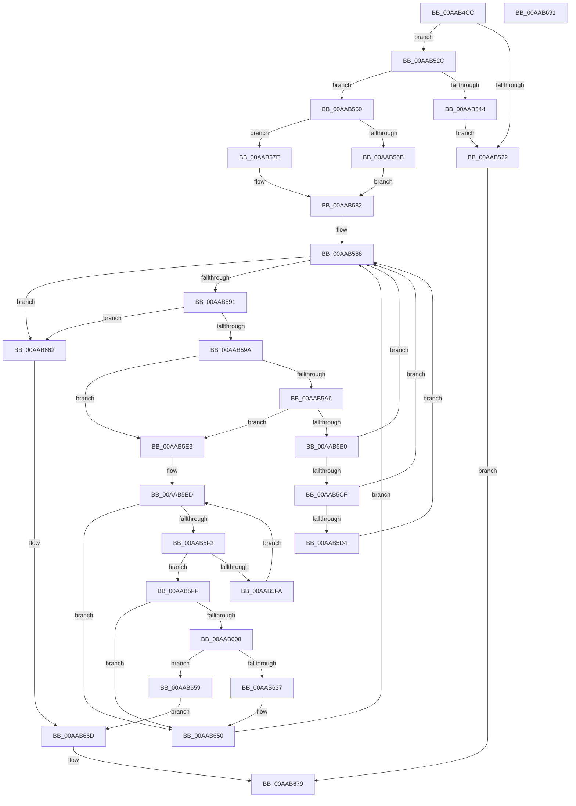

# IopChildToRootTranslation

- RVA: `0x00AAB4CC`–`0x00AAB692` (길이 `454` bytes)
- VA: `0x0000000140AAB4CC`
- 실행 섹션: `PAGE`
- PDB 이름 있음: `예`; PDB Function 태그: `아니요`
- unwind 정보 RVA: `0x000BBDE4`
- 디코드: `131`개 명령, `454/454` bytes 표시
- 미해석 바이트: `0` (있으면 어셈블리에 `.byte`로 보존)

> 이 문서는 커널 이미지의 기계어와 PDB 기호를 분석해 생성했습니다. 4번과 5번은 함수 원형과 자료형을 바이너리 사용 방식에서 추정한 C 해석이며 원본 소스 복구 결과는 아닙니다.

## 1. Dependencies

- 직접 호출 지점: **9**; 고유 호출 대상: **4**
- 직접 호출자로 확인된 함수: **1**
- RIP 상대 이미지 참조: **1**

### Outgoing calls
- `0x00AAB515` → [ExAllocatePool2](../../poolcode/B8/ExAllocatePool2_function_00B820F0.md) (function, `0x00B820F0`)
- `0x00AAB537` → [ExAllocatePool2](../../poolcode/B8/ExAllocatePool2_function_00B820F0.md) (function, `0x00B820F0`)
- `0x00AAB549` → [ExFreePoolWithTag](../../poolcode/B8/ExFreePoolWithTag_function_00B82870.md) (function, `0x00B82870`)
- `0x00AAB571` → [IopFindLegacyBusDeviceNode](IopFindLegacyBusDeviceNode_function_00AAB698.md) (function, `0x00AAB698`)
- `0x00AAB5C2` → [IopFindLegacyBusDeviceNode](IopFindLegacyBusDeviceNode_function_00AAB698.md) (function, `0x00AAB698`)
- `0x00AAB5D9` → [IopFindLegacyBusDeviceNode](IopFindLegacyBusDeviceNode_function_00AAB698.md) (function, `0x00AAB698`)
- `0x00AAB629` → [guard_dispatch_icall](../../text/6B/guard_dispatch_icall_function_006BAAD0.md) (function, `0x006BAAD0`)
- `0x00AAB65B` → [ExFreePoolWithTag](../../poolcode/B8/ExFreePoolWithTag_function_00B82870.md) (function, `0x00B82870`)
- `0x00AAB672` → [ExFreePoolWithTag](../../poolcode/B8/ExFreePoolWithTag_function_00B82870.md) (function, `0x00B82870`)

### Direct callers
- [PnpBuildCmResourceList](PnpBuildCmResourceList_function_00AAB034.md) at `0x00AAB21B`

### Static image references
- `0x00AAB59A` → RVA `0x00F8C438` (`.data`; read)

## 2. Other-region calls and transfers

- 다른 실행 섹션으로 향하는 call: **6**
  - `0x00AAB515` → [ExAllocatePool2](../../poolcode/B8/ExAllocatePool2_function_00B820F0.md) (`PAGE` → `POOLCODE`)
  - `0x00AAB537` → [ExAllocatePool2](../../poolcode/B8/ExAllocatePool2_function_00B820F0.md) (`PAGE` → `POOLCODE`)
  - `0x00AAB549` → [ExFreePoolWithTag](../../poolcode/B8/ExFreePoolWithTag_function_00B82870.md) (`PAGE` → `POOLCODE`)
  - `0x00AAB629` → [guard_dispatch_icall](../../text/6B/guard_dispatch_icall_function_006BAAD0.md) (`PAGE` → `.text`)
  - `0x00AAB65B` → [ExFreePoolWithTag](../../poolcode/B8/ExFreePoolWithTag_function_00B82870.md) (`PAGE` → `POOLCODE`)
  - `0x00AAB672` → [ExFreePoolWithTag](../../poolcode/B8/ExFreePoolWithTag_function_00B82870.md) (`PAGE` → `POOLCODE`)
- 별도 외부 분기/꼬리 이동을 확인하지 못했습니다.

## 3. Assembly (complete function range)

```asm
00AAB4CC  48 89 5C 24 08                  mov qword ptr [rsp + 8], rbx
00AAB4D1  44 89 44 24 18                  mov dword ptr [rsp + 0x18], r8d
00AAB4D6  55                              push rbp
00AAB4D7  56                              push rsi
00AAB4D8  57                              push rdi
00AAB4D9  41 54                           push r12
00AAB4DB  41 55                           push r13
00AAB4DD  41 56                           push r14
00AAB4DF  41 57                           push r15
00AAB4E1  48 83 EC 40                     sub rsp, 0x40
00AAB4E5  33 ED                           xor ebp, ebp
00AAB4E7  45 8B E8                        mov r13d, r8d
00AAB4EA  44 8B E2                        mov r12d, edx
00AAB4ED  48 8B D9                        mov rbx, rcx
00AAB4F0  45 32 F6                        xor r14b, r14b
00AAB4F3  BE 50 70 20 20                  mov esi, 0x20207050
00AAB4F8  44 8B C6                        mov r8d, esi
00AAB4FB  B9 00 01 00 00                  mov ecx, 0x100
00AAB500  8D 45 01                        lea eax, [rbp + 1]
00AAB503  44 3B C8                        cmp r9d, eax
00AAB506  44 8D 7D 14                     lea r15d, [rbp + 0x14]
00AAB50A  41 8B D7                        mov edx, r15d
00AAB50D  0F 94 84 24 98 00 00 00         sete byte ptr [rsp + 0x98]
00AAB515  E8 D6 6B 0D 00                  call 0x140b820f0
00AAB51A  48 8B F8                        mov rdi, rax
00AAB51D  48 85 C0                        test rax, rax
00AAB520  75 0A                           jne 0x140aab52c
00AAB522  B8 9A 00 00 C0                  mov eax, 0xc000009a
00AAB527  E9 4D 01 00 00                  jmp 0x140aab679
00AAB52C  44 8B C6                        mov r8d, esi
00AAB52F  49 8B D7                        mov rdx, r15
00AAB532  B9 00 01 00 00                  mov ecx, 0x100
00AAB537  E8 B4 6B 0D 00                  call 0x140b820f0
00AAB53C  48 8B F0                        mov rsi, rax
00AAB53F  48 85 C0                        test rax, rax
00AAB542  75 0C                           jne 0x140aab550
00AAB544  33 D2                           xor edx, edx
00AAB546  48 8B CF                        mov rcx, rdi
00AAB549  E8 22 73 0D 00                  call 0x140b82870
00AAB54E  EB D2                           jmp 0x140aab522
00AAB550  4C 8B BC 24 A0 00 00 00         mov r15, qword ptr [rsp + 0xa0]
00AAB558  41 0F 10 07                     movups xmm0, xmmword ptr [r15]
00AAB55C  0F 11 07                        movups xmmword ptr [rdi], xmm0
00AAB55F  41 8B 47 10                     mov eax, dword ptr [r15 + 0x10]
00AAB563  89 47 10                        mov dword ptr [rdi + 0x10], eax
00AAB566  48 85 DB                        test rbx, rbx
00AAB569  75 13                           jne 0x140aab57e
00AAB56B  41 8B D5                        mov edx, r13d
00AAB56E  41 8B CC                        mov ecx, r12d
00AAB571  E8 22 01 00 00                  call 0x140aab698
00AAB576  48 8B D8                        mov rbx, rax
00AAB579  45 33 ED                        xor r13d, r13d
00AAB57C  EB 04                           jmp 0x140aab582
00AAB57E  4C 8B 6B 20                     mov r13, qword ptr [rbx + 0x20]
00AAB582  41 BB 01 00 00 00               mov r11d, 1
00AAB588  48 85 DB                        test rbx, rbx
00AAB58B  0F 84 D1 00 00 00               je 0x140aab662
00AAB591  45 84 F6                        test r14b, r14b
00AAB594  0F 85 C8 00 00 00               jne 0x140aab662
00AAB59A  4C 8B 0D 97 0E 4E 00            mov r9, qword ptr [rip + 0x4e0e97]
00AAB5A1  49 3B D9                        cmp rbx, r9
00AAB5A4  75 3D                           jne 0x140aab5e3
00AAB5A6  44 38 B4 24 98 00 00 00         cmp byte ptr [rsp + 0x98], r14b
00AAB5AE  75 33                           jne 0x140aab5e3
00AAB5B0  8B 94 24 90 00 00 00            mov edx, dword ptr [rsp + 0x90]
00AAB5B7  41 8B CC                        mov ecx, r12d
00AAB5BA  44 88 9C 24 98 00 00 00         mov byte ptr [rsp + 0x98], r11b
00AAB5C2  E8 D1 00 00 00                  call 0x140aab698
00AAB5C7  48 8B D8                        mov rbx, rax
00AAB5CA  49 3B C1                        cmp rax, r9
00AAB5CD  75 B9                           jne 0x140aab588
00AAB5CF  45 85 E4                        test r12d, r12d
00AAB5D2  75 B4                           jne 0x140aab588
00AAB5D4  33 D2                           xor edx, edx
00AAB5D6  41 8B CB                        mov ecx, r11d
00AAB5D9  E8 BA 00 00 00                  call 0x140aab698
00AAB5DE  48 8B D8                        mov rbx, rax
00AAB5E1  EB A5                           jmp 0x140aab588
00AAB5E3  48 8D 93 F8 01 00 00            lea rdx, [rbx + 0x1f8]
00AAB5EA  48 8B 0A                        mov rcx, qword ptr [rdx]
00AAB5ED  48 3B CA                        cmp rcx, rdx
00AAB5F0  74 5E                           je 0x140aab650
00AAB5F2  41 8A 07                        mov al, byte ptr [r15]
00AAB5F5  38 41 10                        cmp byte ptr [rcx + 0x10], al
00AAB5F8  74 05                           je 0x140aab5ff
00AAB5FA  48 8B 09                        mov rcx, qword ptr [rcx]
00AAB5FD  EB EE                           jmp 0x140aab5ed
00AAB5FF  48 8B 49 18                     mov rcx, qword ptr [rcx + 0x18]
00AAB603  48 85 C9                        test rcx, rcx
00AAB606  74 48                           je 0x140aab650
00AAB608  48 8B 41 20                     mov rax, qword ptr [rcx + 0x20]
00AAB60C  45 33 C9                        xor r9d, r9d
00AAB60F  48 8B 49 08                     mov rcx, qword ptr [rcx + 8]
00AAB613  45 33 C0                        xor r8d, r8d
00AAB616  48 89 74 24 30                  mov qword ptr [rsp + 0x30], rsi
00AAB61B  48 8B D7                        mov rdx, rdi
00AAB61E  4C 89 6C 24 28                  mov qword ptr [rsp + 0x28], r13
00AAB623  48 83 64 24 20 00               and qword ptr [rsp + 0x20], 0
00AAB629  E8 A2 F4 C0 FF                  call 0x1406baad0
00AAB62E  8B E8                           mov ebp, eax
00AAB630  48 8B CF                        mov rcx, rdi
00AAB633  85 C0                           test eax, eax
00AAB635  78 22                           js 0x140aab659
00AAB637  3D 20 01 00 00                  cmp eax, 0x120
00AAB63C  45 0F B6 F6                     movzx r14d, r14b
00AAB640  41 BB 01 00 00 00               mov r11d, 1
00AAB646  48 8B FE                        mov rdi, rsi
00AAB649  45 0F 44 F3                     cmove r14d, r11d
00AAB64D  48 8B F1                        mov rsi, rcx
00AAB650  48 8B 5B 10                     mov rbx, qword ptr [rbx + 0x10]
00AAB654  E9 2F FF FF FF                  jmp 0x140aab588
00AAB659  33 D2                           xor edx, edx
00AAB65B  E8 10 72 0D 00                  call 0x140b82870
00AAB660  EB 0B                           jmp 0x140aab66d
00AAB662  48 8B 84 24 A8 00 00 00         mov rax, qword ptr [rsp + 0xa8]
00AAB66A  48 89 38                        mov qword ptr [rax], rdi
00AAB66D  33 D2                           xor edx, edx
00AAB66F  48 8B CE                        mov rcx, rsi
00AAB672  E8 F9 71 0D 00                  call 0x140b82870
00AAB677  8B C5                           mov eax, ebp
00AAB679  48 8B 9C 24 80 00 00 00         mov rbx, qword ptr [rsp + 0x80]
00AAB681  48 83 C4 40                     add rsp, 0x40
00AAB685  41 5F                           pop r15
00AAB687  41 5E                           pop r14
00AAB689  41 5D                           pop r13
00AAB68B  41 5C                           pop r12
00AAB68D  5F                              pop rdi
00AAB68E  5E                              pop rsi
00AAB68F  5D                              pop rbp
00AAB690  C3                              ret
00AAB691  CC                              int3
```

## 4. C-style interpretation (structured pseudocode)

```c
__int64 __fastcall IopChildToRootTranslation(__int64 a1, int a2, int a3, int a4, __int64 a5, __int64 a6)
{
    __int64 result;
    __int64 v_r13;
    __int64 v_r14;
    __int64 v_rbp;
    __int64 v_rsp;
    unsigned __int64 v_stack_m48;
    unsigned __int64 v_stack_m50;
    unsigned __int64 v_stack_m58;
    unsigned int v_stack_p18;
    unsigned __int8 v_stack_p20;
    unsigned __int64 v_stack_p8;

    v_stack_p8 = v_rbx;
    v_stack_p18 = a3;
    v_rsp = (v_rsp) - (64);
    v_rbp = 0;
    v_r14 = 0;
    result = ExAllocatePool2(256, (unsigned int)((unsigned int)(v_rbp + 20)), (unsigned int)((unsigned int)((unsigned int)(0x20207050ULL))), a4);
    if (result != 0) goto loc_00AAB52C;
loc_00AAB522:
    goto loc_00AAB679;
loc_00AAB52C:
    result = ExAllocatePool2(256, v_rbp + 20, (unsigned int)((unsigned int)((unsigned int)(0x20207050ULL))), a4);
    if (result != 0) goto loc_00AAB550;
    a2 = 0;
    result = ExFreePoolWithTag(result, a2, (unsigned int)((unsigned int)((unsigned int)(0x20207050ULL))), a4);
    goto loc_00AAB522;
loc_00AAB550:
    *(unsigned __int64 *)(result) = v_xmm0;
    *(unsigned int *)(result + 16) = (unsigned int)((unsigned int)(*(unsigned int *)(a5 + 16)));
    if (a1 != 0) goto loc_00AAB57E;
    result = IopFindLegacyBusDeviceNode((unsigned int)((unsigned int)((unsigned int)(a2))), (unsigned int)((unsigned int)((unsigned int)(a3))), (unsigned int)((unsigned int)((unsigned int)(0x20207050ULL))), a4);
    v_r13 = 0;
    goto loc_00AAB582;
loc_00AAB57E:
loc_00AAB582:
loc_00AAB588:
    if (result == 0) goto loc_00AAB662;
    if (0 != 0) goto loc_00AAB662;
    if (result != (*(unsigned __int64 *)(v_rip + 5115543))) goto loc_00AAB5E3;
    if (v_stack_p20 != 0) goto loc_00AAB5E3;
    v_stack_p20 = 1;
    result = IopFindLegacyBusDeviceNode((unsigned int)((unsigned int)((unsigned int)(a2))), (unsigned int)(v_stack_p18), (unsigned int)((unsigned int)((unsigned int)(0x20207050ULL))), *(unsigned __int64 *)(v_rip + 5115543));
    if (result != (*(unsigned __int64 *)(v_rip + 5115543))) goto loc_00AAB588;
    if ((unsigned int)((unsigned int)(a2)) != 0) goto loc_00AAB588;
    a2 = 0;
    result = IopFindLegacyBusDeviceNode(1, a2, (unsigned int)((unsigned int)((unsigned int)(0x20207050ULL))), *(unsigned __int64 *)(v_rip + 5115543));
    goto loc_00AAB588;
loc_00AAB5E3:
loc_00AAB5ED:
    if ((*(unsigned __int64 *)(result + 504)) == (result + 504)) goto loc_00AAB650;
    if ((*(unsigned __int8 *)(*(unsigned __int64 *)(result + 504) + 16)) == ((unsigned __int8)(*(unsigned __int8 *)(a5)))) goto loc_00AAB5FF;
    goto loc_00AAB5ED;
loc_00AAB5FF:
    if (*(unsigned __int64 *)(*(unsigned __int64 *)(*(unsigned __int64 *)(result + 504)) + 24) == 0) goto loc_00AAB650;
    a4 = 0;
    a3 = 0;
    v_stack_m48 = result;
    v_stack_m50 = *(unsigned __int64 *)(result + 32);
    result = guard_dispatch_icall(*(unsigned __int64 *)(*(unsigned __int64 *)(*(unsigned __int64 *)(*(unsigned __int64 *)(result + 504)) + 24) + 8), result, a3, a4);
    if (sign_flag) goto loc_00AAB659;
    v_r14 = 0;
    if (((unsigned int)(result)) == 288) { v_r14 = 1; }
loc_00AAB650:
    goto loc_00AAB588;
loc_00AAB659:
    a2 = 0;
    result = ExFreePoolWithTag(result, a2, a3, a4);
    goto loc_00AAB66D;
loc_00AAB662:
    *(unsigned __int64 *)(a6) = result;
loc_00AAB66D:
    a2 = 0;
    result = ExFreePoolWithTag(result, a2, a3, a4);
loc_00AAB679:
    v_rsp = (v_rsp) + (64);
    return (unsigned int)((unsigned int)((unsigned int)((unsigned int)(result))));
}
```

## 5. (Beta) C Style

```c
int64_t IopChildToRootTranslation(int64_t Arg1, int32_t Arg2, int32_t Arg3, int32_t Arg4, void *Arg5, void *Arg6)
{
    uint8_t *arg5 = (uint8_t *)Arg5;
    uint8_t *arg6 = (uint8_t *)Arg6;

    int64_t result;
    int64_t local_r13;
    int64_t local_r14;
    int64_t local_rbp;
    int64_t local_rsp;
    uint64_t v_stack_m48;
    uint64_t v_stack_m50;
    uint64_t v_stack_m58;
    uint32_t v_stack_p18;
    uint8_t v_stack_p20;
    uint64_t v_stack_p8;

    v_stack_p8 = local_rbx;
    v_stack_p18 = Arg3;
    local_rsp = (local_rsp) - (64);
    local_rbp = 0;
    local_r14 = 0;
    result = ExAllocatePool2(256, (uint32_t)((uint32_t)(local_rbp + 20)), (uint32_t)((uint32_t)((uint32_t)(0x20207050ULL))), Arg4);
    if (result != 0) goto loc_00AAB52C;
loc_00AAB522:
    goto loc_00AAB679;
loc_00AAB52C:
    result = ExAllocatePool2(256, local_rbp + 20, (uint32_t)((uint32_t)((uint32_t)(0x20207050ULL))), Arg4);
    if (result != 0) goto loc_00AAB550;
    Arg2 = 0;
    result = ExFreePoolWithTag(result, Arg2, (uint32_t)((uint32_t)((uint32_t)(0x20207050ULL))), Arg4);
    goto loc_00AAB522;
loc_00AAB550:
    *(uint64_t *)(result) = v_xmm0;
    *(uint32_t *)(result + 0x10) = (uint32_t)((uint32_t)(*(uint32_t *)(arg5 + 0x10)));
    if (Arg1 != 0) goto loc_00AAB57E;
    result = IopFindLegacyBusDeviceNode((uint32_t)((uint32_t)((uint32_t)(Arg2))), (uint32_t)((uint32_t)((uint32_t)(Arg3))), (uint32_t)((uint32_t)((uint32_t)(0x20207050ULL))), Arg4);
    local_r13 = 0;
    goto loc_00AAB582;
loc_00AAB57E:
loc_00AAB582:
loc_00AAB588:
    if (result == 0) goto loc_00AAB662;
    if (0 != 0) goto loc_00AAB662;
    if (result != (*(uint64_t *)(v_rip + 0x4E0E97))) goto loc_00AAB5E3;
    if (v_stack_p20 != 0) goto loc_00AAB5E3;
    v_stack_p20 = 1;
    result = IopFindLegacyBusDeviceNode((uint32_t)((uint32_t)((uint32_t)(Arg2))), (uint32_t)(v_stack_p18), (uint32_t)((uint32_t)((uint32_t)(0x20207050ULL))), *(uint64_t *)(v_rip + 0x4E0E97));
    if (result != (*(uint64_t *)(v_rip + 0x4E0E97))) goto loc_00AAB588;
    if ((uint32_t)((uint32_t)(Arg2)) != 0) goto loc_00AAB588;
    Arg2 = 0;
    result = IopFindLegacyBusDeviceNode(1, Arg2, (uint32_t)((uint32_t)((uint32_t)(0x20207050ULL))), *(uint64_t *)(v_rip + 0x4E0E97));
    goto loc_00AAB588;
loc_00AAB5E3:
loc_00AAB5ED:
    if ((*(uint64_t *)(result + 0x1F8)) == (result + 504)) goto loc_00AAB650;
    if ((*(uint8_t *)(*(uint64_t *)(result + 0x1F8) + 0x10)) == ((uint8_t)(*(uint8_t *)(arg5)))) goto loc_00AAB5FF;
    goto loc_00AAB5ED;
loc_00AAB5FF:
    if (*(uint64_t *)(*(uint64_t *)(*(uint64_t *)(result + 0x1F8)) + 0x18) == 0) goto loc_00AAB650;
    Arg4 = 0;
    Arg3 = 0;
    v_stack_m48 = result;
    v_stack_m50 = *(uint64_t *)(result + 0x20);
    result = guard_dispatch_icall(*(uint64_t *)(*(uint64_t *)(*(uint64_t *)(*(uint64_t *)(result + 0x1F8)) + 0x18) + 0x8), result, Arg3, Arg4);
    if (sign_flag) goto loc_00AAB659;
    local_r14 = 0;
    if (((uint32_t)(result)) == 288) { local_r14 = 1; }
loc_00AAB650:
    goto loc_00AAB588;
loc_00AAB659:
    Arg2 = 0;
    result = ExFreePoolWithTag(result, Arg2, Arg3, Arg4);
    goto loc_00AAB66D;
loc_00AAB662:
    *(uint64_t *)(arg6) = result;
loc_00AAB66D:
    Arg2 = 0;
    result = ExFreePoolWithTag(result, Arg2, Arg3, Arg4);
loc_00AAB679:
    local_rsp = (local_rsp) + (64);
    return (uint32_t)((uint32_t)((uint32_t)((uint32_t)(result))));
}
```

### 관측된 메모리 오프셋

구조체 형식이 확인되지 않은 접근은 인자 기준의 오프셋으로만 기록했습니다.

| 기준 인자 | 오프셋 표현 | 폭 (bit) | 접근 |
|---|---:|---:|---|
| `Arg5` | `+ 0x0` | `8` | `R` |
| `Arg5` | `+ 0x0` | `128` | `R` |
| `Arg5` | `+ 0x10` | `32` | `R` |
| `Arg6` | `+ 0x0` | `64` | `W` |

## 6. Execution-region graph

[열기: 2D/3D 그래프와 함수 탐색 컨트롤 패널](../../../control-panel.html?section=page&rva=0x00AAB4CC&view=graph)

- 2D 그래프는 위에서 아래로 흐르고, 3D 그래프는 빈 공간을 드래그해 회전합니다. Shift+드래그는 이동, 휠은 확대·축소, 함수 노드 선택은 대상 보고서 이동입니다.

### Static fallback


