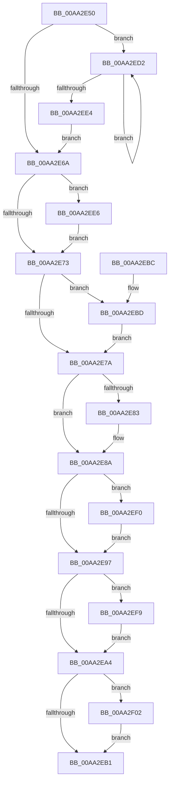

# IopDeleteDriver

- RVA: `0x00AA2E50`–`0x00AA2F0B` (길이 `187` bytes)
- VA: `0x0000000140AA2E50`
- 실행 섹션: `PAGE`
- PDB 이름 있음: `예`; PDB Function 태그: `아니요`
- unwind 정보 RVA: `0x00072DE4`
- 디코드: `58`개 명령, `187/187` bytes 표시
- 미해석 바이트: `0` (있으면 어셈블리에 `.byte`로 보존)

> 이 문서는 커널 이미지의 기계어와 PDB 기호를 분석해 생성했습니다. 4번과 5번은 함수 원형과 자료형을 바이너리 사용 방식에서 추정한 C 해석이며 원본 소스 복구 결과는 아닙니다.

## 1. Dependencies

- 직접 호출 지점: **9**; 고유 호출 대상: **5**
- 직접 호출자로 확인된 함수: **0**
- RIP 상대 이미지 참조: **0**

### Outgoing calls
- `0x00AA2E85` → [ExFreePoolWithTag](../../poolcode/B8/ExFreePoolWithTag_function_00B82870.md) (function, `0x00B82870`)
- `0x00AA2EBD` → [KeFlushQueuedDpcs](../../text/3C/KeFlushQueuedDpcs_function_003C0300.md) (function, `0x003C0300`)
- `0x00AA2EC6` → [MmUnloadSystemImage](MmUnloadSystemImage_function_00AA2F60.md) (function, `0x00AA2F60`)
- `0x00AA2ECB` → [PnpDriverObjectDereferenceComplete](PnpDriverObjectDereferenceComplete_function_00AA2F14.md) (function, `0x00AA2F14`)
- `0x00AA2ED7` → [ExFreePoolWithTag](../../poolcode/B8/ExFreePoolWithTag_function_00B82870.md) (function, `0x00B82870`)
- `0x00AA2EE9` → [IoUnregisterPriorityCallback](../../text/59/IoUnregisterPriorityCallback_function_00597D40.md) (function, `0x00597D40`)
- `0x00AA2EF2` → [ExFreePoolWithTag](../../poolcode/B8/ExFreePoolWithTag_function_00B82870.md) (function, `0x00B82870`)
- `0x00AA2EFB` → [ExFreePoolWithTag](../../poolcode/B8/ExFreePoolWithTag_function_00B82870.md) (function, `0x00B82870`)
- `0x00AA2F04` → [ExFreePoolWithTag](../../poolcode/B8/ExFreePoolWithTag_function_00B82870.md) (function, `0x00B82870`)

### Direct callers
- 이 함수 시작 RVA로 연결되는 직접 call은 확인되지 않았습니다. 간접 호출은 완전히 역산할 수 없습니다.

### Static image references
- 디코드된 RIP-relative 메모리 참조가 없습니다.

## 2. Other-region calls and transfers

- 다른 실행 섹션으로 향하는 call: **7**
  - `0x00AA2E85` → [ExFreePoolWithTag](../../poolcode/B8/ExFreePoolWithTag_function_00B82870.md) (`PAGE` → `POOLCODE`)
  - `0x00AA2EBD` → [KeFlushQueuedDpcs](../../text/3C/KeFlushQueuedDpcs_function_003C0300.md) (`PAGE` → `.text`)
  - `0x00AA2ED7` → [ExFreePoolWithTag](../../poolcode/B8/ExFreePoolWithTag_function_00B82870.md) (`PAGE` → `POOLCODE`)
  - `0x00AA2EE9` → [IoUnregisterPriorityCallback](../../text/59/IoUnregisterPriorityCallback_function_00597D40.md) (`PAGE` → `.text`)
  - `0x00AA2EF2` → [ExFreePoolWithTag](../../poolcode/B8/ExFreePoolWithTag_function_00B82870.md) (`PAGE` → `POOLCODE`)
  - `0x00AA2EFB` → [ExFreePoolWithTag](../../poolcode/B8/ExFreePoolWithTag_function_00B82870.md) (`PAGE` → `POOLCODE`)
  - `0x00AA2F04` → [ExFreePoolWithTag](../../poolcode/B8/ExFreePoolWithTag_function_00B82870.md) (`PAGE` → `POOLCODE`)
- 별도 외부 분기/꼬리 이동을 확인하지 못했습니다.

## 3. Assembly (complete function range)

```asm
00AA2E50  48 89 5C 24 08                  mov qword ptr [rsp + 8], rbx
00AA2E55  57                              push rdi
00AA2E56  48 83 EC 20                     sub rsp, 0x20
00AA2E5A  48 8B 41 30                     mov rax, qword ptr [rcx + 0x30]
00AA2E5E  48 8B F9                        mov rdi, rcx
00AA2E61  48 8B 48 28                     mov rcx, qword ptr [rax + 0x28]
00AA2E65  48 85 C9                        test rcx, rcx
00AA2E68  75 68                           jne 0x140aa2ed2
00AA2E6A  F7 47 10 00 02 00 00            test dword ptr [rdi + 0x10], 0x200
00AA2E71  75 73                           jne 0x140aa2ee6
00AA2E73  48 83 7F 28 00                  cmp qword ptr [rdi + 0x28], 0
00AA2E78  75 43                           jne 0x140aa2ebd
00AA2E7A  48 8B 4F 40                     mov rcx, qword ptr [rdi + 0x40]
00AA2E7E  48 85 C9                        test rcx, rcx
00AA2E81  74 07                           je 0x140aa2e8a
00AA2E83  33 D2                           xor edx, edx
00AA2E85  E8 E6 F9 0D 00                  call 0x140b82870
00AA2E8A  48 8B 47 30                     mov rax, qword ptr [rdi + 0x30]
00AA2E8E  48 8B 48 20                     mov rcx, qword ptr [rax + 0x20]
00AA2E92  48 85 C9                        test rcx, rcx
00AA2E95  75 59                           jne 0x140aa2ef0
00AA2E97  48 8B 47 30                     mov rax, qword ptr [rdi + 0x30]
00AA2E9B  48 8B 48 30                     mov rcx, qword ptr [rax + 0x30]
00AA2E9F  48 85 C9                        test rcx, rcx
00AA2EA2  75 55                           jne 0x140aa2ef9
00AA2EA4  48 8B 47 30                     mov rax, qword ptr [rdi + 0x30]
00AA2EA8  48 8B 48 38                     mov rcx, qword ptr [rax + 0x38]
00AA2EAC  48 85 C9                        test rcx, rcx
00AA2EAF  75 51                           jne 0x140aa2f02
00AA2EB1  48 8B 5C 24 30                  mov rbx, qword ptr [rsp + 0x30]
00AA2EB6  48 83 C4 20                     add rsp, 0x20
00AA2EBA  5F                              pop rdi
00AA2EBB  C3                              ret
00AA2EBC  CC                              int3
00AA2EBD  E8 3E D4 91 FF                  call 0x1403c0300
00AA2EC2  48 8B 4F 28                     mov rcx, qword ptr [rdi + 0x28]
00AA2EC6  E8 95 00 00 00                  call 0x140aa2f60
00AA2ECB  E8 44 00 00 00                  call 0x140aa2f14
00AA2ED0  EB A8                           jmp 0x140aa2e7a
00AA2ED2  48 8B 19                        mov rbx, qword ptr [rcx]
00AA2ED5  33 D2                           xor edx, edx
00AA2ED7  E8 94 F9 0D 00                  call 0x140b82870
00AA2EDC  48 8B CB                        mov rcx, rbx
00AA2EDF  48 85 DB                        test rbx, rbx
00AA2EE2  75 EE                           jne 0x140aa2ed2
00AA2EE4  EB 84                           jmp 0x140aa2e6a
00AA2EE6  48 8B CF                        mov rcx, rdi
00AA2EE9  E8 52 4E AF FF                  call 0x140597d40
00AA2EEE  EB 83                           jmp 0x140aa2e73
00AA2EF0  33 D2                           xor edx, edx
00AA2EF2  E8 79 F9 0D 00                  call 0x140b82870
00AA2EF7  EB 9E                           jmp 0x140aa2e97
00AA2EF9  33 D2                           xor edx, edx
00AA2EFB  E8 70 F9 0D 00                  call 0x140b82870
00AA2F00  EB A2                           jmp 0x140aa2ea4
00AA2F02  33 D2                           xor edx, edx
00AA2F04  E8 67 F9 0D 00                  call 0x140b82870
00AA2F09  EB A6                           jmp 0x140aa2eb1
```

## 4. C-style interpretation (structured pseudocode)

```c
__int64 __fastcall IopDeleteDriver(__int64 a1, int a2)
{
    __int64 result;
    __int64 v_rsp;
    unsigned __int64 v_stack_p8;

    v_stack_p8 = v_rbx;
    v_rsp = (v_rsp) - (32);
    if (*(unsigned __int64 *)(*(unsigned __int64 *)(a1 + 48) + 40) != 0) goto loc_00AA2ED2;
loc_00AA2E6A:
    if (((*(unsigned int *)(a1 + 16)) & (512)) != 0) goto loc_00AA2EE6;
loc_00AA2E73:
    if ((*(unsigned __int64 *)(a1 + 40)) != 0) goto loc_00AA2EBD;
loc_00AA2E7A:
    result = *(unsigned __int64 *)(a1 + 48);
    if (*(unsigned __int64 *)(a1 + 64) != 0) {
        a2 = 0;
        result = ExFreePoolWithTag(*(unsigned __int64 *)(a1 + 64), a2, a3, a4);
    }
    if (*(unsigned __int64 *)(*(unsigned __int64 *)(a1 + 48) + 32) != 0) goto loc_00AA2EF0;
loc_00AA2E97:
    if (*(unsigned __int64 *)(*(unsigned __int64 *)(a1 + 48) + 48) != 0) goto loc_00AA2EF9;
loc_00AA2EA4:
    if (*(unsigned __int64 *)(*(unsigned __int64 *)(a1 + 48) + 56) != 0) goto loc_00AA2F02;
loc_00AA2EB1:
    v_rsp = (v_rsp) + (32);
    return *(unsigned __int64 *)(a1 + 48);
loc_00AA2EBD:
    result = KeFlushQueuedDpcs(*(unsigned __int64 *)(*(unsigned __int64 *)(a1 + 48) + 56), a2, a3, a4);
    result = MmUnloadSystemImage(*(unsigned __int64 *)(a1 + 40), a2, a3, a4);
    result = PnpDriverObjectDereferenceComplete(*(unsigned __int64 *)(a1 + 40), a2, a3, a4);
    goto loc_00AA2E7A;
loc_00AA2ED2:
    a2 = 0;
    result = ExFreePoolWithTag(*(unsigned __int64 *)(a1 + 40), a2, a3, a4);
    if (*(unsigned __int64 *)(*(unsigned __int64 *)(a1 + 40)) != 0) goto loc_00AA2ED2;
    goto loc_00AA2E6A;
loc_00AA2EE6:
    result = IoUnregisterPriorityCallback(a1, a2, a3, a4);
    goto loc_00AA2E73;
loc_00AA2EF0:
    a2 = 0;
    result = ExFreePoolWithTag(a1, a2, a3, a4);
    goto loc_00AA2E97;
loc_00AA2EF9:
    a2 = 0;
    result = ExFreePoolWithTag(a1, a2, a3, a4);
    goto loc_00AA2EA4;
loc_00AA2F02:
    a2 = 0;
    result = ExFreePoolWithTag(a1, a2, a3, a4);
    goto loc_00AA2EB1;
}
```

## 5. (Beta) C Style

```c
int64_t IopDeleteDriver(void *Arg1, int32_t Arg2)
{
    uint8_t *arg1 = (uint8_t *)Arg1;

    int64_t result;
    int64_t local_rsp;
    uint64_t v_stack_p8;

    v_stack_p8 = local_rbx;
    local_rsp = (local_rsp) - (32);
    if (*(uint64_t *)(*(uint64_t *)(arg1 + 0x30) + 0x28) != 0) goto loc_00AA2ED2;
loc_00AA2E6A:
    if (((*(uint32_t *)(arg1 + 0x10)) & (512)) != 0) goto loc_00AA2EE6;
loc_00AA2E73:
    if ((*(uint64_t *)(arg1 + 0x28)) != 0) goto loc_00AA2EBD;
loc_00AA2E7A:
    result = *(uint64_t *)(arg1 + 0x30);
    if (*(uint64_t *)(arg1 + 0x40) != 0) {
        Arg2 = 0;
        result = ExFreePoolWithTag(*(uint64_t *)(arg1 + 0x40), Arg2, a3, a4);
    }
    if (*(uint64_t *)(*(uint64_t *)(arg1 + 0x30) + 0x20) != 0) goto loc_00AA2EF0;
loc_00AA2E97:
    if (*(uint64_t *)(*(uint64_t *)(arg1 + 0x30) + 0x30) != 0) goto loc_00AA2EF9;
loc_00AA2EA4:
    if (*(uint64_t *)(*(uint64_t *)(arg1 + 0x30) + 0x38) != 0) goto loc_00AA2F02;
loc_00AA2EB1:
    local_rsp = (local_rsp) + (32);
    return *(uint64_t *)(arg1 + 0x30);
loc_00AA2EBD:
    result = KeFlushQueuedDpcs(*(uint64_t *)(*(uint64_t *)(arg1 + 0x30) + 0x38), Arg2, a3, a4);
    result = MmUnloadSystemImage(*(uint64_t *)(arg1 + 0x28), Arg2, a3, a4);
    result = PnpDriverObjectDereferenceComplete(*(uint64_t *)(arg1 + 0x28), Arg2, a3, a4);
    goto loc_00AA2E7A;
loc_00AA2ED2:
    Arg2 = 0;
    result = ExFreePoolWithTag(*(uint64_t *)(arg1 + 0x28), Arg2, a3, a4);
    if (*(uint64_t *)(*(uint64_t *)(arg1 + 0x28)) != 0) goto loc_00AA2ED2;
    goto loc_00AA2E6A;
loc_00AA2EE6:
    result = IoUnregisterPriorityCallback(Arg1, Arg2, a3, a4);
    goto loc_00AA2E73;
loc_00AA2EF0:
    Arg2 = 0;
    result = ExFreePoolWithTag(Arg1, Arg2, a3, a4);
    goto loc_00AA2E97;
loc_00AA2EF9:
    Arg2 = 0;
    result = ExFreePoolWithTag(Arg1, Arg2, a3, a4);
    goto loc_00AA2EA4;
loc_00AA2F02:
    Arg2 = 0;
    result = ExFreePoolWithTag(Arg1, Arg2, a3, a4);
    goto loc_00AA2EB1;
}
```

### 관측된 메모리 오프셋

구조체 형식이 확인되지 않은 접근은 인자 기준의 오프셋으로만 기록했습니다.

| 기준 인자 | 오프셋 표현 | 폭 (bit) | 접근 |
|---|---:|---:|---|
| `Arg1` | `+ 0x10` | `32` | `R` |
| `Arg1` | `+ 0x28` | `64` | `R` |
| `Arg1` | `+ 0x30` | `64` | `R` |
| `Arg1` | `+ 0x40` | `64` | `R` |

## 6. Execution-region graph

[열기: 2D/3D 그래프와 함수 탐색 컨트롤 패널](../../../control-panel.html?section=page&rva=0x00AA2E50&view=graph)

- 2D 그래프는 위에서 아래로 흐르고, 3D 그래프는 빈 공간을 드래그해 회전합니다. Shift+드래그는 이동, 휠은 확대·축소, 함수 노드 선택은 대상 보고서 이동입니다.

### Static fallback


