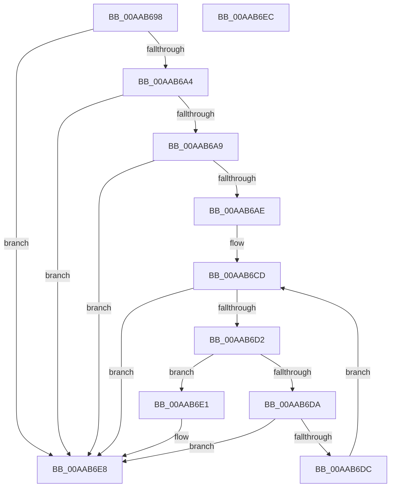

# IopFindLegacyBusDeviceNode

- RVA: `0x00AAB698`–`0x00AAB6ED` (길이 `85` bytes)
- VA: `0x0000000140AAB698`
- 실행 섹션: `PAGE`
- PDB 이름 있음: `예`; PDB Function 태그: `아니요`
- unwind 정보 RVA: `0x000DB714`
- 디코드: `26`개 명령, `85/85` bytes 표시
- 미해석 바이트: `0` (있으면 어셈블리에 `.byte`로 보존)

> 이 문서는 커널 이미지의 기계어와 PDB 기호를 분석해 생성했습니다. 4번과 5번은 함수 원형과 자료형을 바이너리 사용 방식에서 추정한 C 해석이며 원본 소스 복구 결과는 아닙니다.

## 1. Dependencies

- 직접 호출 지점: **0**; 고유 호출 대상: **0**
- 직접 호출자로 확인된 함수: **5**
- RIP 상대 이미지 참조: **2**

### Outgoing calls
- 직접 디코드된 call 명령이 없습니다.

### Direct callers
- [IoTranslateBusAddress](../../text/5A/IoTranslateBusAddress_function_005A5F60.md) at `0x005A6002`
- [IopDuplicateDetection](../72/IopDuplicateDetection_function_0072E4AC.md) at `0x0072E4DC`
- [PnpReleaseResourcesInternal](PnpReleaseResourcesInternal_function_00AA5140.md) at `0x00AA522B`
- [PnpReleaseResourcesInternal](PnpReleaseResourcesInternal_function_00AA5140.md) at `0x00AA5242`
- [IopChildToRootTranslation](IopChildToRootTranslation_function_00AAB4CC.md) at `0x00AAB571`
- [IopChildToRootTranslation](IopChildToRootTranslation_function_00AAB4CC.md) at `0x00AAB5C2`
- [IopChildToRootTranslation](IopChildToRootTranslation_function_00AAB4CC.md) at `0x00AAB5D9`
- [sub_00B43B26](../B4/Unknown_function_00B43B26.md) at `0x00B43B42`
- [sub_00B43B26](../B4/Unknown_function_00B43B26.md) at `0x00B43B75`

### Static image references
- `0x00AAB698` → RVA `0x00F8C438` (`.data`; read)
- `0x00AAB6B9` → RVA `0x00F8C160` (`.data`; read)

## 2. Other-region calls and transfers

- 다른 실행 섹션으로 향하는 call: **0**
- 별도 외부 분기/꼬리 이동을 확인하지 못했습니다.

## 3. Assembly (complete function range)

```asm
00AAB698  4C 8B 05 99 0D 4E 00            mov r8, qword ptr [rip + 0x4e0d99]
00AAB69F  83 F9 12                        cmp ecx, 0x12
00AAB6A2  7D 44                           jge 0x140aab6e8
00AAB6A4  83 F9 0F                        cmp ecx, 0xf
00AAB6A7  74 3F                           je 0x140aab6e8
00AAB6A9  83 F9 FF                        cmp ecx, -1
00AAB6AC  7E 3A                           jle 0x140aab6e8
00AAB6AE  83 F9 02                        cmp ecx, 2
00AAB6B1  B8 01 00 00 00                  mov eax, 1
00AAB6B6  0F 45 C1                        cmovne eax, ecx
00AAB6B9  48 8D 0D A0 0A 4E 00            lea rcx, [rip + 0x4e0aa0]
00AAB6C0  4C 63 D0                        movsxd r10, eax
00AAB6C3  49 C1 E2 04                     shl r10, 4
00AAB6C7  4C 03 D1                        add r10, rcx
00AAB6CA  49 8B 02                        mov rax, qword ptr [r10]
00AAB6CD  49 3B C2                        cmp rax, r10
00AAB6D0  74 16                           je 0x140aab6e8
00AAB6D2  39 90 54 FF FF FF               cmp dword ptr [rax - 0xac], edx
00AAB6D8  74 07                           je 0x140aab6e1
00AAB6DA  77 0C                           ja 0x140aab6e8
00AAB6DC  48 8B 00                        mov rax, qword ptr [rax]
00AAB6DF  EB EC                           jmp 0x140aab6cd
00AAB6E1  4C 8D 80 90 FD FF FF            lea r8, [rax - 0x270]
00AAB6E8  49 8B C0                        mov rax, r8
00AAB6EB  C3                              ret
00AAB6EC  CC                              int3
```

## 4. C-style interpretation (structured pseudocode)

```c
__int64 __fastcall IopFindLegacyBusDeviceNode(int a1, int a2)
{
    __int64 result;
    __int64 v_r10;

    if (a1 >= 18) goto loc_00AAB6E8;
    if (a1 == 15) goto loc_00AAB6E8;
    if (a1 <= -1) goto loc_00AAB6E8;
    result = 1;
    if (a1 != 2) { result = a1; }
    v_r10 = ((int)((unsigned int)(result))) << (4);
    v_r10 = (v_r10) + (v_rip + 5114528);
loc_00AAB6CD:
    if ((*(unsigned __int64 *)(v_r10)) == v_r10) goto loc_00AAB6E8;
    if ((*(unsigned int *)(*(unsigned __int64 *)(v_r10) - 172)) == a2) goto loc_00AAB6E1;
    if ((*(unsigned int *)(*(unsigned __int64 *)(v_r10) - 172)) > a2) goto loc_00AAB6E8;
    goto loc_00AAB6CD;
loc_00AAB6E1:
loc_00AAB6E8:
    return *(unsigned __int64 *)(*(unsigned __int64 *)(v_r10)) - 624;
}
```

## 5. (Beta) C Style

```c
int64_t IopFindLegacyBusDeviceNode(int32_t Arg1, int32_t Arg2)
{
    int64_t result;
    int64_t local_r10;

    if (Arg1 >= 18) goto loc_00AAB6E8;
    if (Arg1 == 15) goto loc_00AAB6E8;
    if (Arg1 <= -1) goto loc_00AAB6E8;
    result = 1;
    if (Arg1 != 2) { result = Arg1; }
    local_r10 = ((int32_t)((uint32_t)(result))) << (4);
    local_r10 = (local_r10) + (v_rip + 5114528);
loc_00AAB6CD:
    if ((*(uint64_t *)(local_r10)) == local_r10) goto loc_00AAB6E8;
    if ((*(uint32_t *)(*(uint64_t *)(local_r10) - 0xAC)) == Arg2) goto loc_00AAB6E1;
    if ((*(uint32_t *)(*(uint64_t *)(local_r10) - 0xAC)) > Arg2) goto loc_00AAB6E8;
    goto loc_00AAB6CD;
loc_00AAB6E1:
loc_00AAB6E8:
    return *(uint64_t *)(*(uint64_t *)(local_r10)) - 624;
}
```

## 6. Execution-region graph

[열기: 2D/3D 그래프와 함수 탐색 컨트롤 패널](../../../control-panel.html?section=page&rva=0x00AAB698&view=graph)

- 2D 그래프는 위에서 아래로 흐르고, 3D 그래프는 빈 공간을 드래그해 회전합니다. Shift+드래그는 이동, 휠은 확대·축소, 함수 노드 선택은 대상 보고서 이동입니다.

### Static fallback


