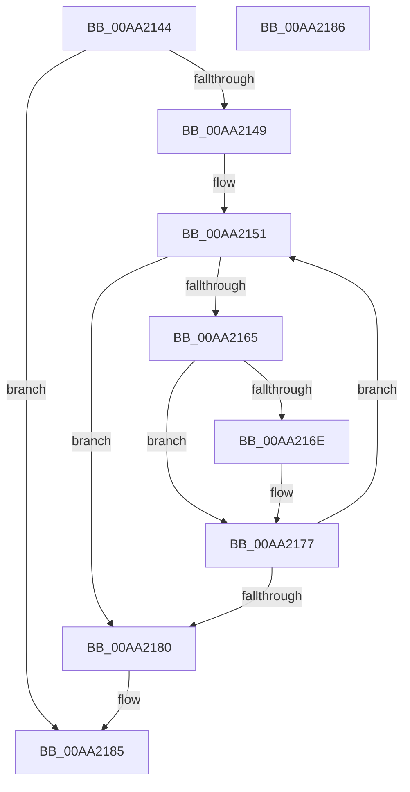

# IopIncDisableableDepends

- RVA: `0x00AA2144`–`0x00AA2187` (길이 `67` bytes)
- VA: `0x0000000140AA2144`
- 실행 섹션: `PAGE`
- PDB 이름 있음: `예`; PDB Function 태그: `아니요`
- unwind 정보 RVA: `0x000805BC`
- 디코드: `22`개 명령, `67/67` bytes 표시
- 미해석 바이트: `0` (있으면 어셈블리에 `.byte`로 보존)

> 이 문서는 커널 이미지의 기계어와 PDB 기호를 분석해 생성했습니다. 4번과 5번은 함수 원형과 자료형을 바이너리 사용 방식에서 추정한 C 해석이며 원본 소스 복구 결과는 아닙니다.

## 1. Dependencies

- 직접 호출 지점: **1**; 고유 호출 대상: **1**
- 직접 호출자로 확인된 함수: **1**
- RIP 상대 이미지 참조: **0**

### Outgoing calls
- `0x00AA2172` → [PnpRaiseNtPlugPlayDevicePropertyChangeEvent](../8F/PnpRaiseNtPlugPlayDevicePropertyChangeEvent_function_008F7D80.md) (function, `0x008F7D80`)

### Direct callers
- [PiProcessQueryDeviceState](../8F/PiProcessQueryDeviceState_function_008FA0F8.md) at `0x008FA2B3`

### Static image references
- 디코드된 RIP-relative 메모리 참조가 없습니다.

## 2. Other-region calls and transfers

- 다른 실행 섹션으로 향하는 call: **0**
- 별도 외부 분기/꼬리 이동을 확인하지 못했습니다.

## 3. Assembly (complete function range)

```asm
00AA2144  48 85 C9                        test rcx, rcx
00AA2147  74 3C                           je 0x140aa2185
00AA2149  53                              push rbx
00AA214A  48 83 EC 20                     sub rsp, 0x20
00AA214E  48 8B D9                        mov rbx, rcx
00AA2151  B8 01 00 00 00                  mov eax, 1
00AA2156  F0 0F C1 83 58 02 00 00         lock xadd dword ptr [rbx + 0x258], eax
00AA215E  FF C0                           inc eax
00AA2160  83 F8 01                        cmp eax, 1
00AA2163  75 1B                           jne 0x140aa2180
00AA2165  48 8B 53 30                     mov rdx, qword ptr [rbx + 0x30]
00AA2169  48 85 D2                        test rdx, rdx
00AA216C  74 09                           je 0x140aa2177
00AA216E  44 8D 40 0A                     lea r8d, [rax + 0xa]
00AA2172  E8 09 5C E5 FF                  call 0x1408f7d80
00AA2177  48 8B 5B 10                     mov rbx, qword ptr [rbx + 0x10]
00AA217B  48 85 DB                        test rbx, rbx
00AA217E  75 D1                           jne 0x140aa2151
00AA2180  48 83 C4 20                     add rsp, 0x20
00AA2184  5B                              pop rbx
00AA2185  C3                              ret
00AA2186  CC                              int3
```

## 4. C-style interpretation (structured pseudocode)

```c
__int64 __fastcall IopIncDisableableDepends(__int64 a1)
{
    __int64 result;
    __int64 v_rsp;

    if (a1 == 0) goto loc_00AA2185;
    v_rsp = (v_rsp) - (32);
loc_00AA2151:
    result = (unsigned int)((1) + 1);
    if (((unsigned int)(result)) != 1) goto loc_00AA2180;
    if (*(unsigned __int64 *)(a1 + 48) != 0) {
        a3 = result + 10;
        result = PnpRaiseNtPlugPlayDevicePropertyChangeEvent(a1, *(unsigned __int64 *)(a1 + 48), a3, a4);
    }
    if (*(unsigned __int64 *)(a1 + 16) != 0) goto loc_00AA2151;
loc_00AA2180:
    v_rsp = (v_rsp) + (32);
loc_00AA2185:
    return result;
}
```

## 5. (Beta) C Style

```c
int64_t IopIncDisableableDepends(int64_t Arg1)
{
    int64_t result;
    int64_t local_rsp;

    if (Arg1 == 0) goto loc_00AA2185;
    local_rsp = (local_rsp) - (32);
loc_00AA2151:
    result = (uint32_t)((1) + 1);
    if (((uint32_t)(result)) != 1) goto loc_00AA2180;
    if (*(uint64_t *)(Arg1 + 0x30) != 0) {
        a3 = result + 10;
        result = PnpRaiseNtPlugPlayDevicePropertyChangeEvent(Arg1, *(uint64_t *)(Arg1 + 0x30), a3, a4);
    }
    if (*(uint64_t *)(Arg1 + 0x10) != 0) goto loc_00AA2151;
loc_00AA2180:
    local_rsp = (local_rsp) + (32);
loc_00AA2185:
    return result;
}
```

## 6. Execution-region graph

[열기: 2D/3D 그래프와 함수 탐색 컨트롤 패널](../../../control-panel.html?section=page&rva=0x00AA2144&view=graph)

- 2D 그래프는 위에서 아래로 흐르고, 3D 그래프는 빈 공간을 드래그해 회전합니다. Shift+드래그는 이동, 휠은 확대·축소, 함수 노드 선택은 대상 보고서 이동입니다.

### Static fallback


