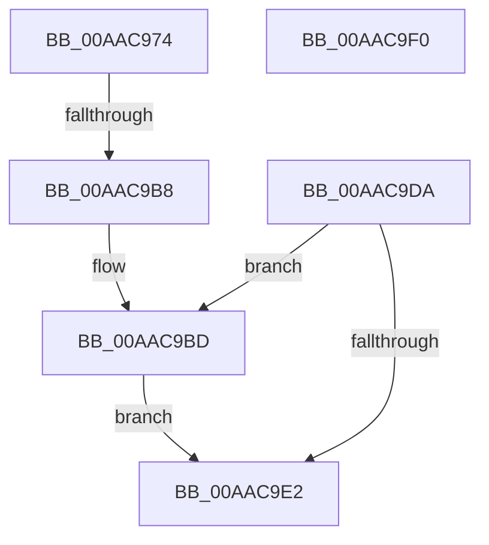

# IopIoRingDispatchRead

- RVA: `0x00AAC974`–`0x00AAC9F1` (길이 `125` bytes)
- VA: `0x0000000140AAC974`
- 실행 섹션: `PAGE`
- PDB 이름 있음: `예`; PDB Function 태그: `예`
- unwind 정보 RVA: `0x000BBF1C`
- 디코드: `36`개 명령, `125/125` bytes 표시
- 미해석 바이트: `0` (있으면 어셈블리에 `.byte`로 보존)

> 이 문서는 커널 이미지의 기계어와 PDB 기호를 분석해 생성했습니다. 4번과 5번은 함수 원형과 자료형을 바이너리 사용 방식에서 추정한 C 해석이며 원본 소스 복구 결과는 아닙니다.

## 1. Dependencies

- 직접 호출 지점: **1**; 고유 호출 대상: **1**
- 직접 호출자로 확인된 함수: **1**
- RIP 상대 이미지 참조: **0**

### Outgoing calls
- `0x00AAC9D3` → [IopCompleteIoRingEntry](../../text/3E/IopCompleteIoRingEntry_function_003ED2C0.md) (function, `0x003ED2C0`)

### Direct callers
- [IopProcessIoRingEntry](../70/IopProcessIoRingEntry_function_00700A38.md) at `0x00700B35`

### Static image references
- 디코드된 RIP-relative 메모리 참조가 없습니다.

## 2. Other-region calls and transfers

- 다른 실행 섹션으로 향하는 call: **1**
  - `0x00AAC9D3` → [IopCompleteIoRingEntry](../../text/3E/IopCompleteIoRingEntry_function_003ED2C0.md) (`PAGE` → `.text`)
- call이 아닌 외부 분기/꼬리 이동: **1**
  - `0x00AAC9B2` → [sub_00B4A690](../B4/Unknown_function_00B4A690.md) (`tail-transfer`)

## 3. Assembly (complete function range)

```asm
00AAC974  40 55                           push rbp
00AAC976  53                              push rbx
00AAC977  56                              push rsi
00AAC978  57                              push rdi
00AAC979  41 56                           push r14
00AAC97B  48 8B EC                        mov rbp, rsp
00AAC97E  48 81 EC 80 00 00 00            sub rsp, 0x80
00AAC985  65 48 8B 04 25 88 01 00 00      mov rax, qword ptr gs:[0x188]
00AAC98E  0F 57 C0                        xorps xmm0, xmm0
00AAC991  44 8B 42 10                     mov r8d, dword ptr [rdx + 0x10]
00AAC995  48 8B DA                        mov rbx, rdx
00AAC998  48 8B F1                        mov rsi, rcx
00AAC99B  44 8A B0 32 02 00 00            mov r14b, byte ptr [rax + 0x232]
00AAC9A2  48 83 65 38 00                  and qword ptr [rbp + 0x38], 0
00AAC9A7  0F 11 45 F0                     movups xmmword ptr [rbp - 0x10], xmm0
00AAC9AB  41 F7 C0 FC FF FF FF            test r8d, 0xfffffffc
00AAC9B2  0F 84 D8 DC 09 00               je 0x140b4a690
00AAC9B8  BF 01 00 46 C0                  mov edi, 0xc0460001
00AAC9BD  48 83 65 F8 00                  and qword ptr [rbp - 8], 0
00AAC9C2  4C 8D 45 F0                     lea r8, [rbp - 0x10]
00AAC9C6  48 8B 53 08                     mov rdx, qword ptr [rbx + 8]
00AAC9CA  45 33 C9                        xor r9d, r9d
00AAC9CD  48 8B CE                        mov rcx, rsi
00AAC9D0  89 7D F0                        mov dword ptr [rbp - 0x10], edi
00AAC9D3  E8 E8 08 94 FF                  call 0x1403ed2c0
00AAC9D8  EB 08                           jmp 0x140aac9e2
00AAC9DA  81 FF 03 01 00 00               cmp edi, 0x103
00AAC9E0  75 DB                           jne 0x140aac9bd
00AAC9E2  48 81 C4 80 00 00 00            add rsp, 0x80
00AAC9E9  41 5E                           pop r14
00AAC9EB  5F                              pop rdi
00AAC9EC  5E                              pop rsi
00AAC9ED  5B                              pop rbx
00AAC9EE  5D                              pop rbp
00AAC9EF  C3                              ret
00AAC9F0  CC                              int3
```

## 4. C-style interpretation (structured pseudocode)

```c
__int64 __fastcall IopIoRingDispatchRead(__int64 a1, __int64 a2, __int64 a3, int a4)
{
    __int64 result;
    __int64 v_rsp;
    unsigned __int64 v_stack_m30;
    unsigned __int64 v_stack_m38;
    unsigned __int64 v_stack_p10;

    v_rsp = (v_rsp) - (128);
    v_stack_m38 = v_xmm0;
loc_00AAC9BD:
    a4 = 0;
    v_stack_m38 = (unsigned int)((unsigned int)(0xC0460001ULL));
    result = IopCompleteIoRingEntry(a1, *(unsigned __int64 *)(a2 + 8), v_stack_m38, a4);
    goto loc_00AAC9E2;
loc_00AAC9E2:
    v_rsp = (v_rsp) + (128);
    return result;
}
```

## 5. (Beta) C Style

```c
int64_t IopIoRingDispatchRead(int64_t Arg1, void *Arg2, int64_t Arg3, int32_t Arg4)
{
    uint8_t *arg2 = (uint8_t *)Arg2;

    int64_t result;
    int64_t local_rsp;
    uint64_t v_stack_m30;
    uint64_t v_stack_m38;
    uint64_t v_stack_p10;

    local_rsp = (local_rsp) - (128);
    v_stack_m38 = v_xmm0;
loc_00AAC9BD:
    Arg4 = 0;
    v_stack_m38 = (uint32_t)((uint32_t)(0xC0460001ULL));
    result = IopCompleteIoRingEntry(Arg1, *(uint64_t *)(arg2 + 0x8), v_stack_m38, Arg4);
    goto loc_00AAC9E2;
loc_00AAC9E2:
    local_rsp = (local_rsp) + (128);
    return result;
}
```

### 관측된 메모리 오프셋

구조체 형식이 확인되지 않은 접근은 인자 기준의 오프셋으로만 기록했습니다.

| 기준 인자 | 오프셋 표현 | 폭 (bit) | 접근 |
|---|---:|---:|---|
| `Arg2` | `+ 0x8` | `64` | `R` |
| `Arg2` | `+ 0x10` | `32` | `R` |

## 6. Execution-region graph

[열기: 2D/3D 그래프와 함수 탐색 컨트롤 패널](../../../control-panel.html?section=page&rva=0x00AAC974&view=graph)

- 2D 그래프는 위에서 아래로 흐르고, 3D 그래프는 빈 공간을 드래그해 회전합니다. Shift+드래그는 이동, 휠은 확대·축소, 함수 노드 선택은 대상 보고서 이동입니다.

### Static fallback


