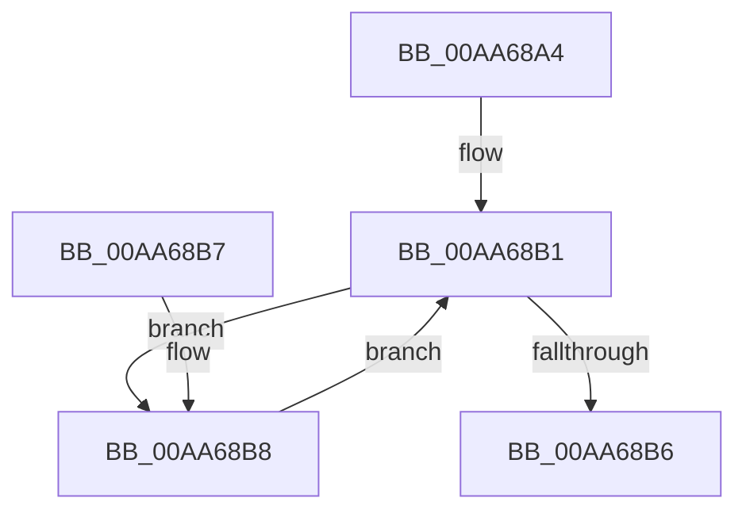

# IopReadyDeviceObjects

- RVA: `0x00AA68A4`–`0x00AA68C3` (길이 `31` bytes)
- VA: `0x0000000140AA68A4`
- 실행 섹션: `PAGE`
- PDB 이름 있음: `예`; PDB Function 태그: `아니요`
- unwind 정보 RVA: `0x000DB714`
- 디코드: `10`개 명령, `31/31` bytes 표시
- 미해석 바이트: `0` (있으면 어셈블리에 `.byte`로 보존)

> 이 문서는 커널 이미지의 기계어와 PDB 기호를 분석해 생성했습니다. 4번과 5번은 함수 원형과 자료형을 바이너리 사용 방식에서 추정한 C 해석이며 원본 소스 복구 결과는 아닙니다.

## 1. Dependencies

- 직접 호출 지점: **0**; 고유 호출 대상: **0**
- 직접 호출자로 확인된 함수: **2**
- RIP 상대 이미지 참조: **0**

### Outgoing calls
- 직접 디코드된 call 명령이 없습니다.

### Direct callers
- [IopLoadDriver](../99/IopLoadDriver_function_00997B54.md) at `0x00998372`
- [IopInitializeBuiltinDriver](../../init/C7/IopInitializeBuiltinDriver_function_00C7625C.md) at `0x00C766C7`

### Static image references
- 디코드된 RIP-relative 메모리 참조가 없습니다.

## 2. Other-region calls and transfers

- 다른 실행 섹션으로 향하는 call: **0**
- 별도 외부 분기/꼬리 이동을 확인하지 못했습니다.

## 3. Assembly (complete function range)

```asm
00AA68A4  48 8B 41 08                     mov rax, qword ptr [rcx + 8]
00AA68A8  F0 83 0C 24 00                  lock or dword ptr [rsp], 0
00AA68AD  83 49 10 10                     or dword ptr [rcx + 0x10], 0x10
00AA68B1  48 85 C0                        test rax, rax
00AA68B4  75 02                           jne 0x140aa68b8
00AA68B6  C3                              ret
00AA68B7  CC                              int3
00AA68B8  0F BA 70 30 07                  btr dword ptr [rax + 0x30], 7
00AA68BD  48 8B 40 10                     mov rax, qword ptr [rax + 0x10]
00AA68C1  EB EE                           jmp 0x140aa68b1
```

## 4. C-style interpretation (structured pseudocode)

```c
__int64 __fastcall IopReadyDeviceObjects(__int64 a1)
{
    unsigned int v_stack_p0;

loc_00AA68B1:
    if (*(unsigned __int64 *)(a1 + 8) != 0) goto loc_00AA68B8;
    return *(unsigned __int64 *)(a1 + 8);
loc_00AA68B8:
    goto loc_00AA68B1;
}
```

## 5. (Beta) C Style

```c
int64_t IopReadyDeviceObjects(void *Arg1)
{
    uint8_t *arg1 = (uint8_t *)Arg1;

    uint32_t v_stack_p0;

loc_00AA68B1:
    if (*(uint64_t *)(arg1 + 0x8) != 0) goto loc_00AA68B8;
    return *(uint64_t *)(arg1 + 0x8);
loc_00AA68B8:
    goto loc_00AA68B1;
}
```

### 관측된 메모리 오프셋

구조체 형식이 확인되지 않은 접근은 인자 기준의 오프셋으로만 기록했습니다.

| 기준 인자 | 오프셋 표현 | 폭 (bit) | 접근 |
|---|---:|---:|---|
| `Arg1` | `+ 0x8` | `64` | `R` |
| `Arg1` | `+ 0x10` | `32` | `R/W` |

## 6. Execution-region graph

[열기: 2D/3D 그래프와 함수 탐색 컨트롤 패널](../../../control-panel.html?section=page&rva=0x00AA68A4&view=graph)

- 2D 그래프는 위에서 아래로 흐르고, 3D 그래프는 빈 공간을 드래그해 회전합니다. Shift+드래그는 이동, 휠은 확대·축소, 함수 노드 선택은 대상 보고서 이동입니다.

### Static fallback


