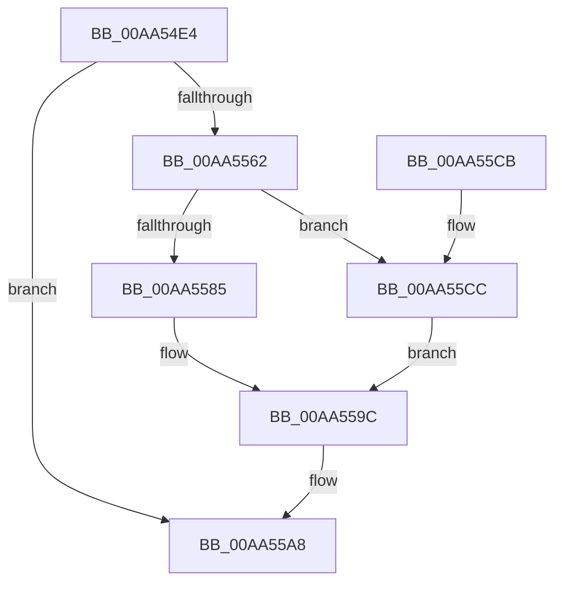

# IopWriteAllocatedResourcesToRegistry

- RVA: `0x00AA54E4`–`0x00AA55D3` (길이 `239` bytes)
- VA: `0x0000000140AA54E4`
- 실행 섹션: `PAGE`
- PDB 이름 있음: `예`; PDB Function 태그: `아니요`
- unwind 정보 RVA: `0x000BB68C`
- 디코드: `57`개 명령, `239/239` bytes 표시
- 미해석 바이트: `0` (있으면 어셈블리에 `.byte`로 보존)

> 이 문서는 커널 이미지의 기계어와 PDB 기호를 분석해 생성했습니다. 4번과 5번은 함수 원형과 자료형을 바이너리 사용 방식에서 추정한 C 해석이며 원본 소스 복구 결과는 아닙니다.

## 1. Dependencies

- 직접 호출 지점: **7**; 고유 호출 대상: **7**
- 직접 호출자로 확인된 함수: **5**
- RIP 상대 이미지 참조: **3**

### Outgoing calls
- `0x00AA5523` → [ExAcquireResourceSharedLite](../../text/21/ExAcquireResourceSharedLite_function_00211BC0.md) (function, `0x00211BC0`)
- `0x00AA5557` → [_CmOpenDeviceRegKey](../8E/_CmOpenDeviceRegKey_function_008EE540.md) (function, `0x008EE540`)
- `0x00AA5597` → [ZwSetValueKey](../../text/6A/ZwSetValueKey_function_006ADCD0.md) (function, `0x006ADCD0`)
- `0x00AA55A3` → [ZwClose](../../text/6A/ZwClose_function_006AD2B0.md) (function, `0x006AD2B0`)
- `0x00AA55AF` → [ExReleaseResourceLite](../../text/25/ExReleaseResourceLite_function_0025FA10.md) (function, `0x0025FA10`)
- `0x00AA55B4` → [KeLeaveCriticalRegion](../../text/25/KeLeaveCriticalRegion_function_0025D8B0.md) (function, `0x0025D8B0`)
- `0x00AA55CC` → [ZwDeleteValueKey](../../text/6A/ZwDeleteValueKey_function_006AECB0.md) (function, `0x006AECB0`)

### Direct callers
- [IoReportDetectedDevice](../72/IoReportDetectedDevice_function_00725CD0.md) at `0x00726639`
- [PnpBuildCmResourceLists](../73/PnpBuildCmResourceLists_function_0073E684.md) at `0x0073E82F`
- [PnpRestoreResourcesInternal](../73/PnpRestoreResourcesInternal_function_0073EB10.md) at `0x0073EC2B`
- [IopLegacyResourceAllocation](../A0/IopLegacyResourceAllocation_function_00A07224.md) at `0x00A07458`
- [PnpReleaseResourcesInternal](PnpReleaseResourcesInternal_function_00AA5140.md) at `0x00AA5364`

### Static image references
- `0x00AA5511` → RVA `0x00F8C600` (`.data`; read)
- `0x00AA553A` → RVA `0x00E66398` (`.data`; read)
- `0x00AA5567` → RVA `0x00AFDF90` (` ?? ::NNGAKEGL::`string'`; read)

## 2. Other-region calls and transfers

- 다른 실행 섹션으로 향하는 call: **6**
  - `0x00AA5523` → [ExAcquireResourceSharedLite](../../text/21/ExAcquireResourceSharedLite_function_00211BC0.md) (`PAGE` → `.text`)
  - `0x00AA5597` → [ZwSetValueKey](../../text/6A/ZwSetValueKey_function_006ADCD0.md) (`PAGE` → `.text`)
  - `0x00AA55A3` → [ZwClose](../../text/6A/ZwClose_function_006AD2B0.md) (`PAGE` → `.text`)
  - `0x00AA55AF` → [ExReleaseResourceLite](../../text/25/ExReleaseResourceLite_function_0025FA10.md) (`PAGE` → `.text`)
  - `0x00AA55B4` → [KeLeaveCriticalRegion](../../text/25/KeLeaveCriticalRegion_function_0025D8B0.md) (`PAGE` → `.text`)
  - `0x00AA55CC` → [ZwDeleteValueKey](../../text/6A/ZwDeleteValueKey_function_006AECB0.md) (`PAGE` → `.text`)
- 별도 외부 분기/꼬리 이동을 확인하지 못했습니다.

## 3. Assembly (complete function range)

```asm
00AA54E4  48 8B C4                        mov rax, rsp
00AA54E7  48 89 58 10                     mov qword ptr [rax + 0x10], rbx
00AA54EB  48 89 70 18                     mov qword ptr [rax + 0x18], rsi
00AA54EF  57                              push rdi
00AA54F0  48 83 EC 50                     sub rsp, 0x50
00AA54F4  48 83 60 08 00                  and qword ptr [rax + 8], 0
00AA54F9  0F 57 C0                        xorps xmm0, xmm0
00AA54FC  0F 11 40 E8                     movups xmmword ptr [rax - 0x18], xmm0
00AA5500  65 48 8B 04 25 88 01 00 00      mov rax, qword ptr gs:[0x188]
00AA5509  48 8B FA                        mov rdi, rdx
00AA550C  48 8B D9                        mov rbx, rcx
00AA550F  B2 01                           mov dl, 1
00AA5511  48 8D 0D E8 70 4E 00            lea rcx, [rip + 0x4e70e8]
00AA5518  41 8B F0                        mov esi, r8d
00AA551B  66 FF 88 E4 01 00 00            dec word ptr [rax + 0x1e4]
00AA5522  90                              nop
00AA5523  E8 98 C6 76 FF                  call 0x140211bc0
00AA5528  48 83 64 24 38 00               and qword ptr [rsp + 0x38], 0
00AA552E  48 8D 44 24 60                  lea rax, [rsp + 0x60]
00AA5533  48 8B 53 30                     mov rdx, qword ptr [rbx + 0x30]
00AA5537  45 33 C9                        xor r9d, r9d
00AA553A  48 8B 0D 57 0E 3C 00            mov rcx, qword ptr [rip + 0x3c0e57]
00AA5541  48 89 44 24 30                  mov qword ptr [rsp + 0x30], rax
00AA5546  C6 44 24 28 01                  mov byte ptr [rsp + 0x28], 1
00AA554B  45 8D 41 13                     lea r8d, [r9 + 0x13]
00AA554F  C7 44 24 20 3F 00 0F 00         mov dword ptr [rsp + 0x20], 0xf003f
00AA5557  E8 E4 8F E4 FF                  call 0x1408ee540
00AA555C  8B D8                           mov ebx, eax
00AA555E  85 C0                           test eax, eax
00AA5560  78 46                           js 0x140aa55a8
00AA5562  48 8B 4C 24 60                  mov rcx, qword ptr [rsp + 0x60]
00AA5567  48 8D 05 22 8A 05 00            lea rax, [rip + 0x58a22]
00AA556E  48 89 44 24 48                  mov qword ptr [rsp + 0x48], rax
00AA5573  48 8D 54 24 40                  lea rdx, [rsp + 0x40]
00AA5578  C7 44 24 40 16 00 18 00         mov dword ptr [rsp + 0x40], 0x180016
00AA5580  48 85 FF                        test rdi, rdi
00AA5583  74 47                           je 0x140aa55cc
00AA5585  89 74 24 28                     mov dword ptr [rsp + 0x28], esi
00AA5589  41 B9 08 00 00 00               mov r9d, 8
00AA558F  45 33 C0                        xor r8d, r8d
00AA5592  48 89 7C 24 20                  mov qword ptr [rsp + 0x20], rdi
00AA5597  E8 34 87 C0 FF                  call 0x1406adcd0
00AA559C  48 8B 4C 24 60                  mov rcx, qword ptr [rsp + 0x60]
00AA55A1  8B D8                           mov ebx, eax
00AA55A3  E8 08 7D C0 FF                  call 0x1406ad2b0
00AA55A8  48 8D 0D 51 70 4E 00            lea rcx, [rip + 0x4e7051]
00AA55AF  E8 5C A4 7B FF                  call 0x14025fa10
00AA55B4  E8 F7 82 7B FF                  call 0x14025d8b0
00AA55B9  48 8B 74 24 70                  mov rsi, qword ptr [rsp + 0x70]
00AA55BE  8B C3                           mov eax, ebx
00AA55C0  48 8B 5C 24 68                  mov rbx, qword ptr [rsp + 0x68]
00AA55C5  48 83 C4 50                     add rsp, 0x50
00AA55C9  5F                              pop rdi
00AA55CA  C3                              ret
00AA55CB  CC                              int3
00AA55CC  E8 DF 96 C0 FF                  call 0x1406aecb0
00AA55D1  EB C9                           jmp 0x140aa559c
```

## 4. C-style interpretation (structured pseudocode)

```c
__int64 __fastcall IopWriteAllocatedResourcesToRegistry(__int64 a1, __int64 a2, int a3, int a4)
{
    __int64 result;
    __int64 v_rsp;
    unsigned __int64 v_stack_m10;
    unsigned __int64 v_stack_m18;
    unsigned __int64 v_stack_m20;
    unsigned __int64 v_stack_m28;
    unsigned __int8 v_stack_m30;
    unsigned int v_stack_m38;
    unsigned __int64 v_stack_p10;
    unsigned __int64 v_stack_p18;
    unsigned __int64 v_stack_p8;

    *(unsigned __int64 *)(v_rsp + 16) = v_rbx;
    *(unsigned __int64 *)(v_rsp + 24) = v_rsi;
    v_rsp = (v_rsp) - (80);
    *(unsigned __int64 *)(v_rsp - 24) = v_xmm0;
    result = ExAcquireResourceSharedLite(v_rip + 5140712, 1, a3, a4);
    a4 = 0;
    v_stack_m28 = v_stack_p8;
    v_stack_m30 = 1;
    v_stack_m38 = 0xF003FULL;
    result = _CmOpenDeviceRegKey(*(unsigned __int64 *)(v_rip + 3935831), *(unsigned __int64 *)(a1 + 48), a4 + 19, a4);
    if (sign_flag) goto loc_00AA55A8;
    v_stack_m10 = v_rip + 363042;
    v_stack_m18 = 0x180016ULL;
    if (a2 == 0) goto loc_00AA55CC;
    v_stack_m30 = (unsigned int)((unsigned int)(a3));
    a3 = 0;
    v_stack_m38 = a2;
    result = ZwSetValueKey(v_stack_p8, v_stack_m18, a3, 8);
loc_00AA559C:
    result = ZwClose(v_stack_p8, v_stack_m18, a3, 8);
loc_00AA55A8:
    result = ExReleaseResourceLite(v_rip + 5140561, v_stack_m18, a3, 8);
    result = KeLeaveCriticalRegion(v_rip + 5140561, v_stack_m18, a3, 8);
    v_rsp = (v_rsp) + (80);
    return (unsigned int)((unsigned int)((unsigned int)((unsigned int)(result))));
loc_00AA55CC:
    result = ZwDeleteValueKey(v_rip + 5140561, v_stack_m18, a3, 8);
    goto loc_00AA559C;
}
```

## 5. (Beta) C Style

```c
int64_t IopWriteAllocatedResourcesToRegistry(void *Arg1, int64_t Arg2, int32_t Arg3, int32_t Arg4)
{
    uint8_t *arg1 = (uint8_t *)Arg1;

    int64_t result;
    int64_t local_rsp;
    uint64_t v_stack_m10;
    uint64_t v_stack_m18;
    uint64_t v_stack_m20;
    uint64_t v_stack_m28;
    uint8_t v_stack_m30;
    uint32_t v_stack_m38;
    uint64_t v_stack_p10;
    uint64_t v_stack_p18;
    uint64_t v_stack_p8;

    *(uint64_t *)(local_rsp + 0x10) = local_rbx;
    *(uint64_t *)(local_rsp + 0x18) = local_rsi;
    local_rsp = (local_rsp) - (80);
    *(uint64_t *)(local_rsp - 0x18) = v_xmm0;
    result = ExAcquireResourceSharedLite(v_rip + 5140712, 1, Arg3, Arg4);
    Arg4 = 0;
    v_stack_m28 = v_stack_p8;
    v_stack_m30 = 1;
    v_stack_m38 = 0xF003FULL;
    result = _CmOpenDeviceRegKey(*(uint64_t *)(v_rip + 0x3C0E57), *(uint64_t *)(arg1 + 0x30), Arg4 + 19, Arg4);
    if (sign_flag) goto loc_00AA55A8;
    v_stack_m10 = v_rip + 363042;
    v_stack_m18 = 0x180016ULL;
    if (Arg2 == 0) goto loc_00AA55CC;
    v_stack_m30 = (uint32_t)((uint32_t)(Arg3));
    Arg3 = 0;
    v_stack_m38 = Arg2;
    result = ZwSetValueKey(v_stack_p8, v_stack_m18, Arg3, 8);
loc_00AA559C:
    result = ZwClose(v_stack_p8, v_stack_m18, Arg3, 8);
loc_00AA55A8:
    result = ExReleaseResourceLite(v_rip + 5140561, v_stack_m18, Arg3, 8);
    result = KeLeaveCriticalRegion(v_rip + 5140561, v_stack_m18, Arg3, 8);
    local_rsp = (local_rsp) + (80);
    return (uint32_t)((uint32_t)((uint32_t)((uint32_t)(result))));
loc_00AA55CC:
    result = ZwDeleteValueKey(v_rip + 5140561, v_stack_m18, Arg3, 8);
    goto loc_00AA559C;
}
```

### 관측된 메모리 오프셋

구조체 형식이 확인되지 않은 접근은 인자 기준의 오프셋으로만 기록했습니다.

| 기준 인자 | 오프셋 표현 | 폭 (bit) | 접근 |
|---|---:|---:|---|
| `Arg1` | `+ 0x30` | `64` | `R` |

## 6. Execution-region graph

[열기: 2D/3D 그래프와 함수 탐색 컨트롤 패널](../../../control-panel.html?section=page&rva=0x00AA54E4&view=graph)

- 2D 그래프는 위에서 아래로 흐르고, 3D 그래프는 빈 공간을 드래그해 회전합니다. Shift+드래그는 이동, 휠은 확대·축소, 함수 노드 선택은 대상 보고서 이동입니다.

### Static fallback


