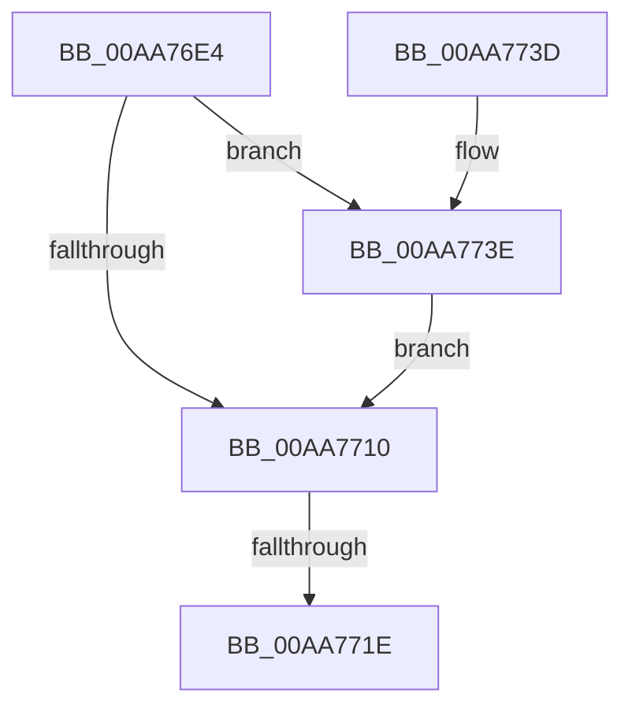

# KeCleanupImageTracepoints

- RVA: `0x00AA76E4`–`0x00AA7745` (길이 `97` bytes)
- VA: `0x0000000140AA76E4`
- 실행 섹션: `PAGE`
- PDB 이름 있음: `예`; PDB Function 태그: `예`
- unwind 정보 RVA: `0x000BBA4C`
- 디코드: `27`개 명령, `97/97` bytes 표시
- 미해석 바이트: `0` (있으면 어셈블리에 `.byte`로 보존)

> 이 문서는 커널 이미지의 기계어와 PDB 기호를 분석해 생성했습니다. 4번과 5번은 함수 원형과 자료형을 바이너리 사용 방식에서 추정한 C 해석이며 원본 소스 복구 결과는 아닙니다.

## 1. Dependencies

- 직접 호출 지점: **1**; 고유 호출 대상: **1**
- 직접 호출자로 확인된 함수: **1**
- RIP 상대 이미지 참조: **2**

### Outgoing calls
- `0x00AA773E` → [guard_dispatch_icall](../../text/6B/guard_dispatch_icall_function_006BAAD0.md) (function, `0x006BAAD0`)

### Direct callers
- [MiUnloadSystemImage](MiUnloadSystemImage_function_00AA2FD4.md) at `0x00AA30E0`

### Static image references
- `0x00AA7701` → RVA `0x00FC7440` (`ALMOSTRO`; read)
- `0x00AA7710` → RVA `0x00F107A0` (`.data`; read)

## 2. Other-region calls and transfers

- 다른 실행 섹션으로 향하는 call: **1**
  - `0x00AA773E` → [guard_dispatch_icall](../../text/6B/guard_dispatch_icall_function_006BAAD0.md) (`PAGE` → `.text`)
- call이 아닌 외부 분기/꼬리 이동: **1**
  - `0x00AA7718` → [sub_00B49FE4](../B4/Unknown_function_00B49FE4.md) (`tail-transfer`)

## 3. Assembly (complete function range)

```asm
00AA76E4  48 8B C4                        mov rax, rsp
00AA76E7  48 89 58 08                     mov qword ptr [rax + 8], rbx
00AA76EB  48 89 68 10                     mov qword ptr [rax + 0x10], rbp
00AA76EF  48 89 70 18                     mov qword ptr [rax + 0x18], rsi
00AA76F3  48 89 78 20                     mov qword ptr [rax + 0x20], rdi
00AA76F7  41 55                           push r13
00AA76F9  41 56                           push r14
00AA76FB  41 57                           push r15
00AA76FD  48 83 EC 20                     sub rsp, 0x20
00AA7701  48 8B 05 38 FD 51 00            mov rax, qword ptr [rip + 0x51fd38]
00AA7708  48 8B D9                        mov rbx, rcx
00AA770B  48 85 C0                        test rax, rax
00AA770E  75 2E                           jne 0x140aa773e
00AA7710  48 83 3D 88 90 46 00 00         cmp qword ptr [rip + 0x469088], 0
00AA7718  0F 85 C6 28 0A 00               jne 0x140b49fe4
00AA771E  48 8B 5C 24 40                  mov rbx, qword ptr [rsp + 0x40]
00AA7723  48 8B 6C 24 48                  mov rbp, qword ptr [rsp + 0x48]
00AA7728  48 8B 74 24 50                  mov rsi, qword ptr [rsp + 0x50]
00AA772D  48 8B 7C 24 58                  mov rdi, qword ptr [rsp + 0x58]
00AA7732  48 83 C4 20                     add rsp, 0x20
00AA7736  41 5F                           pop r15
00AA7738  41 5E                           pop r14
00AA773A  41 5D                           pop r13
00AA773C  C3                              ret
00AA773D  CC                              int3
00AA773E  E8 8D 33 C1 FF                  call 0x1406baad0
00AA7743  EB CB                           jmp 0x140aa7710
```

## 4. C-style interpretation (structured pseudocode)

```c
__int64 __fastcall KeCleanupImageTracepoints(__int64 a1)
{
    __int64 result;
    __int64 v_rsp;
    unsigned __int64 v_stack_p10;
    unsigned __int64 v_stack_p18;
    unsigned __int64 v_stack_p20;
    unsigned __int64 v_stack_p8;

    *(unsigned __int64 *)(v_rsp + 8) = v_rbx;
    *(unsigned __int64 *)(v_rsp + 16) = v_rbp;
    *(unsigned __int64 *)(v_rsp + 24) = v_rsi;
    *(unsigned __int64 *)(v_rsp + 32) = v_rdi;
    v_rsp = (v_rsp) - (32);
    if (*(unsigned __int64 *)(v_rip + 5373240) != 0) goto loc_00AA773E;
loc_00AA7710:
    v_rsp = (v_rsp) + (32);
    return *(unsigned __int64 *)(v_rip + 5373240);
loc_00AA773E:
    result = guard_dispatch_icall(a1, a2, a3, a4);
    goto loc_00AA7710;
}
```

## 5. (Beta) C Style

```c
int64_t KeCleanupImageTracepoints(int64_t Arg1)
{
    int64_t result;
    int64_t local_rsp;
    uint64_t v_stack_p10;
    uint64_t v_stack_p18;
    uint64_t v_stack_p20;
    uint64_t v_stack_p8;

    *(uint64_t *)(local_rsp + 0x8) = local_rbx;
    *(uint64_t *)(local_rsp + 0x10) = local_rbp;
    *(uint64_t *)(local_rsp + 0x18) = local_rsi;
    *(uint64_t *)(local_rsp + 0x20) = local_rdi;
    local_rsp = (local_rsp) - (32);
    if (*(uint64_t *)(v_rip + 0x51FD38) != 0) goto loc_00AA773E;
loc_00AA7710:
    local_rsp = (local_rsp) + (32);
    return *(uint64_t *)(v_rip + 0x51FD38);
loc_00AA773E:
    result = guard_dispatch_icall(Arg1, a2, a3, a4);
    goto loc_00AA7710;
}
```

## 6. Execution-region graph

[열기: 2D/3D 그래프와 함수 탐색 컨트롤 패널](../../../control-panel.html?section=page&rva=0x00AA76E4&view=graph)

- 2D 그래프는 위에서 아래로 흐르고, 3D 그래프는 빈 공간을 드래그해 회전합니다. Shift+드래그는 이동, 휠은 확대·축소, 함수 노드 선택은 대상 보고서 이동입니다.

### Static fallback


