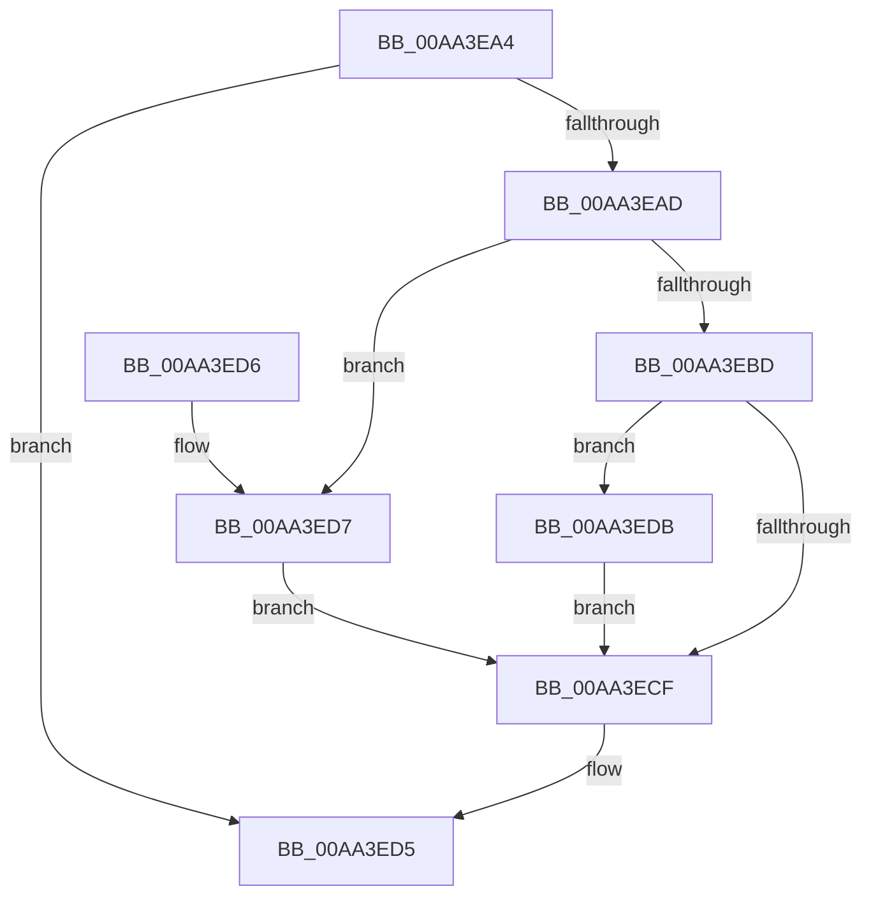

# KeNotifyHeteroParkingPolicyChange

- RVA: `0x00AA3EA4`–`0x00AA3EE4` (길이 `64` bytes)
- VA: `0x0000000140AA3EA4`
- 실행 섹션: `PAGE`
- PDB 이름 있음: `예`; PDB Function 태그: `아니요`
- unwind 정보 RVA: `0x000DB714`
- 디코드: `18`개 명령, `64/64` bytes 표시
- 미해석 바이트: `0` (있으면 어셈블리에 `.byte`로 보존)

> 이 문서는 커널 이미지의 기계어와 PDB 기호를 분석해 생성했습니다. 4번과 5번은 함수 원형과 자료형을 바이너리 사용 방식에서 추정한 C 해석이며 원본 소스 복구 결과는 아닙니다.

## 1. Dependencies

- 직접 호출 지점: **0**; 고유 호출 대상: **0**
- 직접 호출자로 확인된 함수: **1**
- RIP 상대 이미지 참조: **3**

### Outgoing calls
- 직접 디코드된 call 명령이 없습니다.

### Direct callers
- [PopInitializeHeteroProcessors](../A5/PopInitializeHeteroProcessors_function_00A53570.md) at `0x00A53896`

### Static image references
- `0x00AA3EA4` → RVA `0x00F10E60` (`.data`; read)
- `0x00AA3EAD` → RVA `0x00F10E70` (`.data`; read)
- `0x00AA3ECF` → RVA `0x00F10E78` (`.data`; write)

## 2. Other-region calls and transfers

- 다른 실행 섹션으로 향하는 call: **0**
- 별도 외부 분기/꼬리 이동을 확인하지 못했습니다.

## 3. Assembly (complete function range)

```asm
00AA3EA4  80 3D B5 CF 46 00 00            cmp byte ptr [rip + 0x46cfb5], 0
00AA3EAB  74 28                           je 0x140aa3ed5
00AA3EAD  48 8B 05 BC CF 46 00            mov rax, qword ptr [rip + 0x46cfbc]
00AA3EB4  BA 01 00 00 00                  mov edx, 1
00AA3EB9  38 10                           cmp byte ptr [rax], dl
00AA3EBB  76 1A                           jbe 0x140aa3ed7
00AA3EBD  65 48 8B 04 25 20 00 00 00      mov rax, qword ptr gs:[0x20]
00AA3EC6  80 B8 8D 00 00 00 02            cmp byte ptr [rax + 0x8d], 2
00AA3ECD  74 0C                           je 0x140aa3edb
00AA3ECF  89 15 A3 CF 46 00               mov dword ptr [rip + 0x46cfa3], edx
00AA3ED5  C3                              ret
00AA3ED6  CC                              int3
00AA3ED7  33 D2                           xor edx, edx
00AA3ED9  EB F4                           jmp 0x140aa3ecf
00AA3EDB  F6 D9                           neg cl
00AA3EDD  1B D2                           sbb edx, edx
00AA3EDF  83 C2 03                        add edx, 3
00AA3EE2  EB EB                           jmp 0x140aa3ecf
```

## 4. C-style interpretation (structured pseudocode)

```c
__int64 __fastcall KeNotifyHeteroParkingPolicyChange(unsigned __int8 a1)
{
    if ((*(unsigned __int8 *)(v_rip + 4640693)) == 0) goto loc_00AA3ED5;
    if ((*(unsigned __int8 *)(*(unsigned __int64 *)(v_rip + 4640700))) <= 1) goto loc_00AA3ED7;
    if ((*(unsigned __int8 *)(*(unsigned __int64 *)(gs_base + (0 + 32)) + 141)) == 2) goto loc_00AA3EDB;
loc_00AA3ECF:
    *(unsigned int *)(v_rip + 4640675) = 1;
loc_00AA3ED5:
    return *(unsigned __int64 *)(gs_base + (0 + 32));
loc_00AA3ED7:
    a2 = 0;
    goto loc_00AA3ECF;
loc_00AA3EDB:
    a1 = (unsigned __int8)(-(a1));
    a2 = (unsigned int)((a2) + (3));
    goto loc_00AA3ECF;
}
```

## 5. (Beta) C Style

```c
int64_t KeNotifyHeteroParkingPolicyChange(uint8_t Arg1)
{
    if ((*(uint8_t *)(v_rip + 0x46CFB5)) == 0) goto loc_00AA3ED5;
    if ((*(uint8_t *)(*(uint64_t *)(v_rip + 0x46CFBC))) <= 1) goto loc_00AA3ED7;
    if ((*(uint8_t *)(*(uint64_t *)(gs_base + (0 + 0x20)) + 0x8D)) == 2) goto loc_00AA3EDB;
loc_00AA3ECF:
    *(uint32_t *)(v_rip + 0x46CFA3) = 1;
loc_00AA3ED5:
    return *(uint64_t *)(gs_base + (0 + 0x20));
loc_00AA3ED7:
    a2 = 0;
    goto loc_00AA3ECF;
loc_00AA3EDB:
    Arg1 = (uint8_t)(-(Arg1));
    a2 = (uint32_t)((a2) + (3));
    goto loc_00AA3ECF;
}
```

## 6. Execution-region graph

[열기: 2D/3D 그래프와 함수 탐색 컨트롤 패널](../../../control-panel.html?section=page&rva=0x00AA3EA4&view=graph)

- 2D 그래프는 위에서 아래로 흐르고, 3D 그래프는 빈 공간을 드래그해 회전합니다. Shift+드래그는 이동, 휠은 확대·축소, 함수 노드 선택은 대상 보고서 이동입니다.

### Static fallback


