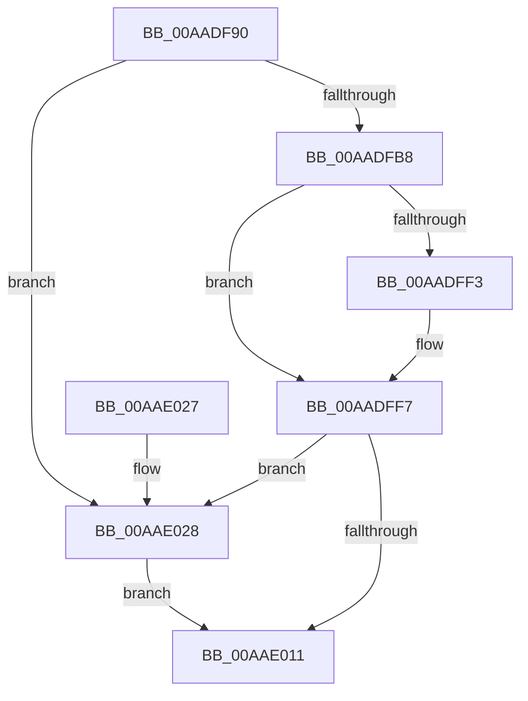

# KeSpecialUserApcKernelRoutine

- RVA: `0x00AADF90`–`0x00AAE035` (길이 `165` bytes)
- VA: `0x0000000140AADF90`
- 실행 섹션: `PAGE`
- PDB 이름 있음: `예`; PDB Function 태그: `아니요`
- unwind 정보 RVA: `0x000BC1F4`
- 디코드: `46`개 명령, `165/165` bytes 표시
- 미해석 바이트: `0` (있으면 어셈블리에 `.byte`로 보존)

> 이 문서는 커널 이미지의 기계어와 PDB 기호를 분석해 생성했습니다. 4번과 5번은 함수 원형과 자료형을 바이너리 사용 방식에서 추정한 C 해석이며 원본 소스 복구 결과는 아닙니다.

## 1. Dependencies

- 직접 호출 지점: **3**; 고유 호출 대상: **3**
- 직접 호출자로 확인된 함수: **0**
- RIP 상대 이미지 참조: **1**

### Outgoing calls
- `0x00AADFE9` → [KeInitializeApc](../../text/42/KeInitializeApc_function_00428510.md) (function, `0x00428510`)
- `0x00AAE008` → [KeInsertQueueApc](../../text/20/KeInsertQueueApc_function_00203F10.md) (function, `0x00203F10`)
- `0x00AAE02E` → [guard_dispatch_icall](../../text/6B/guard_dispatch_icall_function_006BAAD0.md) (function, `0x006BAAD0`)

### Direct callers
- 이 함수 시작 RVA로 연결되는 직접 call은 확인되지 않았습니다. 간접 호출은 완전히 역산할 수 없습니다.

### Static image references
- `0x00AADFC1` → RVA `0x00AADF90` (`KeSpecialUserApcKernelRoutine`; read)

## 2. Other-region calls and transfers

- 다른 실행 섹션으로 향하는 call: **3**
  - `0x00AADFE9` → [KeInitializeApc](../../text/42/KeInitializeApc_function_00428510.md) (`PAGE` → `.text`)
  - `0x00AAE008` → [KeInsertQueueApc](../../text/20/KeInsertQueueApc_function_00203F10.md) (`PAGE` → `.text`)
  - `0x00AAE02E` → [guard_dispatch_icall](../../text/6B/guard_dispatch_icall_function_006BAAD0.md) (`PAGE` → `.text`)
- 별도 외부 분기/꼬리 이동을 확인하지 못했습니다.

## 3. Assembly (complete function range)

```asm
00AADF90  4C 8B DC                        mov r11, rsp
00AADF93  49 89 5B 08                     mov qword ptr [r11 + 8], rbx
00AADF97  49 89 73 10                     mov qword ptr [r11 + 0x10], rsi
00AADF9B  49 89 7B 18                     mov qword ptr [r11 + 0x18], rdi
00AADF9F  41 56                           push r14
00AADFA1  48 83 EC 40                     sub rsp, 0x40
00AADFA5  80 79 51 00                     cmp byte ptr [rcx + 0x51], 0
00AADFA9  4D 8B F1                        mov r14, r9
00AADFAC  48 8B 71 28                     mov rsi, qword ptr [rcx + 0x28]
00AADFB0  48 8B C2                        mov rax, rdx
00AADFB3  48 8B F9                        mov rdi, rcx
00AADFB6  75 70                           jne 0x140aae028
00AADFB8  65 48 8B 14 25 88 01 00 00      mov rdx, qword ptr gs:[0x188]
00AADFC1  4C 8D 0D C8 FF FF FF            lea r9, [rip - 0x38]
00AADFC8  4C 8B 10                        mov r10, qword ptr [rax]
00AADFCB  8A 59 01                        mov bl, byte ptr [rcx + 1]
00AADFCE  48 83 20 00                     and qword ptr [rax], 0
00AADFD2  49 8B 00                        mov rax, qword ptr [r8]
00AADFD5  45 33 C0                        xor r8d, r8d
00AADFD8  49 89 43 F0                     mov qword ptr [r11 - 0x10], rax
00AADFDC  C6 44 24 30 01                  mov byte ptr [rsp + 0x30], 1
00AADFE1  4D 89 53 E0                     mov qword ptr [r11 - 0x20], r10
00AADFE5  49 89 73 D8                     mov qword ptr [r11 - 0x28], rsi
00AADFE9  E8 22 A5 97 FF                  call 0x140428510
00AADFEE  F6 C3 01                        test bl, 1
00AADFF1  74 04                           je 0x140aadff7
00AADFF3  80 4F 01 01                     or byte ptr [rdi + 1], 1
00AADFF7  4C 8B 44 24 70                  mov r8, qword ptr [rsp + 0x70]
00AADFFC  45 33 C9                        xor r9d, r9d
00AADFFF  49 8B 16                        mov rdx, qword ptr [r14]
00AAE002  48 8B CF                        mov rcx, rdi
00AAE005  4D 8B 00                        mov r8, qword ptr [r8]
00AAE008  E8 03 5F 75 FF                  call 0x140203f10
00AAE00D  84 C0                           test al, al
00AAE00F  74 17                           je 0x140aae028
00AAE011  48 8B 5C 24 50                  mov rbx, qword ptr [rsp + 0x50]
00AAE016  48 8B 74 24 58                  mov rsi, qword ptr [rsp + 0x58]
00AAE01B  48 8B 7C 24 60                  mov rdi, qword ptr [rsp + 0x60]
00AAE020  48 83 C4 40                     add rsp, 0x40
00AAE024  41 5E                           pop r14
00AAE026  C3                              ret
00AAE027  CC                              int3
00AAE028  48 8B CF                        mov rcx, rdi
00AAE02B  48 8B C6                        mov rax, rsi
00AAE02E  E8 9D CA C0 FF                  call 0x1406baad0
00AAE033  EB DC                           jmp 0x140aae011
```

## 4. C-style interpretation (structured pseudocode)

```c
__int64 __fastcall KeSpecialUserApcKernelRoutine(__int64 a1, __int64 a2, __int64 a3, __int64 a4, __int64 a5)
{
    __int64 result;
    __int64 v_rsp;
    unsigned __int8 v_stack_m18;
    unsigned __int64 v_stack_p10;
    unsigned __int64 v_stack_p18;
    unsigned __int64 v_stack_p8;

    *(unsigned __int64 *)(v_rsp + 8) = v_rbx;
    *(unsigned __int64 *)(v_rsp + 16) = v_rsi;
    *(unsigned __int64 *)(v_rsp + 24) = v_rdi;
    v_rsp = (v_rsp) - (64);
    if ((*(unsigned __int8 *)(a1 + 81)) != 0) goto loc_00AAE028;
    a3 = 0;
    *(unsigned __int64 *)(v_rsp - 16) = *(unsigned __int64 *)(a3);
    v_stack_m18 = 1;
    *(unsigned __int64 *)(v_rsp - 32) = *(unsigned __int64 *)(a2);
    *(unsigned __int64 *)(v_rsp - 40) = *(unsigned __int64 *)(a1 + 40);
    result = KeInitializeApc(a1, *(unsigned __int64 *)(gs_base + (0 + 392)), a3, v_rip - 56);
    if ((((unsigned __int8)(*(unsigned __int8 *)(a1 + 1))) & (1)) != 0) {
    }
    a4 = 0;
    result = KeInsertQueueApc(a1, *(unsigned __int64 *)(a4), *(unsigned __int64 *)(a5), a4);
    if ((unsigned __int8)(result) == 0) goto loc_00AAE028;
loc_00AAE011:
    v_rsp = (v_rsp) + (64);
    return result;
loc_00AAE028:
    result = guard_dispatch_icall(v_stack_p18, *(unsigned __int64 *)(a4), *(unsigned __int64 *)(a5), a4);
    goto loc_00AAE011;
}
```

## 5. (Beta) C Style

```c
int64_t KeSpecialUserApcKernelRoutine(void *Arg1, void *Arg2, void *Arg3, void *Arg4, void *Arg5)
{
    uint8_t *arg1 = (uint8_t *)Arg1;
    uint8_t *arg2 = (uint8_t *)Arg2;
    uint8_t *arg3 = (uint8_t *)Arg3;
    uint8_t *arg4 = (uint8_t *)Arg4;
    uint8_t *arg5 = (uint8_t *)Arg5;

    int64_t result;
    int64_t local_rsp;
    uint8_t v_stack_m18;
    uint64_t v_stack_p10;
    uint64_t v_stack_p18;
    uint64_t v_stack_p8;

    *(uint64_t *)(local_rsp + 0x8) = local_rbx;
    *(uint64_t *)(local_rsp + 0x10) = local_rsi;
    *(uint64_t *)(local_rsp + 0x18) = local_rdi;
    local_rsp = (local_rsp) - (64);
    if ((*(uint8_t *)(arg1 + 0x51)) != 0) goto loc_00AAE028;
    Arg3 = 0;
    *(uint64_t *)(local_rsp - 0x10) = *(uint64_t *)(arg3);
    v_stack_m18 = 1;
    *(uint64_t *)(local_rsp - 0x20) = *(uint64_t *)(arg2);
    *(uint64_t *)(local_rsp - 0x28) = *(uint64_t *)(arg1 + 0x28);
    result = KeInitializeApc(Arg1, *(uint64_t *)(gs_base + (0 + 0x188)), Arg3, v_rip - 56);
    if ((((uint8_t)(*(uint8_t *)(arg1 + 0x1))) & (1)) != 0) {
    }
    Arg4 = 0;
    result = KeInsertQueueApc(Arg1, *(uint64_t *)(arg4), *(uint64_t *)(arg5), Arg4);
    if ((uint8_t)(result) == 0) goto loc_00AAE028;
loc_00AAE011:
    local_rsp = (local_rsp) + (64);
    return result;
loc_00AAE028:
    result = guard_dispatch_icall(v_stack_p18, *(uint64_t *)(arg4), *(uint64_t *)(arg5), Arg4);
    goto loc_00AAE011;
}
```

### 관측된 메모리 오프셋

구조체 형식이 확인되지 않은 접근은 인자 기준의 오프셋으로만 기록했습니다.

| 기준 인자 | 오프셋 표현 | 폭 (bit) | 접근 |
|---|---:|---:|---|
| `Arg1` | `+ 0x1` | `8` | `R` |
| `Arg1` | `+ 0x1` | `8` | `R/W` |
| `Arg1` | `+ 0x28` | `64` | `R` |
| `Arg1` | `+ 0x51` | `8` | `R` |
| `Arg2` | `+ 0x0` | `64` | `R` |
| `Arg2` | `+ 0x0` | `64` | `R/W` |
| `Arg3` | `+ 0x0` | `64` | `R` |
| `Arg4` | `+ 0x0` | `64` | `R` |
| `Arg5` | `+ 0x0` | `64` | `R` |

## 6. Execution-region graph

[열기: 2D/3D 그래프와 함수 탐색 컨트롤 패널](../../../control-panel.html?section=page&rva=0x00AADF90&view=graph)

- 2D 그래프는 위에서 아래로 흐르고, 3D 그래프는 빈 공간을 드래그해 회전합니다. Shift+드래그는 이동, 휠은 확대·축소, 함수 노드 선택은 대상 보고서 이동입니다.

### Static fallback


