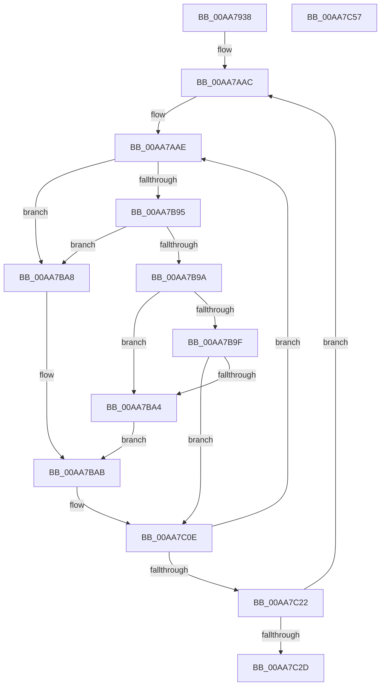

# KiConfigureHeteroMultiCoreProcessors

- RVA: `0x00AA7938`–`0x00AA7C58` (길이 `800` bytes)
- VA: `0x0000000140AA7938`
- 실행 섹션: `PAGE`
- PDB 이름 있음: `예`; PDB Function 태그: `아니요`
- unwind 정보 RVA: `0x000BBAD4`
- 디코드: `176`개 명령, `800/800` bytes 표시
- 미해석 바이트: `0` (있으면 어셈블리에 `.byte`로 보존)

> 이 문서는 커널 이미지의 기계어와 PDB 기호를 분석해 생성했습니다. 4번과 5번은 함수 원형과 자료형을 바이너리 사용 방식에서 추정한 C 해석이며 원본 소스 복구 결과는 아닙니다.

## 1. Dependencies

- 직접 호출 지점: **20**; 고유 호출 대상: **3**
- 직접 호출자로 확인된 함수: **1**
- RIP 상대 이미지 참조: **2**

### Outgoing calls
- `0x00AA7985` → [memset](../../text/6C/memset_function_006C6C40.md) (function, `0x006C6C40`)
- `0x00AA7996` → [memset](../../text/6C/memset_function_006C6C40.md) (function, `0x006C6C40`)
- `0x00AA79A5` → [memset](../../text/6C/memset_function_006C6C40.md) (function, `0x006C6C40`)
- `0x00AA79B6` → [memset](../../text/6C/memset_function_006C6C40.md) (function, `0x006C6C40`)
- `0x00AA79C7` → [memset](../../text/6C/memset_function_006C6C40.md) (function, `0x006C6C40`)
- `0x00AA79D8` → [memset](../../text/6C/memset_function_006C6C40.md) (function, `0x006C6C40`)
- `0x00AA79FA` → [memset](../../text/6C/memset_function_006C6C40.md) (function, `0x006C6C40`)
- `0x00AA7A1C` → [memset](../../text/6C/memset_function_006C6C40.md) (function, `0x006C6C40`)
- `0x00AA7A3E` → [memset](../../text/6C/memset_function_006C6C40.md) (function, `0x006C6C40`)
- `0x00AA7A5A` → [memset](../../text/6C/memset_function_006C6C40.md) (function, `0x006C6C40`)
- `0x00AA7A7C` → [memset](../../text/6C/memset_function_006C6C40.md) (function, `0x006C6C40`)
- `0x00AA7A9E` → [memset](../../text/6C/memset_function_006C6C40.md) (function, `0x006C6C40`)
- `0x00AA7AC3` → [memset](../../text/6C/memset_function_006C6C40.md) (function, `0x006C6C40`)
- `0x00AA7AE9` → [memset](../../text/6C/memset_function_006C6C40.md) (function, `0x006C6C40`)
- `0x00AA7B0F` → [memset](../../text/6C/memset_function_006C6C40.md) (function, `0x006C6C40`)
- `0x00AA7B31` → [memset](../../text/6C/memset_function_006C6C40.md) (function, `0x006C6C40`)
- `0x00AA7B55` → [memset](../../text/6C/memset_function_006C6C40.md) (function, `0x006C6C40`)
- `0x00AA7B7B` → [memset](../../text/6C/memset_function_006C6C40.md) (function, `0x006C6C40`)
- `0x00AA7C09` → [KiPrepareUpdateCoresHeteroMask](../74/KiPrepareUpdateCoresHeteroMask_function_0074508C.md) (function, `0x0074508C`)
- `0x00AA7C37` → [_security_check_cookie](../../text/6A/_security_check_cookie_function_006AC640.md) (function, `0x006AC640`)

### Direct callers
- [KiComputeHeteroConfig](../../text/42/KiComputeHeteroConfig_function_00427544.md) at `0x004278A3`

### Static image references
- `0x00AA7957` → RVA `0x00E0A740` (`.data`; read)
- `0x00AA7AA5` → RVA `0x00FC5460` (`ALMOSTRO`; read)

## 2. Other-region calls and transfers

- 다른 실행 섹션으로 향하는 call: **19**
  - `0x00AA7985` → [memset](../../text/6C/memset_function_006C6C40.md) (`PAGE` → `.text`)
  - `0x00AA7996` → [memset](../../text/6C/memset_function_006C6C40.md) (`PAGE` → `.text`)
  - `0x00AA79A5` → [memset](../../text/6C/memset_function_006C6C40.md) (`PAGE` → `.text`)
  - `0x00AA79B6` → [memset](../../text/6C/memset_function_006C6C40.md) (`PAGE` → `.text`)
  - `0x00AA79C7` → [memset](../../text/6C/memset_function_006C6C40.md) (`PAGE` → `.text`)
  - `0x00AA79D8` → [memset](../../text/6C/memset_function_006C6C40.md) (`PAGE` → `.text`)
  - `0x00AA79FA` → [memset](../../text/6C/memset_function_006C6C40.md) (`PAGE` → `.text`)
  - `0x00AA7A1C` → [memset](../../text/6C/memset_function_006C6C40.md) (`PAGE` → `.text`)
  - `0x00AA7A3E` → [memset](../../text/6C/memset_function_006C6C40.md) (`PAGE` → `.text`)
  - `0x00AA7A5A` → [memset](../../text/6C/memset_function_006C6C40.md) (`PAGE` → `.text`)
  - `0x00AA7A7C` → [memset](../../text/6C/memset_function_006C6C40.md) (`PAGE` → `.text`)
  - `0x00AA7A9E` → [memset](../../text/6C/memset_function_006C6C40.md) (`PAGE` → `.text`)
  - `0x00AA7AC3` → [memset](../../text/6C/memset_function_006C6C40.md) (`PAGE` → `.text`)
  - `0x00AA7AE9` → [memset](../../text/6C/memset_function_006C6C40.md) (`PAGE` → `.text`)
  - `0x00AA7B0F` → [memset](../../text/6C/memset_function_006C6C40.md) (`PAGE` → `.text`)
  - `0x00AA7B31` → [memset](../../text/6C/memset_function_006C6C40.md) (`PAGE` → `.text`)
  - `0x00AA7B55` → [memset](../../text/6C/memset_function_006C6C40.md) (`PAGE` → `.text`)
  - `0x00AA7B7B` → [memset](../../text/6C/memset_function_006C6C40.md) (`PAGE` → `.text`)
  - `0x00AA7C37` → [_security_check_cookie](../../text/6A/_security_check_cookie_function_006AC640.md) (`PAGE` → `.text`)
- 별도 외부 분기/꼬리 이동을 확인하지 못했습니다.

## 3. Assembly (complete function range)

```asm
00AA7938  48 89 5C 24 20                  mov qword ptr [rsp + 0x20], rbx
00AA793D  55                              push rbp
00AA793E  56                              push rsi
00AA793F  57                              push rdi
00AA7940  41 54                           push r12
00AA7942  41 55                           push r13
00AA7944  41 56                           push r14
00AA7946  41 57                           push r15
00AA7948  48 8D AC 24 20 FA FF FF         lea rbp, [rsp - 0x5e0]
00AA7950  48 81 EC E0 06 00 00            sub rsp, 0x6e0
00AA7957  48 8B 05 E2 2D 36 00            mov rax, qword ptr [rip + 0x362de2]
00AA795E  48 33 C4                        xor rax, rsp
00AA7961  48 89 85 D0 05 00 00            mov qword ptr [rbp + 0x5d0], rax
00AA7968  45 8B E8                        mov r13d, r8d
00AA796B  4C 8B E2                        mov r12, rdx
00AA796E  4C 8B F9                        mov r15, rcx
00AA7971  BF 00 01 00 00                  mov edi, 0x100
00AA7976  44 8B C7                        mov r8d, edi
00AA7979  48 8D 8D A8 02 00 00            lea rcx, [rbp + 0x2a8]
00AA7980  33 D2                           xor edx, edx
00AA7982  45 8A F1                        mov r14b, r9b
00AA7985  E8 B6 F2 C1 FF                  call 0x1406c6c40
00AA798A  44 8B C7                        mov r8d, edi
00AA798D  48 8D 8D 98 01 00 00            lea rcx, [rbp + 0x198]
00AA7994  33 D2                           xor edx, edx
00AA7996  E8 A5 F2 C1 FF                  call 0x1406c6c40
00AA799B  44 8B C7                        mov r8d, edi
00AA799E  48 8D 4C 24 78                  lea rcx, [rsp + 0x78]
00AA79A3  33 D2                           xor edx, edx
00AA79A5  E8 96 F2 C1 FF                  call 0x1406c6c40
00AA79AA  44 8B C7                        mov r8d, edi
00AA79AD  48 8D 8D 88 00 00 00            lea rcx, [rbp + 0x88]
00AA79B4  33 D2                           xor edx, edx
00AA79B6  E8 85 F2 C1 FF                  call 0x1406c6c40
00AA79BB  44 8B C7                        mov r8d, edi
00AA79BE  48 8D 8D C8 04 00 00            lea rcx, [rbp + 0x4c8]
00AA79C5  33 D2                           xor edx, edx
00AA79C7  E8 74 F2 C1 FF                  call 0x1406c6c40
00AA79CC  44 8B C7                        mov r8d, edi
00AA79CF  48 8D 8D B8 03 00 00            lea rcx, [rbp + 0x3b8]
00AA79D6  33 D2                           xor edx, edx
00AA79D8  E8 63 F2 C1 FF                  call 0x1406c6c40
00AA79DD  83 A5 C4 04 00 00 00            and dword ptr [rbp + 0x4c4], 0
00AA79E4  48 8D 8D C8 04 00 00            lea rcx, [rbp + 0x4c8]
00AA79EB  44 8B C7                        mov r8d, edi
00AA79EE  C7 85 C0 04 00 00 01 00 20 00   mov dword ptr [rbp + 0x4c0], 0x200001
00AA79F8  33 D2                           xor edx, edx
00AA79FA  E8 41 F2 C1 FF                  call 0x1406c6c40
00AA79FF  83 A5 B4 03 00 00 00            and dword ptr [rbp + 0x3b4], 0
00AA7A06  48 8D 8D B8 03 00 00            lea rcx, [rbp + 0x3b8]
00AA7A0D  44 8B C7                        mov r8d, edi
00AA7A10  C7 85 B0 03 00 00 01 00 20 00   mov dword ptr [rbp + 0x3b0], 0x200001
00AA7A1A  33 D2                           xor edx, edx
00AA7A1C  E8 1F F2 C1 FF                  call 0x1406c6c40
00AA7A21  83 A5 84 00 00 00 00            and dword ptr [rbp + 0x84], 0
00AA7A28  48 8D 8D 88 00 00 00            lea rcx, [rbp + 0x88]
00AA7A2F  44 8B C7                        mov r8d, edi
00AA7A32  C7 85 80 00 00 00 01 00 20 00   mov dword ptr [rbp + 0x80], 0x200001
00AA7A3C  33 D2                           xor edx, edx
00AA7A3E  E8 FD F1 C1 FF                  call 0x1406c6c40
00AA7A43  83 64 24 74 00                  and dword ptr [rsp + 0x74], 0
00AA7A48  48 8D 4C 24 78                  lea rcx, [rsp + 0x78]
00AA7A4D  44 8B C7                        mov r8d, edi
00AA7A50  C7 44 24 70 01 00 20 00         mov dword ptr [rsp + 0x70], 0x200001
00AA7A58  33 D2                           xor edx, edx
00AA7A5A  E8 E1 F1 C1 FF                  call 0x1406c6c40
00AA7A5F  83 A5 A4 02 00 00 00            and dword ptr [rbp + 0x2a4], 0
00AA7A66  48 8D 8D A8 02 00 00            lea rcx, [rbp + 0x2a8]
00AA7A6D  44 8B C7                        mov r8d, edi
00AA7A70  C7 85 A0 02 00 00 01 00 20 00   mov dword ptr [rbp + 0x2a0], 0x200001
00AA7A7A  33 D2                           xor edx, edx
00AA7A7C  E8 BF F1 C1 FF                  call 0x1406c6c40
00AA7A81  83 A5 94 01 00 00 00            and dword ptr [rbp + 0x194], 0
00AA7A88  48 8D 8D 98 01 00 00            lea rcx, [rbp + 0x198]
00AA7A8F  44 8B C7                        mov r8d, edi
00AA7A92  C7 85 90 01 00 00 01 00 20 00   mov dword ptr [rbp + 0x190], 0x200001
00AA7A9C  33 D2                           xor edx, edx
00AA7A9E  E8 9D F1 C1 FF                  call 0x1406c6c40
00AA7AA3  33 F6                           xor esi, esi
00AA7AA5  48 8D 3D B4 D9 51 00            lea rdi, [rip + 0x51d9b4]
00AA7AAC  33 DB                           xor ebx, ebx
00AA7AAE  44 0F B7 85 C0 04 00 00         movzx r8d, word ptr [rbp + 0x4c0]
00AA7AB6  48 8D 8D C8 04 00 00            lea rcx, [rbp + 0x4c8]
00AA7ABD  49 C1 E0 03                     shl r8, 3
00AA7AC1  33 D2                           xor edx, edx
00AA7AC3  E8 78 F1 C1 FF                  call 0x1406c6c40
00AA7AC8  44 0F B7 85 B0 03 00 00         movzx r8d, word ptr [rbp + 0x3b0]
00AA7AD0  48 8D 8D B8 03 00 00            lea rcx, [rbp + 0x3b8]
00AA7AD7  B8 01 00 00 00                  mov eax, 1
00AA7ADC  49 C1 E0 03                     shl r8, 3
00AA7AE0  33 D2                           xor edx, edx
00AA7AE2  66 89 85 C0 04 00 00            mov word ptr [rbp + 0x4c0], ax
00AA7AE9  E8 52 F1 C1 FF                  call 0x1406c6c40
00AA7AEE  44 0F B7 85 80 00 00 00         movzx r8d, word ptr [rbp + 0x80]
00AA7AF6  48 8D 8D 88 00 00 00            lea rcx, [rbp + 0x88]
00AA7AFD  B8 01 00 00 00                  mov eax, 1
00AA7B02  49 C1 E0 03                     shl r8, 3
00AA7B06  33 D2                           xor edx, edx
00AA7B08  66 89 85 B0 03 00 00            mov word ptr [rbp + 0x3b0], ax
00AA7B0F  E8 2C F1 C1 FF                  call 0x1406c6c40
00AA7B14  44 0F B7 44 24 70               movzx r8d, word ptr [rsp + 0x70]
00AA7B1A  48 8D 4C 24 78                  lea rcx, [rsp + 0x78]
00AA7B1F  B8 01 00 00 00                  mov eax, 1
00AA7B24  49 C1 E0 03                     shl r8, 3
00AA7B28  33 D2                           xor edx, edx
00AA7B2A  66 89 85 80 00 00 00            mov word ptr [rbp + 0x80], ax
00AA7B31  E8 0A F1 C1 FF                  call 0x1406c6c40
00AA7B36  44 0F B7 85 A0 02 00 00         movzx r8d, word ptr [rbp + 0x2a0]
00AA7B3E  48 8D 8D A8 02 00 00            lea rcx, [rbp + 0x2a8]
00AA7B45  B8 01 00 00 00                  mov eax, 1
00AA7B4A  49 C1 E0 03                     shl r8, 3
00AA7B4E  33 D2                           xor edx, edx
00AA7B50  66 89 44 24 70                  mov word ptr [rsp + 0x70], ax
00AA7B55  E8 E6 F0 C1 FF                  call 0x1406c6c40
00AA7B5A  44 0F B7 85 90 01 00 00         movzx r8d, word ptr [rbp + 0x190]
00AA7B62  48 8D 8D 98 01 00 00            lea rcx, [rbp + 0x198]
00AA7B69  B8 01 00 00 00                  mov eax, 1
00AA7B6E  49 C1 E0 03                     shl r8, 3
00AA7B72  33 D2                           xor edx, edx
00AA7B74  66 89 85 A0 02 00 00            mov word ptr [rbp + 0x2a0], ax
00AA7B7B  E8 C0 F0 C1 FF                  call 0x1406c6c40
00AA7B80  8B 0F                           mov ecx, dword ptr [rdi]
00AA7B82  41 BA 01 00 00 00               mov r10d, 1
00AA7B88  66 44 89 95 90 01 00 00         mov word ptr [rbp + 0x190], r10w
00AA7B90  41 2B CA                        sub ecx, r10d
00AA7B93  74 13                           je 0x140aa7ba8
00AA7B95  41 2B CA                        sub ecx, r10d
00AA7B98  74 0E                           je 0x140aa7ba8
00AA7B9A  41 2B CA                        sub ecx, r10d
00AA7B9D  74 05                           je 0x140aa7ba4
00AA7B9F  41 3B CA                        cmp ecx, r10d
00AA7BA2  75 6A                           jne 0x140aa7c0e
00AA7BA4  33 C9                           xor ecx, ecx
00AA7BA6  EB 03                           jmp 0x140aa7bab
00AA7BA8  41 8A CA                        mov cl, r10b
00AA7BAB  48 8D 44 24 70                  lea rax, [rsp + 0x70]
00AA7BB0  44 8B CE                        mov r9d, esi
00AA7BB3  48 89 44 24 60                  mov qword ptr [rsp + 0x60], rax
00AA7BB8  44 8B C3                        mov r8d, ebx
00AA7BBB  48 8D 85 80 00 00 00            lea rax, [rbp + 0x80]
00AA7BC2  49 8B D7                        mov rdx, r15
00AA7BC5  48 89 44 24 58                  mov qword ptr [rsp + 0x58], rax
00AA7BCA  48 8D 85 90 01 00 00            lea rax, [rbp + 0x190]
00AA7BD1  48 89 44 24 50                  mov qword ptr [rsp + 0x50], rax
00AA7BD6  48 8D 85 A0 02 00 00            lea rax, [rbp + 0x2a0]
00AA7BDD  48 89 44 24 48                  mov qword ptr [rsp + 0x48], rax
00AA7BE2  48 8D 85 B0 03 00 00            lea rax, [rbp + 0x3b0]
00AA7BE9  48 89 44 24 40                  mov qword ptr [rsp + 0x40], rax
00AA7BEE  48 8D 85 C0 04 00 00            lea rax, [rbp + 0x4c0]
00AA7BF5  48 89 44 24 38                  mov qword ptr [rsp + 0x38], rax
00AA7BFA  44 88 74 24 30                  mov byte ptr [rsp + 0x30], r14b
00AA7BFF  4C 89 64 24 28                  mov qword ptr [rsp + 0x28], r12
00AA7C04  44 89 6C 24 20                  mov dword ptr [rsp + 0x20], r13d
00AA7C09  E8 7E D4 C9 FF                  call 0x14074508c
00AA7C0E  B8 01 00 00 00                  mov eax, 1
00AA7C13  48 83 C7 04                     add rdi, 4
00AA7C17  03 D8                           add ebx, eax
00AA7C19  83 FB 02                        cmp ebx, 2
00AA7C1C  0F 8C 8C FE FF FF               jl 0x140aa7aae
00AA7C22  03 F0                           add esi, eax
00AA7C24  83 FE 07                        cmp esi, 7
00AA7C27  0F 8C 7F FE FF FF               jl 0x140aa7aac
00AA7C2D  48 8B 8D D0 05 00 00            mov rcx, qword ptr [rbp + 0x5d0]
00AA7C34  48 33 CC                        xor rcx, rsp
00AA7C37  E8 04 4A C0 FF                  call 0x1406ac640
00AA7C3C  48 8B 9C 24 38 07 00 00         mov rbx, qword ptr [rsp + 0x738]
00AA7C44  48 81 C4 E0 06 00 00            add rsp, 0x6e0
00AA7C4B  41 5F                           pop r15
00AA7C4D  41 5E                           pop r14
00AA7C4F  41 5D                           pop r13
00AA7C51  41 5C                           pop r12
00AA7C53  5F                              pop rdi
00AA7C54  5E                              pop rsi
00AA7C55  5D                              pop rbp
00AA7C56  C3                              ret
00AA7C57  CC                              int3
```

## 4. C-style interpretation (structured pseudocode)

```c
__int64 __fastcall KiConfigureHeteroMultiCoreProcessors(__int64 a1, __int64 a2, int a3, unsigned __int8 a4)
{
    __int64 result;
    __int64 v_rbx;
    __int64 v_rdi;
    __int64 v_rsi;
    __int64 v_rsp;
    unsigned __int64 v_stack_m150;
    unsigned int v_stack_m154;
    unsigned int v_stack_m158;
    unsigned __int64 v_stack_m260;
    unsigned int v_stack_m264;
    unsigned int v_stack_m268;
    unsigned __int64 v_stack_m370;
    unsigned int v_stack_m374;
    unsigned int v_stack_m378;
    unsigned __int64 v_stack_m48;
    unsigned __int64 v_stack_m480;
    unsigned int v_stack_m484;
    unsigned int v_stack_m488;
    unsigned __int64 v_stack_m590;
    unsigned int v_stack_m594;
    unsigned int v_stack_m598;
    unsigned __int64 v_stack_m618;
    unsigned __int64 v_stack_m6A0;
    unsigned int v_stack_m6A4;
    unsigned int v_stack_m6A8;
    unsigned __int64 v_stack_m6B8;
    unsigned __int64 v_stack_m6C0;
    unsigned __int64 v_stack_m6C8;
    unsigned __int64 v_stack_m6D0;
    unsigned __int64 v_stack_m6D8;
    unsigned __int64 v_stack_m6E0;
    unsigned __int8 v_stack_m6E8;
    unsigned __int64 v_stack_m6F0;
    unsigned int v_stack_m6F8;
    unsigned __int64 v_stack_p20;

    v_stack_p20 = v_rbx;
    v_rsp = (v_rsp) - (0x6E0ULL);
    result = (*(unsigned __int64 *)(v_rip + 3550690)) ^ (v_rsp);
    v_stack_m48 = result;
    a2 = 0;
    result = memset(v_stack_m370, a2, 256, a4);
    a2 = 0;
    result = memset(v_stack_m480, a2, 256, a4);
    a2 = 0;
    result = memset(v_stack_m6A0, a2, 256, a4);
    a2 = 0;
    result = memset(v_stack_m590, a2, 256, a4);
    a2 = 0;
    result = memset(v_stack_m150, a2, 256, a4);
    a2 = 0;
    result = memset(v_stack_m260, a2, 256, a4);
    v_stack_m158 = 0x200001ULL;
    a2 = 0;
    result = memset(v_stack_m150, a2, 256, a4);
    v_stack_m268 = 0x200001ULL;
    a2 = 0;
    result = memset(v_stack_m260, a2, 256, a4);
    v_stack_m598 = 0x200001ULL;
    a2 = 0;
    result = memset(v_stack_m590, a2, 256, a4);
    v_stack_m6A8 = 0x200001ULL;
    a2 = 0;
    result = memset(v_stack_m6A0, a2, 256, a4);
    v_stack_m378 = 0x200001ULL;
    a2 = 0;
    result = memset(v_stack_m370, a2, 256, a4);
    v_stack_m488 = 0x200001ULL;
    a2 = 0;
    result = memset(v_stack_m480, a2, 256, a4);
    v_rsi = 0;
loc_00AA7AAC:
    v_rbx = 0;
loc_00AA7AAE:
    a3 = (v_stack_m158) << (3);
    a2 = 0;
    result = memset(v_stack_m150, a2, a3, a4);
    a3 = (v_stack_m268) << (3);
    a2 = 0;
    v_stack_m158 = 1;
    result = memset(v_stack_m260, a2, a3, a4);
    a3 = (v_stack_m598) << (3);
    a2 = 0;
    v_stack_m268 = 1;
    result = memset(v_stack_m590, a2, a3, a4);
    a3 = (v_stack_m6A8) << (3);
    a2 = 0;
    v_stack_m598 = 1;
    result = memset(v_stack_m6A0, a2, a3, a4);
    a3 = (v_stack_m378) << (3);
    a2 = 0;
    v_stack_m6A8 = 1;
    result = memset(v_stack_m370, a2, a3, a4);
    a3 = (v_stack_m488) << (3);
    a2 = 0;
    v_stack_m378 = 1;
    result = memset(v_stack_m480, a2, a3, a4);
    v_stack_m488 = 1;
    a1 = (unsigned int)(((unsigned int)(*(unsigned int *)(v_rip + 5364148))) - (1));
    if (condition_is_equal) goto loc_00AA7BA8;
    a1 = (unsigned int)((a1) - (1));
    if (condition_is_equal) goto loc_00AA7BA8;
    a1 = (unsigned int)((a1) - (1));
    if (condition_is_equal) goto loc_00AA7BA4;
    if (((unsigned int)(a1)) != 1) goto loc_00AA7C0E;
loc_00AA7BA4:
    a1 = 0;
    goto loc_00AA7BAB;
loc_00AA7BA8:
loc_00AA7BAB:
    v_stack_m6B8 = v_stack_m6A8;
    v_stack_m6C0 = v_stack_m598;
    v_stack_m6C8 = v_stack_m488;
    v_stack_m6D0 = v_stack_m378;
    v_stack_m6D8 = v_stack_m268;
    v_stack_m6E0 = v_stack_m158;
    v_stack_m6E8 = a4;
    v_stack_m6F0 = 0;
    v_stack_m6F8 = (unsigned int)((unsigned int)(a3));
    result = KiPrepareUpdateCoresHeteroMask(1, 0, 0, 0);
loc_00AA7C0E:
    v_rdi = (v_rip + 5364148) + (4);
    v_rbx = (unsigned int)((v_rbx) + (1));
    if (((unsigned int)(v_rbx)) < 2) goto loc_00AA7AAE;
    v_rsi = (unsigned int)((v_rsi) + (1));
    if (((unsigned int)(v_rsi)) < 7) goto loc_00AA7AAC;
    a1 = (v_stack_m48) ^ (v_rsp);
    result = _security_check_cookie(a1, 0, 0, 0);
    v_rsp = (v_rsp) + (0x6E0ULL);
    return result;
}
```

## 5. (Beta) C Style

```c
int64_t KiConfigureHeteroMultiCoreProcessors(int64_t Arg1, int64_t Arg2, int32_t Arg3, uint8_t Arg4)
{
    int64_t result;
    int64_t local_rbx;
    int64_t local_rdi;
    int64_t local_rsi;
    int64_t local_rsp;
    uint64_t v_stack_m150;
    uint32_t v_stack_m154;
    uint32_t v_stack_m158;
    uint64_t v_stack_m260;
    uint32_t v_stack_m264;
    uint32_t v_stack_m268;
    uint64_t v_stack_m370;
    uint32_t v_stack_m374;
    uint32_t v_stack_m378;
    uint64_t v_stack_m48;
    uint64_t v_stack_m480;
    uint32_t v_stack_m484;
    uint32_t v_stack_m488;
    uint64_t v_stack_m590;
    uint32_t v_stack_m594;
    uint32_t v_stack_m598;
    uint64_t v_stack_m618;
    uint64_t v_stack_m6A0;
    uint32_t v_stack_m6A4;
    uint32_t v_stack_m6A8;
    uint64_t v_stack_m6B8;
    uint64_t v_stack_m6C0;
    uint64_t v_stack_m6C8;
    uint64_t v_stack_m6D0;
    uint64_t v_stack_m6D8;
    uint64_t v_stack_m6E0;
    uint8_t v_stack_m6E8;
    uint64_t v_stack_m6F0;
    uint32_t v_stack_m6F8;
    uint64_t v_stack_p20;

    v_stack_p20 = local_rbx;
    local_rsp = (local_rsp) - (0x6E0ULL);
    result = (*(uint64_t *)(v_rip + 0x362DE2)) ^ (local_rsp);
    v_stack_m48 = result;
    Arg2 = 0;
    result = memset(v_stack_m370, Arg2, 256, Arg4);
    Arg2 = 0;
    result = memset(v_stack_m480, Arg2, 256, Arg4);
    Arg2 = 0;
    result = memset(v_stack_m6A0, Arg2, 256, Arg4);
    Arg2 = 0;
    result = memset(v_stack_m590, Arg2, 256, Arg4);
    Arg2 = 0;
    result = memset(v_stack_m150, Arg2, 256, Arg4);
    Arg2 = 0;
    result = memset(v_stack_m260, Arg2, 256, Arg4);
    v_stack_m158 = 0x200001ULL;
    Arg2 = 0;
    result = memset(v_stack_m150, Arg2, 256, Arg4);
    v_stack_m268 = 0x200001ULL;
    Arg2 = 0;
    result = memset(v_stack_m260, Arg2, 256, Arg4);
    v_stack_m598 = 0x200001ULL;
    Arg2 = 0;
    result = memset(v_stack_m590, Arg2, 256, Arg4);
    v_stack_m6A8 = 0x200001ULL;
    Arg2 = 0;
    result = memset(v_stack_m6A0, Arg2, 256, Arg4);
    v_stack_m378 = 0x200001ULL;
    Arg2 = 0;
    result = memset(v_stack_m370, Arg2, 256, Arg4);
    v_stack_m488 = 0x200001ULL;
    Arg2 = 0;
    result = memset(v_stack_m480, Arg2, 256, Arg4);
    local_rsi = 0;
loc_00AA7AAC:
    local_rbx = 0;
loc_00AA7AAE:
    Arg3 = (v_stack_m158) << (3);
    Arg2 = 0;
    result = memset(v_stack_m150, Arg2, Arg3, Arg4);
    Arg3 = (v_stack_m268) << (3);
    Arg2 = 0;
    v_stack_m158 = 1;
    result = memset(v_stack_m260, Arg2, Arg3, Arg4);
    Arg3 = (v_stack_m598) << (3);
    Arg2 = 0;
    v_stack_m268 = 1;
    result = memset(v_stack_m590, Arg2, Arg3, Arg4);
    Arg3 = (v_stack_m6A8) << (3);
    Arg2 = 0;
    v_stack_m598 = 1;
    result = memset(v_stack_m6A0, Arg2, Arg3, Arg4);
    Arg3 = (v_stack_m378) << (3);
    Arg2 = 0;
    v_stack_m6A8 = 1;
    result = memset(v_stack_m370, Arg2, Arg3, Arg4);
    Arg3 = (v_stack_m488) << (3);
    Arg2 = 0;
    v_stack_m378 = 1;
    result = memset(v_stack_m480, Arg2, Arg3, Arg4);
    v_stack_m488 = 1;
    Arg1 = (uint32_t)(((uint32_t)(*(uint32_t *)(v_rip + 0x51D9B4))) - (1));
    if (condition_is_equal) goto loc_00AA7BA8;
    Arg1 = (uint32_t)((Arg1) - (1));
    if (condition_is_equal) goto loc_00AA7BA8;
    Arg1 = (uint32_t)((Arg1) - (1));
    if (condition_is_equal) goto loc_00AA7BA4;
    if (((uint32_t)(Arg1)) != 1) goto loc_00AA7C0E;
loc_00AA7BA4:
    Arg1 = 0;
    goto loc_00AA7BAB;
loc_00AA7BA8:
loc_00AA7BAB:
    v_stack_m6B8 = v_stack_m6A8;
    v_stack_m6C0 = v_stack_m598;
    v_stack_m6C8 = v_stack_m488;
    v_stack_m6D0 = v_stack_m378;
    v_stack_m6D8 = v_stack_m268;
    v_stack_m6E0 = v_stack_m158;
    v_stack_m6E8 = Arg4;
    v_stack_m6F0 = 0;
    v_stack_m6F8 = (uint32_t)((uint32_t)(Arg3));
    result = KiPrepareUpdateCoresHeteroMask(1, 0, 0, 0);
loc_00AA7C0E:
    local_rdi = (v_rip + 5364148) + (4);
    local_rbx = (uint32_t)((local_rbx) + (1));
    if (((uint32_t)(local_rbx)) < 2) goto loc_00AA7AAE;
    local_rsi = (uint32_t)((local_rsi) + (1));
    if (((uint32_t)(local_rsi)) < 7) goto loc_00AA7AAC;
    Arg1 = (v_stack_m48) ^ (local_rsp);
    result = _security_check_cookie(Arg1, 0, 0, 0);
    local_rsp = (local_rsp) + (0x6E0ULL);
    return result;
}
```

## 6. Execution-region graph

[열기: 2D/3D 그래프와 함수 탐색 컨트롤 패널](../../../control-panel.html?section=page&rva=0x00AA7938&view=graph)

- 2D 그래프는 위에서 아래로 흐르고, 3D 그래프는 빈 공간을 드래그해 회전합니다. Shift+드래그는 이동, 휠은 확대·축소, 함수 노드 선택은 대상 보고서 이동입니다.

### Static fallback


