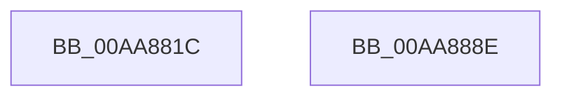

# MiCaptureSecureImageBaseAddress

- RVA: `0x00AA881C`–`0x00AA888F` (길이 `115` bytes)
- VA: `0x0000000140AA881C`
- 실행 섹션: `PAGE`
- PDB 이름 있음: `예`; PDB Function 태그: `아니요`
- unwind 정보 RVA: `0x0005C954`
- 디코드: `31`개 명령, `115/115` bytes 표시
- 미해석 바이트: `0` (있으면 어셈블리에 `.byte`로 보존)

> 이 문서는 커널 이미지의 기계어와 PDB 기호를 분석해 생성했습니다. 4번과 5번은 함수 원형과 자료형을 바이너리 사용 방식에서 추정한 C 해석이며 원본 소스 복구 결과는 아닙니다.

## 1. Dependencies

- 직접 호출 지점: **3**; 고유 호출 대상: **3**
- 직접 호출자로 확인된 함수: **1**
- RIP 상대 이미지 참조: **0**

### Outgoing calls
- `0x00AA8852` → [MI_LOCK_RELOCATIONS_EXCLUSIVE](../../text/46/MI_LOCK_RELOCATIONS_EXCLUSIVE_function_004650F8.md) (function, `0x004650F8`)
- `0x00AA8865` → [SeSetImageBaseAddress](SeSetImageBaseAddress_function_00AA8898.md) (function, `0x00AA8898`)
- `0x00AA8872` → [MI_UNLOCK_RELOCATIONS_EXCLUSIVE](../../text/46/MI_UNLOCK_RELOCATIONS_EXCLUSIVE_function_0046965C.md) (function, `0x0046965C`)

### Direct callers
- [MiValidateSectionCreate](../94/MiValidateSectionCreate_function_00940190.md) at `0x00940CC3`

### Static image references
- 디코드된 RIP-relative 메모리 참조가 없습니다.

## 2. Other-region calls and transfers

- 다른 실행 섹션으로 향하는 call: **2**
  - `0x00AA8852` → [MI_LOCK_RELOCATIONS_EXCLUSIVE](../../text/46/MI_LOCK_RELOCATIONS_EXCLUSIVE_function_004650F8.md) (`PAGE` → `.text`)
  - `0x00AA8872` → [MI_UNLOCK_RELOCATIONS_EXCLUSIVE](../../text/46/MI_UNLOCK_RELOCATIONS_EXCLUSIVE_function_0046965C.md) (`PAGE` → `.text`)
- 별도 외부 분기/꼬리 이동을 확인하지 못했습니다.

## 3. Assembly (complete function range)

```asm
00AA881C  48 89 5C 24 08                  mov qword ptr [rsp + 8], rbx
00AA8821  48 89 6C 24 10                  mov qword ptr [rsp + 0x10], rbp
00AA8826  48 89 74 24 18                  mov qword ptr [rsp + 0x18], rsi
00AA882B  57                              push rdi
00AA882C  48 83 EC 20                     sub rsp, 0x20
00AA8830  48 8B 59 60                     mov rbx, qword ptr [rcx + 0x60]
00AA8834  48 8B F1                        mov rsi, rcx
00AA8837  48 83 E3 F8                     and rbx, 0xfffffffffffffff8
00AA883B  48 8B 6B 20                     mov rbp, qword ptr [rbx + 0x20]
00AA883F  48 8B 5B 28                     mov rbx, qword ptr [rbx + 0x28]
00AA8843  48 8B D5                        mov rdx, rbp
00AA8846  65 48 8B 3C 25 88 01 00 00      mov rdi, qword ptr gs:[0x188]
00AA884F  48 8B CF                        mov rcx, rdi
00AA8852  E8 A1 C8 9B FF                  call 0x1404650f8
00AA8857  48 8B 16                        mov rdx, qword ptr [rsi]
00AA885A  48 83 E3 F8                     and rbx, 0xfffffffffffffff8
00AA885E  48 8B CB                        mov rcx, rbx
00AA8861  48 8B 52 20                     mov rdx, qword ptr [rdx + 0x20]
00AA8865  E8 2E 00 00 00                  call 0x140aa8898
00AA886A  48 8B D5                        mov rdx, rbp
00AA886D  48 8B CF                        mov rcx, rdi
00AA8870  8B D8                           mov ebx, eax
00AA8872  E8 E5 0D 9C FF                  call 0x14046965c
00AA8877  48 8B 6C 24 38                  mov rbp, qword ptr [rsp + 0x38]
00AA887C  8B C3                           mov eax, ebx
00AA887E  48 8B 5C 24 30                  mov rbx, qword ptr [rsp + 0x30]
00AA8883  48 8B 74 24 40                  mov rsi, qword ptr [rsp + 0x40]
00AA8888  48 83 C4 20                     add rsp, 0x20
00AA888C  5F                              pop rdi
00AA888D  C3                              ret
00AA888E  CC                              int3
```

## 4. C-style interpretation (structured pseudocode)

```c
__int64 __fastcall MiCaptureSecureImageBaseAddress(__int64 a1)
{
    __int64 result;
    __int64 v_rbx;
    __int64 v_rsp;
    unsigned __int64 v_stack_p10;
    unsigned __int64 v_stack_p18;
    unsigned __int64 v_stack_p8;

    v_stack_p8 = v_rbx;
    v_stack_p10 = v_rbp;
    v_stack_p18 = v_rsi;
    v_rsp = (v_rsp) - (32);
    v_rbx = (*(unsigned __int64 *)(a1 + 96)) & (-8);
    result = MI_LOCK_RELOCATIONS_EXCLUSIVE(*(unsigned __int64 *)(gs_base + (0 + 392)), *(unsigned __int64 *)(v_rbx + 32), a3, a4);
    v_rbx = (*(unsigned __int64 *)(v_rbx + 40)) & (-8);
    result = SeSetImageBaseAddress(v_rbx, *(unsigned __int64 *)(*(unsigned __int64 *)(a1) + 32), a3, a4);
    result = MI_UNLOCK_RELOCATIONS_EXCLUSIVE(*(unsigned __int64 *)(gs_base + (0 + 392)), *(unsigned __int64 *)(v_rbx + 32), a3, a4);
    v_rsp = (v_rsp) + (32);
    return (unsigned int)((unsigned int)((unsigned int)((unsigned int)(result))));
}
```

## 5. (Beta) C Style

```c
int64_t MiCaptureSecureImageBaseAddress(void *Arg1)
{
    uint8_t *arg1 = (uint8_t *)Arg1;

    int64_t result;
    int64_t local_rbx;
    int64_t local_rsp;
    uint64_t v_stack_p10;
    uint64_t v_stack_p18;
    uint64_t v_stack_p8;

    v_stack_p8 = local_rbx;
    v_stack_p10 = local_rbp;
    v_stack_p18 = local_rsi;
    local_rsp = (local_rsp) - (32);
    local_rbx = (*(uint64_t *)(arg1 + 0x60)) & (-8);
    result = MI_LOCK_RELOCATIONS_EXCLUSIVE(*(uint64_t *)(gs_base + (0 + 0x188)), *(uint64_t *)(local_rbx + 0x20), a3, a4);
    local_rbx = (*(uint64_t *)(local_rbx + 0x28)) & (-8);
    result = SeSetImageBaseAddress(local_rbx, *(uint64_t *)(*(uint64_t *)(arg1) + 0x20), a3, a4);
    result = MI_UNLOCK_RELOCATIONS_EXCLUSIVE(*(uint64_t *)(gs_base + (0 + 0x188)), *(uint64_t *)(local_rbx + 0x20), a3, a4);
    local_rsp = (local_rsp) + (32);
    return (uint32_t)((uint32_t)((uint32_t)((uint32_t)(result))));
}
```

### 관측된 메모리 오프셋

구조체 형식이 확인되지 않은 접근은 인자 기준의 오프셋으로만 기록했습니다.

| 기준 인자 | 오프셋 표현 | 폭 (bit) | 접근 |
|---|---:|---:|---|
| `Arg1` | `+ 0x0` | `64` | `R` |
| `Arg1` | `+ 0x60` | `64` | `R` |

## 6. Execution-region graph

[열기: 2D/3D 그래프와 함수 탐색 컨트롤 패널](../../../control-panel.html?section=page&rva=0x00AA881C&view=graph)

- 2D 그래프는 위에서 아래로 흐르고, 3D 그래프는 빈 공간을 드래그해 회전합니다. Shift+드래그는 이동, 휠은 확대·축소, 함수 노드 선택은 대상 보고서 이동입니다.

### Static fallback


