# MiConstructLoaderEntry

- RVA: `0x00AAA264`–`0x00AAA780` (길이 `1,308` bytes)
- VA: `0x0000000140AAA264`
- 실행 섹션: `PAGE`
- PDB 이름 있음: `예`; PDB Function 태그: `아니요`
- unwind 정보 RVA: `0x000BBD2C`
- 디코드: `342`개 명령, `1,308/1,308` bytes 표시
- 미해석 바이트: `0` (있으면 어셈블리에 `.byte`로 보존)

> 이 문서는 커널 이미지의 기계어와 PDB 기호를 분석해 생성했습니다. 4번과 5번은 함수 원형과 자료형을 바이너리 사용 방식에서 추정한 C 해석이며 원본 소스 복구 결과는 아닙니다.

## 1. Dependencies

- 직접 호출 지점: **20**; 고유 호출 대상: **16**
- 직접 호출자로 확인된 함수: **2**
- RIP 상대 이미지 참조: **4**

### Outgoing calls
- `0x00AAA2BA` → [MiAllocatePool](../../text/35/MiAllocatePool_function_0035B540.md) (function, `0x0035B540`)
- `0x00AAA2E7` → [memcpy](../../text/6C/memcpy_function_006C6840.md) (function, `0x006C6840`)
- `0x00AAA300` → [RtlImageNtHeader](../../text/44/RtlImageNtHeader_function_00443B60.md) (function, `0x00443B60`)
- `0x00AAA3A9` → [MiAllocatePool](../../text/35/MiAllocatePool_function_0035B540.md) (function, `0x0035B540`)
- `0x00AAA3C8` → [MiSectionControlArea](../../text/29/MiSectionControlArea_function_00294CB0.md) (function, `0x00294CB0`)
- `0x00AAA3F2` → [MiChargeResident](../../text/28/MiChargeResident_function_0028A0F0.md) (function, `0x0028A0F0`)
- `0x00AAA40D` → [ExFreePoolWithTag](../../poolcode/B8/ExFreePoolWithTag_function_00B82870.md) (function, `0x00B82870`)
- `0x00AAA41C` → [ExFreePoolWithTag](../../poolcode/B8/ExFreePoolWithTag_function_00B82870.md) (function, `0x00B82870`)
- `0x00AAA560` → [MiGetExtendedLoaderBitmap](../../text/4F/MiGetExtendedLoaderBitmap_function_004FCC74.md) (function, `0x004FCC74`)
- `0x00AAA595` → [MiInitializeImageSectionLocks](../AB/MiInitializeImageSectionLocks_function_00AB8EDC.md) (function, `0x00AB8EDC`)
- `0x00AAA5EB` → [memcpy](../../text/6C/memcpy_function_006C6840.md) (function, `0x006C6840`)
- `0x00AAA633` → [memset](../../text/6C/memset_function_006C6C40.md) (function, `0x006C6C40`)
- `0x00AAA63B` → [MiSectionControlArea](../../text/29/MiSectionControlArea_function_00294CB0.md) (function, `0x00294CB0`)
- `0x00AAA6A1` → [MiManageSubsectionView](../../text/2E/MiManageSubsectionView_function_002E2570.md) (function, `0x002E2570`)
- `0x00AAA6C0` → [MiCaptureImageExceptionValues](MiCaptureImageExceptionValues_function_00AAA890.md) (function, `0x00AAA890`)
- `0x00AAA6C8` → [MiLockdownSections](MiLockdownSections_function_00AAA788.md) (function, `0x00AAA788`)
- `0x00AAA71D` → [MiReferenceControlAreaFile](../../text/43/MiReferenceControlAreaFile_function_00431554.md) (function, `0x00431554`)
- `0x00AAA72C` → [IoIsDeviceEjectable](../../text/49/IoIsDeviceEjectable_function_0049C644.md) (function, `0x0049C644`)
- `0x00AAA746` → [MiDereferenceControlAreaFile](../../text/43/MiDereferenceControlAreaFile_function_004345E0.md) (function, `0x004345E0`)
- `0x00AAA752` → [MiBackSingleImageWithPagefile](../7F/MiBackSingleImageWithPagefile_function_007F8664.md) (function, `0x007F8664`)

### Direct callers
- [MmLoadSystemImageEx](../99/MmLoadSystemImageEx_function_00999B8C.md) at `0x00999EE8`
- [MiInitializeLoadedModuleList](../../init/C6/MiInitializeLoadedModuleList_function_00C6BCDC.md) at `0x00C6BDDC`

### Static image references
- `0x00AAA3DC` → RVA `0x00E38D00` (`.data`; read)
- `0x00AAA538` → RVA `0x00FC6B28` (`ALMOSTRO`; read)
- `0x00AAA541` → RVA `0x00FC6B98` (`ALMOSTRO`; read)
- `0x00AAA6CD` → RVA `0x00FC51F4` (`ALMOSTRO`; read)

## 2. Other-region calls and transfers

- 다른 실행 섹션으로 향하는 call: **16**
  - `0x00AAA2BA` → [MiAllocatePool](../../text/35/MiAllocatePool_function_0035B540.md) (`PAGE` → `.text`)
  - `0x00AAA2E7` → [memcpy](../../text/6C/memcpy_function_006C6840.md) (`PAGE` → `.text`)
  - `0x00AAA300` → [RtlImageNtHeader](../../text/44/RtlImageNtHeader_function_00443B60.md) (`PAGE` → `.text`)
  - `0x00AAA3A9` → [MiAllocatePool](../../text/35/MiAllocatePool_function_0035B540.md) (`PAGE` → `.text`)
  - `0x00AAA3C8` → [MiSectionControlArea](../../text/29/MiSectionControlArea_function_00294CB0.md) (`PAGE` → `.text`)
  - `0x00AAA3F2` → [MiChargeResident](../../text/28/MiChargeResident_function_0028A0F0.md) (`PAGE` → `.text`)
  - `0x00AAA40D` → [ExFreePoolWithTag](../../poolcode/B8/ExFreePoolWithTag_function_00B82870.md) (`PAGE` → `POOLCODE`)
  - `0x00AAA41C` → [ExFreePoolWithTag](../../poolcode/B8/ExFreePoolWithTag_function_00B82870.md) (`PAGE` → `POOLCODE`)
  - `0x00AAA560` → [MiGetExtendedLoaderBitmap](../../text/4F/MiGetExtendedLoaderBitmap_function_004FCC74.md) (`PAGE` → `.text`)
  - `0x00AAA5EB` → [memcpy](../../text/6C/memcpy_function_006C6840.md) (`PAGE` → `.text`)
  - `0x00AAA633` → [memset](../../text/6C/memset_function_006C6C40.md) (`PAGE` → `.text`)
  - `0x00AAA63B` → [MiSectionControlArea](../../text/29/MiSectionControlArea_function_00294CB0.md) (`PAGE` → `.text`)
  - `0x00AAA6A1` → [MiManageSubsectionView](../../text/2E/MiManageSubsectionView_function_002E2570.md) (`PAGE` → `.text`)
  - `0x00AAA71D` → [MiReferenceControlAreaFile](../../text/43/MiReferenceControlAreaFile_function_00431554.md) (`PAGE` → `.text`)
  - `0x00AAA72C` → [IoIsDeviceEjectable](../../text/49/IoIsDeviceEjectable_function_0049C644.md) (`PAGE` → `.text`)
  - `0x00AAA746` → [MiDereferenceControlAreaFile](../../text/43/MiDereferenceControlAreaFile_function_004345E0.md) (`PAGE` → `.text`)
- 별도 외부 분기/꼬리 이동을 확인하지 못했습니다.

## 3. Assembly (complete function range)

```asm
00AAA264  48 89 5C 24 08                  mov qword ptr [rsp + 8], rbx
00AAA269  44 89 4C 24 20                  mov dword ptr [rsp + 0x20], r9d
00AAA26E  55                              push rbp
00AAA26F  56                              push rsi
00AAA270  57                              push rdi
00AAA271  41 54                           push r12
00AAA273  41 55                           push r13
00AAA275  41 56                           push r14
00AAA277  41 57                           push r15
00AAA279  48 81 EC F0 00 00 00            sub rsp, 0xf0
00AAA280  48 8B 84 24 50 01 00 00         mov rax, qword ptr [rsp + 0x150]
00AAA288  4C 8B EA                        mov r13, rdx
00AAA28B  41 0F B7 10                     movzx edx, word ptr [r8]
00AAA28F  45 33 E4                        xor r12d, r12d
00AAA292  49 8B D8                        mov rbx, r8
00AAA295  4C 89 64 24 20                  mov qword ptr [rsp + 0x20], r12
00AAA29A  48 8B F9                        mov rdi, rcx
00AAA29D  0F 57 C0                        xorps xmm0, xmm0
00AAA2A0  48 83 C2 02                     add rdx, 2
00AAA2A4  4C 89 20                        mov qword ptr [rax], r12
00AAA2A7  B9 00 01 00 00                  mov ecx, 0x100
00AAA2AC  41 B8 4D 6D 44 54               mov r8d, 0x54446d4d
00AAA2B2  0F 11 44 24 28                  movups xmmword ptr [rsp + 0x28], xmm0
00AAA2B7  45 8B FC                        mov r15d, r12d
00AAA2BA  E8 81 12 8B FF                  call 0x14035b540
00AAA2BF  48 89 44 24 30                  mov qword ptr [rsp + 0x30], rax
00AAA2C4  4C 8B F0                        mov r14, rax
00AAA2C7  48 85 C0                        test rax, rax
00AAA2CA  0F 84 2E 01 00 00               je 0x140aaa3fe
00AAA2D0  44 0F B7 03                     movzx r8d, word ptr [rbx]
00AAA2D4  48 8B C8                        mov rcx, rax
00AAA2D7  48 8B 53 08                     mov rdx, qword ptr [rbx + 8]
00AAA2DB  66 44 89 44 24 28               mov word ptr [rsp + 0x28], r8w
00AAA2E1  66 44 89 44 24 2A               mov word ptr [rsp + 0x2a], r8w
00AAA2E7  E8 54 C5 C1 FF                  call 0x1406c6840
00AAA2EC  0F B7 03                        movzx eax, word ptr [rbx]
00AAA2EF  48 D1 E8                        shr rax, 1
00AAA2F2  66 45 89 24 46                  mov word ptr [r14 + rax*2], r12w
00AAA2F7  48 8B 4F 30                     mov rcx, qword ptr [rdi + 0x30]
00AAA2FB  48 89 4C 24 40                  mov qword ptr [rsp + 0x40], rcx
00AAA300  E8 5B 98 99 FF                  call 0x140443b60
00AAA305  48 8B F0                        mov rsi, rax
00AAA308  33 D2                           xor edx, edx
00AAA30A  44 0F B7 48 06                  movzx r9d, word ptr [rax + 6]
00AAA30F  48 83 C8 FF                     or rax, 0xffffffffffffffff
00AAA313  49 F7 F1                        div r9
00AAA316  44 89 8C 24 40 01 00 00         mov dword ptr [rsp + 0x140], r9d
00AAA31E  48 83 F8 0C                     cmp rax, 0xc
00AAA322  73 0A                           jae 0x140aaa32e
00AAA324  BB 30 01 00 C0                  mov ebx, 0xc0000130
00AAA329  E9 D5 00 00 00                  jmp 0x140aaa403
00AAA32E  8B 46 50                        mov eax, dword ptr [rsi + 0x50]
00AAA331  41 8B D4                        mov edx, r12d
00AAA334  A9 FF 0F 00 00                  test eax, 0xfff
00AAA339  0F 95 C2                        setne dl
00AAA33C  C1 E8 0C                        shr eax, 0xc
00AAA33F  03 D0                           add edx, eax
00AAA341  8B C2                           mov eax, edx
00AAA343  24 3F                           and al, 0x3f
00AAA345  F6 D8                           neg al
00AAA347  1B C9                           sbb ecx, ecx
00AAA349  C1 EA 06                        shr edx, 6
00AAA34C  F7 D9                           neg ecx
00AAA34E  8D 41 02                        lea eax, [rcx + 2]
00AAA351  03 C2                           add eax, edx
00AAA353  C1 E0 03                        shl eax, 3
00AAA356  48 89 44 24 38                  mov qword ptr [rsp + 0x38], rax
00AAA35B  48 05 30 01 00 00               add rax, 0x130
00AAA361  48 3D 30 01 00 00               cmp rax, 0x130
00AAA367  77 0A                           ja 0x140aaa373
00AAA369  BB 7B 00 00 C0                  mov ebx, 0xc000007b
00AAA36E  E9 90 00 00 00                  jmp 0x140aaa403
00AAA373  41 0F B7 6D 00                  movzx ebp, word ptr [r13]
00AAA378  48 83 C5 09                     add rbp, 9
00AAA37C  48 83 E5 F8                     and rbp, 0xfffffffffffffff8
00AAA380  48 8D 14 28                     lea rdx, [rax + rbp]
00AAA384  48 3B D0                        cmp rdx, rax
00AAA387  76 E0                           jbe 0x140aaa369
00AAA389  45 85 C9                        test r9d, r9d
00AAA38C  74 10                           je 0x140aaa39e
00AAA38E  4B 8D 04 49                     lea rax, [r9 + r9*2]
00AAA392  48 8D 0C 82                     lea rcx, [rdx + rax*4]
00AAA396  48 3B CA                        cmp rcx, rdx
00AAA399  76 CE                           jbe 0x140aaa369
00AAA39B  48 8B D1                        mov rdx, rcx
00AAA39E  B9 40 00 00 00                  mov ecx, 0x40
00AAA3A3  41 B8 4D 6D 4C 64               mov r8d, 0x644c6d4d
00AAA3A9  E8 92 11 8B FF                  call 0x14035b540
00AAA3AE  48 8B D8                        mov rbx, rax
00AAA3B1  48 85 C0                        test rax, rax
00AAA3B4  74 48                           je 0x140aaa3fe
00AAA3B6  4C 8B 67 70                     mov r12, qword ptr [rdi + 0x70]
00AAA3BA  45 33 C0                        xor r8d, r8d
00AAA3BD  4C 8B F8                        mov r15, rax
00AAA3C0  4D 85 E4                        test r12, r12
00AAA3C3  74 63                           je 0x140aaa428
00AAA3C5  49 8B CC                        mov rcx, r12
00AAA3C8  E8 E3 A8 7E FF                  call 0x140294cb0
00AAA3CD  48 8B 08                        mov rcx, qword ptr [rax]
00AAA3D0  41 8B C0                        mov eax, r8d
00AAA3D3  8B 51 08                        mov edx, dword ptr [rcx + 8]
00AAA3D6  F7 C2 FF 0F 00 00               test edx, 0xfff
00AAA3DC  48 8D 0D 1D E9 38 00            lea rcx, [rip + 0x38e91d]
00AAA3E3  0F 95 C0                        setne al
00AAA3E6  C1 EA 0C                        shr edx, 0xc
00AAA3E9  03 C2                           add eax, edx
00AAA3EB  8B D0                           mov edx, eax
00AAA3ED  48 89 44 24 20                  mov qword ptr [rsp + 0x20], rax
00AAA3F2  E8 F9 FC 7D FF                  call 0x14028a0f0
00AAA3F7  45 33 C0                        xor r8d, r8d
00AAA3FA  85 C0                           test eax, eax
00AAA3FC  75 2A                           jne 0x140aaa428
00AAA3FE  BB 9A 00 00 C0                  mov ebx, 0xc000009a
00AAA403  4D 85 F6                        test r14, r14
00AAA406  74 0A                           je 0x140aaa412
00AAA408  33 D2                           xor edx, edx
00AAA40A  49 8B CE                        mov rcx, r14
00AAA40D  E8 5E 84 0D 00                  call 0x140b82870
00AAA412  4D 85 FF                        test r15, r15
00AAA415  74 0A                           je 0x140aaa421
00AAA417  33 D2                           xor edx, edx
00AAA419  49 8B CF                        mov rcx, r15
00AAA41C  E8 4F 84 0D 00                  call 0x140b82870
00AAA421  8B C3                           mov eax, ebx
00AAA423  E9 3C 03 00 00                  jmp 0x140aaa764
00AAA428  8B 8C 24 48 01 00 00            mov ecx, dword ptr [rsp + 0x148]
00AAA42F  41 BF 80 00 00 00               mov r15d, 0x80
00AAA435  81 E1 00 00 00 10               and ecx, 0x10000000
00AAA43B  74 58                           je 0x140aaa495
00AAA43D  0F 10 07                        movups xmm0, xmmword ptr [rdi]
00AAA440  0F 11 03                        movups xmmword ptr [rbx], xmm0
00AAA443  0F 10 4F 10                     movups xmm1, xmmword ptr [rdi + 0x10]
00AAA447  0F 11 4B 10                     movups xmmword ptr [rbx + 0x10], xmm1
00AAA44B  0F 10 47 20                     movups xmm0, xmmword ptr [rdi + 0x20]
00AAA44F  0F 11 43 20                     movups xmmword ptr [rbx + 0x20], xmm0
00AAA453  0F 10 4F 30                     movups xmm1, xmmword ptr [rdi + 0x30]
00AAA457  0F 11 4B 30                     movups xmmword ptr [rbx + 0x30], xmm1
00AAA45B  0F 10 47 40                     movups xmm0, xmmword ptr [rdi + 0x40]
00AAA45F  0F 11 43 40                     movups xmmword ptr [rbx + 0x40], xmm0
00AAA463  0F 10 4F 50                     movups xmm1, xmmword ptr [rdi + 0x50]
00AAA467  0F 11 4B 50                     movups xmmword ptr [rbx + 0x50], xmm1
00AAA46B  0F 10 47 60                     movups xmm0, xmmword ptr [rdi + 0x60]
00AAA46F  0F 11 43 60                     movups xmmword ptr [rbx + 0x60], xmm0
00AAA473  0F 10 47 70                     movups xmm0, xmmword ptr [rdi + 0x70]
00AAA477  42 0F 11 44 3B F0               movups xmmword ptr [rbx + r15 - 0x10], xmm0
00AAA47D  42 0F 10 0C 3F                  movups xmm1, xmmword ptr [rdi + r15]
00AAA482  42 0F 11 0C 3B                  movups xmmword ptr [rbx + r15], xmm1
00AAA487  42 0F 10 44 3F 10               movups xmm0, xmmword ptr [rdi + r15 + 0x10]
00AAA48D  42 0F 11 44 3B 10               movups xmmword ptr [rbx + r15 + 0x10], xmm0
00AAA493  EB 68                           jmp 0x140aaa4fd
00AAA495  48 8B C3                        mov rax, rbx
00AAA498  BA 02 00 00 00                  mov edx, 2
00AAA49D  0F 10 07                        movups xmm0, xmmword ptr [rdi]
00AAA4A0  0F 11 00                        movups xmmword ptr [rax], xmm0
00AAA4A3  0F 10 4F 10                     movups xmm1, xmmword ptr [rdi + 0x10]
00AAA4A7  0F 11 48 10                     movups xmmword ptr [rax + 0x10], xmm1
00AAA4AB  0F 10 47 20                     movups xmm0, xmmword ptr [rdi + 0x20]
00AAA4AF  0F 11 40 20                     movups xmmword ptr [rax + 0x20], xmm0
00AAA4B3  0F 10 4F 30                     movups xmm1, xmmword ptr [rdi + 0x30]
00AAA4B7  0F 11 48 30                     movups xmmword ptr [rax + 0x30], xmm1
00AAA4BB  0F 10 47 40                     movups xmm0, xmmword ptr [rdi + 0x40]
00AAA4BF  0F 11 40 40                     movups xmmword ptr [rax + 0x40], xmm0
00AAA4C3  0F 10 4F 50                     movups xmm1, xmmword ptr [rdi + 0x50]
00AAA4C7  0F 11 48 50                     movups xmmword ptr [rax + 0x50], xmm1
00AAA4CB  0F 10 47 60                     movups xmm0, xmmword ptr [rdi + 0x60]
00AAA4CF  0F 11 40 60                     movups xmmword ptr [rax + 0x60], xmm0
00AAA4D3  49 03 C7                        add rax, r15
00AAA4D6  0F 10 4F 70                     movups xmm1, xmmword ptr [rdi + 0x70]
00AAA4DA  49 03 FF                        add rdi, r15
00AAA4DD  0F 11 48 F0                     movups xmmword ptr [rax - 0x10], xmm1
00AAA4E1  48 83 EA 01                     sub rdx, 1
00AAA4E5  75 B6                           jne 0x140aaa49d
00AAA4E7  0F 10 07                        movups xmm0, xmmword ptr [rdi]
00AAA4EA  0F 11 00                        movups xmmword ptr [rax], xmm0
00AAA4ED  0F 10 4F 10                     movups xmm1, xmmword ptr [rdi + 0x10]
00AAA4F1  0F 11 48 10                     movups xmmword ptr [rax + 0x10], xmm1
00AAA4F5  0F 10 47 20                     movups xmm0, xmmword ptr [rdi + 0x20]
00AAA4F9  0F 11 40 20                     movups xmmword ptr [rax + 0x20], xmm0
00AAA4FD  48 8D 83 00 01 00 00            lea rax, [rbx + 0x100]
00AAA504  4C 89 83 E8 00 00 00            mov qword ptr [rbx + 0xe8], r8
00AAA50B  BF 01 00 00 00                  mov edi, 1
00AAA510  09 BB B8 00 00 00               or dword ptr [rbx + 0xb8], edi
00AAA516  48 89 40 08                     mov qword ptr [rax + 8], rax
00AAA51A  48 89 00                        mov qword ptr [rax], rax
00AAA51D  85 C9                           test ecx, ecx
00AAA51F  74 3C                           je 0x140aaa55d
00AAA521  81 8B B8 00 00 00 00 C0 05 00   or dword ptr [rbx + 0xb8], 0x5c000
00AAA52B  F7 43 68 00 00 00 04            test dword ptr [rbx + 0x68], 0x4000000
00AAA532  74 1C                           je 0x140aaa550
00AAA534  48 8B 43 30                     mov rax, qword ptr [rbx + 0x30]
00AAA538  48 3B 05 E9 C5 51 00            cmp rax, qword ptr [rip + 0x51c5e9]
00AAA53F  74 0F                           je 0x140aaa550
00AAA541  48 3B 05 50 C6 51 00            cmp rax, qword ptr [rip + 0x51c650]
00AAA548  74 06                           je 0x140aaa550
00AAA54A  41 0F B7 C0                     movzx eax, r8w
00AAA54E  EB 02                           jmp 0x140aaa552
00AAA550  8B C7                           mov eax, edi
00AAA552  66 89 43 6C                     mov word ptr [rbx + 0x6c], ax
00AAA556  48 89 BB 88 00 00 00            mov qword ptr [rbx + 0x88], rdi
00AAA55D  48 8B CB                        mov rcx, rbx
00AAA560  E8 0F 27 A5 FF                  call 0x1404fcc74
00AAA565  4C 8B F0                        mov r14, rax
00AAA568  48 8B 44 24 20                  mov rax, qword ptr [rsp + 0x20]
00AAA56D  4C 03 74 24 38                  add r14, qword ptr [rsp + 0x38]
00AAA572  48 89 83 C0 00 00 00            mov qword ptr [rbx + 0xc0], rax
00AAA579  8B 84 24 40 01 00 00            mov eax, dword ptr [rsp + 0x140]
00AAA580  85 C0                           test eax, eax
00AAA582  74 16                           je 0x140aaa59a
00AAA584  89 83 28 01 00 00               mov dword ptr [rbx + 0x128], eax
00AAA58A  49 8D 04 2E                     lea rax, [r14 + rbp]
00AAA58E  48 89 83 C8 00 00 00            mov qword ptr [rbx + 0xc8], rax
00AAA595  E8 42 E9 00 00                  call 0x140ab8edc
00AAA59A  66 83 7E 40 05                  cmp word ptr [rsi + 0x40], 5
00AAA59F  72 0C                           jb 0x140aaa5ad
00AAA5A1  66 83 7E 44 05                  cmp word ptr [rsi + 0x44], 5
00AAA5A6  72 05                           jb 0x140aaa5ad
00AAA5A8  0F BA 6B 68 1B                  bts dword ptr [rbx + 0x68], 0x1b
00AAA5AD  44 84 7E 5E                     test byte ptr [rsi + 0x5e], r15b
00AAA5B1  74 04                           je 0x140aaa5b7
00AAA5B3  83 4B 68 20                     or dword ptr [rbx + 0x68], 0x20
00AAA5B7  8B AC 24 48 01 00 00            mov ebp, dword ptr [rsp + 0x148]
00AAA5BE  40 F6 C5 08                     test bpl, 8
00AAA5C2  74 05                           je 0x140aaa5c9
00AAA5C4  0F BA 6B 68 1A                  bts dword ptr [rbx + 0x68], 0x1a
00AAA5C9  4C 89 73 60                     mov qword ptr [rbx + 0x60], r14
00AAA5CD  49 8B CE                        mov rcx, r14
00AAA5D0  41 0F B7 45 00                  movzx eax, word ptr [r13]
00AAA5D5  66 89 43 58                     mov word ptr [rbx + 0x58], ax
00AAA5D9  41 0F B7 45 00                  movzx eax, word ptr [r13]
00AAA5DE  66 89 43 5A                     mov word ptr [rbx + 0x5a], ax
00AAA5E2  45 0F B7 45 00                  movzx r8d, word ptr [r13]
00AAA5E7  49 8B 55 08                     mov rdx, qword ptr [r13 + 8]
00AAA5EB  E8 50 C2 C1 FF                  call 0x1406c6840
00AAA5F0  41 0F B7 4D 00                  movzx ecx, word ptr [r13]
00AAA5F5  45 33 ED                        xor r13d, r13d
00AAA5F8  48 8B 43 60                     mov rax, qword ptr [rbx + 0x60]
00AAA5FC  4C 8B 7C 24 40                  mov r15, qword ptr [rsp + 0x40]
00AAA601  48 D1 E9                        shr rcx, 1
00AAA604  66 44 89 2C 48                  mov word ptr [rax + rcx*2], r13w
00AAA609  4C 89 6B 28                     mov qword ptr [rbx + 0x28], r13
00AAA60D  8B 46 28                        mov eax, dword ptr [rsi + 0x28]
00AAA610  49 03 C7                        add rax, r15
00AAA613  48 89 43 38                     mov qword ptr [rbx + 0x38], rax
00AAA617  8B 46 58                        mov eax, dword ptr [rsi + 0x58]
00AAA61A  89 43 78                        mov dword ptr [rbx + 0x78], eax
00AAA61D  4D 85 E4                        test r12, r12
00AAA620  0F 84 82 00 00 00               je 0x140aaa6a8
00AAA626  33 D2                           xor edx, edx
00AAA628  48 8D 4C 24 58                  lea rcx, [rsp + 0x58]
00AAA62D  41 B8 90 00 00 00               mov r8d, 0x90
00AAA633  E8 08 C6 C1 FF                  call 0x1406c6c40
00AAA638  49 8B CC                        mov rcx, r12
00AAA63B  E8 70 A6 7E FF                  call 0x140294cb0
00AAA640  4C 8B F0                        mov r14, rax
00AAA643  49 83 CF 03                     or r15, 3
00AAA647  48 8B 08                        mov rcx, qword ptr [rax]
00AAA64A  B8 F0 FF 00 00                  mov eax, 0xfff0
00AAA64F  8A 49 0F                        mov cl, byte ptr [rcx + 0xf]
00AAA652  8A D1                           mov dl, cl
00AAA654  4C 89 74 24 50                  mov qword ptr [rsp + 0x50], r14
00AAA659  80 E2 0F                        and dl, 0xf
00AAA65C  C0 E9 04                        shr cl, 4
00AAA65F  44 0F B6 C2                     movzx r8d, dl
00AAA663  80 E1 07                        and cl, 7
00AAA666  0F B7 53 6E                     movzx edx, word ptr [rbx + 0x6e]
00AAA66A  66 23 D0                        and dx, ax
00AAA66D  B8 8F FF 00 00                  mov eax, 0xff8f
00AAA672  66 44 0B C2                     or r8w, dx
00AAA676  48 8D 93 A0 00 00 00            lea rdx, [rbx + 0xa0]
00AAA67D  66 44 23 C0                     and r8w, ax
00AAA681  0F B6 C1                        movzx eax, cl
00AAA684  66 C1 E0 04                     shl ax, 4
00AAA688  48 8D 4C 24 50                  lea rcx, [rsp + 0x50]
00AAA68D  66 44 0B C0                     or r8w, ax
00AAA691  66 44 89 43 6E                  mov word ptr [rbx + 0x6e], r8w
00AAA696  45 8D 45 03                     lea r8d, [r13 + 3]
00AAA69A  4C 89 BB B0 00 00 00            mov qword ptr [rbx + 0xb0], r15
00AAA6A1  E8 CA 7E 83 FF                  call 0x1402e2570
00AAA6A6  EB 03                           jmp 0x140aaa6ab
00AAA6A8  4D 8B F5                        mov r14, r13
00AAA6AB  8B 46 50                        mov eax, dword ptr [rsi + 0x50]
00AAA6AE  48 8B CB                        mov rcx, rbx
00AAA6B1  89 83 98 00 00 00               mov dword ptr [rbx + 0x98], eax
00AAA6B7  8B 46 08                        mov eax, dword ptr [rsi + 8]
00AAA6BA  89 83 9C 00 00 00               mov dword ptr [rbx + 0x9c], eax
00AAA6C0  E8 CB 01 00 00                  call 0x140aaa890
00AAA6C5  48 8B CB                        mov rcx, rbx
00AAA6C8  E8 BB 00 00 00                  call 0x140aaa788
00AAA6CD  8B 05 21 AB 51 00               mov eax, dword ptr [rip + 0x51ab21]
00AAA6D3  40 84 C7                        test dil, al
00AAA6D6  75 06                           jne 0x140aaa6de
00AAA6D8  40 F6 C5 02                     test bpl, 2
00AAA6DC  74 07                           je 0x140aaa6e5
00AAA6DE  83 8B B8 00 00 00 08            or dword ptr [rbx + 0xb8], 8
00AAA6E5  8B 93 B8 00 00 00               mov edx, dword ptr [rbx + 0xb8]
00AAA6EB  F6 C2 04                        test dl, 4
00AAA6EE  0F 94 C1                        sete cl
00AAA6F1  40 F6 C5 20                     test bpl, 0x20
00AAA6F5  0F 94 C0                        sete al
00AAA6F8  84 C8                           test al, cl
00AAA6FA  75 0A                           jne 0x140aaa706
00AAA6FC  0F BA EA 0D                     bts edx, 0xd
00AAA700  89 93 B8 00 00 00               mov dword ptr [rbx + 0xb8], edx
00AAA706  0F 10 44 24 28                  movups xmm0, xmmword ptr [rsp + 0x28]
00AAA70B  F3 0F 7F 43 48                  movdqu xmmword ptr [rbx + 0x48], xmm0
00AAA710  F6 C2 04                        test dl, 4
00AAA713  75 3A                           jne 0x140aaa74f
00AAA715  4D 85 E4                        test r12, r12
00AAA718  74 3D                           je 0x140aaa757
00AAA71A  49 8B CE                        mov rcx, r14
00AAA71D  E8 32 6E 98 FF                  call 0x140431554
00AAA722  4C 8B C0                        mov r8, rax
00AAA725  48 8B 50 08                     mov rdx, qword ptr [rax + 8]
00AAA729  48 8B CA                        mov rcx, rdx
00AAA72C  E8 13 1F 9F FF                  call 0x14049c644
00AAA731  84 C0                           test al, al
00AAA733  75 08                           jne 0x140aaa73d
00AAA735  8B 4A 34                        mov ecx, dword ptr [rdx + 0x34]
00AAA738  F6 C1 11                        test cl, 0x11
00AAA73B  74 03                           je 0x140aaa740
00AAA73D  41 8B FD                        mov edi, r13d
00AAA740  49 8B D0                        mov rdx, r8
00AAA743  49 8B CE                        mov rcx, r14
00AAA746  E8 95 9E 98 FF                  call 0x1404345e0
00AAA74B  85 FF                           test edi, edi
00AAA74D  75 08                           jne 0x140aaa757
00AAA74F  48 8B CB                        mov rcx, rbx
00AAA752  E8 0D DF D4 FF                  call 0x1407f8664
00AAA757  48 8B 84 24 50 01 00 00         mov rax, qword ptr [rsp + 0x150]
00AAA75F  48 89 18                        mov qword ptr [rax], rbx
00AAA762  33 C0                           xor eax, eax
00AAA764  48 8B 9C 24 30 01 00 00         mov rbx, qword ptr [rsp + 0x130]
00AAA76C  48 81 C4 F0 00 00 00            add rsp, 0xf0
00AAA773  41 5F                           pop r15
00AAA775  41 5E                           pop r14
00AAA777  41 5D                           pop r13
00AAA779  41 5C                           pop r12
00AAA77B  5F                              pop rdi
00AAA77C  5E                              pop rsi
00AAA77D  5D                              pop rbp
00AAA77E  C3                              ret
00AAA77F  CC                              int3
```

## 4. C-style interpretation (structured pseudocode)

```c
__int64 __fastcall MiConstructLoaderEntry(__int64 a1, __int64 a2, __int64 a3, int a4, __int64 a5)
{
    __int64 result;
    __int64 v_r12;
    __int64 v_r13;
    __int64 v_r14;
    __int64 v_r15;
    __int64 v_rbp;
    __int64 v_rdi;
    __int64 v_rsp;
    unsigned __int64 v_stack_m100;
    unsigned __int64 v_stack_m108;
    unsigned __int64 v_stack_mD0;
    unsigned __int64 v_stack_mD8;
    unsigned __int64 v_stack_mE8;
    unsigned __int64 v_stack_mF0;
    unsigned __int64 v_stack_mF8;
    unsigned __int16 v_stack_mFE;
    unsigned int v_stack_p18;
    unsigned int v_stack_p20;
    unsigned __int64 v_stack_p8;

    v_stack_p8 = v_rbx;
    v_stack_p20 = a4;
    v_rsp = (v_rsp) - (240);
    v_r12 = 0;
    v_stack_m108 = 0;
    a2 = (*(unsigned __int16 *)(a3)) + (2);
    *(unsigned __int64 *)(a5) = 0;
    v_stack_m100 = v_xmm0;
    result = MiAllocatePool(256, a2, (unsigned int)(0x54446D4DULL), a4);
    v_stack_mF8 = result;
    if (result == 0) goto loc_00AAA3FE;
    v_stack_m100 = (unsigned __int16)(*(unsigned __int16 *)(a3));
    v_stack_mFE = (unsigned __int16)(*(unsigned __int16 *)(a3));
    result = memcpy(result, *(unsigned __int64 *)(a3 + 8), *(unsigned __int16 *)(a3), a4);
    result = (*(unsigned __int16 *)(a3)) >> (1);
    *(unsigned __int16 *)(result + result * 2) = 0;
    v_stack_mE8 = *(unsigned __int64 *)(a1 + 48);
    result = RtlImageNtHeader(*(unsigned __int64 *)(a1 + 48), *(unsigned __int64 *)(a3 + 8), *(unsigned __int16 *)(a3), a4);
    a2 = 0;
    result = (result) | (-1);
    v_stack_p18 = (unsigned int)(*(unsigned __int16 *)(result + 6));
    if (result >= 12) goto loc_00AAA32E;
    goto loc_00AAA403;
loc_00AAA32E:
    a2 = ((((unsigned int)((unsigned int)(*(unsigned int *)(result + 80)))) & (0xFFFULL)) != 0) ? 1 : 0;
    result = (unsigned int)(((unsigned int)(*(unsigned int *)(result + 80))) >> (12));
    a2 = (unsigned int)((a2) + ((unsigned int)(result)));
    result = (unsigned __int8)(((unsigned int)((unsigned int)(a2))) & (63));
    result = (unsigned __int8)(-(result));
    a2 = (unsigned int)((a2) >> (6));
    a1 = (unsigned int)(-(*(unsigned __int64 *)(a1 + 48)));
    result = (unsigned int)((a1 + 2) + ((unsigned int)(a2)));
    result = (unsigned int)((result) << (3));
    v_stack_mF0 = result;
    result = (result) + (304);
    if (result > 304) goto loc_00AAA373;
loc_00AAA369:
    goto loc_00AAA403;
loc_00AAA373:
    v_rbp = (*(unsigned __int16 *)(a2)) + (9);
    v_rbp = (v_rbp) & (-8);
    if ((result + v_rbp * 1) <= result) goto loc_00AAA369;
    if ((unsigned int)(*(unsigned __int16 *)(result + 6)) == 0) goto loc_00AAA39E;
    if ((result + v_rbp * 1 + *(unsigned __int16 *)(result + 6) + *(unsigned __int16 *)(result + 6) * 2 * 4) <= (result + v_rbp * 1)) goto loc_00AAA369;
loc_00AAA39E:
    result = MiAllocatePool(64, result + v_rbp * 1 + *(unsigned __int16 *)(result + 6) + *(unsigned __int16 *)(result + 6) * 2 * 4, (unsigned int)(0x644C6D4DULL), *(unsigned __int16 *)(result + 6));
    if (result == 0) goto loc_00AAA3FE;
    a3 = 0;
    if (*(unsigned __int64 *)(a1 + 112) == 0) goto loc_00AAA428;
    result = MiSectionControlArea(*(unsigned __int64 *)(a1 + 112), result + v_rbp * 1 + *(unsigned __int16 *)(result + 6) + *(unsigned __int16 *)(result + 6) * 2 * 4, a3, *(unsigned __int16 *)(result + 6));
    result = ((((unsigned int)((unsigned int)(*(unsigned int *)(*(unsigned __int64 *)(result) + 8)))) & (0xFFFULL)) != 0) ? 1 : 0;
    a2 = (unsigned int)(((unsigned int)(*(unsigned int *)(*(unsigned __int64 *)(result) + 8))) >> (12));
    result = (unsigned int)((result) + ((unsigned int)(a2)));
    v_stack_m108 = result;
    result = MiChargeResident(v_rip + 3729693, (unsigned int)((unsigned int)(result)), a3, *(unsigned __int16 *)(result + 6));
    a3 = 0;
    if ((unsigned int)(result) != 0) goto loc_00AAA428;
loc_00AAA3FE:
loc_00AAA403:
    if (result != 0) {
        a2 = 0;
        a1 = result;
        result = ExFreePoolWithTag(a1, a2, a3, *(unsigned __int16 *)(result + 6));
    }
    if (result != 0) {
        a2 = 0;
        a1 = result;
        result = ExFreePoolWithTag(a1, a2, a3, *(unsigned __int16 *)(result + 6));
    }
    goto loc_00AAA764;
loc_00AAA428:
    a1 = (unsigned int)(((unsigned int)(v_stack_p20)) & (0x10000000ULL));
    if (condition_is_equal) goto loc_00AAA495;
    *(unsigned __int64 *)((unsigned int)(0xC000009AULL)) = v_xmm0;
    *(unsigned __int64 *)((unsigned int)(0xC000009AULL) + 16) = v_xmm1;
    *(unsigned __int64 *)((unsigned int)(0xC000009AULL) + 32) = v_xmm0;
    *(unsigned __int64 *)((unsigned int)(0xC000009AULL) + 48) = v_xmm1;
    *(unsigned __int64 *)((unsigned int)(0xC000009AULL) + 64) = v_xmm0;
    *(unsigned __int64 *)((unsigned int)(0xC000009AULL) + 80) = v_xmm1;
    *(unsigned __int64 *)((unsigned int)(0xC000009AULL) + 96) = v_xmm0;
    *(unsigned __int64 *)((unsigned int)(0xC000009AULL) + 128 * 1 - 16) = v_xmm0;
    *(unsigned __int64 *)((unsigned int)(0xC000009AULL) + 128 * 1) = v_xmm1;
    *(unsigned __int64 *)((unsigned int)(0xC000009AULL) + 128 * 1 + 16) = v_xmm0;
    goto loc_00AAA4FD;
loc_00AAA495:
loc_00AAA49D:
    *(unsigned __int64 *)((unsigned int)(0xC000009AULL)) = v_xmm0;
    *(unsigned __int64 *)((unsigned int)(0xC000009AULL) + 16) = v_xmm1;
    *(unsigned __int64 *)((unsigned int)(0xC000009AULL) + 32) = v_xmm0;
    *(unsigned __int64 *)((unsigned int)(0xC000009AULL) + 48) = v_xmm1;
    *(unsigned __int64 *)((unsigned int)(0xC000009AULL) + 64) = v_xmm0;
    *(unsigned __int64 *)((unsigned int)(0xC000009AULL) + 80) = v_xmm1;
    *(unsigned __int64 *)((unsigned int)(0xC000009AULL) + 96) = v_xmm0;
    result = ((unsigned int)(0xC000009AULL)) + (128);
    v_rdi = (a1) + (128);
    *(unsigned __int64 *)(result - 16) = v_xmm1;
    a2 = (2) - (1);
    if (condition_is_not_equal) goto loc_00AAA49D;
    *(unsigned __int64 *)(result) = v_xmm0;
    *(unsigned __int64 *)(result + 16) = v_xmm1;
    *(unsigned __int64 *)(result + 32) = v_xmm0;
loc_00AAA4FD:
    *(unsigned __int64 *)((unsigned int)(0xC000009AULL) + 232) = 0;
    *(unsigned __int64 *)((unsigned int)(0xC000009AULL) + 256 + 8) = (unsigned int)(0xC000009AULL) + 256;
    *(unsigned __int64 *)((unsigned int)(0xC000009AULL) + 256) = (unsigned int)(0xC000009AULL) + 256;
    if ((unsigned int)(a1) == 0) goto loc_00AAA55D;
    if (((*(unsigned int *)((unsigned int)(0xC000009AULL) + 104)) & (0x4000000ULL)) == 0) goto loc_00AAA550;
    if ((*(unsigned __int64 *)((unsigned int)(0xC000009AULL) + 48)) == (*(unsigned __int64 *)(v_rip + 5359081))) goto loc_00AAA550;
    if ((*(unsigned __int64 *)((unsigned int)(0xC000009AULL) + 48)) == (*(unsigned __int64 *)(v_rip + 5359184))) goto loc_00AAA550;
    goto loc_00AAA552;
loc_00AAA550:
loc_00AAA552:
    *(unsigned __int16 *)((unsigned int)(0xC000009AULL) + 108) = 1;
    *(unsigned __int64 *)((unsigned int)(0xC000009AULL) + 136) = 1;
loc_00AAA55D:
    result = MiGetExtendedLoaderBitmap((unsigned int)(0xC000009AULL), a2, a3, *(unsigned __int16 *)(result + 6));
    v_r14 = (result) + (v_stack_mF0);
    *(unsigned __int64 *)((unsigned int)(0xC000009AULL) + 192) = v_stack_m108;
    result = (unsigned int)(v_stack_p18);
    if ((unsigned int)((unsigned int)(v_stack_p18)) != 0) {
        *(unsigned int *)((unsigned int)(0xC000009AULL) + 296) = (unsigned int)((unsigned int)(v_stack_p18));
        result = v_r14 + v_rbp * 1;
        *(unsigned __int64 *)((unsigned int)(0xC000009AULL) + 200) = result;
        result = MiInitializeImageSectionLocks((unsigned int)(0xC000009AULL), a2, a3, *(unsigned __int16 *)(result + 6));
    }
    if ((*(unsigned __int16 *)(result + 64)) < 5) goto loc_00AAA5AD;
    if ((*(unsigned __int16 *)(result + 68)) >= 5) {
    }
    if (((*(unsigned __int8 *)(result + 94)) & (128)) != 0) {
    }
    if ((((unsigned __int8)((unsigned int)(v_stack_p20))) & (8)) != 0) {
    }
    *(unsigned __int64 *)((unsigned int)(0xC000009AULL) + 96) = v_r14;
    *(unsigned __int16 *)((unsigned int)(0xC000009AULL) + 88) = (unsigned __int16)(*(unsigned __int16 *)(a2));
    *(unsigned __int16 *)((unsigned int)(0xC000009AULL) + 90) = (unsigned __int16)(*(unsigned __int16 *)(a2));
    result = memcpy(v_r14, *(unsigned __int64 *)(a2 + 8), *(unsigned __int16 *)(a2), *(unsigned __int16 *)(result + 6));
    v_r13 = 0;
    a1 = (*(unsigned __int16 *)(a2)) >> (1);
    *(unsigned __int16 *)(*(unsigned __int64 *)((unsigned int)(0xC000009AULL) + 96) + a1 * 2) = 0;
    *(unsigned __int64 *)((unsigned int)(0xC000009AULL) + 40) = 0;
    result = ((unsigned int)(*(unsigned int *)(result + 40))) + (v_stack_mE8);
    *(unsigned __int64 *)((unsigned int)(0xC000009AULL) + 56) = result;
    *(unsigned int *)((unsigned int)(0xC000009AULL) + 120) = (unsigned int)((unsigned int)(*(unsigned int *)(result + 88)));
    if (*(unsigned __int64 *)(a1 + 112) == 0) goto loc_00AAA6A8;
    a2 = 0;
    result = memset(v_stack_mD0, a2, 144, *(unsigned __int16 *)(result + 6));
    result = MiSectionControlArea(*(unsigned __int64 *)(a1 + 112), a2, 144, *(unsigned __int16 *)(result + 6));
    v_r15 = (v_stack_mE8) | (3);
    v_stack_mD8 = result;
    a2 = (unsigned __int8)(((unsigned __int8)(*(unsigned __int8 *)(*(unsigned __int64 *)(result) + 15))) & (15));
    a1 = (unsigned __int8)((*(unsigned __int8 *)(*(unsigned __int64 *)(result) + 15)) >> (4));
    a1 = (unsigned __int8)((a1) & (7));
    a2 = (unsigned __int16)((*(unsigned __int16 *)((unsigned int)(0xC000009AULL) + 110)) & ((unsigned __int16)((unsigned int)(0xFFF0ULL))));
    a3 = (unsigned __int16)(((unsigned __int8)(a2)) | ((unsigned __int16)(a2)));
    a3 = (unsigned __int16)((a3) & ((unsigned __int16)((unsigned int)(0xFF8FULL))));
    result = (unsigned __int16)(((unsigned __int8)(a1)) << (4));
    a3 = (unsigned __int16)((a3) | ((unsigned __int16)(result)));
    *(unsigned __int16 *)((unsigned int)(0xC000009AULL) + 110) = (unsigned __int16)(a3);
    *(unsigned __int64 *)((unsigned int)(0xC000009AULL) + 176) = v_r15;
    result = MiManageSubsectionView(v_stack_mD8, (unsigned int)(0xC000009AULL) + 160, v_r13 + 3, *(unsigned __int16 *)(result + 6));
    goto loc_00AAA6AB;
loc_00AAA6A8:
loc_00AAA6AB:
    *(unsigned int *)((unsigned int)(0xC000009AULL) + 152) = (unsigned int)((unsigned int)(*(unsigned int *)(result + 80)));
    *(unsigned int *)((unsigned int)(0xC000009AULL) + 156) = (unsigned int)((unsigned int)(*(unsigned int *)(result + 8)));
    result = MiCaptureImageExceptionValues((unsigned int)(0xC000009AULL), (unsigned int)(0xC000009AULL) + 160, v_r13 + 3, *(unsigned __int16 *)(result + 6));
    result = MiLockdownSections((unsigned int)(0xC000009AULL), (unsigned int)(0xC000009AULL) + 160, v_r13 + 3, *(unsigned __int16 *)(result + 6));
    if (((1) & ((unsigned __int8)((unsigned int)(*(unsigned int *)(v_rip + 5352225))))) != 0) goto loc_00AAA6DE;
    if ((((unsigned __int8)((unsigned int)(v_stack_p20))) & (2)) != 0) {
    }
    a1 = ((((unsigned __int8)((unsigned int)(*(unsigned int *)((unsigned int)(0xC000009AULL) + 184)))) & (4)) == 0) ? 1 : 0;
    result = ((((unsigned __int8)((unsigned int)(v_stack_p20))) & (32)) == 0) ? 1 : 0;
    if ((((unsigned __int8)(result)) & ((unsigned __int8)(a1))) == 0) {
        *(unsigned int *)((unsigned int)(0xC000009AULL) + 184) = (unsigned int)((unsigned int)(*(unsigned int *)((unsigned int)(0xC000009AULL) + 184)));
    }
    *(unsigned __int64 *)((unsigned int)(0xC000009AULL) + 72) = v_xmm0;
    if ((((unsigned __int8)((unsigned int)(*(unsigned int *)((unsigned int)(0xC000009AULL) + 184)))) & (4)) != 0) goto loc_00AAA74F;
    if (*(unsigned __int64 *)(a1 + 112) == 0) goto loc_00AAA757;
    result = MiReferenceControlAreaFile(0, (unsigned int)(*(unsigned int *)((unsigned int)(0xC000009AULL) + 184)), v_r13 + 3, *(unsigned __int16 *)(result + 6));
    result = IoIsDeviceEjectable(*(unsigned __int64 *)(result + 8), *(unsigned __int64 *)(result + 8), result, *(unsigned __int16 *)(result + 6));
    if ((unsigned __int8)(result) != 0) goto loc_00AAA73D;
    v_rdi = 1;
    if ((((unsigned __int8)((unsigned int)(*(unsigned int *)(*(unsigned __int64 *)(result + 8) + 52)))) & (17)) != 0) {
        v_rdi = 0;
    }
    result = MiDereferenceControlAreaFile(0, result, result, *(unsigned __int16 *)(result + 6));
    if ((unsigned int)(v_rdi) == 0) {
        a1 = (unsigned int)(0xC000009AULL);
        result = MiBackSingleImageWithPagefile(a1, result, result, *(unsigned __int16 *)(result + 6));
    }
    *(unsigned __int64 *)(a5) = (unsigned int)(0xC000009AULL);
    result = 0;
loc_00AAA764:
    v_rsp = (v_rsp) + (240);
    return result;
}
```

## 5. (Beta) C Style

```c
int64_t MiConstructLoaderEntry(void *Arg1, void *Arg2, void *Arg3, int32_t Arg4, void *Arg5)
{
    uint8_t *arg1 = (uint8_t *)Arg1;
    uint8_t *arg2 = (uint8_t *)Arg2;
    uint8_t *arg3 = (uint8_t *)Arg3;
    uint8_t *arg5 = (uint8_t *)Arg5;

    int64_t result;
    int64_t local_r12;
    int64_t local_r13;
    int64_t local_r14;
    int64_t local_r15;
    int64_t local_rbp;
    int64_t local_rdi;
    int64_t local_rsp;
    uint64_t v_stack_m100;
    uint64_t v_stack_m108;
    uint64_t v_stack_mD0;
    uint64_t v_stack_mD8;
    uint64_t v_stack_mE8;
    uint64_t v_stack_mF0;
    uint64_t v_stack_mF8;
    uint16_t v_stack_mFE;
    uint32_t v_stack_p18;
    uint32_t v_stack_p20;
    uint64_t v_stack_p8;

    v_stack_p8 = local_rbx;
    v_stack_p20 = Arg4;
    local_rsp = (local_rsp) - (240);
    local_r12 = 0;
    v_stack_m108 = 0;
    Arg2 = (*(uint16_t *)(arg3)) + (2);
    *(uint64_t *)(arg5) = 0;
    v_stack_m100 = v_xmm0;
    result = MiAllocatePool(256, Arg2, (uint32_t)(0x54446D4DULL), Arg4);
    v_stack_mF8 = result;
    if (result == 0) goto loc_00AAA3FE;
    v_stack_m100 = (uint16_t)(*(uint16_t *)(arg3));
    v_stack_mFE = (uint16_t)(*(uint16_t *)(arg3));
    result = memcpy(result, *(uint64_t *)(arg3 + 0x8), *(uint16_t *)(arg3), Arg4);
    result = (*(uint16_t *)(arg3)) >> (1);
    *(uint16_t *)(result + result * 2) = 0;
    v_stack_mE8 = *(uint64_t *)(arg1 + 0x30);
    result = RtlImageNtHeader(*(uint64_t *)(arg1 + 0x30), *(uint64_t *)(arg3 + 0x8), *(uint16_t *)(arg3), Arg4);
    Arg2 = 0;
    result = (result) | (-1);
    v_stack_p18 = (uint32_t)(*(uint16_t *)(result + 0x6));
    if (result >= 12) goto loc_00AAA32E;
    goto loc_00AAA403;
loc_00AAA32E:
    Arg2 = ((((uint32_t)((uint32_t)(*(uint32_t *)(result + 0x50)))) & (0xFFFULL)) != 0) ? 1 : 0;
    result = (uint32_t)(((uint32_t)(*(uint32_t *)(result + 0x50))) >> (12));
    Arg2 = (uint32_t)((Arg2) + ((uint32_t)(result)));
    result = (uint8_t)(((uint32_t)((uint32_t)(Arg2))) & (63));
    result = (uint8_t)(-(result));
    Arg2 = (uint32_t)((Arg2) >> (6));
    Arg1 = (uint32_t)(-(*(uint64_t *)(arg1 + 0x30)));
    result = (uint32_t)((Arg1 + 2) + ((uint32_t)(Arg2)));
    result = (uint32_t)((result) << (3));
    v_stack_mF0 = result;
    result = (result) + (304);
    if (result > 304) goto loc_00AAA373;
loc_00AAA369:
    goto loc_00AAA403;
loc_00AAA373:
    local_rbp = (*(uint16_t *)(arg2)) + (9);
    local_rbp = (local_rbp) & (-8);
    if ((result + local_rbp * 1) <= result) goto loc_00AAA369;
    if ((uint32_t)(*(uint16_t *)(result + 0x6)) == 0) goto loc_00AAA39E;
    if ((result + local_rbp * 1 + *(uint16_t *)(result + 0x6) + *(uint16_t *)(result + 0x6) * 2 * 4) <= (result + local_rbp * 1)) goto loc_00AAA369;
loc_00AAA39E:
    result = MiAllocatePool(64, result + local_rbp * 1 + *(uint16_t *)(result + 0x6) + *(uint16_t *)(result + 0x6) * 2 * 4, (uint32_t)(0x644C6D4DULL), *(uint16_t *)(result + 0x6));
    if (result == 0) goto loc_00AAA3FE;
    Arg3 = 0;
    if (*(uint64_t *)(arg1 + 0x70) == 0) goto loc_00AAA428;
    result = MiSectionControlArea(*(uint64_t *)(arg1 + 0x70), result + local_rbp * 1 + *(uint16_t *)(result + 0x6) + *(uint16_t *)(result + 0x6) * 2 * 4, Arg3, *(uint16_t *)(result + 0x6));
    result = ((((uint32_t)((uint32_t)(*(uint32_t *)(*(uint64_t *)(result) + 0x8)))) & (0xFFFULL)) != 0) ? 1 : 0;
    Arg2 = (uint32_t)(((uint32_t)(*(uint32_t *)(*(uint64_t *)(result) + 0x8))) >> (12));
    result = (uint32_t)((result) + ((uint32_t)(Arg2)));
    v_stack_m108 = result;
    result = MiChargeResident(v_rip + 3729693, (uint32_t)((uint32_t)(result)), Arg3, *(uint16_t *)(result + 0x6));
    Arg3 = 0;
    if ((uint32_t)(result) != 0) goto loc_00AAA428;
loc_00AAA3FE:
loc_00AAA403:
    if (result != 0) {
        Arg2 = 0;
        Arg1 = result;
        result = ExFreePoolWithTag(Arg1, Arg2, Arg3, *(uint16_t *)(result + 0x6));
    }
    if (result != 0) {
        Arg2 = 0;
        Arg1 = result;
        result = ExFreePoolWithTag(Arg1, Arg2, Arg3, *(uint16_t *)(result + 0x6));
    }
    goto loc_00AAA764;
loc_00AAA428:
    Arg1 = (uint32_t)(((uint32_t)(v_stack_p20)) & (0x10000000ULL));
    if (condition_is_equal) goto loc_00AAA495;
    *(uint64_t *)((uint32_t)(0xC000009AULL)) = v_xmm0;
    *(uint64_t *)((uint32_t)(0xC000009AULL) + 0x10) = v_xmm1;
    *(uint64_t *)((uint32_t)(0xC000009AULL) + 0x20) = v_xmm0;
    *(uint64_t *)((uint32_t)(0xC000009AULL) + 0x30) = v_xmm1;
    *(uint64_t *)((uint32_t)(0xC000009AULL) + 0x40) = v_xmm0;
    *(uint64_t *)((uint32_t)(0xC000009AULL) + 0x50) = v_xmm1;
    *(uint64_t *)((uint32_t)(0xC000009AULL) + 0x60) = v_xmm0;
    *(uint64_t *)((uint32_t)(0xC000009AULL) + 0x80 * 1 - 0x10) = v_xmm0;
    *(uint64_t *)((uint32_t)(0xC000009AULL) + 0x80 * 1) = v_xmm1;
    *(uint64_t *)((uint32_t)(0xC000009AULL) + 0x80 * 1 + 0x10) = v_xmm0;
    goto loc_00AAA4FD;
loc_00AAA495:
loc_00AAA49D:
    *(uint64_t *)((uint32_t)(0xC000009AULL)) = v_xmm0;
    *(uint64_t *)((uint32_t)(0xC000009AULL) + 0x10) = v_xmm1;
    *(uint64_t *)((uint32_t)(0xC000009AULL) + 0x20) = v_xmm0;
    *(uint64_t *)((uint32_t)(0xC000009AULL) + 0x30) = v_xmm1;
    *(uint64_t *)((uint32_t)(0xC000009AULL) + 0x40) = v_xmm0;
    *(uint64_t *)((uint32_t)(0xC000009AULL) + 0x50) = v_xmm1;
    *(uint64_t *)((uint32_t)(0xC000009AULL) + 0x60) = v_xmm0;
    result = ((uint32_t)(0xC000009AULL)) + (128);
    local_rdi = (Arg1) + (128);
    *(uint64_t *)(result - 0x10) = v_xmm1;
    Arg2 = (2) - (1);
    if (condition_is_not_equal) goto loc_00AAA49D;
    *(uint64_t *)(result) = v_xmm0;
    *(uint64_t *)(result + 0x10) = v_xmm1;
    *(uint64_t *)(result + 0x20) = v_xmm0;
loc_00AAA4FD:
    *(uint64_t *)((uint32_t)(0xC000009AULL) + 0xE8) = 0;
    *(uint64_t *)((uint32_t)(0xC000009AULL) + 0x100 + 0x8) = (uint32_t)(0xC000009AULL) + 256;
    *(uint64_t *)((uint32_t)(0xC000009AULL) + 0x100) = (uint32_t)(0xC000009AULL) + 256;
    if ((uint32_t)(Arg1) == 0) goto loc_00AAA55D;
    if (((*(uint32_t *)((uint32_t)(0xC000009AULL) + 0x68)) & (0x4000000ULL)) == 0) goto loc_00AAA550;
    if ((*(uint64_t *)((uint32_t)(0xC000009AULL) + 0x30)) == (*(uint64_t *)(v_rip + 0x51C5E9))) goto loc_00AAA550;
    if ((*(uint64_t *)((uint32_t)(0xC000009AULL) + 0x30)) == (*(uint64_t *)(v_rip + 0x51C650))) goto loc_00AAA550;
    goto loc_00AAA552;
loc_00AAA550:
loc_00AAA552:
    *(uint16_t *)((uint32_t)(0xC000009AULL) + 0x6C) = 1;
    *(uint64_t *)((uint32_t)(0xC000009AULL) + 0x88) = 1;
loc_00AAA55D:
    result = MiGetExtendedLoaderBitmap((uint32_t)(0xC000009AULL), Arg2, Arg3, *(uint16_t *)(result + 0x6));
    local_r14 = (result) + (v_stack_mF0);
    *(uint64_t *)((uint32_t)(0xC000009AULL) + 0xC0) = v_stack_m108;
    result = (uint32_t)(v_stack_p18);
    if ((uint32_t)((uint32_t)(v_stack_p18)) != 0) {
        *(uint32_t *)((uint32_t)(0xC000009AULL) + 0x128) = (uint32_t)((uint32_t)(v_stack_p18));
        result = local_r14 + local_rbp * 1;
        *(uint64_t *)((uint32_t)(0xC000009AULL) + 0xC8) = result;
        result = MiInitializeImageSectionLocks((uint32_t)(0xC000009AULL), Arg2, Arg3, *(uint16_t *)(result + 0x6));
    }
    if ((*(uint16_t *)(result + 0x40)) < 5) goto loc_00AAA5AD;
    if ((*(uint16_t *)(result + 0x44)) >= 5) {
    }
    if (((*(uint8_t *)(result + 0x5E)) & (128)) != 0) {
    }
    if ((((uint8_t)((uint32_t)(v_stack_p20))) & (8)) != 0) {
    }
    *(uint64_t *)((uint32_t)(0xC000009AULL) + 0x60) = local_r14;
    *(uint16_t *)((uint32_t)(0xC000009AULL) + 0x58) = (uint16_t)(*(uint16_t *)(arg2));
    *(uint16_t *)((uint32_t)(0xC000009AULL) + 0x5A) = (uint16_t)(*(uint16_t *)(arg2));
    result = memcpy(local_r14, *(uint64_t *)(arg2 + 0x8), *(uint16_t *)(arg2), *(uint16_t *)(result + 0x6));
    local_r13 = 0;
    Arg1 = (*(uint16_t *)(arg2)) >> (1);
    *(uint16_t *)(*(uint64_t *)((uint32_t)(0xC000009AULL) + 0x60) + arg1 * 2) = 0;
    *(uint64_t *)((uint32_t)(0xC000009AULL) + 0x28) = 0;
    result = ((uint32_t)(*(uint32_t *)(result + 0x28))) + (v_stack_mE8);
    *(uint64_t *)((uint32_t)(0xC000009AULL) + 0x38) = result;
    *(uint32_t *)((uint32_t)(0xC000009AULL) + 0x78) = (uint32_t)((uint32_t)(*(uint32_t *)(result + 0x58)));
    if (*(uint64_t *)(arg1 + 0x70) == 0) goto loc_00AAA6A8;
    Arg2 = 0;
    result = memset(v_stack_mD0, Arg2, 144, *(uint16_t *)(result + 0x6));
    result = MiSectionControlArea(*(uint64_t *)(arg1 + 0x70), Arg2, 144, *(uint16_t *)(result + 0x6));
    local_r15 = (v_stack_mE8) | (3);
    v_stack_mD8 = result;
    Arg2 = (uint8_t)(((uint8_t)(*(uint8_t *)(*(uint64_t *)(result) + 0xF))) & (15));
    Arg1 = (uint8_t)((*(uint8_t *)(*(uint64_t *)(result) + 0xF)) >> (4));
    Arg1 = (uint8_t)((Arg1) & (7));
    Arg2 = (uint16_t)((*(uint16_t *)((uint32_t)(0xC000009AULL) + 0x6E)) & ((uint16_t)((uint32_t)(0xFFF0ULL))));
    Arg3 = (uint16_t)(((uint8_t)(Arg2)) | ((uint16_t)(Arg2)));
    Arg3 = (uint16_t)((Arg3) & ((uint16_t)((uint32_t)(0xFF8FULL))));
    result = (uint16_t)(((uint8_t)(Arg1)) << (4));
    Arg3 = (uint16_t)((Arg3) | ((uint16_t)(result)));
    *(uint16_t *)((uint32_t)(0xC000009AULL) + 0x6E) = (uint16_t)(Arg3);
    *(uint64_t *)((uint32_t)(0xC000009AULL) + 0xB0) = local_r15;
    result = MiManageSubsectionView(v_stack_mD8, (uint32_t)(0xC000009AULL) + 160, local_r13 + 3, *(uint16_t *)(result + 0x6));
    goto loc_00AAA6AB;
loc_00AAA6A8:
loc_00AAA6AB:
    *(uint32_t *)((uint32_t)(0xC000009AULL) + 0x98) = (uint32_t)((uint32_t)(*(uint32_t *)(result + 0x50)));
    *(uint32_t *)((uint32_t)(0xC000009AULL) + 0x9C) = (uint32_t)((uint32_t)(*(uint32_t *)(result + 0x8)));
    result = MiCaptureImageExceptionValues((uint32_t)(0xC000009AULL), (uint32_t)(0xC000009AULL) + 160, local_r13 + 3, *(uint16_t *)(result + 0x6));
    result = MiLockdownSections((uint32_t)(0xC000009AULL), (uint32_t)(0xC000009AULL) + 160, local_r13 + 3, *(uint16_t *)(result + 0x6));
    if (((1) & ((uint8_t)((uint32_t)(*(uint32_t *)(v_rip + 0x51AB21))))) != 0) goto loc_00AAA6DE;
    if ((((uint8_t)((uint32_t)(v_stack_p20))) & (2)) != 0) {
    }
    Arg1 = ((((uint8_t)((uint32_t)(*(uint32_t *)((uint32_t)(0xC000009AULL) + 0xB8)))) & (4)) == 0) ? 1 : 0;
    result = ((((uint8_t)((uint32_t)(v_stack_p20))) & (32)) == 0) ? 1 : 0;
    if ((((uint8_t)(result)) & ((uint8_t)(Arg1))) == 0) {
        *(uint32_t *)((uint32_t)(0xC000009AULL) + 0xB8) = (uint32_t)((uint32_t)(*(uint32_t *)((uint32_t)(0xC000009AULL) + 0xB8)));
    }
    *(uint64_t *)((uint32_t)(0xC000009AULL) + 0x48) = v_xmm0;
    if ((((uint8_t)((uint32_t)(*(uint32_t *)((uint32_t)(0xC000009AULL) + 0xB8)))) & (4)) != 0) goto loc_00AAA74F;
    if (*(uint64_t *)(arg1 + 0x70) == 0) goto loc_00AAA757;
    result = MiReferenceControlAreaFile(0, (uint32_t)(*(uint32_t *)((uint32_t)(0xC000009AULL) + 0xB8)), local_r13 + 3, *(uint16_t *)(result + 0x6));
    result = IoIsDeviceEjectable(*(uint64_t *)(result + 0x8), *(uint64_t *)(result + 0x8), result, *(uint16_t *)(result + 0x6));
    if ((uint8_t)(result) != 0) goto loc_00AAA73D;
    local_rdi = 1;
    if ((((uint8_t)((uint32_t)(*(uint32_t *)(*(uint64_t *)(result + 0x8) + 0x34)))) & (17)) != 0) {
        local_rdi = 0;
    }
    result = MiDereferenceControlAreaFile(0, result, result, *(uint16_t *)(result + 0x6));
    if ((uint32_t)(local_rdi) == 0) {
        Arg1 = (uint32_t)(0xC000009AULL);
        result = MiBackSingleImageWithPagefile(Arg1, result, result, *(uint16_t *)(result + 0x6));
    }
    *(uint64_t *)(arg5) = (uint32_t)(0xC000009AULL);
    result = 0;
loc_00AAA764:
    local_rsp = (local_rsp) + (240);
    return result;
}
```

### 관측된 메모리 오프셋

구조체 형식이 확인되지 않은 접근은 인자 기준의 오프셋으로만 기록했습니다.

| 기준 인자 | 오프셋 표현 | 폭 (bit) | 접근 |
|---|---:|---:|---|
| `Arg1` | `+ 0x0` | `128` | `R` |
| `Arg1` | `+ 0x0 + r15*1` | `128` | `R` |
| `Arg1` | `+ 0x10` | `128` | `R` |
| `Arg1` | `+ 0x10 + r15*1` | `128` | `R` |
| `Arg1` | `+ 0x20` | `128` | `R` |
| `Arg1` | `+ 0x30` | `64` | `R` |
| `Arg1` | `+ 0x30` | `128` | `R` |
| `Arg1` | `+ 0x40` | `128` | `R` |
| `Arg1` | `+ 0x50` | `128` | `R` |
| `Arg1` | `+ 0x60` | `128` | `R` |
| `Arg1` | `+ 0x70` | `64` | `R` |
| `Arg1` | `+ 0x70` | `128` | `R` |
| `Arg2` | `+ 0x0` | `16` | `R` |
| `Arg2` | `+ 0x8` | `64` | `R` |
| `Arg3` | `+ 0x0` | `16` | `R` |
| `Arg3` | `+ 0x8` | `64` | `R` |
| `Arg5` | `+ 0x0` | `64` | `W` |

## 6. Execution-region graph

[열기: 2D/3D 그래프와 함수 탐색 컨트롤 패널](../../../control-panel.html?section=page&rva=0x00AAA264&view=graph)

- 2D 그래프는 위에서 아래로 흐르고, 3D 그래프는 빈 공간을 드래그해 회전합니다. Shift+드래그는 이동, 휠은 확대·축소, 함수 노드 선택은 대상 보고서 이동입니다.

### Static fallback

```mermaid
flowchart TD
  bb_00AAA264[BB_00AAA264]
  bb_00AAA2D0[BB_00AAA2D0]
  bb_00AAA324[BB_00AAA324]
  bb_00AAA32E[BB_00AAA32E]
  bb_00AAA369[BB_00AAA369]
  bb_00AAA373[BB_00AAA373]
  bb_00AAA389[BB_00AAA389]
  bb_00AAA38E[BB_00AAA38E]
  bb_00AAA39B[BB_00AAA39B]
  bb_00AAA39E[BB_00AAA39E]
  bb_00AAA3B6[BB_00AAA3B6]
  bb_00AAA3C5[BB_00AAA3C5]
  bb_00AAA3FE[BB_00AAA3FE]
  bb_00AAA403[BB_00AAA403]
  bb_00AAA408[BB_00AAA408]
  bb_00AAA412[BB_00AAA412]
  bb_00AAA417[BB_00AAA417]
  bb_00AAA421[BB_00AAA421]
  bb_00AAA428[BB_00AAA428]
  bb_00AAA43D[BB_00AAA43D]
  bb_00AAA495[BB_00AAA495]
  bb_00AAA49D[BB_00AAA49D]
  bb_00AAA4E7[BB_00AAA4E7]
  bb_00AAA4FD[BB_00AAA4FD]
  bb_00AAA521[BB_00AAA521]
  bb_00AAA534[BB_00AAA534]
  bb_00AAA541[BB_00AAA541]
  bb_00AAA54A[BB_00AAA54A]
  bb_00AAA550[BB_00AAA550]
  bb_00AAA552[BB_00AAA552]
  bb_00AAA55D[BB_00AAA55D]
  bb_00AAA584[BB_00AAA584]
  bb_00AAA59A[BB_00AAA59A]
  bb_00AAA5A1[BB_00AAA5A1]
  bb_00AAA5A8[BB_00AAA5A8]
  bb_00AAA5AD[BB_00AAA5AD]
  bb_00AAA5B3[BB_00AAA5B3]
  bb_00AAA5B7[BB_00AAA5B7]
  bb_00AAA5C4[BB_00AAA5C4]
  bb_00AAA5C9[BB_00AAA5C9]
  bb_00AAA626[BB_00AAA626]
  bb_00AAA6A8[BB_00AAA6A8]
  bb_00AAA6AB[BB_00AAA6AB]
  bb_00AAA6D8[BB_00AAA6D8]
  bb_00AAA6DE[BB_00AAA6DE]
  bb_00AAA6E5[BB_00AAA6E5]
  bb_00AAA6FC[BB_00AAA6FC]
  bb_00AAA706[BB_00AAA706]
  bb_00AAA715[BB_00AAA715]
  bb_00AAA71A[BB_00AAA71A]
  bb_00AAA735[BB_00AAA735]
  bb_00AAA73D[BB_00AAA73D]
  bb_00AAA740[BB_00AAA740]
  bb_00AAA74F[BB_00AAA74F]
  bb_00AAA757[BB_00AAA757]
  bb_00AAA764[BB_00AAA764]
  bb_00AAA77F[BB_00AAA77F]
  bb_00AAA264 -->|branch| bb_00AAA3FE
  bb_00AAA264 -->|fallthrough| bb_00AAA2D0
  bb_00AAA2D0 -->|branch| bb_00AAA32E
  bb_00AAA2D0 -->|fallthrough| bb_00AAA324
  bb_00AAA324 -->|branch| bb_00AAA403
  bb_00AAA32E -->|branch| bb_00AAA373
  bb_00AAA32E -->|fallthrough| bb_00AAA369
  bb_00AAA369 -->|branch| bb_00AAA403
  bb_00AAA373 -->|branch| bb_00AAA369
  bb_00AAA373 -->|fallthrough| bb_00AAA389
  bb_00AAA389 -->|branch| bb_00AAA39E
  bb_00AAA389 -->|fallthrough| bb_00AAA38E
  bb_00AAA38E -->|branch| bb_00AAA369
  bb_00AAA38E -->|fallthrough| bb_00AAA39B
  bb_00AAA39B -->|flow| bb_00AAA39E
  bb_00AAA39E -->|branch| bb_00AAA3FE
  bb_00AAA39E -->|fallthrough| bb_00AAA3B6
  bb_00AAA3B6 -->|branch| bb_00AAA428
  bb_00AAA3B6 -->|fallthrough| bb_00AAA3C5
  bb_00AAA3C5 -->|branch| bb_00AAA428
  bb_00AAA3C5 -->|fallthrough| bb_00AAA3FE
  bb_00AAA3FE -->|flow| bb_00AAA403
  bb_00AAA403 -->|branch| bb_00AAA412
  bb_00AAA403 -->|fallthrough| bb_00AAA408
  bb_00AAA408 -->|flow| bb_00AAA412
  bb_00AAA412 -->|branch| bb_00AAA421
  bb_00AAA412 -->|fallthrough| bb_00AAA417
  bb_00AAA417 -->|flow| bb_00AAA421
  bb_00AAA421 -->|branch| bb_00AAA764
  bb_00AAA428 -->|branch| bb_00AAA495
  bb_00AAA428 -->|fallthrough| bb_00AAA43D
  bb_00AAA43D -->|branch| bb_00AAA4FD
  bb_00AAA495 -->|flow| bb_00AAA49D
  bb_00AAA49D -->|branch| bb_00AAA49D
  bb_00AAA49D -->|fallthrough| bb_00AAA4E7
  bb_00AAA4E7 -->|flow| bb_00AAA4FD
  bb_00AAA4FD -->|branch| bb_00AAA55D
  bb_00AAA4FD -->|fallthrough| bb_00AAA521
  bb_00AAA521 -->|branch| bb_00AAA550
  bb_00AAA521 -->|fallthrough| bb_00AAA534
  bb_00AAA534 -->|branch| bb_00AAA550
  bb_00AAA534 -->|fallthrough| bb_00AAA541
  bb_00AAA541 -->|branch| bb_00AAA550
  bb_00AAA541 -->|fallthrough| bb_00AAA54A
  bb_00AAA54A -->|branch| bb_00AAA552
  bb_00AAA550 -->|flow| bb_00AAA552
  bb_00AAA552 -->|flow| bb_00AAA55D
  bb_00AAA55D -->|branch| bb_00AAA59A
  bb_00AAA55D -->|fallthrough| bb_00AAA584
  bb_00AAA584 -->|flow| bb_00AAA59A
  bb_00AAA59A -->|branch| bb_00AAA5AD
  bb_00AAA59A -->|fallthrough| bb_00AAA5A1
  bb_00AAA5A1 -->|branch| bb_00AAA5AD
  bb_00AAA5A1 -->|fallthrough| bb_00AAA5A8
  bb_00AAA5A8 -->|flow| bb_00AAA5AD
  bb_00AAA5AD -->|branch| bb_00AAA5B7
  bb_00AAA5AD -->|fallthrough| bb_00AAA5B3
  bb_00AAA5B3 -->|flow| bb_00AAA5B7
  bb_00AAA5B7 -->|branch| bb_00AAA5C9
  bb_00AAA5B7 -->|fallthrough| bb_00AAA5C4
  bb_00AAA5C4 -->|flow| bb_00AAA5C9
  bb_00AAA5C9 -->|branch| bb_00AAA6A8
  bb_00AAA5C9 -->|fallthrough| bb_00AAA626
  bb_00AAA626 -->|branch| bb_00AAA6AB
  bb_00AAA6A8 -->|flow| bb_00AAA6AB
  bb_00AAA6AB -->|branch| bb_00AAA6DE
  bb_00AAA6AB -->|fallthrough| bb_00AAA6D8
  bb_00AAA6D8 -->|branch| bb_00AAA6E5
  bb_00AAA6D8 -->|fallthrough| bb_00AAA6DE
  bb_00AAA6DE -->|flow| bb_00AAA6E5
  bb_00AAA6E5 -->|branch| bb_00AAA706
  bb_00AAA6E5 -->|fallthrough| bb_00AAA6FC
  bb_00AAA6FC -->|flow| bb_00AAA706
  bb_00AAA706 -->|branch| bb_00AAA74F
  bb_00AAA706 -->|fallthrough| bb_00AAA715
  bb_00AAA715 -->|branch| bb_00AAA757
  bb_00AAA715 -->|fallthrough| bb_00AAA71A
  bb_00AAA71A -->|branch| bb_00AAA73D
  bb_00AAA71A -->|fallthrough| bb_00AAA735
  bb_00AAA735 -->|branch| bb_00AAA740
  bb_00AAA735 -->|fallthrough| bb_00AAA73D
  bb_00AAA73D -->|flow| bb_00AAA740
  bb_00AAA740 -->|branch| bb_00AAA757
  bb_00AAA740 -->|fallthrough| bb_00AAA74F
  bb_00AAA74F -->|flow| bb_00AAA757
  bb_00AAA757 -->|flow| bb_00AAA764
```


