# MiFindLargePageMemory

- RVA: `0x00AA8334`–`0x00AA86F6` (길이 `962` bytes)
- VA: `0x0000000140AA8334`
- 실행 섹션: `PAGE`
- PDB 이름 있음: `예`; PDB Function 태그: `아니요`
- unwind 정보 RVA: `0x000B2818`
- 디코드: `264`개 명령, `962/962` bytes 표시
- 미해석 바이트: `0` (있으면 어셈블리에 `.byte`로 보존)

> 이 문서는 커널 이미지의 기계어와 PDB 기호를 분석해 생성했습니다. 4번과 5번은 함수 원형과 자료형을 바이너리 사용 방식에서 추정한 C 해석이며 원본 소스 복구 결과는 아닙니다.

## 1. Dependencies

- 직접 호출 지점: **19**; 고유 호출 대상: **18**
- 직접 호출자로 확인된 함수: **1**
- RIP 상대 이미지 참조: **5**

### Outgoing calls
- `0x00AA8378` → [memset](../../text/6C/memset_function_006C6C40.md) (function, `0x006C6C40`)
- `0x00AA83B6` → [MiSufficientAvailablePages](../../text/36/MiSufficientAvailablePages_function_0036D0B0.md) (function, `0x0036D0B0`)
- `0x00AA83C7` → [MiProtectionToCacheAttribute](../../text/2B/MiProtectionToCacheAttribute_function_002B8530.md) (function, `0x002B8530`)
- `0x00AA83DD` → [MiCreatePageChains](../../text/49/MiCreatePageChains_function_0049ECD0.md) (function, `0x0049ECD0`)
- `0x00AA841B` → [MiGetLargestPageIndex](../../text/49/MiGetLargestPageIndex_function_0049F730.md) (function, `0x0049F730`)
- `0x00AA845E` → [MiAllocatePool](../../text/35/MiAllocatePool_function_0035B540.md) (function, `0x0035B540`)
- `0x00AA8495` → [MiInitializeBestCandidatesContext](../../text/3B/MiInitializeBestCandidatesContext_function_003B7E18.md) (function, `0x003B7E18`)
- `0x00AA84F5` → [MiFindContiguousPagesEx](../../text/28/MiFindContiguousPagesEx_function_0028BDE0.md) (function, `0x0028BDE0`)
- `0x00AA8544` → [MiPfnZeroingNeeded](../../text/29/MiPfnZeroingNeeded_function_0029FA80.md) (function, `0x0029FA80`)
- `0x00AA8559` → [MiInsertMdlPageNeedsZero](../../text/37/MiInsertMdlPageNeedsZero_function_00374D7C.md) (function, `0x00374D7C`)
- `0x00AA856B` → [MiUpdateCacheAttributeListsForPage](../../text/2C/MiUpdateCacheAttributeListsForPage_function_002C97CC.md) (function, `0x002C97CC`)
- `0x00AA85CC` → [RtlAvlInsertNodeEx](../../text/26/RtlAvlInsertNodeEx_function_00265790.md) (function, `0x00265790`)
- `0x00AA860B` → [MiCleanupBestCandidatesContext](../../text/49/MiCleanupBestCandidatesContext_function_0049F52C.md) (function, `0x0049F52C`)
- `0x00AA8638` → [ExFreePoolWithTag](../../poolcode/B8/ExFreePoolWithTag_function_00B82870.md) (function, `0x00B82870`)
- `0x00AA8650` → [MiChangePageAttributeAndZeroBatch](../../text/2C/MiChangePageAttributeAndZeroBatch_function_002C98EC.md) (function, `0x002C98EC`)
- `0x00AA8658` → [MiDereferencePageChains](../../text/2C/MiDereferencePageChains_function_002C75E4.md) (function, `0x002C75E4`)
- `0x00AA8666` → [MiCleanupBestCandidatesContext](../../text/49/MiCleanupBestCandidatesContext_function_0049F52C.md) (function, `0x0049F52C`)
- `0x00AA86C4` → [MiConvertSmallPageRangeToLarge](../../text/34/MiConvertSmallPageRangeToLarge_function_003484DC.md) (function, `0x003484DC`)
- `0x00AA86D5` → [_security_check_cookie](../../text/6A/_security_check_cookie_function_006AC640.md) (function, `0x006AC640`)

### Direct callers
- [MiAllocateLargeZeroPages](../../text/3B/MiAllocateLargeZeroPages_function_003B743C.md) at `0x003B753A`

### Static image references
- `0x00AA8350` → RVA `0x00E0A740` (`.data`; read)
- `0x00AA8381` → RVA `0x00010A90` (`.rdata`; read)
- `0x00AA83FC` → RVA `0x00E3D548` (`.data`; read)
- `0x00AA842F` → RVA `0x00011C60` (`.rdata`; read)
- `0x00AA863D` → RVA `0x00010880` (`.rdata`; read)

## 2. Other-region calls and transfers

- 다른 실행 섹션으로 향하는 call: **19**
  - `0x00AA8378` → [memset](../../text/6C/memset_function_006C6C40.md) (`PAGE` → `.text`)
  - `0x00AA83B6` → [MiSufficientAvailablePages](../../text/36/MiSufficientAvailablePages_function_0036D0B0.md) (`PAGE` → `.text`)
  - `0x00AA83C7` → [MiProtectionToCacheAttribute](../../text/2B/MiProtectionToCacheAttribute_function_002B8530.md) (`PAGE` → `.text`)
  - `0x00AA83DD` → [MiCreatePageChains](../../text/49/MiCreatePageChains_function_0049ECD0.md) (`PAGE` → `.text`)
  - `0x00AA841B` → [MiGetLargestPageIndex](../../text/49/MiGetLargestPageIndex_function_0049F730.md) (`PAGE` → `.text`)
  - `0x00AA845E` → [MiAllocatePool](../../text/35/MiAllocatePool_function_0035B540.md) (`PAGE` → `.text`)
  - `0x00AA8495` → [MiInitializeBestCandidatesContext](../../text/3B/MiInitializeBestCandidatesContext_function_003B7E18.md) (`PAGE` → `.text`)
  - `0x00AA84F5` → [MiFindContiguousPagesEx](../../text/28/MiFindContiguousPagesEx_function_0028BDE0.md) (`PAGE` → `.text`)
  - `0x00AA8544` → [MiPfnZeroingNeeded](../../text/29/MiPfnZeroingNeeded_function_0029FA80.md) (`PAGE` → `.text`)
  - `0x00AA8559` → [MiInsertMdlPageNeedsZero](../../text/37/MiInsertMdlPageNeedsZero_function_00374D7C.md) (`PAGE` → `.text`)
  - `0x00AA856B` → [MiUpdateCacheAttributeListsForPage](../../text/2C/MiUpdateCacheAttributeListsForPage_function_002C97CC.md) (`PAGE` → `.text`)
  - `0x00AA85CC` → [RtlAvlInsertNodeEx](../../text/26/RtlAvlInsertNodeEx_function_00265790.md) (`PAGE` → `.text`)
  - `0x00AA860B` → [MiCleanupBestCandidatesContext](../../text/49/MiCleanupBestCandidatesContext_function_0049F52C.md) (`PAGE` → `.text`)
  - `0x00AA8638` → [ExFreePoolWithTag](../../poolcode/B8/ExFreePoolWithTag_function_00B82870.md) (`PAGE` → `POOLCODE`)
  - `0x00AA8650` → [MiChangePageAttributeAndZeroBatch](../../text/2C/MiChangePageAttributeAndZeroBatch_function_002C98EC.md) (`PAGE` → `.text`)
  - `0x00AA8658` → [MiDereferencePageChains](../../text/2C/MiDereferencePageChains_function_002C75E4.md) (`PAGE` → `.text`)
  - `0x00AA8666` → [MiCleanupBestCandidatesContext](../../text/49/MiCleanupBestCandidatesContext_function_0049F52C.md) (`PAGE` → `.text`)
  - `0x00AA86C4` → [MiConvertSmallPageRangeToLarge](../../text/34/MiConvertSmallPageRangeToLarge_function_003484DC.md) (`PAGE` → `.text`)
  - `0x00AA86D5` → [_security_check_cookie](../../text/6A/_security_check_cookie_function_006AC640.md) (`PAGE` → `.text`)
- 별도 외부 분기/꼬리 이동을 확인하지 못했습니다.

## 3. Assembly (complete function range)

```asm
00AA8334  48 89 5C 24 18                  mov qword ptr [rsp + 0x18], rbx
00AA8339  55                              push rbp
00AA833A  56                              push rsi
00AA833B  57                              push rdi
00AA833C  41 54                           push r12
00AA833E  41 55                           push r13
00AA8340  41 56                           push r14
00AA8342  41 57                           push r15
00AA8344  48 8D 6C 24 B0                  lea rbp, [rsp - 0x50]
00AA8349  48 81 EC 50 01 00 00            sub rsp, 0x150
00AA8350  48 8B 05 E9 23 36 00            mov rax, qword ptr [rip + 0x3623e9]
00AA8357  48 33 C4                        xor rax, rsp
00AA835A  48 89 45 40                     mov qword ptr [rbp + 0x40], rax
00AA835E  48 83 65 80 00                  and qword ptr [rbp - 0x80], 0
00AA8363  4C 8B F9                        mov r15, rcx
00AA8366  48 89 55 A0                     mov qword ptr [rbp - 0x60], rdx
00AA836A  33 D2                           xor edx, edx
00AA836C  48 89 4D B0                     mov qword ptr [rbp - 0x50], rcx
00AA8370  48 8D 4D E0                     lea rcx, [rbp - 0x20]
00AA8374  44 8D 42 58                     lea r8d, [rdx + 0x58]
00AA8378  E8 C3 E8 C1 FF                  call 0x1406c6c40
00AA837D  49 8B 7F 08                     mov rdi, qword ptr [r15 + 8]
00AA8381  66 0F 6F 05 07 87 56 FF         movdqa xmm0, xmmword ptr [rip - 0xa978f9]
00AA8389  48 8B CF                        mov rcx, rdi
00AA838C  49 8B 5F 10                     mov rbx, qword ptr [r15 + 0x10]
00AA8390  49 2B 5F 48                     sub rbx, qword ptr [r15 + 0x48]
00AA8394  8B 47 04                        mov eax, dword ptr [rdi + 4]
00AA8397  24 10                           and al, 0x10
00AA8399  48 89 7D A8                     mov qword ptr [rbp - 0x58], rdi
00AA839D  F6 D8                           neg al
00AA839F  0F 11 45 B8                     movups xmmword ptr [rbp - 0x48], xmm0
00AA83A3  48 1B D2                        sbb rdx, rdx
00AA83A6  48 F7 D2                        not rdx
00AA83A9  81 E2 A0 00 00 00               and edx, 0xa0
00AA83AF  48 03 D3                        add rdx, rbx
00AA83B2  0F 11 45 C8                     movups xmmword ptr [rbp - 0x38], xmm0
00AA83B6  E8 F5 4C 8C FF                  call 0x14036d0b0
00AA83BB  85 C0                           test eax, eax
00AA83BD  0F 84 0B 03 00 00               je 0x140aa86ce
00AA83C3  41 8B 4F 24                     mov ecx, dword ptr [r15 + 0x24]
00AA83C7  E8 64 01 81 FF                  call 0x1402b8530
00AA83CC  41 8B 57 20                     mov edx, dword ptr [r15 + 0x20]
00AA83D0  44 8B C0                        mov r8d, eax
00AA83D3  48 8B CF                        mov rcx, rdi
00AA83D6  89 44 24 74                     mov dword ptr [rsp + 0x74], eax
00AA83DA  45 33 C9                        xor r9d, r9d
00AA83DD  E8 EE 68 9F FF                  call 0x14049ecd0
00AA83E2  4C 8B E8                        mov r13, rax
00AA83E5  48 85 C0                        test rax, rax
00AA83E8  0F 84 E0 02 00 00               je 0x140aa86ce
00AA83EE  83 48 10 01                     or dword ptr [rax + 0x10], 1
00AA83F2  45 33 C0                        xor r8d, r8d
00AA83F5  41 8B 47 34                     mov eax, dword ptr [r15 + 0x34]
00AA83F9  45 33 F6                        xor r14d, r14d
00AA83FC  48 8B 15 45 51 39 00            mov rdx, qword ptr [rip + 0x395145]
00AA8403  0D 00 00 10 60                  or eax, 0x60100000
00AA8408  89 45 90                        mov dword ptr [rbp - 0x70], eax
00AA840B  33 F6                           xor esi, esi
00AA840D  44 89 44 24 70                  mov dword ptr [rsp + 0x70], r8d
00AA8412  4C 89 74 24 78                  mov qword ptr [rsp + 0x78], r14
00AA8417  48 89 55 88                     mov qword ptr [rbp - 0x78], rdx
00AA841B  E8 10 73 9F FF                  call 0x14049f730
00AA8420  44 8B E0                        mov r12d, eax
00AA8423  83 F8 03                        cmp eax, 3
00AA8426  0F 83 11 02 00 00               jae 0x140aa863d
00AA842C  41 8B CC                        mov ecx, r12d
00AA842F  48 8D 3D 2A 98 56 FF            lea rdi, [rip - 0xa967d6]
00AA8436  48 8B 3C CF                     mov rdi, qword ptr [rdi + rcx*8]
00AA843A  48 3B DF                        cmp rbx, rdi
00AA843D  0F 82 B1 01 00 00               jb 0x140aa85f4
00AA8443  49 3B 7F 18                     cmp rdi, qword ptr [r15 + 0x18]
00AA8447  0F 82 E1 01 00 00               jb 0x140aa862e
00AA844D  48 85 F6                        test rsi, rsi
00AA8450  75 22                           jne 0x140aa8474
00AA8452  8D 56 28                        lea edx, [rsi + 0x28]
00AA8455  41 B8 4D 6D 4C 6C               mov r8d, 0x6c4c6d4d
00AA845B  8D 4E 40                        lea ecx, [rsi + 0x40]
00AA845E  E8 DD 30 8B FF                  call 0x14035b540
00AA8463  48 8B F0                        mov rsi, rax
00AA8466  48 85 C0                        test rax, rax
00AA8469  0F 84 CE 01 00 00               je 0x140aa863d
00AA846F  44 8B 44 24 70                  mov r8d, dword ptr [rsp + 0x70]
00AA8474  45 85 C0                        test r8d, r8d
00AA8477  75 2E                           jne 0x140aa84a7
00AA8479  33 D2                           xor edx, edx
00AA847B  48 89 7C 24 20                  mov qword ptr [rsp + 0x20], rdi
00AA8480  48 8B C3                        mov rax, rbx
00AA8483  48 8D 4C 24 78                  lea rcx, [rsp + 0x78]
00AA8488  48 F7 F7                        div rdi
00AA848B  4C 8B C7                        mov r8, rdi
00AA848E  48 8D 55 E0                     lea rdx, [rbp - 0x20]
00AA8492  4C 8B C8                        mov r9, rax
00AA8495  E8 7E F9 90 FF                  call 0x1403b7e18
00AA849A  4C 8B 74 24 78                  mov r14, qword ptr [rsp + 0x78]
00AA849F  C7 44 24 70 01 00 00 00         mov dword ptr [rsp + 0x70], 1
00AA84A7  41 8B 47 20                     mov eax, dword ptr [r15 + 0x20]
00AA84AB  48 8D 4D 80                     lea rcx, [rbp - 0x80]
00AA84AF  4C 8B 45 88                     mov r8, qword ptr [rbp - 0x78]
00AA84B3  4C 8B CF                        mov r9, rdi
00AA84B6  48 89 4C 24 68                  mov qword ptr [rsp + 0x68], rcx
00AA84BB  48 8B D7                        mov rdx, rdi
00AA84BE  8B 4D 90                        mov ecx, dword ptr [rbp - 0x70]
00AA84C1  4C 89 74 24 60                  mov qword ptr [rsp + 0x60], r14
00AA84C6  48 83 64 24 58 00               and qword ptr [rsp + 0x58], 0
00AA84CC  83 64 24 50 00                  and dword ptr [rsp + 0x50], 0
00AA84D1  89 4C 24 48                     mov dword ptr [rsp + 0x48], ecx
00AA84D5  48 8B 4D A8                     mov rcx, qword ptr [rbp - 0x58]
00AA84D9  C6 44 24 40 FF                  mov byte ptr [rsp + 0x40], 0xff
00AA84DE  89 44 24 38                     mov dword ptr [rsp + 0x38], eax
00AA84E2  8B 44 24 74                     mov eax, dword ptr [rsp + 0x74]
00AA84E6  89 44 24 30                     mov dword ptr [rsp + 0x30], eax
00AA84EA  48 89 7C 24 28                  mov qword ptr [rsp + 0x28], rdi
00AA84EF  48 83 64 24 20 00               and qword ptr [rsp + 0x20], 0
00AA84F5  E8 E6 38 7E FF                  call 0x14028bde0
00AA84FA  85 C0                           test eax, eax
00AA84FC  0F 88 F2 00 00 00               js 0x140aa85f4
00AA8502  41 8B 07                        mov eax, dword ptr [r15]
00AA8505  48 2B DF                        sub rbx, rdi
00AA8508  48 89 5D 98                     mov qword ptr [rbp - 0x68], rbx
00AA850C  A8 04                           test al, 4
00AA850E  75 76                           jne 0x140aa8586
00AA8510  48 8B 45 80                     mov rax, qword ptr [rbp - 0x80]
00AA8514  48 8D 1C 40                     lea rbx, [rax + rax*2]
00AA8518  48 C1 E3 04                     shl rbx, 4
00AA851C  48 B8 00 00 00 00 00 DE FF FF   movabs rax, 0xffffde0000000000
00AA8526  48 03 D8                        add rbx, rax
00AA8529  4C 8D 34 7F                     lea r14, [rdi + rdi*2]
00AA852D  49 C1 E6 04                     shl r14, 4
00AA8531  4C 03 F3                        add r14, rbx
00AA8534  49 3B DE                        cmp rbx, r14
00AA8537  73 44                           jae 0x140aa857d
00AA8539  44 8B 7C 24 74                  mov r15d, dword ptr [rsp + 0x74]
00AA853E  41 8B D7                        mov edx, r15d
00AA8541  48 8B CB                        mov rcx, rbx
00AA8544  E8 37 75 7F FF                  call 0x14029fa80
00AA8549  85 C0                           test eax, eax
00AA854B  74 23                           je 0x140aa8570
00AA854D  41 B8 01 00 00 00               mov r8d, 1
00AA8553  48 8B D3                        mov rdx, rbx
00AA8556  49 8B CD                        mov rcx, r13
00AA8559  E8 1E C8 8C FF                  call 0x140374d7c
00AA855E  45 8B C8                        mov r9d, r8d
00AA8561  48 8D 4D B8                     lea rcx, [rbp - 0x48]
00AA8565  45 8B C7                        mov r8d, r15d
00AA8568  48 8B D3                        mov rdx, rbx
00AA856B  E8 5C 12 82 FF                  call 0x1402c97cc
00AA8570  48 83 C3 30                     add rbx, 0x30
00AA8574  49 3B DE                        cmp rbx, r14
00AA8577  72 C5                           jb 0x140aa853e
00AA8579  4C 8B 7D B0                     mov r15, qword ptr [rbp - 0x50]
00AA857D  4C 8B 74 24 78                  mov r14, qword ptr [rsp + 0x78]
00AA8582  48 8B 5D 98                     mov rbx, qword ptr [rbp - 0x68]
00AA8586  48 8B 45 80                     mov rax, qword ptr [rbp - 0x80]
00AA858A  45 32 C0                        xor r8b, r8b
00AA858D  4C 8B 55 A0                     mov r10, qword ptr [rbp - 0x60]
00AA8591  48 89 06                        mov qword ptr [rsi], rax
00AA8594  48 8B 4D 80                     mov rcx, qword ptr [rbp - 0x80]
00AA8598  44 89 66 08                     mov dword ptr [rsi + 8], r12d
00AA859C  49 8B 12                        mov rdx, qword ptr [r10]
00AA859F  48 85 D2                        test rdx, rdx
00AA85A2  74 21                           je 0x140aa85c5
00AA85A4  48 3B 4A F0                     cmp rcx, qword ptr [rdx - 0x10]
00AA85A8  73 0A                           jae 0x140aa85b4
00AA85AA  48 8B 02                        mov rax, qword ptr [rdx]
00AA85AD  48 85 C0                        test rax, rax
00AA85B0  74 13                           je 0x140aa85c5
00AA85B2  EB 09                           jmp 0x140aa85bd
00AA85B4  48 8B 42 08                     mov rax, qword ptr [rdx + 8]
00AA85B8  48 85 C0                        test rax, rax
00AA85BB  74 05                           je 0x140aa85c2
00AA85BD  48 8B D0                        mov rdx, rax
00AA85C0  EB E2                           jmp 0x140aa85a4
00AA85C2  41 B0 01                        mov r8b, 1
00AA85C5  4C 8D 4E 10                     lea r9, [rsi + 0x10]
00AA85C9  49 8B CA                        mov rcx, r10
00AA85CC  E8 BF D1 7B FF                  call 0x140265790
00AA85D1  33 F6                           xor esi, esi
00AA85D3  48 85 DB                        test rbx, rbx
00AA85D6  74 65                           je 0x140aa863d
00AA85D8  41 39 76 0C                     cmp dword ptr [r14 + 0xc], esi
00AA85DC  75 0D                           jne 0x140aa85eb
00AA85DE  48 8B 55 80                     mov rdx, qword ptr [rbp - 0x80]
00AA85E2  48 FF CA                        dec rdx
00AA85E5  48 89 55 88                     mov qword ptr [rbp - 0x78], rdx
00AA85E9  EB 04                           jmp 0x140aa85ef
00AA85EB  48 8B 55 88                     mov rdx, qword ptr [rbp - 0x78]
00AA85EF  48 3B D7                        cmp rdx, rdi
00AA85F2  77 2B                           ja 0x140aa861f
00AA85F4  48 8B 05 4D 4F 39 00            mov rax, qword ptr [rip + 0x394f4d]
00AA85FB  48 8D 55 E0                     lea rdx, [rbp - 0x20]
00AA85FF  48 8D 4C 24 78                  lea rcx, [rsp + 0x78]
00AA8604  48 89 45 88                     mov qword ptr [rbp - 0x78], rax
00AA8608  41 FF C4                        inc r12d
00AA860B  E8 1C 6F 9F FF                  call 0x14049f52c
00AA8610  4C 8B 74 24 78                  mov r14, qword ptr [rsp + 0x78]
00AA8615  45 33 C0                        xor r8d, r8d
00AA8618  44 89 44 24 70                  mov dword ptr [rsp + 0x70], r8d
00AA861D  EB 05                           jmp 0x140aa8624
00AA861F  44 8B 44 24 70                  mov r8d, dword ptr [rsp + 0x70]
00AA8624  41 83 FC 03                     cmp r12d, 3
00AA8628  0F 82 FE FD FF FF               jb 0x140aa842c
00AA862E  48 85 F6                        test rsi, rsi
00AA8631  74 0A                           je 0x140aa863d
00AA8633  33 D2                           xor edx, edx
00AA8635  48 8B CE                        mov rcx, rsi
00AA8638  E8 33 A2 0D 00                  call 0x140b82870
00AA863D  4C 8B 0D 3C 82 56 FF            mov r9, qword ptr [rip - 0xa97dc4]
00AA8644  48 8D 4D B8                     lea rcx, [rbp - 0x48]
00AA8648  44 8B 44 24 74                  mov r8d, dword ptr [rsp + 0x74]
00AA864D  49 8B D5                        mov rdx, r13
00AA8650  E8 97 12 82 FF                  call 0x1402c98ec
00AA8655  49 8B CD                        mov rcx, r13
00AA8658  E8 87 EF 81 FF                  call 0x1402c75e4
00AA865D  48 8D 55 E0                     lea rdx, [rbp - 0x20]
00AA8661  48 8D 4C 24 78                  lea rcx, [rsp + 0x78]
00AA8666  E8 C1 6E 9F FF                  call 0x14049f52c
00AA866B  48 8B 45 A0                     mov rax, qword ptr [rbp - 0x60]
00AA866F  33 DB                           xor ebx, ebx
00AA8671  EB 03                           jmp 0x140aa8676
00AA8673  48 8B D8                        mov rbx, rax
00AA8676  48 8B 00                        mov rax, qword ptr [rax]
00AA8679  48 85 C0                        test rax, rax
00AA867C  75 F5                           jne 0x140aa8673
00AA867E  EB 49                           jmp 0x140aa86c9
00AA8680  48 8B 43 08                     mov rax, qword ptr [rbx + 8]
00AA8684  4C 8D 43 F0                     lea r8, [rbx - 0x10]
00AA8688  48 8B CB                        mov rcx, rbx
00AA868B  48 85 C0                        test rax, rax
00AA868E  74 23                           je 0x140aa86b3
00AA8690  48 8B 08                        mov rcx, qword ptr [rax]
00AA8693  48 8B D8                        mov rbx, rax
00AA8696  48 85 C9                        test rcx, rcx
00AA8699  74 22                           je 0x140aa86bd
00AA869B  48 8B 01                        mov rax, qword ptr [rcx]
00AA869E  48 8B D9                        mov rbx, rcx
00AA86A1  48 8B C8                        mov rcx, rax
00AA86A4  48 85 C0                        test rax, rax
00AA86A7  75 F2                           jne 0x140aa869b
00AA86A9  EB 12                           jmp 0x140aa86bd
00AA86AB  48 39 0B                        cmp qword ptr [rbx], rcx
00AA86AE  74 0D                           je 0x140aa86bd
00AA86B0  48 8B CB                        mov rcx, rbx
00AA86B3  48 8B 5B 10                     mov rbx, qword ptr [rbx + 0x10]
00AA86B7  48 83 E3 FC                     and rbx, 0xfffffffffffffffc
00AA86BB  75 EE                           jne 0x140aa86ab
00AA86BD  41 8B 50 08                     mov edx, dword ptr [r8 + 8]
00AA86C1  49 8B 08                        mov rcx, qword ptr [r8]
00AA86C4  E8 13 FE 89 FF                  call 0x1403484dc
00AA86C9  48 85 DB                        test rbx, rbx
00AA86CC  75 B2                           jne 0x140aa8680
00AA86CE  48 8B 4D 40                     mov rcx, qword ptr [rbp + 0x40]
00AA86D2  48 33 CC                        xor rcx, rsp
00AA86D5  E8 66 3F C0 FF                  call 0x1406ac640
00AA86DA  48 8B 9C 24 A0 01 00 00         mov rbx, qword ptr [rsp + 0x1a0]
00AA86E2  48 81 C4 50 01 00 00            add rsp, 0x150
00AA86E9  41 5F                           pop r15
00AA86EB  41 5E                           pop r14
00AA86ED  41 5D                           pop r13
00AA86EF  41 5C                           pop r12
00AA86F1  5F                              pop rdi
00AA86F2  5E                              pop rsi
00AA86F3  5D                              pop rbp
00AA86F4  C3                              ret
00AA86F5  CC                              int3
```

## 4. C-style interpretation (structured pseudocode)

```c
__int64 __fastcall MiFindLargePageMemory(__int64 a1, __int64 a2, __int64 a3, int a4)
{
    __int64 result;
    __int64 v_r12;
    __int64 v_r14;
    __int64 v_rbx;
    __int64 v_rsi;
    __int64 v_rsp;
    unsigned __int64 v_stack_m100;
    unsigned __int64 v_stack_m108;
    unsigned __int64 v_stack_m110;
    unsigned int v_stack_m114;
    unsigned int v_stack_m118;
    unsigned __int64 v_stack_m120;
    unsigned __int64 v_stack_m128;
    unsigned __int64 v_stack_m130;
    unsigned int v_stack_m138;
    unsigned int v_stack_m140;
    unsigned __int8 v_stack_m148;
    unsigned int v_stack_m150;
    unsigned int v_stack_m158;
    unsigned __int64 v_stack_m160;
    unsigned __int64 v_stack_m168;
    unsigned __int64 v_stack_m48;
    unsigned __int64 v_stack_m88;
    unsigned __int64 v_stack_mA8;
    unsigned __int64 v_stack_mC0;
    unsigned __int64 v_stack_mD0;
    unsigned __int64 v_stack_mD8;
    unsigned __int64 v_stack_mE0;
    unsigned __int64 v_stack_mE8;
    unsigned __int64 v_stack_mF0;
    unsigned int v_stack_mF8;
    unsigned __int64 v_stack_p18;

    v_stack_p18 = v_rbx;
    v_rsp = (v_rsp) - (336);
    result = (*(unsigned __int64 *)(v_rip + 3548137)) ^ (v_rsp);
    v_stack_m48 = result;
    v_stack_mE8 = a2;
    a2 = 0;
    v_stack_mD8 = a1;
    result = memset(v_stack_mA8, a2, a2 + 88, a4);
    v_rbx = (*(unsigned __int64 *)(a1 + 16)) - (*(unsigned __int64 *)(a1 + 72));
    result = (unsigned __int8)(((unsigned int)(*(unsigned int *)(*(unsigned __int64 *)(a1 + 8) + 4))) & (16));
    v_stack_mE0 = *(unsigned __int64 *)(a1 + 8);
    result = (unsigned __int8)(-(result));
    v_stack_mD0 = v_xmm0;
    a2 = ~(a2);
    a2 = (unsigned int)((a2) & (160));
    a2 = (a2) + (v_rbx);
    v_stack_mC0 = v_xmm0;
    result = MiSufficientAvailablePages(*(unsigned __int64 *)(a1 + 8), a2, a2 + 88, a4);
    if ((unsigned int)(result) == 0) goto loc_00AA86CE;
    result = MiProtectionToCacheAttribute((unsigned int)(*(unsigned int *)(a1 + 36)), a2, a2 + 88, a4);
    v_stack_m114 = (unsigned int)(result);
    a4 = 0;
    result = MiCreatePageChains(*(unsigned __int64 *)(a1 + 8), (unsigned int)(*(unsigned int *)(a1 + 32)), (unsigned int)((unsigned int)(result)), a4);
    if (result == 0) goto loc_00AA86CE;
    a3 = 0;
    v_r14 = 0;
    result = (unsigned int)(((unsigned int)(*(unsigned int *)(a1 + 52))) | (0x60100000ULL));
    v_stack_mF8 = (unsigned int)(result);
    v_rsi = 0;
    v_stack_m118 = 0;
    v_stack_m110 = 0;
    v_stack_m100 = *(unsigned __int64 *)(v_rip + 3756357);
    result = MiGetLargestPageIndex(*(unsigned __int64 *)(a1 + 8), *(unsigned __int64 *)(v_rip + 3756357), a3, a4);
    if (((unsigned int)(result)) >= 3) goto loc_00AA863D;
loc_00AA842C:
    if (v_rbx < (*(unsigned __int64 *)(v_rip - 11102166 + (unsigned int)((unsigned int)((unsigned int)((unsigned int)(result)))) * 8))) goto loc_00AA85F4;
    if ((*(unsigned __int64 *)(v_rip - 11102166 + (unsigned int)((unsigned int)((unsigned int)((unsigned int)(result)))) * 8)) < (*(unsigned __int64 *)(a1 + 24))) goto loc_00AA862E;
    if (0 != 0) goto loc_00AA8474;
    result = MiAllocatePool(v_rsi + 64, v_rsi + 40, (unsigned int)(0x6C4C6D4DULL), a4);
    if (result == 0) goto loc_00AA863D;
loc_00AA8474:
    if ((unsigned int)((unsigned int)(v_stack_m118)) == 0) {
        a2 = 0;
        v_stack_m168 = *(unsigned __int64 *)(v_rip - 11102166 + (unsigned int)((unsigned int)((unsigned int)((unsigned int)(result)))) * 8);
        result = v_rbx;
        a1 = v_stack_m110;
        a3 = *(unsigned __int64 *)(v_rip - 11102166 + (unsigned int)((unsigned int)((unsigned int)((unsigned int)(result)))) * 8);
        a2 = v_stack_mA8;
        a4 = result;
        result = MiInitializeBestCandidatesContext(a1, a2, a3, a4);
        v_r14 = v_stack_m110;
        v_stack_m118 = 1;
    }
    v_stack_m120 = v_stack_m108;
    v_stack_m128 = v_r14;
    v_stack_m140 = (unsigned int)((unsigned int)(v_stack_mF8));
    v_stack_m148 = 255;
    v_stack_m150 = (unsigned int)((unsigned int)(*(unsigned int *)(a1 + 32)));
    v_stack_m158 = (unsigned int)((unsigned int)(v_stack_m114));
    v_stack_m160 = *(unsigned __int64 *)(v_rip - 11102166 + (unsigned int)((unsigned int)((unsigned int)((unsigned int)(result)))) * 8);
    result = MiFindContiguousPagesEx(v_stack_mE0, *(unsigned __int64 *)(v_rip - 11102166 + (unsigned int)((unsigned int)((unsigned int)((unsigned int)(result)))) * 8), v_stack_m100, *(unsigned __int64 *)(v_rip - 11102166 + (unsigned int)((unsigned int)((unsigned int)((unsigned int)(result)))) * 8));
    if (sign_flag) goto loc_00AA85F4;
    v_rbx = (v_rbx) - (*(unsigned __int64 *)(v_rip - 11102166 + (unsigned int)((unsigned int)((unsigned int)((unsigned int)(result)))) * 8));
    v_stack_mF0 = v_rbx;
    if ((((unsigned __int8)((unsigned int)(*(unsigned int *)(a1)))) & (4)) != 0) goto loc_00AA8586;
    v_rbx = (v_stack_m108 + v_stack_m108 * 2) << (4);
    v_rbx = (v_rbx) + (v_stack_m108);
    v_r14 = (*(unsigned __int64 *)(v_rip - 11102166 + (unsigned int)((unsigned int)((unsigned int)((unsigned int)(result)))) * 8) + *(unsigned __int64 *)(v_rip - 11102166 + (unsigned int)((unsigned int)((unsigned int)((unsigned int)(result)))) * 8) * 2) << (4);
    v_r14 = (v_r14) + (v_rbx);
    if (v_rbx >= v_r14) goto loc_00AA857D;
loc_00AA853E:
    result = MiPfnZeroingNeeded(v_rbx, (unsigned int)((unsigned int)((unsigned int)(v_stack_m114))), v_stack_m100, *(unsigned __int64 *)(v_rip - 11102166 + (unsigned int)((unsigned int)((unsigned int)((unsigned int)(result)))) * 8));
    if ((unsigned int)(result) != 0) {
        a3 = 1;
        a2 = v_rbx;
        a1 = result;
        result = MiInsertMdlPageNeedsZero(a1, a2, a3, *(unsigned __int64 *)(v_rip - 11102166 + (unsigned int)((unsigned int)((unsigned int)((unsigned int)(result)))) * 8));
        a4 = (unsigned int)(a3);
        a1 = v_stack_mD0;
        a3 = (unsigned int)((unsigned int)(v_stack_m114));
        a2 = v_rbx;
        result = MiUpdateCacheAttributeListsForPage(a1, a2, a3, a4);
    }
    v_rbx = (v_rbx) + (48);
    if (v_rbx < v_r14) goto loc_00AA853E;
loc_00AA857D:
loc_00AA8586:
    a3 = 0;
    *(unsigned __int64 *)(result) = v_stack_m108;
    *(unsigned int *)(result + 8) = (unsigned int)((unsigned int)((unsigned int)(result)));
    if (*(unsigned __int64 *)(v_stack_mE8) == 0) goto loc_00AA85C5;
loc_00AA85A4:
    if (v_stack_m108 >= (*(unsigned __int64 *)(*(unsigned __int64 *)(v_stack_mE8) - 16))) goto loc_00AA85B4;
    if (*(unsigned __int64 *)(*(unsigned __int64 *)(v_stack_mE8)) == 0) goto loc_00AA85C5;
    goto loc_00AA85BD;
loc_00AA85B4:
    if (*(unsigned __int64 *)(*(unsigned __int64 *)(v_stack_mE8) + 8) == 0) goto loc_00AA85C2;
loc_00AA85BD:
    goto loc_00AA85A4;
loc_00AA85C2:
loc_00AA85C5:
    result = RtlAvlInsertNodeEx(v_stack_mE8, *(unsigned __int64 *)(*(unsigned __int64 *)(v_stack_mE8) + 8), 1, result + 16);
    v_rsi = 0;
    if (v_stack_mF0 == 0) goto loc_00AA863D;
    if ((*(unsigned int *)(v_stack_m110 + 12)) != 0) goto loc_00AA85EB;
    a2 = (v_stack_m108) - 1;
    v_stack_m100 = a2;
    goto loc_00AA85EF;
loc_00AA85EB:
loc_00AA85EF:
    if (v_stack_m100 > (*(unsigned __int64 *)(v_rip - 11102166 + (unsigned int)((unsigned int)((unsigned int)((unsigned int)(result)))) * 8))) goto loc_00AA861F;
loc_00AA85F4:
    v_stack_m100 = *(unsigned __int64 *)(v_rip + 3755853);
    v_r12 = (unsigned int)(((unsigned int)((unsigned int)(result))) + 1);
    result = MiCleanupBestCandidatesContext(v_stack_m110, v_stack_mA8, 1, result + 16);
    a3 = 0;
    v_stack_m118 = 0;
    goto loc_00AA8624;
loc_00AA861F:
loc_00AA8624:
    if (((unsigned int)(v_r12)) < 3) goto loc_00AA842C;
loc_00AA862E:
    if (0 != 0) {
        a2 = 0;
        a1 = 0;
        result = ExFreePoolWithTag(a1, a2, (unsigned int)(v_stack_m118), result + 16);
    }
    result = MiChangePageAttributeAndZeroBatch(v_stack_mD0, result, (unsigned int)(v_stack_m114), *(unsigned __int64 *)(v_rip - 11107780));
    result = MiDereferencePageChains(result, result, (unsigned int)(v_stack_m114), *(unsigned __int64 *)(v_rip - 11107780));
    result = MiCleanupBestCandidatesContext(v_stack_m110, v_stack_mA8, (unsigned int)(v_stack_m114), *(unsigned __int64 *)(v_rip - 11107780));
    v_rbx = 0;
    goto loc_00AA8676;
loc_00AA8673:
loc_00AA8676:
    if (*(unsigned __int64 *)(v_stack_mE8) != 0) goto loc_00AA8673;
    goto loc_00AA86C9;
loc_00AA8680:
    if (*(unsigned __int64 *)(v_stack_mE8 + 8) == 0) goto loc_00AA86B3;
    if (*(unsigned __int64 *)(*(unsigned __int64 *)(v_stack_mE8 + 8)) == 0) goto loc_00AA86BD;
loc_00AA869B:
    if (*(unsigned __int64 *)(*(unsigned __int64 *)(*(unsigned __int64 *)(v_stack_mE8 + 8))) != 0) goto loc_00AA869B;
    goto loc_00AA86BD;
loc_00AA86AB:
    if ((*(unsigned __int64 *)(*(unsigned __int64 *)(*(unsigned __int64 *)(v_stack_mE8 + 8)))) == (*(unsigned __int64 *)(*(unsigned __int64 *)(*(unsigned __int64 *)(v_stack_mE8 + 8))))) goto loc_00AA86BD;
loc_00AA86B3:
    v_rbx = (*(unsigned __int64 *)(*(unsigned __int64 *)(*(unsigned __int64 *)(v_stack_mE8 + 8)) + 16)) & (-4);
    if (condition_is_not_equal) goto loc_00AA86AB;
loc_00AA86BD:
    result = MiConvertSmallPageRangeToLarge(*(unsigned __int64 *)(v_stack_mE8 - 16), (unsigned int)(*(unsigned int *)(v_stack_mE8 - 16 + 8)), v_stack_mE8 - 16, *(unsigned __int64 *)(v_rip - 11107780));
loc_00AA86C9:
    if (v_rbx != 0) goto loc_00AA8680;
loc_00AA86CE:
    a1 = (v_stack_m48) ^ (v_rsp);
    result = _security_check_cookie(a1, (unsigned int)(*(unsigned int *)(v_stack_mE8 - 16 + 8)), v_stack_mE8 - 16, *(unsigned __int64 *)(v_rip - 11107780));
    v_rsp = (v_rsp) + (336);
    return result;
}
```

## 5. (Beta) C Style

```c
int64_t MiFindLargePageMemory(void *Arg1, int64_t Arg2, int64_t Arg3, int32_t Arg4)
{
    uint8_t *arg1 = (uint8_t *)Arg1;

    int64_t result;
    int64_t local_r12;
    int64_t local_r14;
    int64_t local_rbx;
    int64_t local_rsi;
    int64_t local_rsp;
    uint64_t v_stack_m100;
    uint64_t v_stack_m108;
    uint64_t v_stack_m110;
    uint32_t v_stack_m114;
    uint32_t v_stack_m118;
    uint64_t v_stack_m120;
    uint64_t v_stack_m128;
    uint64_t v_stack_m130;
    uint32_t v_stack_m138;
    uint32_t v_stack_m140;
    uint8_t v_stack_m148;
    uint32_t v_stack_m150;
    uint32_t v_stack_m158;
    uint64_t v_stack_m160;
    uint64_t v_stack_m168;
    uint64_t v_stack_m48;
    uint64_t v_stack_m88;
    uint64_t v_stack_mA8;
    uint64_t v_stack_mC0;
    uint64_t v_stack_mD0;
    uint64_t v_stack_mD8;
    uint64_t v_stack_mE0;
    uint64_t v_stack_mE8;
    uint64_t v_stack_mF0;
    uint32_t v_stack_mF8;
    uint64_t v_stack_p18;

    v_stack_p18 = local_rbx;
    local_rsp = (local_rsp) - (336);
    result = (*(uint64_t *)(v_rip + 0x3623E9)) ^ (local_rsp);
    v_stack_m48 = result;
    v_stack_mE8 = Arg2;
    Arg2 = 0;
    v_stack_mD8 = Arg1;
    result = memset(v_stack_mA8, Arg2, Arg2 + 88, Arg4);
    local_rbx = (*(uint64_t *)(arg1 + 0x10)) - (*(uint64_t *)(arg1 + 0x48));
    result = (uint8_t)(((uint32_t)(*(uint32_t *)(*(uint64_t *)(arg1 + 0x8) + 0x4))) & (16));
    v_stack_mE0 = *(uint64_t *)(arg1 + 0x8);
    result = (uint8_t)(-(result));
    v_stack_mD0 = v_xmm0;
    Arg2 = ~(Arg2);
    Arg2 = (uint32_t)((Arg2) & (160));
    Arg2 = (Arg2) + (local_rbx);
    v_stack_mC0 = v_xmm0;
    result = MiSufficientAvailablePages(*(uint64_t *)(arg1 + 0x8), Arg2, Arg2 + 88, Arg4);
    if ((uint32_t)(result) == 0) goto loc_00AA86CE;
    result = MiProtectionToCacheAttribute((uint32_t)(*(uint32_t *)(arg1 + 0x24)), Arg2, Arg2 + 88, Arg4);
    v_stack_m114 = (uint32_t)(result);
    Arg4 = 0;
    result = MiCreatePageChains(*(uint64_t *)(arg1 + 0x8), (uint32_t)(*(uint32_t *)(arg1 + 0x20)), (uint32_t)((uint32_t)(result)), Arg4);
    if (result == 0) goto loc_00AA86CE;
    Arg3 = 0;
    local_r14 = 0;
    result = (uint32_t)(((uint32_t)(*(uint32_t *)(arg1 + 0x34))) | (0x60100000ULL));
    v_stack_mF8 = (uint32_t)(result);
    local_rsi = 0;
    v_stack_m118 = 0;
    v_stack_m110 = 0;
    v_stack_m100 = *(uint64_t *)(v_rip + 0x395145);
    result = MiGetLargestPageIndex(*(uint64_t *)(arg1 + 0x8), *(uint64_t *)(v_rip + 0x395145), Arg3, Arg4);
    if (((uint32_t)(result)) >= 3) goto loc_00AA863D;
loc_00AA842C:
    if (local_rbx < (*(uint64_t *)(v_rip - 0xA967D6 + (uint32_t)((uint32_t)((uint32_t)((uint32_t)(result)))) * 8))) goto loc_00AA85F4;
    if ((*(uint64_t *)(v_rip - 0xA967D6 + (uint32_t)((uint32_t)((uint32_t)((uint32_t)(result)))) * 8)) < (*(uint64_t *)(arg1 + 0x18))) goto loc_00AA862E;
    if (0 != 0) goto loc_00AA8474;
    result = MiAllocatePool(local_rsi + 64, local_rsi + 40, (uint32_t)(0x6C4C6D4DULL), Arg4);
    if (result == 0) goto loc_00AA863D;
loc_00AA8474:
    if ((uint32_t)((uint32_t)(v_stack_m118)) == 0) {
        Arg2 = 0;
        v_stack_m168 = *(uint64_t *)(v_rip - 0xA967D6 + (uint32_t)((uint32_t)((uint32_t)((uint32_t)(result)))) * 8);
        result = local_rbx;
        Arg1 = v_stack_m110;
        Arg3 = *(uint64_t *)(v_rip - 0xA967D6 + (uint32_t)((uint32_t)((uint32_t)((uint32_t)(result)))) * 8);
        Arg2 = v_stack_mA8;
        Arg4 = result;
        result = MiInitializeBestCandidatesContext(Arg1, Arg2, Arg3, Arg4);
        local_r14 = v_stack_m110;
        v_stack_m118 = 1;
    }
    v_stack_m120 = v_stack_m108;
    v_stack_m128 = local_r14;
    v_stack_m140 = (uint32_t)((uint32_t)(v_stack_mF8));
    v_stack_m148 = 255;
    v_stack_m150 = (uint32_t)((uint32_t)(*(uint32_t *)(arg1 + 0x20)));
    v_stack_m158 = (uint32_t)((uint32_t)(v_stack_m114));
    v_stack_m160 = *(uint64_t *)(v_rip - 0xA967D6 + (uint32_t)((uint32_t)((uint32_t)((uint32_t)(result)))) * 8);
    result = MiFindContiguousPagesEx(v_stack_mE0, *(uint64_t *)(v_rip - 0xA967D6 + (uint32_t)((uint32_t)((uint32_t)((uint32_t)(result)))) * 8), v_stack_m100, *(uint64_t *)(v_rip - 0xA967D6 + (uint32_t)((uint32_t)((uint32_t)((uint32_t)(result)))) * 8));
    if (sign_flag) goto loc_00AA85F4;
    local_rbx = (local_rbx) - (*(uint64_t *)(v_rip - 0xA967D6 + (uint32_t)((uint32_t)((uint32_t)((uint32_t)(result)))) * 8));
    v_stack_mF0 = local_rbx;
    if ((((uint8_t)((uint32_t)(*(uint32_t *)(arg1)))) & (4)) != 0) goto loc_00AA8586;
    local_rbx = (v_stack_m108 + v_stack_m108 * 2) << (4);
    local_rbx = (local_rbx) + (v_stack_m108);
    local_r14 = (*(uint64_t *)(v_rip - 0xA967D6 + (uint32_t)((uint32_t)((uint32_t)((uint32_t)(result)))) * 8) + *(uint64_t *)(v_rip - 0xA967D6 + (uint32_t)((uint32_t)((uint32_t)((uint32_t)(result)))) * 8) * 2) << (4);
    local_r14 = (local_r14) + (local_rbx);
    if (local_rbx >= local_r14) goto loc_00AA857D;
loc_00AA853E:
    result = MiPfnZeroingNeeded(local_rbx, (uint32_t)((uint32_t)((uint32_t)(v_stack_m114))), v_stack_m100, *(uint64_t *)(v_rip - 0xA967D6 + (uint32_t)((uint32_t)((uint32_t)((uint32_t)(result)))) * 8));
    if ((uint32_t)(result) != 0) {
        Arg3 = 1;
        Arg2 = local_rbx;
        Arg1 = result;
        result = MiInsertMdlPageNeedsZero(Arg1, Arg2, Arg3, *(uint64_t *)(v_rip - 0xA967D6 + (uint32_t)((uint32_t)((uint32_t)((uint32_t)(result)))) * 8));
        Arg4 = (uint32_t)(Arg3);
        Arg1 = v_stack_mD0;
        Arg3 = (uint32_t)((uint32_t)(v_stack_m114));
        Arg2 = local_rbx;
        result = MiUpdateCacheAttributeListsForPage(Arg1, Arg2, Arg3, Arg4);
    }
    local_rbx = (local_rbx) + (48);
    if (local_rbx < local_r14) goto loc_00AA853E;
loc_00AA857D:
loc_00AA8586:
    Arg3 = 0;
    *(uint64_t *)(result) = v_stack_m108;
    *(uint32_t *)(result + 0x8) = (uint32_t)((uint32_t)((uint32_t)(result)));
    if (*(uint64_t *)(v_stack_mE8) == 0) goto loc_00AA85C5;
loc_00AA85A4:
    if (v_stack_m108 >= (*(uint64_t *)(*(uint64_t *)(v_stack_mE8) - 0x10))) goto loc_00AA85B4;
    if (*(uint64_t *)(*(uint64_t *)(v_stack_mE8)) == 0) goto loc_00AA85C5;
    goto loc_00AA85BD;
loc_00AA85B4:
    if (*(uint64_t *)(*(uint64_t *)(v_stack_mE8) + 0x8) == 0) goto loc_00AA85C2;
loc_00AA85BD:
    goto loc_00AA85A4;
loc_00AA85C2:
loc_00AA85C5:
    result = RtlAvlInsertNodeEx(v_stack_mE8, *(uint64_t *)(*(uint64_t *)(v_stack_mE8) + 0x8), 1, result + 16);
    local_rsi = 0;
    if (v_stack_mF0 == 0) goto loc_00AA863D;
    if ((*(uint32_t *)(v_stack_m110 + 0xC)) != 0) goto loc_00AA85EB;
    Arg2 = (v_stack_m108) - 1;
    v_stack_m100 = Arg2;
    goto loc_00AA85EF;
loc_00AA85EB:
loc_00AA85EF:
    if (v_stack_m100 > (*(uint64_t *)(v_rip - 0xA967D6 + (uint32_t)((uint32_t)((uint32_t)((uint32_t)(result)))) * 8))) goto loc_00AA861F;
loc_00AA85F4:
    v_stack_m100 = *(uint64_t *)(v_rip + 0x394F4D);
    local_r12 = (uint32_t)(((uint32_t)((uint32_t)(result))) + 1);
    result = MiCleanupBestCandidatesContext(v_stack_m110, v_stack_mA8, 1, result + 16);
    Arg3 = 0;
    v_stack_m118 = 0;
    goto loc_00AA8624;
loc_00AA861F:
loc_00AA8624:
    if (((uint32_t)(local_r12)) < 3) goto loc_00AA842C;
loc_00AA862E:
    if (0 != 0) {
        Arg2 = 0;
        Arg1 = 0;
        result = ExFreePoolWithTag(Arg1, Arg2, (uint32_t)(v_stack_m118), result + 16);
    }
    result = MiChangePageAttributeAndZeroBatch(v_stack_mD0, result, (uint32_t)(v_stack_m114), *(uint64_t *)(v_rip - 0xA97DC4));
    result = MiDereferencePageChains(result, result, (uint32_t)(v_stack_m114), *(uint64_t *)(v_rip - 0xA97DC4));
    result = MiCleanupBestCandidatesContext(v_stack_m110, v_stack_mA8, (uint32_t)(v_stack_m114), *(uint64_t *)(v_rip - 0xA97DC4));
    local_rbx = 0;
    goto loc_00AA8676;
loc_00AA8673:
loc_00AA8676:
    if (*(uint64_t *)(v_stack_mE8) != 0) goto loc_00AA8673;
    goto loc_00AA86C9;
loc_00AA8680:
    if (*(uint64_t *)(v_stack_mE8 + 0x8) == 0) goto loc_00AA86B3;
    if (*(uint64_t *)(*(uint64_t *)(v_stack_mE8 + 0x8)) == 0) goto loc_00AA86BD;
loc_00AA869B:
    if (*(uint64_t *)(*(uint64_t *)(*(uint64_t *)(v_stack_mE8 + 0x8))) != 0) goto loc_00AA869B;
    goto loc_00AA86BD;
loc_00AA86AB:
    if ((*(uint64_t *)(*(uint64_t *)(*(uint64_t *)(v_stack_mE8 + 0x8)))) == (*(uint64_t *)(*(uint64_t *)(*(uint64_t *)(v_stack_mE8 + 0x8))))) goto loc_00AA86BD;
loc_00AA86B3:
    local_rbx = (*(uint64_t *)(*(uint64_t *)(*(uint64_t *)(v_stack_mE8 + 0x8)) + 0x10)) & (-4);
    if (condition_is_not_equal) goto loc_00AA86AB;
loc_00AA86BD:
    result = MiConvertSmallPageRangeToLarge(*(uint64_t *)(v_stack_mE8 - 0x10), (uint32_t)(*(uint32_t *)(v_stack_mE8 - 0x10 + 0x8)), v_stack_mE8 - 16, *(uint64_t *)(v_rip - 0xA97DC4));
loc_00AA86C9:
    if (local_rbx != 0) goto loc_00AA8680;
loc_00AA86CE:
    Arg1 = (v_stack_m48) ^ (local_rsp);
    result = _security_check_cookie(Arg1, (uint32_t)(*(uint32_t *)(v_stack_mE8 - 0x10 + 0x8)), v_stack_mE8 - 16, *(uint64_t *)(v_rip - 0xA97DC4));
    local_rsp = (local_rsp) + (336);
    return result;
}
```

### 관측된 메모리 오프셋

구조체 형식이 확인되지 않은 접근은 인자 기준의 오프셋으로만 기록했습니다.

| 기준 인자 | 오프셋 표현 | 폭 (bit) | 접근 |
|---|---:|---:|---|
| `Arg1` | `+ 0x8` | `64` | `R` |
| `Arg1` | `+ 0x10` | `64` | `R` |
| `Arg1` | `+ 0x20` | `32` | `R` |
| `Arg1` | `+ 0x24` | `32` | `R` |
| `Arg1` | `+ 0x34` | `32` | `R` |
| `Arg1` | `+ 0x48` | `64` | `R` |

## 6. Execution-region graph

[열기: 2D/3D 그래프와 함수 탐색 컨트롤 패널](../../../control-panel.html?section=page&rva=0x00AA8334&view=graph)

- 2D 그래프는 위에서 아래로 흐르고, 3D 그래프는 빈 공간을 드래그해 회전합니다. Shift+드래그는 이동, 휠은 확대·축소, 함수 노드 선택은 대상 보고서 이동입니다.

### Static fallback

```mermaid
flowchart TD
  bb_00AA8334[BB_00AA8334]
  bb_00AA83C3[BB_00AA83C3]
  bb_00AA83EE[BB_00AA83EE]
  bb_00AA842C[BB_00AA842C]
  bb_00AA8443[BB_00AA8443]
  bb_00AA844D[BB_00AA844D]
  bb_00AA8452[BB_00AA8452]
  bb_00AA846F[BB_00AA846F]
  bb_00AA8474[BB_00AA8474]
  bb_00AA8479[BB_00AA8479]
  bb_00AA84A7[BB_00AA84A7]
  bb_00AA8502[BB_00AA8502]
  bb_00AA8510[BB_00AA8510]
  bb_00AA8539[BB_00AA8539]
  bb_00AA853E[BB_00AA853E]
  bb_00AA854D[BB_00AA854D]
  bb_00AA8570[BB_00AA8570]
  bb_00AA8579[BB_00AA8579]
  bb_00AA857D[BB_00AA857D]
  bb_00AA8586[BB_00AA8586]
  bb_00AA85A4[BB_00AA85A4]
  bb_00AA85AA[BB_00AA85AA]
  bb_00AA85B2[BB_00AA85B2]
  bb_00AA85B4[BB_00AA85B4]
  bb_00AA85BD[BB_00AA85BD]
  bb_00AA85C2[BB_00AA85C2]
  bb_00AA85C5[BB_00AA85C5]
  bb_00AA85D8[BB_00AA85D8]
  bb_00AA85DE[BB_00AA85DE]
  bb_00AA85EB[BB_00AA85EB]
  bb_00AA85EF[BB_00AA85EF]
  bb_00AA85F4[BB_00AA85F4]
  bb_00AA861F[BB_00AA861F]
  bb_00AA8624[BB_00AA8624]
  bb_00AA862E[BB_00AA862E]
  bb_00AA8633[BB_00AA8633]
  bb_00AA863D[BB_00AA863D]
  bb_00AA8673[BB_00AA8673]
  bb_00AA8676[BB_00AA8676]
  bb_00AA867E[BB_00AA867E]
  bb_00AA8680[BB_00AA8680]
  bb_00AA8690[BB_00AA8690]
  bb_00AA869B[BB_00AA869B]
  bb_00AA86A9[BB_00AA86A9]
  bb_00AA86AB[BB_00AA86AB]
  bb_00AA86B0[BB_00AA86B0]
  bb_00AA86B3[BB_00AA86B3]
  bb_00AA86BD[BB_00AA86BD]
  bb_00AA86C9[BB_00AA86C9]
  bb_00AA86CE[BB_00AA86CE]
  bb_00AA86F5[BB_00AA86F5]
  bb_00AA8334 -->|branch| bb_00AA86CE
  bb_00AA8334 -->|fallthrough| bb_00AA83C3
  bb_00AA83C3 -->|branch| bb_00AA86CE
  bb_00AA83C3 -->|fallthrough| bb_00AA83EE
  bb_00AA83EE -->|branch| bb_00AA863D
  bb_00AA83EE -->|fallthrough| bb_00AA842C
  bb_00AA842C -->|branch| bb_00AA85F4
  bb_00AA842C -->|fallthrough| bb_00AA8443
  bb_00AA8443 -->|branch| bb_00AA862E
  bb_00AA8443 -->|fallthrough| bb_00AA844D
  bb_00AA844D -->|branch| bb_00AA8474
  bb_00AA844D -->|fallthrough| bb_00AA8452
  bb_00AA8452 -->|branch| bb_00AA863D
  bb_00AA8452 -->|fallthrough| bb_00AA846F
  bb_00AA846F -->|flow| bb_00AA8474
  bb_00AA8474 -->|branch| bb_00AA84A7
  bb_00AA8474 -->|fallthrough| bb_00AA8479
  bb_00AA8479 -->|flow| bb_00AA84A7
  bb_00AA84A7 -->|branch| bb_00AA85F4
  bb_00AA84A7 -->|fallthrough| bb_00AA8502
  bb_00AA8502 -->|branch| bb_00AA8586
  bb_00AA8502 -->|fallthrough| bb_00AA8510
  bb_00AA8510 -->|branch| bb_00AA857D
  bb_00AA8510 -->|fallthrough| bb_00AA8539
  bb_00AA8539 -->|flow| bb_00AA853E
  bb_00AA853E -->|branch| bb_00AA8570
  bb_00AA853E -->|fallthrough| bb_00AA854D
  bb_00AA854D -->|flow| bb_00AA8570
  bb_00AA8570 -->|branch| bb_00AA853E
  bb_00AA8570 -->|fallthrough| bb_00AA8579
  bb_00AA8579 -->|flow| bb_00AA857D
  bb_00AA857D -->|flow| bb_00AA8586
  bb_00AA8586 -->|branch| bb_00AA85C5
  bb_00AA8586 -->|fallthrough| bb_00AA85A4
  bb_00AA85A4 -->|branch| bb_00AA85B4
  bb_00AA85A4 -->|fallthrough| bb_00AA85AA
  bb_00AA85AA -->|branch| bb_00AA85C5
  bb_00AA85AA -->|fallthrough| bb_00AA85B2
  bb_00AA85B2 -->|branch| bb_00AA85BD
  bb_00AA85B4 -->|branch| bb_00AA85C2
  bb_00AA85B4 -->|fallthrough| bb_00AA85BD
  bb_00AA85BD -->|branch| bb_00AA85A4
  bb_00AA85C2 -->|flow| bb_00AA85C5
  bb_00AA85C5 -->|branch| bb_00AA863D
  bb_00AA85C5 -->|fallthrough| bb_00AA85D8
  bb_00AA85D8 -->|branch| bb_00AA85EB
  bb_00AA85D8 -->|fallthrough| bb_00AA85DE
  bb_00AA85DE -->|branch| bb_00AA85EF
  bb_00AA85EB -->|flow| bb_00AA85EF
  bb_00AA85EF -->|branch| bb_00AA861F
  bb_00AA85EF -->|fallthrough| bb_00AA85F4
  bb_00AA85F4 -->|branch| bb_00AA8624
  bb_00AA861F -->|flow| bb_00AA8624
  bb_00AA8624 -->|branch| bb_00AA842C
  bb_00AA8624 -->|fallthrough| bb_00AA862E
  bb_00AA862E -->|branch| bb_00AA863D
  bb_00AA862E -->|fallthrough| bb_00AA8633
  bb_00AA8633 -->|flow| bb_00AA863D
  bb_00AA863D -->|branch| bb_00AA8676
  bb_00AA8673 -->|flow| bb_00AA8676
  bb_00AA8676 -->|branch| bb_00AA8673
  bb_00AA8676 -->|fallthrough| bb_00AA867E
  bb_00AA867E -->|branch| bb_00AA86C9
  bb_00AA8680 -->|branch| bb_00AA86B3
  bb_00AA8680 -->|fallthrough| bb_00AA8690
  bb_00AA8690 -->|branch| bb_00AA86BD
  bb_00AA8690 -->|fallthrough| bb_00AA869B
  bb_00AA869B -->|branch| bb_00AA869B
  bb_00AA869B -->|fallthrough| bb_00AA86A9
  bb_00AA86A9 -->|branch| bb_00AA86BD
  bb_00AA86AB -->|branch| bb_00AA86BD
  bb_00AA86AB -->|fallthrough| bb_00AA86B0
  bb_00AA86B0 -->|flow| bb_00AA86B3
  bb_00AA86B3 -->|branch| bb_00AA86AB
  bb_00AA86B3 -->|fallthrough| bb_00AA86BD
  bb_00AA86BD -->|flow| bb_00AA86C9
  bb_00AA86C9 -->|branch| bb_00AA8680
  bb_00AA86C9 -->|fallthrough| bb_00AA86CE
```


