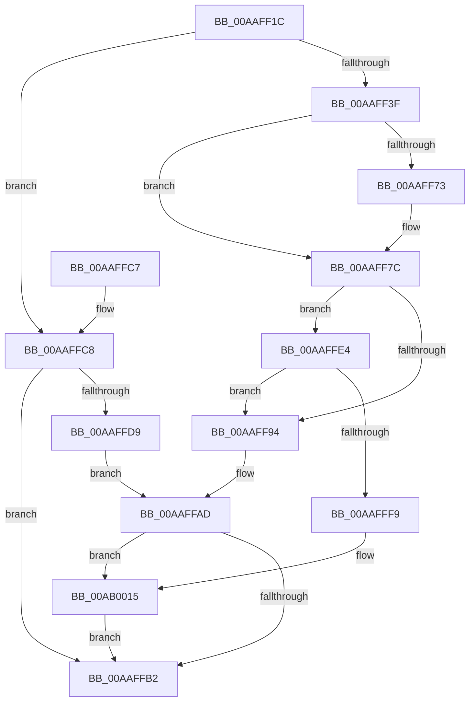

# MiFreeRetpolineImportInfo

- RVA: `0x00AAFF1C`–`0x00AB0021` (길이 `261` bytes)
- VA: `0x0000000140AAFF1C`
- 실행 섹션: `PAGE`
- PDB 이름 있음: `예`; PDB Function 태그: `아니요`
- unwind 정보 RVA: `0x000BC4A4`
- 디코드: `67`개 명령, `261/261` bytes 표시
- 미해석 바이트: `0` (있으면 어셈블리에 `.byte`로 보존)

> 이 문서는 커널 이미지의 기계어와 PDB 기호를 분석해 생성했습니다. 4번과 5번은 함수 원형과 자료형을 바이너리 사용 방식에서 추정한 C 해석이며 원본 소스 복구 결과는 아닙니다.

## 1. Dependencies

- 직접 호출 지점: **8**; 고유 호출 대상: **8**
- 직접 호출자로 확인된 함수: **1**
- RIP 상대 이미지 참조: **2**

### Outgoing calls
- `0x00AAFF42` → [MiSectionControlArea](../../text/29/MiSectionControlArea_function_00294CB0.md) (function, `0x00294CB0`)
- `0x00AAFF65` → [MI_LOCK_RELOCATIONS_EXCLUSIVE](../../text/46/MI_LOCK_RELOCATIONS_EXCLUSIVE_function_004650F8.md) (function, `0x004650F8`)
- `0x00AAFF82` → [MI_UNLOCK_RELOCATIONS_EXCLUSIVE](../../text/46/MI_UNLOCK_RELOCATIONS_EXCLUSIVE_function_0046965C.md) (function, `0x0046965C`)
- `0x00AAFFA8` → [MiWalkEntireImage](../../text/36/MiWalkEntireImage_function_00365D70.md) (function, `0x00365D70`)
- `0x00AAFFC8` → [MiGetBaseLoaderPortion](../../text/4D/MiGetBaseLoaderPortion_function_004D9D34.md) (function, `0x004D9D34`)
- `0x00AAFFF0` → [VslFreeSecureImageIat](../../text/4B/VslFreeSecureImageIat_function_004BCD74.md) (function, `0x004BCD74`)
- `0x00AB000F` → [KeBugCheckEx](../../text/4F/KeBugCheckEx_function_004FD660.md) (function, `0x004FD660`)
- `0x00AB001A` → [ExFreePoolWithTag](../../poolcode/B8/ExFreePoolWithTag_function_00B82870.md) (function, `0x00B82870`)

### Direct callers
- [MiUnloadSystemImage](MiUnloadSystemImage_function_00AA2FD4.md) at `0x00AA32DB`

### Static image references
- `0x00AAFF87` → RVA `0x00FC6A88` (`ALMOSTRO`; read)
- `0x00AAFF94` → RVA `0x00E2D850` (`.data`; read)

## 2. Other-region calls and transfers

- 다른 실행 섹션으로 향하는 call: **8**
  - `0x00AAFF42` → [MiSectionControlArea](../../text/29/MiSectionControlArea_function_00294CB0.md) (`PAGE` → `.text`)
  - `0x00AAFF65` → [MI_LOCK_RELOCATIONS_EXCLUSIVE](../../text/46/MI_LOCK_RELOCATIONS_EXCLUSIVE_function_004650F8.md) (`PAGE` → `.text`)
  - `0x00AAFF82` → [MI_UNLOCK_RELOCATIONS_EXCLUSIVE](../../text/46/MI_UNLOCK_RELOCATIONS_EXCLUSIVE_function_0046965C.md) (`PAGE` → `.text`)
  - `0x00AAFFA8` → [MiWalkEntireImage](../../text/36/MiWalkEntireImage_function_00365D70.md) (`PAGE` → `.text`)
  - `0x00AAFFC8` → [MiGetBaseLoaderPortion](../../text/4D/MiGetBaseLoaderPortion_function_004D9D34.md) (`PAGE` → `.text`)
  - `0x00AAFFF0` → [VslFreeSecureImageIat](../../text/4B/VslFreeSecureImageIat_function_004BCD74.md) (`PAGE` → `.text`)
  - `0x00AB000F` → [KeBugCheckEx](../../text/4F/KeBugCheckEx_function_004FD660.md) (`PAGE` → `.text`)
  - `0x00AB001A` → [ExFreePoolWithTag](../../poolcode/B8/ExFreePoolWithTag_function_00B82870.md) (`PAGE` → `POOLCODE`)
- 별도 외부 분기/꼬리 이동을 확인하지 못했습니다.

## 3. Assembly (complete function range)

```asm
00AAFF1C  48 89 5C 24 08                  mov qword ptr [rsp + 8], rbx
00AAFF21  48 89 6C 24 10                  mov qword ptr [rsp + 0x10], rbp
00AAFF26  48 89 74 24 18                  mov qword ptr [rsp + 0x18], rsi
00AAFF2B  57                              push rdi
00AAFF2C  48 83 EC 30                     sub rsp, 0x30
00AAFF30  48 8B 41 70                     mov rax, qword ptr [rcx + 0x70]
00AAFF34  33 DB                           xor ebx, ebx
00AAFF36  48 85 C0                        test rax, rax
00AAFF39  0F 84 89 00 00 00               je 0x140aaffc8
00AAFF3F  48 8B C8                        mov rcx, rax
00AAFF42  E8 69 4D 7E FF                  call 0x140294cb0
00AAFF47  65 48 8B 2C 25 88 01 00 00      mov rbp, qword ptr gs:[0x188]
00AAFF50  48 8B F8                        mov rdi, rax
00AAFF53  48 8B 48 60                     mov rcx, qword ptr [rax + 0x60]
00AAFF57  48 83 E1 F8                     and rcx, 0xfffffffffffffff8
00AAFF5B  48 8B 71 20                     mov rsi, qword ptr [rcx + 0x20]
00AAFF5F  48 8B CD                        mov rcx, rbp
00AAFF62  48 8B D6                        mov rdx, rsi
00AAFF65  E8 8E 51 9B FF                  call 0x1404650f8
00AAFF6A  48 8B 46 58                     mov rax, qword ptr [rsi + 0x58]
00AAFF6E  48 85 C0                        test rax, rax
00AAFF71  74 09                           je 0x140aaff7c
00AAFF73  48 8B 58 10                     mov rbx, qword ptr [rax + 0x10]
00AAFF77  48 83 60 10 00                  and qword ptr [rax + 0x10], 0
00AAFF7C  48 8B D6                        mov rdx, rsi
00AAFF7F  48 8B CD                        mov rcx, rbp
00AAFF82  E8 D5 96 9B FF                  call 0x14046965c
00AAFF87  48 F7 05 F6 6A 51 00 00 80 00 00  test qword ptr [rip + 0x516af6], 0x8000
00AAFF92  75 50                           jne 0x140aaffe4
00AAFF94  48 8B 15 B5 D8 37 00            mov rdx, qword ptr [rip + 0x37d8b5]
00AAFF9B  41 83 C9 FF                     or r9d, 0xffffffff
00AAFF9F  41 B8 08 00 00 00               mov r8d, 8
00AAFFA5  48 8B CF                        mov rcx, rdi
00AAFFA8  E8 C3 5D 8B FF                  call 0x140365d70
00AAFFAD  48 85 DB                        test rbx, rbx
00AAFFB0  75 63                           jne 0x140ab0015
00AAFFB2  48 8B 5C 24 40                  mov rbx, qword ptr [rsp + 0x40]
00AAFFB7  48 8B 6C 24 48                  mov rbp, qword ptr [rsp + 0x48]
00AAFFBC  48 8B 74 24 50                  mov rsi, qword ptr [rsp + 0x50]
00AAFFC1  48 83 C4 30                     add rsp, 0x30
00AAFFC5  5F                              pop rdi
00AAFFC6  C3                              ret
00AAFFC7  CC                              int3
00AAFFC8  E8 67 9D A2 FF                  call 0x1404d9d34
00AAFFCD  48 8B 88 18 01 00 00            mov rcx, qword ptr [rax + 0x118]
00AAFFD4  48 85 C9                        test rcx, rcx
00AAFFD7  74 D9                           je 0x140aaffb2
00AAFFD9  48 8B 59 10                     mov rbx, qword ptr [rcx + 0x10]
00AAFFDD  48 83 61 10 00                  and qword ptr [rcx + 0x10], 0
00AAFFE2  EB C9                           jmp 0x140aaffad
00AAFFE4  48 8B 4F 60                     mov rcx, qword ptr [rdi + 0x60]
00AAFFE8  48 83 E1 F8                     and rcx, 0xfffffffffffffff8
00AAFFEC  48 8B 49 40                     mov rcx, qword ptr [rcx + 0x40]
00AAFFF0  E8 7F CD A0 FF                  call 0x1404bcd74
00AAFFF5  85 C0                           test eax, eax
00AAFFF7  79 9B                           jns 0x140aaff94
00AAFFF9  48 83 64 24 20 00               and qword ptr [rsp + 0x20], 0
00AAFFFF  4C 8B C7                        mov r8, rdi
00AB0002  4C 63 C8                        movsxd r9, eax
00AB0005  BA 85 10 00 00                  mov edx, 0x1085
00AB000A  B9 1A 00 00 00                  mov ecx, 0x1a
00AB000F  E8 4C D6 A4 FF                  call 0x1404fd660
00AB0014  CC                              int3
00AB0015  33 D2                           xor edx, edx
00AB0017  48 8B CB                        mov rcx, rbx
00AB001A  E8 51 28 0D 00                  call 0x140b82870
00AB001F  EB 91                           jmp 0x140aaffb2
```

## 4. C-style interpretation (structured pseudocode)

```c
__int64 __fastcall MiFreeRetpolineImportInfo(__int64 a1, __int64 a2, __int64 a3, int a4)
{
    __int64 result;
    __int64 v_rbx;
    __int64 v_rsp;
    unsigned __int64 v_stack_p10;
    unsigned __int64 v_stack_p18;
    unsigned __int64 v_stack_p20;
    unsigned __int64 v_stack_p8;

    v_stack_p8 = v_rbx;
    v_stack_p10 = v_rbp;
    v_stack_p18 = v_rsi;
    v_rsp = (v_rsp) - (48);
    v_rbx = 0;
    if (*(unsigned __int64 *)(a1 + 112) == 0) goto loc_00AAFFC8;
    result = MiSectionControlArea(*(unsigned __int64 *)(a1 + 112), a2, a3, a4);
    a1 = (*(unsigned __int64 *)(result + 96)) & (-8);
    result = MI_LOCK_RELOCATIONS_EXCLUSIVE(*(unsigned __int64 *)(gs_base + (0 + 392)), *(unsigned __int64 *)(a1 + 32), a3, a4);
    if (*(unsigned __int64 *)(*(unsigned __int64 *)(a1 + 32) + 88) != 0) {
        v_rbx = *(unsigned __int64 *)(*(unsigned __int64 *)(*(unsigned __int64 *)(a1 + 32) + 88) + 16);
    }
    result = MI_UNLOCK_RELOCATIONS_EXCLUSIVE(*(unsigned __int64 *)(gs_base + (0 + 392)), *(unsigned __int64 *)(a1 + 32), a3, a4);
    if (((*(unsigned __int64 *)(v_rip + 5335798)) & (0x8000ULL)) != 0) goto loc_00AAFFE4;
loc_00AAFF94:
    a4 = (unsigned int)((a4) | (0xFFFFFFFFULL));
    result = MiWalkEntireImage(result, *(unsigned __int64 *)(v_rip + 3659957), 8, a4);
loc_00AAFFAD:
    if (v_rbx != 0) goto loc_00AB0015;
loc_00AAFFB2:
    v_rsp = (v_rsp) + (48);
    return result;
loc_00AAFFC8:
    result = MiGetBaseLoaderPortion(result, *(unsigned __int64 *)(v_rip + 3659957), 8, a4);
    if (*(unsigned __int64 *)(result + 280) == 0) goto loc_00AAFFB2;
    goto loc_00AAFFAD;
loc_00AAFFE4:
    a1 = (*(unsigned __int64 *)(result + 96)) & (-8);
    result = VslFreeSecureImageIat(*(unsigned __int64 *)(a1 + 64), *(unsigned __int64 *)(v_rip + 3659957), 8, a4);
    if (!sign_flag) goto loc_00AAFF94;
    result = KeBugCheckEx(26, (unsigned int)(0x1085ULL), result, (int)((unsigned int)(result)));
loc_00AB0015:
    a2 = 0;
    result = ExFreePoolWithTag(*(unsigned __int64 *)(*(unsigned __int64 *)(result + 280) + 16), a2, result, (int)((unsigned int)(result)));
    goto loc_00AAFFB2;
}
```

## 5. (Beta) C Style

```c
int64_t MiFreeRetpolineImportInfo(void *Arg1, int64_t Arg2, int64_t Arg3, int32_t Arg4)
{
    uint8_t *arg1 = (uint8_t *)Arg1;

    int64_t result;
    int64_t local_rbx;
    int64_t local_rsp;
    uint64_t v_stack_p10;
    uint64_t v_stack_p18;
    uint64_t v_stack_p20;
    uint64_t v_stack_p8;

    v_stack_p8 = local_rbx;
    v_stack_p10 = local_rbp;
    v_stack_p18 = local_rsi;
    local_rsp = (local_rsp) - (48);
    local_rbx = 0;
    if (*(uint64_t *)(arg1 + 0x70) == 0) goto loc_00AAFFC8;
    result = MiSectionControlArea(*(uint64_t *)(arg1 + 0x70), Arg2, Arg3, Arg4);
    Arg1 = (*(uint64_t *)(result + 0x60)) & (-8);
    result = MI_LOCK_RELOCATIONS_EXCLUSIVE(*(uint64_t *)(gs_base + (0 + 0x188)), *(uint64_t *)(arg1 + 0x20), Arg3, Arg4);
    if (*(uint64_t *)(*(uint64_t *)(arg1 + 0x20) + 0x58) != 0) {
        local_rbx = *(uint64_t *)(*(uint64_t *)(*(uint64_t *)(arg1 + 0x20) + 0x58) + 0x10);
    }
    result = MI_UNLOCK_RELOCATIONS_EXCLUSIVE(*(uint64_t *)(gs_base + (0 + 0x188)), *(uint64_t *)(arg1 + 0x20), Arg3, Arg4);
    if (((*(uint64_t *)(v_rip + 0x516AF6)) & (0x8000ULL)) != 0) goto loc_00AAFFE4;
loc_00AAFF94:
    Arg4 = (uint32_t)((Arg4) | (0xFFFFFFFFULL));
    result = MiWalkEntireImage(result, *(uint64_t *)(v_rip + 0x37D8B5), 8, Arg4);
loc_00AAFFAD:
    if (local_rbx != 0) goto loc_00AB0015;
loc_00AAFFB2:
    local_rsp = (local_rsp) + (48);
    return result;
loc_00AAFFC8:
    result = MiGetBaseLoaderPortion(result, *(uint64_t *)(v_rip + 0x37D8B5), 8, Arg4);
    if (*(uint64_t *)(result + 0x118) == 0) goto loc_00AAFFB2;
    goto loc_00AAFFAD;
loc_00AAFFE4:
    Arg1 = (*(uint64_t *)(result + 0x60)) & (-8);
    result = VslFreeSecureImageIat(*(uint64_t *)(arg1 + 0x40), *(uint64_t *)(v_rip + 0x37D8B5), 8, Arg4);
    if (!sign_flag) goto loc_00AAFF94;
    result = KeBugCheckEx(26, (uint32_t)(0x1085ULL), result, (int32_t)((uint32_t)(result)));
loc_00AB0015:
    Arg2 = 0;
    result = ExFreePoolWithTag(*(uint64_t *)(*(uint64_t *)(result + 0x118) + 0x10), Arg2, result, (int32_t)((uint32_t)(result)));
    goto loc_00AAFFB2;
}
```

### 관측된 메모리 오프셋

구조체 형식이 확인되지 않은 접근은 인자 기준의 오프셋으로만 기록했습니다.

| 기준 인자 | 오프셋 표현 | 폭 (bit) | 접근 |
|---|---:|---:|---|
| `Arg1` | `+ 0x70` | `64` | `R` |

## 6. Execution-region graph

[열기: 2D/3D 그래프와 함수 탐색 컨트롤 패널](../../../control-panel.html?section=page&rva=0x00AAFF1C&view=graph)

- 2D 그래프는 위에서 아래로 흐르고, 3D 그래프는 빈 공간을 드래그해 회전합니다. Shift+드래그는 이동, 휠은 확대·축소, 함수 노드 선택은 대상 보고서 이동입니다.

### Static fallback


