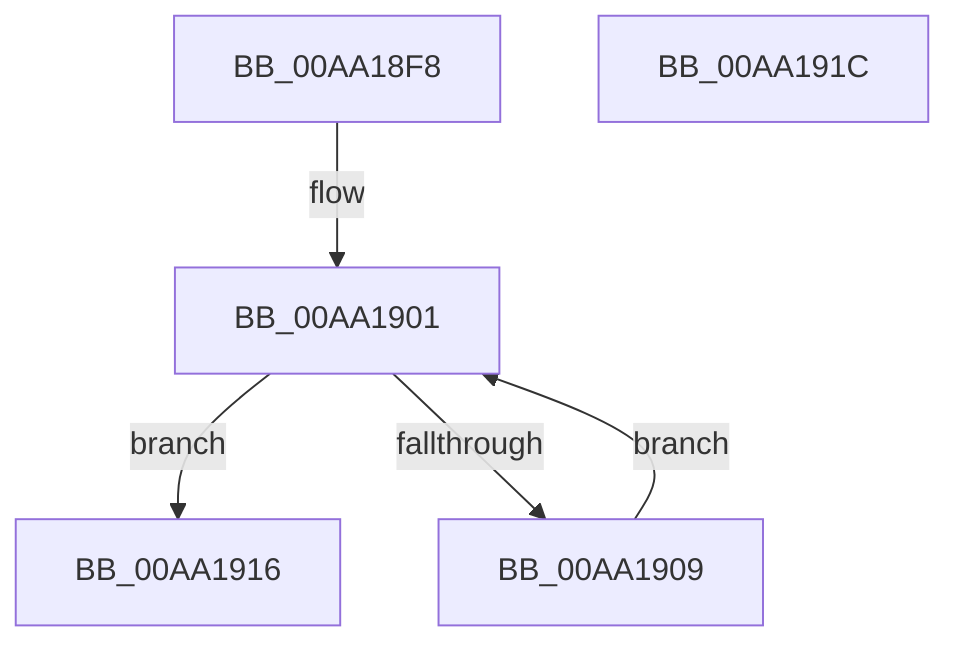

# MiFreeSubsectionProtos

- RVA: `0x00AA18F8`–`0x00AA191D` (길이 `37` bytes)
- VA: `0x0000000140AA18F8`
- 실행 섹션: `PAGE`
- PDB 이름 있음: `예`; PDB Function 태그: `아니요`
- unwind 정보 RVA: `0x0005CF00`
- 디코드: `14`개 명령, `37/37` bytes 표시
- 미해석 바이트: `0` (있으면 어셈블리에 `.byte`로 보존)

> 이 문서는 커널 이미지의 기계어와 PDB 기호를 분석해 생성했습니다. 4번과 5번은 함수 원형과 자료형을 바이너리 사용 방식에서 추정한 C 해석이며 원본 소스 복구 결과는 아닙니다.

## 1. Dependencies

- 직접 호출 지점: **1**; 고유 호출 대상: **1**
- 직접 호출자로 확인된 함수: **2**
- RIP 상대 이미지 참조: **0**

### Outgoing calls
- `0x00AA190F` → [MiDeletePerSessionProtos](../../text/4A/MiDeletePerSessionProtos_function_004A0840.md) (function, `0x004A0840`)

### Direct callers
- [sub_006E3418](../../text/6E/Unknown_function_006E3418.md) at `0x006E3538`
- [sub_00B3E706](../B3/Unknown_function_00B3E706.md) at `0x00B3E760`

### Static image references
- 디코드된 RIP-relative 메모리 참조가 없습니다.

## 2. Other-region calls and transfers

- 다른 실행 섹션으로 향하는 call: **1**
  - `0x00AA190F` → [MiDeletePerSessionProtos](../../text/4A/MiDeletePerSessionProtos_function_004A0840.md) (`PAGE` → `.text`)
- 별도 외부 분기/꼬리 이동을 확인하지 못했습니다.

## 3. Assembly (complete function range)

```asm
00AA18F8  40 53                           push rbx
00AA18FA  48 83 EC 20                     sub rsp, 0x20
00AA18FE  48 8B D9                        mov rbx, rcx
00AA1901  48 8B 0B                        mov rcx, qword ptr [rbx]
00AA1904  48 85 C9                        test rcx, rcx
00AA1907  74 0D                           je 0x140aa1916
00AA1909  48 8B 01                        mov rax, qword ptr [rcx]
00AA190C  48 89 03                        mov qword ptr [rbx], rax
00AA190F  E8 2C EF 9F FF                  call 0x1404a0840
00AA1914  EB EB                           jmp 0x140aa1901
00AA1916  48 83 C4 20                     add rsp, 0x20
00AA191A  5B                              pop rbx
00AA191B  C3                              ret
00AA191C  CC                              int3
```

## 4. C-style interpretation (structured pseudocode)

```c
__int64 __fastcall MiFreeSubsectionProtos(__int64 a1)
{
    __int64 result;
    __int64 v_rsp;

    v_rsp = (v_rsp) - (32);
loc_00AA1901:
    if (*(unsigned __int64 *)(a1) == 0) goto loc_00AA1916;
    *(unsigned __int64 *)(a1) = *(unsigned __int64 *)(*(unsigned __int64 *)(a1));
    result = MiDeletePerSessionProtos(*(unsigned __int64 *)(a1), a2, a3, a4);
    goto loc_00AA1901;
loc_00AA1916:
    v_rsp = (v_rsp) + (32);
    return result;
}
```

## 5. (Beta) C Style

```c
int64_t MiFreeSubsectionProtos(void *Arg1)
{
    uint8_t *arg1 = (uint8_t *)Arg1;

    int64_t result;
    int64_t local_rsp;

    local_rsp = (local_rsp) - (32);
loc_00AA1901:
    if (*(uint64_t *)(arg1) == 0) goto loc_00AA1916;
    *(uint64_t *)(arg1) = *(uint64_t *)(*(uint64_t *)(arg1));
    result = MiDeletePerSessionProtos(*(uint64_t *)(arg1), a2, a3, a4);
    goto loc_00AA1901;
loc_00AA1916:
    local_rsp = (local_rsp) + (32);
    return result;
}
```

### 관측된 메모리 오프셋

구조체 형식이 확인되지 않은 접근은 인자 기준의 오프셋으로만 기록했습니다.

| 기준 인자 | 오프셋 표현 | 폭 (bit) | 접근 |
|---|---:|---:|---|
| `Arg1` | `+ 0x0` | `64` | `R` |
| `Arg1` | `+ 0x0` | `64` | `W` |

## 6. Execution-region graph

[열기: 2D/3D 그래프와 함수 탐색 컨트롤 패널](../../../control-panel.html?section=page&rva=0x00AA18F8&view=graph)

- 2D 그래프는 위에서 아래로 흐르고, 3D 그래프는 빈 공간을 드래그해 회전합니다. Shift+드래그는 이동, 휠은 확대·축소, 함수 노드 선택은 대상 보고서 이동입니다.

### Static fallback


