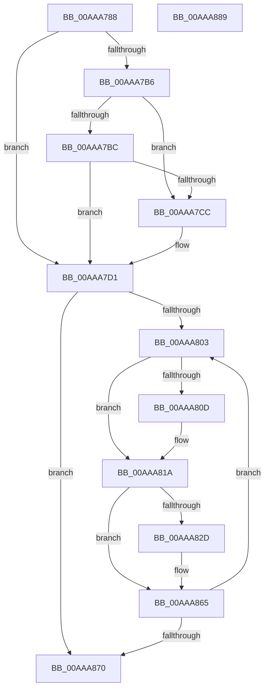

# MiLockdownSections

- RVA: `0x00AAA788`–`0x00AAA88A` (길이 `258` bytes)
- VA: `0x0000000140AAA788`
- 실행 섹션: `PAGE`
- PDB 이름 있음: `예`; PDB Function 태그: `아니요`
- unwind 정보 RVA: `0x00060300`
- 디코드: `73`개 명령, `258/258` bytes 표시
- 미해석 바이트: `0` (있으면 어셈블리에 `.byte`로 보존)

> 이 문서는 커널 이미지의 기계어와 PDB 기호를 분석해 생성했습니다. 4번과 5번은 함수 원형과 자료형을 바이너리 사용 방식에서 추정한 C 해석이며 원본 소스 복구 결과는 아닙니다.

## 1. Dependencies

- 직접 호출 지점: **4**; 고유 호출 대상: **4**
- 직접 호출자로 확인된 함수: **1**
- RIP 상대 이미지 참조: **1**

### Outgoing calls
- `0x00AAA7BC` → [MiGetBaseLoaderPortion](../../text/4D/MiGetBaseLoaderPortion_function_004D9D34.md) (function, `0x004D9D34`)
- `0x00AAA7DD` → [RtlImageNtHeader](../../text/44/RtlImageNtHeader_function_00443B60.md) (function, `0x00443B60`)
- `0x00AAA7F3` → [MiGetExtendedLoaderBitmap](../../text/4F/MiGetExtendedLoaderBitmap_function_004FCC74.md) (function, `0x004FCC74`)
- `0x00AAA860` → [RtlSetBits](../../text/3E/RtlSetBits_function_003E1610.md) (function, `0x003E1610`)

### Direct callers
- [MiConstructLoaderEntry](MiConstructLoaderEntry_function_00AAA264.md) at `0x00AAA6C8`

### Static image references
- `0x00AAA7A6` → RVA `0x00FC6A88` (`ALMOSTRO`; read)

## 2. Other-region calls and transfers

- 다른 실행 섹션으로 향하는 call: **4**
  - `0x00AAA7BC` → [MiGetBaseLoaderPortion](../../text/4D/MiGetBaseLoaderPortion_function_004D9D34.md) (`PAGE` → `.text`)
  - `0x00AAA7DD` → [RtlImageNtHeader](../../text/44/RtlImageNtHeader_function_00443B60.md) (`PAGE` → `.text`)
  - `0x00AAA7F3` → [MiGetExtendedLoaderBitmap](../../text/4F/MiGetExtendedLoaderBitmap_function_004FCC74.md) (`PAGE` → `.text`)
  - `0x00AAA860` → [RtlSetBits](../../text/3E/RtlSetBits_function_003E1610.md) (`PAGE` → `.text`)
- 별도 외부 분기/꼬리 이동을 확인하지 못했습니다.

## 3. Assembly (complete function range)

```asm
00AAA788  48 89 5C 24 08                  mov qword ptr [rsp + 8], rbx
00AAA78D  48 89 6C 24 10                  mov qword ptr [rsp + 0x10], rbp
00AAA792  48 89 74 24 18                  mov qword ptr [rsp + 0x18], rsi
00AAA797  57                              push rdi
00AAA798  41 56                           push r14
00AAA79A  41 57                           push r15
00AAA79C  48 83 EC 20                     sub rsp, 0x20
00AAA7A0  48 8B 69 30                     mov rbp, qword ptr [rcx + 0x30]
00AAA7A4  33 DB                           xor ebx, ebx
00AAA7A6  48 F7 05 D7 C2 51 00 00 80 00 00  test qword ptr [rip + 0x51c2d7], 0x8000
00AAA7B1  48 8B F1                        mov rsi, rcx
00AAA7B4  74 1B                           je 0x140aaa7d1
00AAA7B6  48 39 59 70                     cmp qword ptr [rcx + 0x70], rbx
00AAA7BA  74 10                           je 0x140aaa7cc
00AAA7BC  E8 73 F5 A2 FF                  call 0x1404d9d34
00AAA7C1  8B 88 B8 00 00 00               mov ecx, dword ptr [rax + 0xb8]
00AAA7C7  F6 C1 10                        test cl, 0x10
00AAA7CA  74 05                           je 0x140aaa7d1
00AAA7CC  BB 02 00 00 00                  mov ebx, 2
00AAA7D1  41 BF 01 00 00 00               mov r15d, 1
00AAA7D7  48 8B CD                        mov rcx, rbp
00AAA7DA  41 0B DF                        or ebx, r15d
00AAA7DD  E8 7E 93 99 FF                  call 0x140443b60
00AAA7E2  48 8B D0                        mov rdx, rax
00AAA7E5  0F B7 48 14                     movzx ecx, word ptr [rax + 0x14]
00AAA7E9  48 8D 78 18                     lea rdi, [rax + 0x18]
00AAA7ED  48 03 F9                        add rdi, rcx
00AAA7F0  48 8B CE                        mov rcx, rsi
00AAA7F3  E8 7C 24 A5 FF                  call 0x1404fcc74
00AAA7F8  0F B7 72 06                     movzx esi, word ptr [rdx + 6]
00AAA7FC  4C 8B F0                        mov r14, rax
00AAA7FF  85 F6                           test esi, esi
00AAA801  74 6D                           je 0x140aaa870
00AAA803  33 C9                           xor ecx, ecx
00AAA805  81 3F 2E 63 6F 76               cmp dword ptr [rdi], 0x766f632e
00AAA80B  75 0D                           jne 0x140aaa81a
00AAA80D  B8 65 72 00 00                  mov eax, 0x7265
00AAA812  66 39 47 04                     cmp word ptr [rdi + 4], ax
00AAA816  41 0F 44 CF                     cmove ecx, r15d
00AAA81A  8B D1                           mov edx, ecx
00AAA81C  83 CA 02                        or edx, 2
00AAA81F  F7 47 24 00 00 00 20            test dword ptr [rdi + 0x24], 0x20000000
00AAA826  0F 44 D1                        cmove edx, ecx
00AAA829  85 D3                           test ebx, edx
00AAA82B  74 38                           je 0x140aaa865
00AAA82D  8B 4F 10                        mov ecx, dword ptr [rdi + 0x10]
00AAA830  8B 47 08                        mov eax, dword ptr [rdi + 8]
00AAA833  3B C8                           cmp ecx, eax
00AAA835  8B 57 0C                        mov edx, dword ptr [rdi + 0xc]
00AAA838  0F 42 C8                        cmovb ecx, eax
00AAA83B  44 8B C1                        mov r8d, ecx
00AAA83E  49 8B CE                        mov rcx, r14
00AAA841  49 81 C0 FF 0F 00 00            add r8, 0xfff
00AAA848  4C 8D 0C 2A                     lea r9, [rdx + rbp]
00AAA84C  C1 EA 0C                        shr edx, 0xc
00AAA84F  4D 03 C1                        add r8, r9
00AAA852  49 81 E0 00 F0 FF FF            and r8, 0xfffffffffffff000
00AAA859  4D 2B C1                        sub r8, r9
00AAA85C  49 C1 E8 0C                     shr r8, 0xc
00AAA860  E8 AB 6D 93 FF                  call 0x1403e1610
00AAA865  41 2B F7                        sub esi, r15d
00AAA868  48 83 C7 28                     add rdi, 0x28
00AAA86C  85 F6                           test esi, esi
00AAA86E  7F 93                           jg 0x140aaa803
00AAA870  48 8B 5C 24 40                  mov rbx, qword ptr [rsp + 0x40]
00AAA875  48 8B 6C 24 48                  mov rbp, qword ptr [rsp + 0x48]
00AAA87A  48 8B 74 24 50                  mov rsi, qword ptr [rsp + 0x50]
00AAA87F  48 83 C4 20                     add rsp, 0x20
00AAA883  41 5F                           pop r15
00AAA885  41 5E                           pop r14
00AAA887  5F                              pop rdi
00AAA888  C3                              ret
00AAA889  CC                              int3
```

## 4. C-style interpretation (structured pseudocode)

```c
__int64 __fastcall MiLockdownSections(__int64 a1)
{
    __int64 result;
    __int64 v_rbx;
    __int64 v_rdi;
    __int64 v_rsi;
    __int64 v_rsp;
    unsigned __int64 v_stack_p10;
    unsigned __int64 v_stack_p18;
    unsigned __int64 v_stack_p8;

    v_stack_p8 = v_rbx;
    v_stack_p10 = v_rbp;
    v_stack_p18 = v_rsi;
    v_rsp = (v_rsp) - (32);
    v_rbx = 0;
    if (((*(unsigned __int64 *)(v_rip + 5358295)) & (0x8000ULL)) == 0) goto loc_00AAA7D1;
    if ((*(unsigned __int64 *)(a1 + 112)) == 0) goto loc_00AAA7CC;
    result = MiGetBaseLoaderPortion(a1, a2, a3, a4);
    if ((((unsigned __int8)((unsigned int)(*(unsigned int *)(result + 184)))) & (16)) != 0) {
        v_rbx = 2;
    }
    v_rbx = (unsigned int)((v_rbx) | (1));
    result = RtlImageNtHeader(*(unsigned __int64 *)(a1 + 48), a2, a3, a4);
    v_rdi = (result + 24) + (*(unsigned __int16 *)(result + 20));
    result = MiGetExtendedLoaderBitmap(a1, result, a3, a4);
    if ((unsigned int)(*(unsigned __int16 *)(result + 6)) == 0) goto loc_00AAA870;
loc_00AAA803:
    a1 = 0;
    if ((*(unsigned int *)(v_rdi)) == 0x766F632EULL) {
        result = 0x7265ULL;
        if ((*(unsigned __int16 *)(v_rdi + 4)) == ((unsigned __int16)(result))) { a1 = 1; }
    }
    a2 = (unsigned int)(((unsigned int)((unsigned int)(a1))) | (2));
    if (((*(unsigned int *)(v_rdi + 36)) & (0x20000000ULL)) == 0) { a2 = (unsigned int)(a1); }
    if ((((unsigned int)(v_rbx)) & ((unsigned int)(a2))) != 0) {
        a1 = *(unsigned int *)(v_rdi + 16);
        result = *(unsigned int *)(v_rdi + 8);
        a2 = *(unsigned int *)(v_rdi + 12);
        if (((unsigned int)(a1)) < ((unsigned int)(result))) { a1 = (unsigned int)(result); }
        a3 = (unsigned int)(a1);
        a1 = result;
        a3 = (a3) + (0xFFFULL);
        a4 = a2 + *(unsigned __int64 *)(a1 + 48) * 1;
        a2 = (unsigned int)((a2) >> (12));
        a3 = (a3) + (a4);
        a3 = (a3) & (0xFFFFFFFFFFFFF000ULL);
        a3 = (a3) - (a4);
        a3 = (a3) >> (12);
        result = RtlSetBits(a1, a2, a3, a4);
    }
    v_rsi = (unsigned int)((*(unsigned __int16 *)(result + 6)) - (1));
    v_rdi = (v_rdi) + (40);
    if (condition_is_greater) goto loc_00AAA803;
loc_00AAA870:
    v_rsp = (v_rsp) + (32);
    return result;
}
```

## 5. (Beta) C Style

```c
int64_t MiLockdownSections(void *Arg1)
{
    uint8_t *arg1 = (uint8_t *)Arg1;

    int64_t result;
    int64_t local_rbx;
    int64_t local_rdi;
    int64_t local_rsi;
    int64_t local_rsp;
    uint64_t v_stack_p10;
    uint64_t v_stack_p18;
    uint64_t v_stack_p8;

    v_stack_p8 = local_rbx;
    v_stack_p10 = local_rbp;
    v_stack_p18 = local_rsi;
    local_rsp = (local_rsp) - (32);
    local_rbx = 0;
    if (((*(uint64_t *)(v_rip + 0x51C2D7)) & (0x8000ULL)) == 0) goto loc_00AAA7D1;
    if ((*(uint64_t *)(arg1 + 0x70)) == 0) goto loc_00AAA7CC;
    result = MiGetBaseLoaderPortion(Arg1, a2, a3, a4);
    if ((((uint8_t)((uint32_t)(*(uint32_t *)(result + 0xB8)))) & (16)) != 0) {
        local_rbx = 2;
    }
    local_rbx = (uint32_t)((local_rbx) | (1));
    result = RtlImageNtHeader(*(uint64_t *)(arg1 + 0x30), a2, a3, a4);
    local_rdi = (result + 24) + (*(uint16_t *)(result + 0x14));
    result = MiGetExtendedLoaderBitmap(Arg1, result, a3, a4);
    if ((uint32_t)(*(uint16_t *)(result + 0x6)) == 0) goto loc_00AAA870;
loc_00AAA803:
    Arg1 = 0;
    if ((*(uint32_t *)(local_rdi)) == 0x766F632EULL) {
        result = 0x7265ULL;
        if ((*(uint16_t *)(local_rdi + 0x4)) == ((uint16_t)(result))) { Arg1 = 1; }
    }
    a2 = (uint32_t)(((uint32_t)((uint32_t)(Arg1))) | (2));
    if (((*(uint32_t *)(local_rdi + 0x24)) & (0x20000000ULL)) == 0) { a2 = (uint32_t)(Arg1); }
    if ((((uint32_t)(local_rbx)) & ((uint32_t)(a2))) != 0) {
        Arg1 = *(uint32_t *)(local_rdi + 0x10);
        result = *(uint32_t *)(local_rdi + 0x8);
        a2 = *(uint32_t *)(local_rdi + 0xC);
        if (((uint32_t)(Arg1)) < ((uint32_t)(result))) { Arg1 = (uint32_t)(result); }
        a3 = (uint32_t)(Arg1);
        Arg1 = result;
        a3 = (a3) + (0xFFFULL);
        a4 = a2 + *(uint64_t *)(arg1 + 0x30) * 1;
        a2 = (uint32_t)((a2) >> (12));
        a3 = (a3) + (a4);
        a3 = (a3) & (0xFFFFFFFFFFFFF000ULL);
        a3 = (a3) - (a4);
        a3 = (a3) >> (12);
        result = RtlSetBits(Arg1, a2, a3, a4);
    }
    local_rsi = (uint32_t)((*(uint16_t *)(result + 0x6)) - (1));
    local_rdi = (local_rdi) + (40);
    if (condition_is_greater) goto loc_00AAA803;
loc_00AAA870:
    local_rsp = (local_rsp) + (32);
    return result;
}
```

### 관측된 메모리 오프셋

구조체 형식이 확인되지 않은 접근은 인자 기준의 오프셋으로만 기록했습니다.

| 기준 인자 | 오프셋 표현 | 폭 (bit) | 접근 |
|---|---:|---:|---|
| `Arg1` | `+ 0x30` | `64` | `R` |
| `Arg1` | `+ 0x70` | `64` | `R` |

## 6. Execution-region graph

[열기: 2D/3D 그래프와 함수 탐색 컨트롤 패널](../../../control-panel.html?section=page&rva=0x00AAA788&view=graph)

- 2D 그래프는 위에서 아래로 흐르고, 3D 그래프는 빈 공간을 드래그해 회전합니다. Shift+드래그는 이동, 휠은 확대·축소, 함수 노드 선택은 대상 보고서 이동입니다.

### Static fallback


