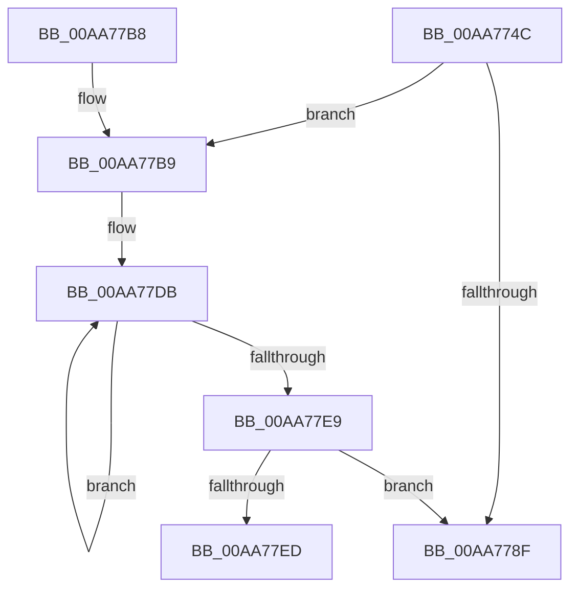

# MiLogReserveVaFailed

- RVA: `0x00AA774C`–`0x00AA77F2` (길이 `166` bytes)
- VA: `0x0000000140AA774C`
- 실행 섹션: `PAGE`
- PDB 이름 있음: `예`; PDB Function 태그: `예`
- unwind 정보 RVA: `0x000BBA7C`
- 디코드: `43`개 명령, `166/166` bytes 표시
- 미해석 바이트: `0` (있으면 어셈블리에 `.byte`로 보존)

> 이 문서는 커널 이미지의 기계어와 PDB 기호를 분석해 생성했습니다. 4번과 5번은 함수 원형과 자료형을 바이너리 사용 방식에서 추정한 C 해석이며 원본 소스 복구 결과는 아닙니다.

## 1. Dependencies

- 직접 호출 지점: **1**; 고유 호출 대상: **1**
- 직접 호출자로 확인된 함수: **1**
- RIP 상대 이미지 참조: **2**

### Outgoing calls
- `0x00AA7796` → [_security_check_cookie](../../text/6A/_security_check_cookie_function_006AC640.md) (function, `0x006AC640`)

### Direct callers
- [MiReserveUserMemory](../88/MiReserveUserMemory_function_00884498.md) at `0x00884A1B`

### Static image references
- `0x00AA776B` → RVA `0x00E0A740` (`.data`; read)
- `0x00AA7779` → RVA `0x00E37618` (`.data`; read)

## 2. Other-region calls and transfers

- 다른 실행 섹션으로 향하는 call: **1**
  - `0x00AA7796` → [_security_check_cookie](../../text/6A/_security_check_cookie_function_006AC640.md) (`PAGE` → `.text`)
- call이 아닌 외부 분기/꼬리 이동: **1**
  - `0x00AA77ED` → [sub_00B4A0F6](../B4/Unknown_function_00B4A0F6.md) (`tail-transfer`)

## 3. Assembly (complete function range)

```asm
00AA774C  48 8B C4                        mov rax, rsp
00AA774F  48 89 58 08                     mov qword ptr [rax + 8], rbx
00AA7753  48 89 70 10                     mov qword ptr [rax + 0x10], rsi
00AA7757  48 89 78 18                     mov qword ptr [rax + 0x18], rdi
00AA775B  55                              push rbp
00AA775C  41 56                           push r14
00AA775E  41 57                           push r15
00AA7760  48 8D 68 A8                     lea rbp, [rax - 0x58]
00AA7764  48 81 EC 40 01 00 00            sub rsp, 0x140
00AA776B  48 8B 05 CE 2F 36 00            mov rax, qword ptr [rip + 0x362fce]
00AA7772  48 33 C4                        xor rax, rsp
00AA7775  48 89 45 30                     mov qword ptr [rbp + 0x30], rax
00AA7779  48 83 3D 97 FE 38 00 00         cmp qword ptr [rip + 0x38fe97], 0
00AA7781  49 8B F9                        mov rdi, r9
00AA7784  49 8B F0                        mov rsi, r8
00AA7787  4C 8B F2                        mov r14, rdx
00AA778A  4C 8B F9                        mov r15, rcx
00AA778D  75 2A                           jne 0x140aa77b9
00AA778F  48 8B 4D 30                     mov rcx, qword ptr [rbp + 0x30]
00AA7793  48 33 CC                        xor rcx, rsp
00AA7796  E8 A5 4E C0 FF                  call 0x1406ac640
00AA779B  4C 8D 9C 24 40 01 00 00         lea r11, [rsp + 0x140]
00AA77A3  49 8B 5B 20                     mov rbx, qword ptr [r11 + 0x20]
00AA77A7  49 8B 73 28                     mov rsi, qword ptr [r11 + 0x28]
00AA77AB  49 8B 7B 30                     mov rdi, qword ptr [r11 + 0x30]
00AA77AF  49 8B E3                        mov rsp, r11
00AA77B2  41 5F                           pop r15
00AA77B4  41 5E                           pop r14
00AA77B6  5D                              pop rbp
00AA77B7  C3                              ret
00AA77B8  CC                              int3
00AA77B9  65 48 8B 04 25 88 01 00 00      mov rax, qword ptr gs:[0x188]
00AA77C2  48 8B 98 B8 00 00 00            mov rbx, qword ptr [rax + 0xb8]
00AA77C9  0F 0D 8B FC 05 00 00            prefetchw byte ptr [rbx + 0x5fc]
00AA77D0  8B 83 FC 05 00 00               mov eax, dword ptr [rbx + 0x5fc]
00AA77D6  BA 00 08 00 00                  mov edx, 0x800
00AA77DB  8B C8                           mov ecx, eax
00AA77DD  0B CA                           or ecx, edx
00AA77DF  F0 0F B1 8B FC 05 00 00         lock cmpxchg dword ptr [rbx + 0x5fc], ecx
00AA77E7  75 F2                           jne 0x140aa77db
00AA77E9  85 C2                           test edx, eax
00AA77EB  75 A2                           jne 0x140aa778f
00AA77ED  E9 04 29 0A 00                  jmp 0x140b4a0f6
```

## 4. C-style interpretation (structured pseudocode)

```c
__int64 __fastcall MiLogReserveVaFailed(__int64 a1, __int64 a2, __int64 a3, __int64 a4)
{
    __int64 result;
    __int64 v_rsp;
    unsigned __int64 v_stack_m18;

    *(unsigned __int64 *)(v_rsp + 8) = v_rbx;
    *(unsigned __int64 *)(v_rsp + 16) = v_rsi;
    *(unsigned __int64 *)(v_rsp + 24) = v_rdi;
    v_rsp = (v_rsp) - (320);
    result = (*(unsigned __int64 *)(v_rip + 3551182)) ^ (v_rsp);
    *(unsigned __int64 *)(v_rsp - 88 + 48) = result;
    if ((*(unsigned __int64 *)(v_rip + 3735191)) != 0) goto loc_00AA77B9;
loc_00AA778F:
    a1 = (*(unsigned __int64 *)(v_rsp - 88 + 48)) ^ (v_rsp);
    result = _security_check_cookie(a1, a2, a3, a4);
    return result;
loc_00AA77B9:
loc_00AA77DB:
    a1 = (unsigned int)(((unsigned int)((unsigned int)((unsigned int)(*(unsigned int *)(*(unsigned __int64 *)(*(unsigned __int64 *)(gs_base + (0 + 392)) + 184) + 1532))))) | ((unsigned int)((unsigned int)(0x800ULL))));
    if (condition_is_not_equal) goto loc_00AA77DB;
    if ((((unsigned int)((unsigned int)(0x800ULL))) & ((unsigned int)((unsigned int)(*(unsigned int *)(*(unsigned __int64 *)(*(unsigned __int64 *)(gs_base + (0 + 392)) + 184) + 1532))))) != 0) goto loc_00AA778F;
}
```

## 5. (Beta) C Style

```c
int64_t MiLogReserveVaFailed(int64_t Arg1, int64_t Arg2, int64_t Arg3, int64_t Arg4)
{
    int64_t result;
    int64_t local_rsp;
    uint64_t v_stack_m18;

    *(uint64_t *)(local_rsp + 0x8) = local_rbx;
    *(uint64_t *)(local_rsp + 0x10) = local_rsi;
    *(uint64_t *)(local_rsp + 0x18) = local_rdi;
    local_rsp = (local_rsp) - (320);
    result = (*(uint64_t *)(v_rip + 0x362FCE)) ^ (local_rsp);
    *(uint64_t *)(local_rsp - 0x58 + 0x30) = result;
    if ((*(uint64_t *)(v_rip + 0x38FE97)) != 0) goto loc_00AA77B9;
loc_00AA778F:
    Arg1 = (*(uint64_t *)(local_rsp - 0x58 + 0x30)) ^ (local_rsp);
    result = _security_check_cookie(Arg1, Arg2, Arg3, Arg4);
    return result;
loc_00AA77B9:
loc_00AA77DB:
    Arg1 = (uint32_t)(((uint32_t)((uint32_t)((uint32_t)(*(uint32_t *)(*(uint64_t *)(*(uint64_t *)(gs_base + (0 + 0x188)) + 0xB8) + 0x5FC))))) | ((uint32_t)((uint32_t)(0x800ULL))));
    if (condition_is_not_equal) goto loc_00AA77DB;
    if ((((uint32_t)((uint32_t)(0x800ULL))) & ((uint32_t)((uint32_t)(*(uint32_t *)(*(uint64_t *)(*(uint64_t *)(gs_base + (0 + 0x188)) + 0xB8) + 0x5FC))))) != 0) goto loc_00AA778F;
}
```

## 6. Execution-region graph

[열기: 2D/3D 그래프와 함수 탐색 컨트롤 패널](../../../control-panel.html?section=page&rva=0x00AA774C&view=graph)

- 2D 그래프는 위에서 아래로 흐르고, 3D 그래프는 빈 공간을 드래그해 회전합니다. Shift+드래그는 이동, 휠은 확대·축소, 함수 노드 선택은 대상 보고서 이동입니다.

### Static fallback


