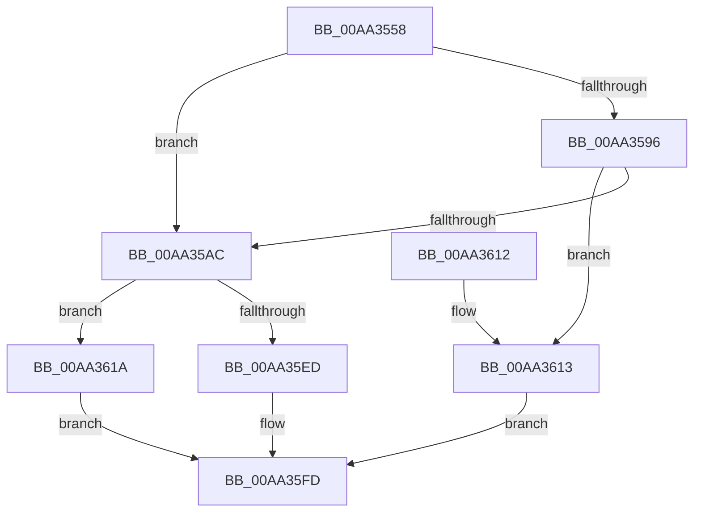

# MiMapSystemImage

- RVA: `0x00AA3558`–`0x00AA3628` (길이 `208` bytes)
- VA: `0x0000000140AA3558`
- 실행 섹션: `PAGE`
- PDB 이름 있음: `예`; PDB Function 태그: `아니요`
- unwind 정보 RVA: `0x000BB2AC`
- 디코드: `58`개 명령, `208/208` bytes 표시
- 미해석 바이트: `0` (있으면 어셈블리에 `.byte`로 보존)

> 이 문서는 커널 이미지의 기계어와 PDB 기호를 분석해 생성했습니다. 4번과 5번은 함수 원형과 자료형을 바이너리 사용 방식에서 추정한 C 해석이며 원본 소스 복구 결과는 아닙니다.

## 1. Dependencies

- 직접 호출 지점: **7**; 고유 호출 대상: **6**
- 직접 호출자로 확인된 함수: **1**
- RIP 상대 이미지 참조: **3**

### Outgoing calls
- `0x00AA3577` → [MiSectionControlArea](../../text/29/MiSectionControlArea_function_00294CB0.md) (function, `0x00294CB0`)
- `0x00AA3586` → [MiSectionControlArea](../../text/29/MiSectionControlArea_function_00294CB0.md) (function, `0x00294CB0`)
- `0x00AA35A3` → [MiAcquireNonPagedResources](../../text/28/MiAcquireNonPagedResources_function_00286C60.md) (function, `0x00286C60`)
- `0x00AA35AF` → [MiGetPteAddress](../../text/43/MiGetPteAddress_function_0043E130.md) (function, `0x0043E130`)
- `0x00AA35C0` → [MiGetAnyMultiplexedVm](../../text/44/MiGetAnyMultiplexedVm_function_00448BD0.md) (function, `0x00448BD0`)
- `0x00AA35E2` → [MiAddMappedPtes](../../text/34/MiAddMappedPtes_function_00349030.md) (function, `0x00349030`)
- `0x00AA361F` → [MiChargeSystemImageCommitment](../AB/MiChargeSystemImageCommitment_function_00AB5BA4.md) (function, `0x00AB5BA4`)

### Direct callers
- [MmLoadSystemImageEx](../99/MmLoadSystemImageEx_function_00999B8C.md) at `0x00999E1F`

### Static image references
- `0x00AA3599` → RVA `0x00E38D00` (`.data`; read)
- `0x00AA35ED` → RVA `0x00E2D974` (`.data`; read/write)
- `0x00AA35F4` → RVA `0x00E376F0` (`.data`; read/write)

## 2. Other-region calls and transfers

- 다른 실행 섹션으로 향하는 call: **6**
  - `0x00AA3577` → [MiSectionControlArea](../../text/29/MiSectionControlArea_function_00294CB0.md) (`PAGE` → `.text`)
  - `0x00AA3586` → [MiSectionControlArea](../../text/29/MiSectionControlArea_function_00294CB0.md) (`PAGE` → `.text`)
  - `0x00AA35A3` → [MiAcquireNonPagedResources](../../text/28/MiAcquireNonPagedResources_function_00286C60.md) (`PAGE` → `.text`)
  - `0x00AA35AF` → [MiGetPteAddress](../../text/43/MiGetPteAddress_function_0043E130.md) (`PAGE` → `.text`)
  - `0x00AA35C0` → [MiGetAnyMultiplexedVm](../../text/44/MiGetAnyMultiplexedVm_function_00448BD0.md) (`PAGE` → `.text`)
  - `0x00AA35E2` → [MiAddMappedPtes](../../text/34/MiAddMappedPtes_function_00349030.md) (`PAGE` → `.text`)
- 별도 외부 분기/꼬리 이동을 확인하지 못했습니다.

## 3. Assembly (complete function range)

```asm
00AA3558  48 8B C4                        mov rax, rsp
00AA355B  48 89 58 08                     mov qword ptr [rax + 8], rbx
00AA355F  48 89 68 10                     mov qword ptr [rax + 0x10], rbp
00AA3563  48 89 70 20                     mov qword ptr [rax + 0x20], rsi
00AA3567  57                              push rdi
00AA3568  48 83 EC 40                     sub rsp, 0x40
00AA356C  48 83 60 18 00                  and qword ptr [rax + 0x18], 0
00AA3571  48 8B EA                        mov rbp, rdx
00AA3574  48 8B F9                        mov rdi, rcx
00AA3577  E8 34 17 7F FF                  call 0x140294cb0
00AA357C  48 8B F0                        mov rsi, rax
00AA357F  4C 8B 00                        mov r8, qword ptr [rax]
00AA3582  41 8B 58 08                     mov ebx, dword ptr [r8 + 8]
00AA3586  E8 25 17 7F FF                  call 0x140294cb0
00AA358B  48 8B 10                        mov rdx, qword ptr [rax]
00AA358E  8B 52 08                        mov edx, dword ptr [rdx + 8]
00AA3591  48 85 D2                        test rdx, rdx
00AA3594  74 16                           je 0x140aa35ac
00AA3596  45 33 C9                        xor r9d, r9d
00AA3599  48 8D 0D 60 57 39 00            lea rcx, [rip + 0x395760]
00AA35A0  45 33 C0                        xor r8d, r8d
00AA35A3  E8 B8 36 7E FF                  call 0x140286c60
00AA35A8  85 C0                           test eax, eax
00AA35AA  78 67                           js 0x140aa3613
00AA35AC  48 8B CD                        mov rcx, rbp
00AA35AF  E8 7C AB 99 FF                  call 0x14043e130
00AA35B4  41 B8 01 00 00 00               mov r8d, 1
00AA35BA  48 8B D0                        mov rdx, rax
00AA35BD  41 8B C8                        mov ecx, r8d
00AA35C0  E8 0B 56 9A FF                  call 0x140448bd0
00AA35C5  44 89 44 24 30                  mov dword ptr [rsp + 0x30], r8d
00AA35CA  48 8B C8                        mov rcx, rax
00AA35CD  83 4C 24 28 FF                  or dword ptr [rsp + 0x28], 0xffffffff
00AA35D2  48 8D 44 24 60                  lea rax, [rsp + 0x60]
00AA35D7  4C 8B CE                        mov r9, rsi
00AA35DA  48 89 44 24 20                  mov qword ptr [rsp + 0x20], rax
00AA35DF  4C 8B C3                        mov r8, rbx
00AA35E2  E8 49 5A 8A FF                  call 0x140349030
00AA35E7  8B F0                           mov esi, eax
00AA35E9  85 C0                           test eax, eax
00AA35EB  78 2D                           js 0x140aa361a
00AA35ED  F0 01 1D 80 A3 38 00            lock add dword ptr [rip + 0x38a380], ebx
00AA35F4  F0 01 1D F5 40 39 00            lock add dword ptr [rip + 0x3940f5], ebx
00AA35FB  33 C0                           xor eax, eax
00AA35FD  48 8B 5C 24 50                  mov rbx, qword ptr [rsp + 0x50]
00AA3602  48 8B 6C 24 58                  mov rbp, qword ptr [rsp + 0x58]
00AA3607  48 8B 74 24 68                  mov rsi, qword ptr [rsp + 0x68]
00AA360C  48 83 C4 40                     add rsp, 0x40
00AA3610  5F                              pop rdi
00AA3611  C3                              ret
00AA3612  CC                              int3
00AA3613  B8 9A 00 00 C0                  mov eax, 0xc000009a
00AA3618  EB E3                           jmp 0x140aa35fd
00AA361A  33 D2                           xor edx, edx
00AA361C  48 8B CF                        mov rcx, rdi
00AA361F  E8 80 25 01 00                  call 0x140ab5ba4
00AA3624  8B C6                           mov eax, esi
00AA3626  EB D5                           jmp 0x140aa35fd
```

## 4. C-style interpretation (structured pseudocode)

```c
__int64 __fastcall MiMapSystemImage(__int64 a1, __int64 a2, __int64 a3, int a4)
{
    __int64 result;
    __int64 v_rsp;
    unsigned int v_stack_m18;
    unsigned int v_stack_m20;
    unsigned __int64 v_stack_m28;
    unsigned __int64 v_stack_p10;
    unsigned __int64 v_stack_p18;
    unsigned __int64 v_stack_p20;
    unsigned __int64 v_stack_p8;

    *(unsigned __int64 *)(v_rsp + 8) = v_rbx;
    *(unsigned __int64 *)(v_rsp + 16) = v_rbp;
    *(unsigned __int64 *)(v_rsp + 32) = v_rsi;
    v_rsp = (v_rsp) - (64);
    result = MiSectionControlArea(a1, a2, a3, a4);
    result = MiSectionControlArea(a1, a2, *(unsigned __int64 *)(result), a4);
    if ((unsigned int)(*(unsigned int *)(*(unsigned __int64 *)(result) + 8)) == 0) goto loc_00AA35AC;
    a4 = 0;
    a3 = 0;
    result = MiAcquireNonPagedResources(v_rip + 3757920, (unsigned int)(*(unsigned int *)(*(unsigned __int64 *)(result) + 8)), a3, a4);
    if (sign_flag) goto loc_00AA3613;
loc_00AA35AC:
    result = MiGetPteAddress(a2, (unsigned int)(*(unsigned int *)(*(unsigned __int64 *)(result) + 8)), a3, a4);
    result = MiGetAnyMultiplexedVm(1, result, 1, a4);
    v_stack_m18 = 1;
    v_stack_m28 = v_stack_p18;
    result = MiAddMappedPtes(result, result, (unsigned int)(*(unsigned int *)(*(unsigned __int64 *)(result) + 8)), result);
    if (sign_flag) goto loc_00AA361A;
    result = 0;
loc_00AA35FD:
    v_rsp = (v_rsp) + (64);
    return result;
loc_00AA3613:
    goto loc_00AA35FD;
loc_00AA361A:
    a2 = 0;
    result = MiChargeSystemImageCommitment(a1, a2, (unsigned int)(*(unsigned int *)(*(unsigned __int64 *)(result) + 8)), result);
    goto loc_00AA35FD;
}
```

## 5. (Beta) C Style

```c
int64_t MiMapSystemImage(int64_t Arg1, int64_t Arg2, int64_t Arg3, int32_t Arg4)
{
    int64_t result;
    int64_t local_rsp;
    uint32_t v_stack_m18;
    uint32_t v_stack_m20;
    uint64_t v_stack_m28;
    uint64_t v_stack_p10;
    uint64_t v_stack_p18;
    uint64_t v_stack_p20;
    uint64_t v_stack_p8;

    *(uint64_t *)(local_rsp + 0x8) = local_rbx;
    *(uint64_t *)(local_rsp + 0x10) = local_rbp;
    *(uint64_t *)(local_rsp + 0x20) = local_rsi;
    local_rsp = (local_rsp) - (64);
    result = MiSectionControlArea(Arg1, Arg2, Arg3, Arg4);
    result = MiSectionControlArea(Arg1, Arg2, *(uint64_t *)(result), Arg4);
    if ((uint32_t)(*(uint32_t *)(*(uint64_t *)(result) + 0x8)) == 0) goto loc_00AA35AC;
    Arg4 = 0;
    Arg3 = 0;
    result = MiAcquireNonPagedResources(v_rip + 3757920, (uint32_t)(*(uint32_t *)(*(uint64_t *)(result) + 0x8)), Arg3, Arg4);
    if (sign_flag) goto loc_00AA3613;
loc_00AA35AC:
    result = MiGetPteAddress(Arg2, (uint32_t)(*(uint32_t *)(*(uint64_t *)(result) + 0x8)), Arg3, Arg4);
    result = MiGetAnyMultiplexedVm(1, result, 1, Arg4);
    v_stack_m18 = 1;
    v_stack_m28 = v_stack_p18;
    result = MiAddMappedPtes(result, result, (uint32_t)(*(uint32_t *)(*(uint64_t *)(result) + 0x8)), result);
    if (sign_flag) goto loc_00AA361A;
    result = 0;
loc_00AA35FD:
    local_rsp = (local_rsp) + (64);
    return result;
loc_00AA3613:
    goto loc_00AA35FD;
loc_00AA361A:
    Arg2 = 0;
    result = MiChargeSystemImageCommitment(Arg1, Arg2, (uint32_t)(*(uint32_t *)(*(uint64_t *)(result) + 0x8)), result);
    goto loc_00AA35FD;
}
```

## 6. Execution-region graph

[열기: 2D/3D 그래프와 함수 탐색 컨트롤 패널](../../../control-panel.html?section=page&rva=0x00AA3558&view=graph)

- 2D 그래프는 위에서 아래로 흐르고, 3D 그래프는 빈 공간을 드래그해 회전합니다. Shift+드래그는 이동, 휠은 확대·축소, 함수 노드 선택은 대상 보고서 이동입니다.

### Static fallback


