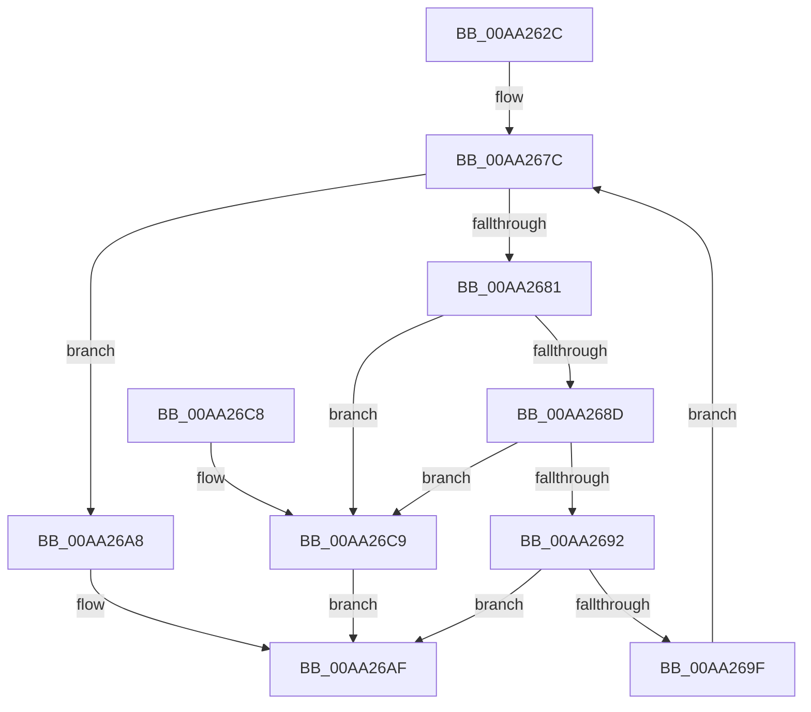

# MiMarkKernelCfgAddressTakenImports

- RVA: `0x00AA262C`–`0x00AA26D0` (길이 `164` bytes)
- VA: `0x0000000140AA262C`
- 실행 섹션: `PAGE`
- PDB 이름 있음: `예`; PDB Function 태그: `아니요`
- unwind 정보 RVA: `0x000B34FC`
- 디코드: `51`개 명령, `164/164` bytes 표시
- 미해석 바이트: `0` (있으면 어셈블리에 `.byte`로 보존)

> 이 문서는 커널 이미지의 기계어와 PDB 기호를 분석해 생성했습니다. 4번과 5번은 함수 원형과 자료형을 바이너리 사용 방식에서 추정한 C 해석이며 원본 소스 복구 결과는 아닙니다.

## 1. Dependencies

- 직접 호출 지점: **2**; 고유 호출 대상: **2**
- 직접 호출자로 확인된 함수: **1**
- RIP 상대 이미지 참조: **0**

### Outgoing calls
- `0x00AA2657` → [RtlImageDirectoryEntryToData](../../text/43/RtlImageDirectoryEntryToData_function_004328D0.md) (function, `0x004328D0`)
- `0x00AA2696` → [MiMarkKernelCfgTarget](../../text/48/MiMarkKernelCfgTarget_function_0048C8F4.md) (function, `0x0048C8F4`)

### Direct callers
- [MiProcessKernelCfgAddressTakenImports](../AD/MiProcessKernelCfgAddressTakenImports_function_00AD4384.md) at `0x00AD43BB`

### Static image references
- 디코드된 RIP-relative 메모리 참조가 없습니다.

## 2. Other-region calls and transfers

- 다른 실행 섹션으로 향하는 call: **2**
  - `0x00AA2657` → [RtlImageDirectoryEntryToData](../../text/43/RtlImageDirectoryEntryToData_function_004328D0.md) (`PAGE` → `.text`)
  - `0x00AA2696` → [MiMarkKernelCfgTarget](../../text/48/MiMarkKernelCfgTarget_function_0048C8F4.md) (`PAGE` → `.text`)
- 별도 외부 분기/꼬리 이동을 확인하지 못했습니다.

## 3. Assembly (complete function range)

```asm
00AA262C  48 8B C4                        mov rax, rsp
00AA262F  48 89 58 10                     mov qword ptr [rax + 0x10], rbx
00AA2633  48 89 68 18                     mov qword ptr [rax + 0x18], rbp
00AA2637  48 89 70 20                     mov qword ptr [rax + 0x20], rsi
00AA263B  57                              push rdi
00AA263C  41 56                           push r14
00AA263E  41 57                           push r15
00AA2640  48 83 EC 20                     sub rsp, 0x20
00AA2644  48 8B D9                        mov rbx, rcx
00AA2647  4C 8D 48 08                     lea r9, [rax + 8]
00AA264B  48 8B 49 30                     mov rcx, qword ptr [rcx + 0x30]
00AA264F  41 B8 0A 00 00 00               mov r8d, 0xa
00AA2655  B2 01                           mov dl, 1
00AA2657  E8 74 02 99 FF                  call 0x1404328d0
00AA265C  4C 8B 7B 30                     mov r15, qword ptr [rbx + 0x30]
00AA2660  8B A8 90 00 00 00               mov ebp, dword ptr [rax + 0x90]
00AA2666  44 8B B0 A8 00 00 00            mov r14d, dword ptr [rax + 0xa8]
00AA266D  48 8B B0 A0 00 00 00            mov rsi, qword ptr [rax + 0xa0]
00AA2674  C1 ED 1C                        shr ebp, 0x1c
00AA2677  83 C5 04                        add ebp, 4
00AA267A  33 FF                           xor edi, edi
00AA267C  41 3B FE                        cmp edi, r14d
00AA267F  73 27                           jae 0x140aa26a8
00AA2681  8B 43 40                        mov eax, dword ptr [rbx + 0x40]
00AA2684  8B 0E                           mov ecx, dword ptr [rsi]
00AA2686  83 E8 08                        sub eax, 8
00AA2689  3B C8                           cmp ecx, eax
00AA268B  77 3C                           ja 0x140aa26c9
00AA268D  F6 C1 07                        test cl, 7
00AA2690  75 37                           jne 0x140aa26c9
00AA2692  4A 8B 0C 39                     mov rcx, qword ptr [rcx + r15]
00AA2696  E8 59 A2 9E FF                  call 0x14048c8f4
00AA269B  85 C0                           test eax, eax
00AA269D  78 10                           js 0x140aa26af
00AA269F  8B C5                           mov eax, ebp
00AA26A1  48 03 F0                        add rsi, rax
00AA26A4  FF C7                           inc edi
00AA26A6  EB D4                           jmp 0x140aa267c
00AA26A8  0F BA 6B 68 08                  bts dword ptr [rbx + 0x68], 8
00AA26AD  33 C0                           xor eax, eax
00AA26AF  48 8B 5C 24 48                  mov rbx, qword ptr [rsp + 0x48]
00AA26B4  48 8B 6C 24 50                  mov rbp, qword ptr [rsp + 0x50]
00AA26B9  48 8B 74 24 58                  mov rsi, qword ptr [rsp + 0x58]
00AA26BE  48 83 C4 20                     add rsp, 0x20
00AA26C2  41 5F                           pop r15
00AA26C4  41 5E                           pop r14
00AA26C6  5F                              pop rdi
00AA26C7  C3                              ret
00AA26C8  CC                              int3
00AA26C9  B8 7B 00 00 C0                  mov eax, 0xc000007b
00AA26CE  EB DF                           jmp 0x140aa26af
```

## 4. C-style interpretation (structured pseudocode)

```c
__int64 __fastcall MiMarkKernelCfgAddressTakenImports(__int64 a1)
{
    __int64 result;
    __int64 v_rbp;
    __int64 v_rdi;
    __int64 v_rsi;
    __int64 v_rsp;
    unsigned __int64 v_stack_p10;
    unsigned __int64 v_stack_p18;
    unsigned __int64 v_stack_p20;

    *(unsigned __int64 *)(v_rsp + 16) = v_rbx;
    *(unsigned __int64 *)(v_rsp + 24) = v_rbp;
    *(unsigned __int64 *)(v_rsp + 32) = v_rsi;
    v_rsp = (v_rsp) - (32);
    result = RtlImageDirectoryEntryToData(*(unsigned __int64 *)(a1 + 48), 1, 10, v_rsp + 8);
    v_rbp = (unsigned int)(((unsigned int)(*(unsigned int *)(result + 144))) >> (28));
    v_rbp = (unsigned int)((v_rbp) + (4));
    v_rdi = 0;
loc_00AA267C:
    if (0 >= ((unsigned int)((unsigned int)(*(unsigned int *)(result + 168))))) goto loc_00AA26A8;
    result = (unsigned int)(((unsigned int)(*(unsigned int *)(a1 + 64))) - (8));
    if (((unsigned int)((unsigned int)(*(unsigned int *)(*(unsigned __int64 *)(result + 160))))) > ((unsigned int)(result))) goto loc_00AA26C9;
    if ((((unsigned __int8)((unsigned int)(*(unsigned int *)(*(unsigned __int64 *)(result + 160))))) & (7)) != 0) goto loc_00AA26C9;
    result = MiMarkKernelCfgTarget(*(unsigned __int64 *)((unsigned int)(*(unsigned int *)(*(unsigned __int64 *)(result + 160))) + *(unsigned __int64 *)(a1 + 48) * 1), 1, 10, v_rsp + 8);
    if (sign_flag) goto loc_00AA26AF;
    v_rsi = (*(unsigned __int64 *)(result + 160)) + ((unsigned int)((unsigned int)(v_rbp)));
    v_rdi = (unsigned int)((v_rdi) + 1);
    goto loc_00AA267C;
loc_00AA26A8:
    result = 0;
loc_00AA26AF:
    v_rsp = (v_rsp) + (32);
    return result;
loc_00AA26C9:
    goto loc_00AA26AF;
}
```

## 5. (Beta) C Style

```c
int64_t MiMarkKernelCfgAddressTakenImports(void *Arg1)
{
    uint8_t *arg1 = (uint8_t *)Arg1;

    int64_t result;
    int64_t local_rbp;
    int64_t local_rdi;
    int64_t local_rsi;
    int64_t local_rsp;
    uint64_t v_stack_p10;
    uint64_t v_stack_p18;
    uint64_t v_stack_p20;

    *(uint64_t *)(local_rsp + 0x10) = local_rbx;
    *(uint64_t *)(local_rsp + 0x18) = local_rbp;
    *(uint64_t *)(local_rsp + 0x20) = local_rsi;
    local_rsp = (local_rsp) - (32);
    result = RtlImageDirectoryEntryToData(*(uint64_t *)(arg1 + 0x30), 1, 10, local_rsp + 8);
    local_rbp = (uint32_t)(((uint32_t)(*(uint32_t *)(result + 0x90))) >> (28));
    local_rbp = (uint32_t)((local_rbp) + (4));
    local_rdi = 0;
loc_00AA267C:
    if (0 >= ((uint32_t)((uint32_t)(*(uint32_t *)(result + 0xA8))))) goto loc_00AA26A8;
    result = (uint32_t)(((uint32_t)(*(uint32_t *)(arg1 + 0x40))) - (8));
    if (((uint32_t)((uint32_t)(*(uint32_t *)(*(uint64_t *)(result + 0xA0))))) > ((uint32_t)(result))) goto loc_00AA26C9;
    if ((((uint8_t)((uint32_t)(*(uint32_t *)(*(uint64_t *)(result + 0xA0))))) & (7)) != 0) goto loc_00AA26C9;
    result = MiMarkKernelCfgTarget(*(uint64_t *)((uint32_t)(*(uint32_t *)(*(uint64_t *)(result + 0xA0))) + *(uint64_t *)(arg1 + 0x30) * 1), 1, 10, local_rsp + 8);
    if (sign_flag) goto loc_00AA26AF;
    local_rsi = (*(uint64_t *)(result + 0xA0)) + ((uint32_t)((uint32_t)(local_rbp)));
    local_rdi = (uint32_t)((local_rdi) + 1);
    goto loc_00AA267C;
loc_00AA26A8:
    result = 0;
loc_00AA26AF:
    local_rsp = (local_rsp) + (32);
    return result;
loc_00AA26C9:
    goto loc_00AA26AF;
}
```

### 관측된 메모리 오프셋

구조체 형식이 확인되지 않은 접근은 인자 기준의 오프셋으로만 기록했습니다.

| 기준 인자 | 오프셋 표현 | 폭 (bit) | 접근 |
|---|---:|---:|---|
| `Arg1` | `+ 0x30` | `64` | `R` |
| `Arg1` | `+ 0x40` | `32` | `R` |
| `Arg1` | `+ 0x68` | `32` | `R/W` |

## 6. Execution-region graph

[열기: 2D/3D 그래프와 함수 탐색 컨트롤 패널](../../../control-panel.html?section=page&rva=0x00AA262C&view=graph)

- 2D 그래프는 위에서 아래로 흐르고, 3D 그래프는 빈 공간을 드래그해 회전합니다. Shift+드래그는 이동, 휠은 확대·축소, 함수 노드 선택은 대상 보고서 이동입니다.

### Static fallback


