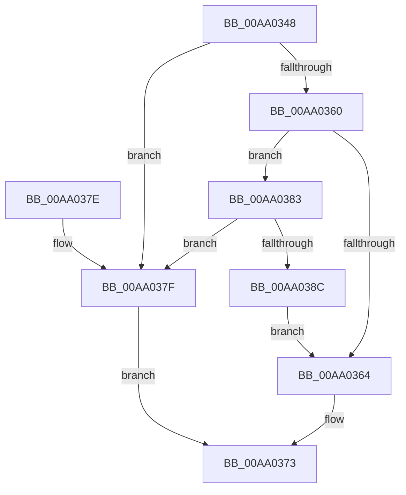

# MiMarkKernelImageRetpolineBits

- RVA: `0x00AA0348`–`0x00AA038E` (길이 `70` bytes)
- VA: `0x0000000140AA0348`
- 실행 섹션: `PAGE`
- PDB 이름 있음: `예`; PDB Function 태그: `아니요`
- unwind 정보 RVA: `0x000B38AC`
- 디코드: `25`개 명령, `70/70` bytes 표시
- 미해석 바이트: `0` (있으면 어셈블리에 `.byte`로 보존)

> 이 문서는 커널 이미지의 기계어와 PDB 기호를 분석해 생성했습니다. 4번과 5번은 함수 원형과 자료형을 바이너리 사용 방식에서 추정한 C 해석이며 원본 소스 복구 결과는 아닙니다.

## 1. Dependencies

- 직접 호출 지점: **3**; 고유 호출 대상: **3**
- 직접 호출자로 확인된 함수: **2**
- RIP 상대 이미지 참조: **0**

### Outgoing calls
- `0x00AA0357` → [KeIsRetpolineEnabled](../../text/44/KeIsRetpolineEnabled_function_0044EE20.md) (function, `0x0044EE20`)
- `0x00AA036E` → [MiMarkRetpolineBits](MiMarkRetpolineBits_function_00AA0394.md) (function, `0x00AA0394`)
- `0x00AA0383` → [MiIsImageFullyRetpolined](../AB/MiIsImageFullyRetpolined_function_00AB01D4.md) (function, `0x00AB01D4`)

### Direct callers
- [MiFinalizeKernelScpForSystemImage](MiFinalizeKernelScpForSystemImage_function_00AA02F8.md) at `0x00AA031D`
- [MiUnloadSystemImage](MiUnloadSystemImage_function_00AA2FD4.md) at `0x00AA3159`

### Static image references
- 디코드된 RIP-relative 메모리 참조가 없습니다.

## 2. Other-region calls and transfers

- 다른 실행 섹션으로 향하는 call: **1**
  - `0x00AA0357` → [KeIsRetpolineEnabled](../../text/44/KeIsRetpolineEnabled_function_0044EE20.md) (`PAGE` → `.text`)
- 별도 외부 분기/꼬리 이동을 확인하지 못했습니다.

## 3. Assembly (complete function range)

```asm
00AA0348  48 89 5C 24 08                  mov qword ptr [rsp + 8], rbx
00AA034D  57                              push rdi
00AA034E  48 83 EC 20                     sub rsp, 0x20
00AA0352  8B FA                           mov edi, edx
00AA0354  48 8B D9                        mov rbx, rcx
00AA0357  E8 C4 EA 9A FF                  call 0x14044ee20
00AA035C  84 C0                           test al, al
00AA035E  74 1F                           je 0x140aa037f
00AA0360  85 D2                           test edx, edx
00AA0362  75 1F                           jne 0x140aa0383
00AA0364  8B 53 40                        mov edx, dword ptr [rbx + 0x40]
00AA0367  44 8B C7                        mov r8d, edi
00AA036A  48 8B 4B 30                     mov rcx, qword ptr [rbx + 0x30]
00AA036E  E8 21 00 00 00                  call 0x140aa0394
00AA0373  48 8B 5C 24 30                  mov rbx, qword ptr [rsp + 0x30]
00AA0378  48 83 C4 20                     add rsp, 0x20
00AA037C  5F                              pop rdi
00AA037D  C3                              ret
00AA037E  CC                              int3
00AA037F  33 C0                           xor eax, eax
00AA0381  EB F0                           jmp 0x140aa0373
00AA0383  E8 4C FE 00 00                  call 0x140ab01d4
00AA0388  85 C0                           test eax, eax
00AA038A  74 F3                           je 0x140aa037f
00AA038C  EB D6                           jmp 0x140aa0364
```

## 4. C-style interpretation (structured pseudocode)

```c
__int64 __fastcall MiMarkKernelImageRetpolineBits(__int64 a1, int a2)
{
    __int64 result;
    __int64 v_rsp;
    unsigned __int64 v_stack_p8;

    v_stack_p8 = v_rbx;
    v_rsp = (v_rsp) - (32);
    result = KeIsRetpolineEnabled(a1, a2, a3, a4);
    if ((unsigned __int8)(result) == 0) goto loc_00AA037F;
    if (a2 != 0) goto loc_00AA0383;
loc_00AA0364:
    result = MiMarkRetpolineBits(*(unsigned __int64 *)(a1 + 48), (unsigned int)(*(unsigned int *)(a1 + 64)), (unsigned int)((unsigned int)((unsigned int)(a2))), a4);
loc_00AA0373:
    v_rsp = (v_rsp) + (32);
    return result;
loc_00AA037F:
    result = 0;
    goto loc_00AA0373;
loc_00AA0383:
    result = MiIsImageFullyRetpolined(*(unsigned __int64 *)(a1 + 48), (unsigned int)(*(unsigned int *)(a1 + 64)), (unsigned int)((unsigned int)((unsigned int)(a2))), a4);
    if ((unsigned int)(result) == 0) goto loc_00AA037F;
    goto loc_00AA0364;
}
```

## 5. (Beta) C Style

```c
int64_t MiMarkKernelImageRetpolineBits(void *Arg1, int32_t Arg2)
{
    uint8_t *arg1 = (uint8_t *)Arg1;

    int64_t result;
    int64_t local_rsp;
    uint64_t v_stack_p8;

    v_stack_p8 = local_rbx;
    local_rsp = (local_rsp) - (32);
    result = KeIsRetpolineEnabled(Arg1, Arg2, a3, a4);
    if ((uint8_t)(result) == 0) goto loc_00AA037F;
    if (Arg2 != 0) goto loc_00AA0383;
loc_00AA0364:
    result = MiMarkRetpolineBits(*(uint64_t *)(arg1 + 0x30), (uint32_t)(*(uint32_t *)(arg1 + 0x40)), (uint32_t)((uint32_t)((uint32_t)(Arg2))), a4);
loc_00AA0373:
    local_rsp = (local_rsp) + (32);
    return result;
loc_00AA037F:
    result = 0;
    goto loc_00AA0373;
loc_00AA0383:
    result = MiIsImageFullyRetpolined(*(uint64_t *)(arg1 + 0x30), (uint32_t)(*(uint32_t *)(arg1 + 0x40)), (uint32_t)((uint32_t)((uint32_t)(Arg2))), a4);
    if ((uint32_t)(result) == 0) goto loc_00AA037F;
    goto loc_00AA0364;
}
```

### 관측된 메모리 오프셋

구조체 형식이 확인되지 않은 접근은 인자 기준의 오프셋으로만 기록했습니다.

| 기준 인자 | 오프셋 표현 | 폭 (bit) | 접근 |
|---|---:|---:|---|
| `Arg1` | `+ 0x30` | `64` | `R` |
| `Arg1` | `+ 0x40` | `32` | `R` |

## 6. Execution-region graph

[열기: 2D/3D 그래프와 함수 탐색 컨트롤 패널](../../../control-panel.html?section=page&rva=0x00AA0348&view=graph)

- 2D 그래프는 위에서 아래로 흐르고, 3D 그래프는 빈 공간을 드래그해 회전합니다. Shift+드래그는 이동, 휠은 확대·축소, 함수 노드 선택은 대상 보고서 이동입니다.

### Static fallback


