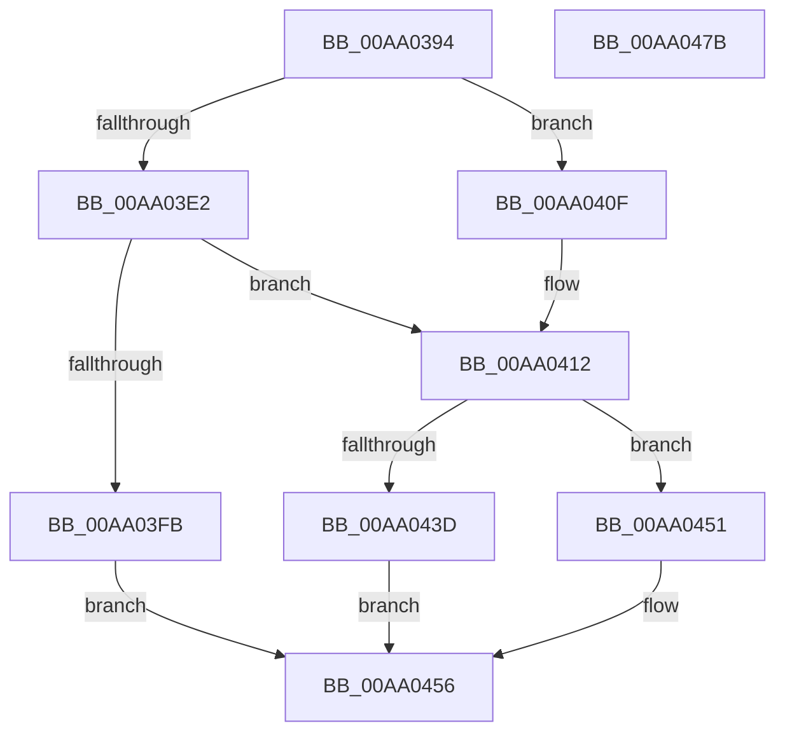

# MiMarkRetpolineBits

- RVA: `0x00AA0394`–`0x00AA047C` (길이 `232` bytes)
- VA: `0x0000000140AA0394`
- 실행 섹션: `PAGE`
- PDB 이름 있음: `예`; PDB Function 태그: `아니요`
- unwind 정보 RVA: `0x0005E6B4`
- 디코드: `63`개 명령, `232/232` bytes 표시
- 미해석 바이트: `0` (있으면 어셈블리에 `.byte`로 보존)

> 이 문서는 커널 이미지의 기계어와 PDB 기호를 분석해 생성했습니다. 4번과 5번은 함수 원형과 자료형을 바이너리 사용 방식에서 추정한 C 해석이며 원본 소스 복구 결과는 아닙니다.

## 1. Dependencies

- 직접 호출 지점: **8**; 고유 호출 대상: **7**
- 직접 호출자로 확인된 함수: **4**
- RIP 상대 이미지 참조: **2**

### Outgoing calls
- `0x00AA03B0` → [MiAddressToRetpolineBit](../../text/4D/MiAddressToRetpolineBit_function_004D1EB8.md) (function, `0x004D1EB8`)
- `0x00AA03C9` → [MiAddressToRetpolineBit](../../text/4D/MiAddressToRetpolineBit_function_004D1EB8.md) (function, `0x004D1EB8`)
- `0x00AA03D3` → [MmAcquireLoadLock](../../text/4D/MmAcquireLoadLock_function_004DC2A0.md) (function, `0x004DC2A0`)
- `0x00AA03F2` → [RtlAreBitsClearEx](../../text/41/RtlAreBitsClearEx_function_0041DBF0.md) (function, `0x0041DBF0`)
- `0x00AA0408` → [RtlClearBitsEx](../../text/29/RtlClearBitsEx_function_00297740.md) (function, `0x00297740`)
- `0x00AA0434` → [MiSplitBitmapPages](../../text/3B/MiSplitBitmapPages_function_003B4A34.md) (function, `0x003B4A34`)
- `0x00AA044A` → [RtlSetBitsEx](../../text/3B/RtlSetBitsEx_function_003B6570.md) (function, `0x003B6570`)
- `0x00AA0459` → [MmReleaseLoadLock](../../text/4D/MmReleaseLoadLock_function_004D36D0.md) (function, `0x004D36D0`)

### Direct callers
- [HvlPhase1Initialize](../../text/58/HvlPhase1Initialize_function_00583D80.md) at `0x00583DF6`
- [MiMarkKernelImageRetpolineBits](MiMarkKernelImageRetpolineBits_function_00AA0348.md) at `0x00AA036E`
- [MiApplyRetpolineToBootDriver](../../init/C6/MiApplyRetpolineToBootDriver_function_00C66264.md) at `0x00C663DF`
- [MiInitializeRetpoline](../../init/C6/MiInitializeRetpoline_function_00C66544.md) at `0x00C665D7`
- [MiInitializeRetpoline](../../init/C6/MiInitializeRetpoline_function_00C66544.md) at `0x00C6660F`

### Static image references
- `0x00AA03E5` → RVA `0x00E2D858` (`.data`; read)
- `0x00AA0426` → RVA `0x00E2D860` (`.data`; read)

## 2. Other-region calls and transfers

- 다른 실행 섹션으로 향하는 call: **8**
  - `0x00AA03B0` → [MiAddressToRetpolineBit](../../text/4D/MiAddressToRetpolineBit_function_004D1EB8.md) (`PAGE` → `.text`)
  - `0x00AA03C9` → [MiAddressToRetpolineBit](../../text/4D/MiAddressToRetpolineBit_function_004D1EB8.md) (`PAGE` → `.text`)
  - `0x00AA03D3` → [MmAcquireLoadLock](../../text/4D/MmAcquireLoadLock_function_004DC2A0.md) (`PAGE` → `.text`)
  - `0x00AA03F2` → [RtlAreBitsClearEx](../../text/41/RtlAreBitsClearEx_function_0041DBF0.md) (`PAGE` → `.text`)
  - `0x00AA0408` → [RtlClearBitsEx](../../text/29/RtlClearBitsEx_function_00297740.md) (`PAGE` → `.text`)
  - `0x00AA0434` → [MiSplitBitmapPages](../../text/3B/MiSplitBitmapPages_function_003B4A34.md) (`PAGE` → `.text`)
  - `0x00AA044A` → [RtlSetBitsEx](../../text/3B/RtlSetBitsEx_function_003B6570.md) (`PAGE` → `.text`)
  - `0x00AA0459` → [MmReleaseLoadLock](../../text/4D/MmReleaseLoadLock_function_004D36D0.md) (`PAGE` → `.text`)
- 별도 외부 분기/꼬리 이동을 확인하지 못했습니다.

## 3. Assembly (complete function range)

```asm
00AA0394  48 8B C4                        mov rax, rsp
00AA0397  48 89 58 08                     mov qword ptr [rax + 8], rbx
00AA039B  48 89 68 10                     mov qword ptr [rax + 0x10], rbp
00AA039F  48 89 70 18                     mov qword ptr [rax + 0x18], rsi
00AA03A3  48 89 78 20                     mov qword ptr [rax + 0x20], rdi
00AA03A7  41 56                           push r14
00AA03A9  48 83 EC 20                     sub rsp, 0x20
00AA03AD  41 8B D8                        mov ebx, r8d
00AA03B0  E8 03 1B A3 FF                  call 0x1404d1eb8
00AA03B5  48 81 C2 FF FF 00 00            add rdx, 0xffff
00AA03BC  48 8B F8                        mov rdi, rax
00AA03BF  48 03 CA                        add rcx, rdx
00AA03C2  48 81 E1 00 00 FF FF            and rcx, 0xffffffffffff0000
00AA03C9  E8 EA 1A A3 FF                  call 0x1404d1eb8
00AA03CE  48 8B E8                        mov rbp, rax
00AA03D1  33 F6                           xor esi, esi
00AA03D3  E8 C8 BE A3 FF                  call 0x1404dc2a0
00AA03D8  85 DB                           test ebx, ebx
00AA03DA  4C 8B F0                        mov r14, rax
00AA03DD  48 8B DD                        mov rbx, rbp
00AA03E0  75 2D                           jne 0x140aa040f
00AA03E2  48 2B DF                        sub rbx, rdi
00AA03E5  48 8D 0D 6C D4 38 00            lea rcx, [rip + 0x38d46c]
00AA03EC  4C 8B C3                        mov r8, rbx
00AA03EF  48 8B D7                        mov rdx, rdi
00AA03F2  E8 F9 D7 97 FF                  call 0x14041dbf0
00AA03F7  84 C0                           test al, al
00AA03F9  75 17                           jne 0x140aa0412
00AA03FB  4C 8B C3                        mov r8, rbx
00AA03FE  48 8D 0D 53 D4 38 00            lea rcx, [rip + 0x38d453]
00AA0405  48 8B D7                        mov rdx, rdi
00AA0408  E8 33 73 7F FF                  call 0x140297740
00AA040D  EB 47                           jmp 0x140aa0456
00AA040F  48 2B DF                        sub rbx, rdi
00AA0412  4C 8B C7                        mov r8, rdi
00AA0415  45 33 C9                        xor r9d, r9d
00AA0418  41 83 E0 07                     and r8d, 7
00AA041C  48 8B D7                        mov rdx, rdi
00AA041F  4C 2B C7                        sub r8, rdi
00AA0422  48 C1 EA 03                     shr rdx, 3
00AA0426  48 03 15 33 D4 38 00            add rdx, qword ptr [rip + 0x38d433]
00AA042D  4C 03 C5                        add r8, rbp
00AA0430  41 8D 49 04                     lea ecx, [r9 + 4]
00AA0434  E8 FB 45 91 FF                  call 0x1403b4a34
00AA0439  85 C0                           test eax, eax
00AA043B  74 14                           je 0x140aa0451
00AA043D  4C 8B C3                        mov r8, rbx
00AA0440  48 8D 0D 11 D4 38 00            lea rcx, [rip + 0x38d411]
00AA0447  48 8B D7                        mov rdx, rdi
00AA044A  E8 21 61 91 FF                  call 0x1403b6570
00AA044F  EB 05                           jmp 0x140aa0456
00AA0451  BE 17 00 00 C0                  mov esi, 0xc0000017
00AA0456  49 8B CE                        mov rcx, r14
00AA0459  E8 72 32 A3 FF                  call 0x1404d36d0
00AA045E  48 8B 5C 24 30                  mov rbx, qword ptr [rsp + 0x30]
00AA0463  8B C6                           mov eax, esi
00AA0465  48 8B 74 24 40                  mov rsi, qword ptr [rsp + 0x40]
00AA046A  48 8B 6C 24 38                  mov rbp, qword ptr [rsp + 0x38]
00AA046F  48 8B 7C 24 48                  mov rdi, qword ptr [rsp + 0x48]
00AA0474  48 83 C4 20                     add rsp, 0x20
00AA0478  41 5E                           pop r14
00AA047A  C3                              ret
00AA047B  CC                              int3
```

## 4. C-style interpretation (structured pseudocode)

```c
__int64 __fastcall MiMarkRetpolineBits(__int64 a1, __int64 a2, int a3, int a4)
{
    __int64 result;
    __int64 v_rbx;
    __int64 v_rsi;
    __int64 v_rsp;
    unsigned __int64 v_stack_p10;
    unsigned __int64 v_stack_p18;
    unsigned __int64 v_stack_p20;
    unsigned __int64 v_stack_p8;

    *(unsigned __int64 *)(v_rsp + 8) = v_rbx;
    *(unsigned __int64 *)(v_rsp + 16) = v_rbp;
    *(unsigned __int64 *)(v_rsp + 24) = v_rsi;
    *(unsigned __int64 *)(v_rsp + 32) = v_rdi;
    v_rsp = (v_rsp) - (32);
    result = MiAddressToRetpolineBit(a1, a2, a3, a4);
    a2 = (a2) + (0xFFFFULL);
    a1 = (a1) + (a2);
    a1 = (a1) & (0xFFFFFFFFFFFF0000ULL);
    result = MiAddressToRetpolineBit(a1, a2, a3, a4);
    v_rsi = 0;
    result = MmAcquireLoadLock(a1, a2, a3, a4);
    if ((unsigned int)((unsigned int)(a3)) != 0) goto loc_00AA040F;
    v_rbx = (result) - (result);
    result = RtlAreBitsClearEx(v_rip + 3724396, result, v_rbx, a4);
    if ((unsigned __int8)(result) != 0) goto loc_00AA0412;
    result = RtlClearBitsEx(v_rip + 3724371, result, v_rbx, a4);
    goto loc_00AA0456;
loc_00AA040F:
    v_rbx = (v_rbx) - (result);
loc_00AA0412:
    a4 = 0;
    a3 = (unsigned int)((result) & (7));
    a3 = (a3) - (result);
    a2 = (result) >> (3);
    a2 = (a2) + (*(unsigned __int64 *)(v_rip + 3724339));
    a3 = (a3) + (result);
    result = MiSplitBitmapPages(a4 + 4, a2, a3, a4);
    if ((unsigned int)(result) == 0) goto loc_00AA0451;
    result = RtlSetBitsEx(v_rip + 3724305, result, v_rbx, a4);
    goto loc_00AA0456;
loc_00AA0451:
loc_00AA0456:
    result = MmReleaseLoadLock(result, result, v_rbx, a4);
    v_rsp = (v_rsp) + (32);
    return (unsigned int)((unsigned int)((unsigned int)(0xC0000017ULL)));
}
```

## 5. (Beta) C Style

```c
int64_t MiMarkRetpolineBits(int64_t Arg1, int64_t Arg2, int32_t Arg3, int32_t Arg4)
{
    int64_t result;
    int64_t local_rbx;
    int64_t local_rsi;
    int64_t local_rsp;
    uint64_t v_stack_p10;
    uint64_t v_stack_p18;
    uint64_t v_stack_p20;
    uint64_t v_stack_p8;

    *(uint64_t *)(local_rsp + 0x8) = local_rbx;
    *(uint64_t *)(local_rsp + 0x10) = local_rbp;
    *(uint64_t *)(local_rsp + 0x18) = local_rsi;
    *(uint64_t *)(local_rsp + 0x20) = local_rdi;
    local_rsp = (local_rsp) - (32);
    result = MiAddressToRetpolineBit(Arg1, Arg2, Arg3, Arg4);
    Arg2 = (Arg2) + (0xFFFFULL);
    Arg1 = (Arg1) + (Arg2);
    Arg1 = (Arg1) & (0xFFFFFFFFFFFF0000ULL);
    result = MiAddressToRetpolineBit(Arg1, Arg2, Arg3, Arg4);
    local_rsi = 0;
    result = MmAcquireLoadLock(Arg1, Arg2, Arg3, Arg4);
    if ((uint32_t)((uint32_t)(Arg3)) != 0) goto loc_00AA040F;
    local_rbx = (result) - (result);
    result = RtlAreBitsClearEx(v_rip + 3724396, result, local_rbx, Arg4);
    if ((uint8_t)(result) != 0) goto loc_00AA0412;
    result = RtlClearBitsEx(v_rip + 3724371, result, local_rbx, Arg4);
    goto loc_00AA0456;
loc_00AA040F:
    local_rbx = (local_rbx) - (result);
loc_00AA0412:
    Arg4 = 0;
    Arg3 = (uint32_t)((result) & (7));
    Arg3 = (Arg3) - (result);
    Arg2 = (result) >> (3);
    Arg2 = (Arg2) + (*(uint64_t *)(v_rip + 0x38D433));
    Arg3 = (Arg3) + (result);
    result = MiSplitBitmapPages(Arg4 + 4, Arg2, Arg3, Arg4);
    if ((uint32_t)(result) == 0) goto loc_00AA0451;
    result = RtlSetBitsEx(v_rip + 3724305, result, local_rbx, Arg4);
    goto loc_00AA0456;
loc_00AA0451:
loc_00AA0456:
    result = MmReleaseLoadLock(result, result, local_rbx, Arg4);
    local_rsp = (local_rsp) + (32);
    return (uint32_t)((uint32_t)((uint32_t)(0xC0000017ULL)));
}
```

## 6. Execution-region graph

[열기: 2D/3D 그래프와 함수 탐색 컨트롤 패널](../../../control-panel.html?section=page&rva=0x00AA0394&view=graph)

- 2D 그래프는 위에서 아래로 흐르고, 3D 그래프는 빈 공간을 드래그해 회전합니다. Shift+드래그는 이동, 휠은 확대·축소, 함수 노드 선택은 대상 보고서 이동입니다.

### Static fallback


