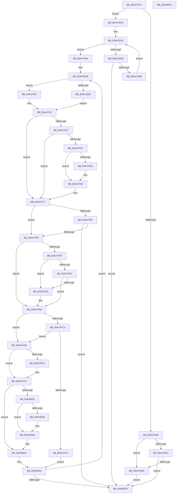

# MiProtectSystemImage

- RVA: `0x00AA7D74`–`0x00AA80A2` (길이 `814` bytes)
- VA: `0x0000000140AA7D74`
- 실행 섹션: `PAGE`
- PDB 이름 있음: `예`; PDB Function 태그: `아니요`
- unwind 정보 RVA: `0x000BBB30`
- 디코드: `219`개 명령, `814/814` bytes 표시
- 미해석 바이트: `0` (있으면 어셈블리에 `.byte`로 보존)

> 이 문서는 커널 이미지의 기계어와 PDB 기호를 분석해 생성했습니다. 4번과 5번은 함수 원형과 자료형을 바이너리 사용 방식에서 추정한 C 해석이며 원본 소스 복구 결과는 아닙니다.

## 1. Dependencies

- 직접 호출 지점: **12**; 고유 호출 대상: **7**
- 직접 호출자로 확인된 함수: **3**
- RIP 상대 이미지 참조: **5**

### Outgoing calls
- `0x00AA7DCD` → [MI_IS_PHYSICAL_ADDRESS](../../text/23/MI_IS_PHYSICAL_ADDRESS_function_0023B3A0.md) (function, `0x0023B3A0`)
- `0x00AA7E00` → [MiActOnLargeKernelHalPages](../7F/MiActOnLargeKernelHalPages_function_007F852C.md) (function, `0x007F852C`)
- `0x00AA7E0D` → [RtlImageNtHeader](../../text/44/RtlImageNtHeader_function_00443B60.md) (function, `0x00443B60`)
- `0x00AA7EB4` → [MiGetPteAddress](../../text/43/MiGetPteAddress_function_0043E130.md) (function, `0x0043E130`)
- `0x00AA7EF7` → [MiGetPteAddress](../../text/43/MiGetPteAddress_function_0043E130.md) (function, `0x0043E130`)
- `0x00AA7F19` → [MiGetPteAddress](../../text/43/MiGetPteAddress_function_0043E130.md) (function, `0x0043E130`)
- `0x00AA7F3F` → [MiComputeDriverProtection](MiComputeDriverProtection_function_00AA80A8.md) (function, `0x00AA80A8`)
- `0x00AA7F5A` → [MiSetSystemCodeProtection](../../text/38/MiSetSystemCodeProtection_function_00384420.md) (function, `0x00384420`)
- `0x00AA7FD6` → [MiGetPteAddress](../../text/43/MiGetPteAddress_function_0043E130.md) (function, `0x0043E130`)
- `0x00AA800D` → [MiComputeDriverProtection](MiComputeDriverProtection_function_00AA80A8.md) (function, `0x00AA80A8`)
- `0x00AA8028` → [MiSetSystemCodeProtection](../../text/38/MiSetSystemCodeProtection_function_00384420.md) (function, `0x00384420`)
- `0x00AA807B` → [_security_check_cookie](../../text/6A/_security_check_cookie_function_006AC640.md) (function, `0x006AC640`)

### Direct callers
- [MiDriverLoadSucceeded](../70/MiDriverLoadSucceeded_function_00702F08.md) at `0x00702F67`
- [MiWriteProtectSystemImages](../7F/MiWriteProtectSystemImages_function_007F8F50.md) at `0x007F8F81`
- [MmLoadSystemImageEx](../99/MmLoadSystemImageEx_function_00999B8C.md) at `0x0099A15E`

### Static image references
- `0x00AA7D93` → RVA `0x00E0A740` (`.data`; read)
- `0x00AA7DD8` → RVA `0x00FC6B28` (`ALMOSTRO`; read)
- `0x00AA7DE1` → RVA `0x00FC6B98` (`ALMOSTRO`; read)
- `0x00AA7DF0` → RVA `0x007F8D20` (`MiProtectLargeKernelHalRange`; read)
- `0x00AA7F9F` → RVA `0x00FC6A88` (`ALMOSTRO`; read)

## 2. Other-region calls and transfers

- 다른 실행 섹션으로 향하는 call: **9**
  - `0x00AA7DCD` → [MI_IS_PHYSICAL_ADDRESS](../../text/23/MI_IS_PHYSICAL_ADDRESS_function_0023B3A0.md) (`PAGE` → `.text`)
  - `0x00AA7E0D` → [RtlImageNtHeader](../../text/44/RtlImageNtHeader_function_00443B60.md) (`PAGE` → `.text`)
  - `0x00AA7EB4` → [MiGetPteAddress](../../text/43/MiGetPteAddress_function_0043E130.md) (`PAGE` → `.text`)
  - `0x00AA7EF7` → [MiGetPteAddress](../../text/43/MiGetPteAddress_function_0043E130.md) (`PAGE` → `.text`)
  - `0x00AA7F19` → [MiGetPteAddress](../../text/43/MiGetPteAddress_function_0043E130.md) (`PAGE` → `.text`)
  - `0x00AA7F5A` → [MiSetSystemCodeProtection](../../text/38/MiSetSystemCodeProtection_function_00384420.md) (`PAGE` → `.text`)
  - `0x00AA7FD6` → [MiGetPteAddress](../../text/43/MiGetPteAddress_function_0043E130.md) (`PAGE` → `.text`)
  - `0x00AA8028` → [MiSetSystemCodeProtection](../../text/38/MiSetSystemCodeProtection_function_00384420.md) (`PAGE` → `.text`)
  - `0x00AA807B` → [_security_check_cookie](../../text/6A/_security_check_cookie_function_006AC640.md) (`PAGE` → `.text`)
- 별도 외부 분기/꼬리 이동을 확인하지 못했습니다.

## 3. Assembly (complete function range)

```asm
00AA7D74  4C 8B DC                        mov r11, rsp
00AA7D77  49 89 5B 10                     mov qword ptr [r11 + 0x10], rbx
00AA7D7B  49 89 6B 18                     mov qword ptr [r11 + 0x18], rbp
00AA7D7F  49 89 73 20                     mov qword ptr [r11 + 0x20], rsi
00AA7D83  57                              push rdi
00AA7D84  41 54                           push r12
00AA7D86  41 55                           push r13
00AA7D88  41 56                           push r14
00AA7D8A  41 57                           push r15
00AA7D8C  48 81 EC A0 00 00 00            sub rsp, 0xa0
00AA7D93  48 8B 05 A6 29 36 00            mov rax, qword ptr [rip + 0x3629a6]
00AA7D9A  48 33 C4                        xor rax, rsp
00AA7D9D  48 89 84 24 98 00 00 00         mov qword ptr [rsp + 0x98], rax
00AA7DA5  48 8B 79 30                     mov rdi, qword ptr [rcx + 0x30]
00AA7DA9  0F 57 C0                        xorps xmm0, xmm0
00AA7DAC  48 8B E9                        mov rbp, rcx
00AA7DAF  48 89 4C 24 58                  mov qword ptr [rsp + 0x58], rcx
00AA7DB4  33 C0                           xor eax, eax
00AA7DB6  89 54 24 38                     mov dword ptr [rsp + 0x38], edx
00AA7DBA  0F 11 44 24 70                  movups xmmword ptr [rsp + 0x70], xmm0
00AA7DBF  48 8B CF                        mov rcx, rdi
00AA7DC2  49 89 43 C8                     mov qword ptr [r11 - 0x38], rax
00AA7DC6  41 0F 11 43 B8                  movups xmmword ptr [r11 - 0x48], xmm0
00AA7DCB  8B F2                           mov esi, edx
00AA7DCD  E8 CE 35 79 FF                  call 0x14023b3a0
00AA7DD2  33 DB                           xor ebx, ebx
00AA7DD4  85 C0                           test eax, eax
00AA7DD6  74 32                           je 0x140aa7e0a
00AA7DD8  48 3B 3D 49 ED 51 00            cmp rdi, qword ptr [rip + 0x51ed49]
00AA7DDF  74 0D                           je 0x140aa7dee
00AA7DE1  48 3B 3D B0 ED 51 00            cmp rdi, qword ptr [rip + 0x51edb0]
00AA7DE8  0F 85 82 02 00 00               jne 0x140aa8070
00AA7DEE  85 F6                           test esi, esi
00AA7DF0  48 8D 15 29 0F D5 FF            lea rdx, [rip - 0x2af0d7]
00AA7DF7  48 8B CF                        mov rcx, rdi
00AA7DFA  0F 95 C3                        setne bl
00AA7DFD  44 8B C3                        mov r8d, ebx
00AA7E00  E8 27 07 D5 FF                  call 0x1407f852c
00AA7E05  E9 66 02 00 00                  jmp 0x140aa8070
00AA7E0A  48 8B CF                        mov rcx, rdi
00AA7E0D  E8 4E BD 99 FF                  call 0x140443b60
00AA7E12  48 8B F0                        mov rsi, rax
00AA7E15  48 89 44 24 60                  mov qword ptr [rsp + 0x60], rax
00AA7E1A  8B 45 68                        mov eax, dword ptr [rbp + 0x68]
00AA7E1D  8B CB                           mov ecx, ebx
00AA7E1F  25 00 00 00 08                  and eax, 0x8000000
00AA7E24  89 44 24 40                     mov dword ptr [rsp + 0x40], eax
00AA7E28  48 8B C7                        mov rax, rdi
00AA7E2B  8B 56 50                        mov edx, dword ptr [rsi + 0x50]
00AA7E2E  F7 C2 FF 0F 00 00               test edx, 0xfff
00AA7E34  44 0F B7 76 14                  movzx r14d, word ptr [rsi + 0x14]
00AA7E39  44 0F B7 7E 06                  movzx r15d, word ptr [rsi + 6]
00AA7E3E  0F 95 C1                        setne cl
00AA7E41  C1 EA 0C                        shr edx, 0xc
00AA7E44  49 83 C6 18                     add r14, 0x18
00AA7E48  4C 03 F6                        add r14, rsi
00AA7E4B  45 8B D7                        mov r10d, r15d
00AA7E4E  44 8D 1C 0A                     lea r11d, [rdx + rcx]
00AA7E52  4D 8D 4E 10                     lea r9, [r14 + 0x10]
00AA7E56  45 85 D2                        test r10d, r10d
00AA7E59  74 39                           je 0x140aa7e94
00AA7E5B  45 8B 41 FC                     mov r8d, dword ptr [r9 - 4]
00AA7E5F  4C 03 C7                        add r8, rdi
00AA7E62  4C 3B C0                        cmp r8, rax
00AA7E65  0F 82 05 02 00 00               jb 0x140aa8070
00AA7E6B  41 8B 41 F8                     mov eax, dword ptr [r9 - 8]
00AA7E6F  41 8B 09                        mov ecx, dword ptr [r9]
00AA7E72  3B C8                           cmp ecx, eax
00AA7E74  8B 56 38                        mov edx, dword ptr [rsi + 0x38]
00AA7E77  0F 42 C8                        cmovb ecx, eax
00AA7E7A  41 FF CA                        dec r10d
00AA7E7D  8B C1                           mov eax, ecx
00AA7E7F  48 FF C8                        dec rax
00AA7E82  48 03 C2                        add rax, rdx
00AA7E85  48 F7 DA                        neg rdx
00AA7E88  49 03 C0                        add rax, r8
00AA7E8B  48 23 C2                        and rax, rdx
00AA7E8E  49 83 C1 28                     add r9, 0x28
00AA7E92  EB C2                           jmp 0x140aa7e56
00AA7E94  4B 8D 0C BF                     lea rcx, [r15 + r15*4]
00AA7E98  BE 00 00 00 C0                  mov esi, 0xc0000000
00AA7E9D  4C 8D 04 CD FF FF FF FF         lea r8, [rcx*8 - 1]
00AA7EA5  89 74 24 3C                     mov dword ptr [rsp + 0x3c], esi
00AA7EA9  4D 03 C6                        add r8, r14
00AA7EAC  48 8B CF                        mov rcx, rdi
00AA7EAF  4C 89 44 24 68                  mov qword ptr [rsp + 0x68], r8
00AA7EB4  E8 77 62 99 FF                  call 0x14043e130
00AA7EB9  4C 8B E8                        mov r13, rax
00AA7EBC  89 5C 24 30                     mov dword ptr [rsp + 0x30], ebx
00AA7EC0  4A 8D 04 DD 00 00 00 00         lea rax, [r11*8]
00AA7EC8  4C 8B E3                        mov r12, rbx
00AA7ECB  49 03 C5                        add rax, r13
00AA7ECE  44 8B CB                        mov r9d, ebx
00AA7ED1  48 89 44 24 50                  mov qword ptr [rsp + 0x50], rax
00AA7ED6  41 FF C7                        inc r15d
00AA7ED9  41 83 FF 01                     cmp r15d, 1
00AA7EDD  75 23                           jne 0x140aa7f02
00AA7EDF  49 8B C8                        mov rcx, r8
00AA7EE2  89 9C 24 94 00 00 00            mov dword ptr [rsp + 0x94], ebx
00AA7EE9  4C 8D 74 24 70                  lea r14, [rsp + 0x70]
00AA7EEE  48 89 5C 24 48                  mov qword ptr [rsp + 0x48], rbx
00AA7EF3  89 5C 24 34                     mov dword ptr [rsp + 0x34], ebx
00AA7EF7  E8 34 62 99 FF                  call 0x14043e130
00AA7EFC  48 8D 68 08                     lea rbp, [rax + 8]
00AA7F00  EB 30                           jmp 0x140aa7f32
00AA7F02  45 8B 4E 0C                     mov r9d, dword ptr [r14 + 0xc]
00AA7F06  45 8B 56 10                     mov r10d, dword ptr [r14 + 0x10]
00AA7F0A  4C 03 CF                        add r9, rdi
00AA7F0D  41 8B 56 08                     mov edx, dword ptr [r14 + 8]
00AA7F11  49 8B C9                        mov rcx, r9
00AA7F14  4C 89 4C 24 48                  mov qword ptr [rsp + 0x48], r9
00AA7F19  E8 12 62 99 FF                  call 0x14043e130
00AA7F1E  44 8B 4C 24 30                  mov r9d, dword ptr [rsp + 0x30]
00AA7F23  44 3B D2                        cmp r10d, edx
00AA7F26  48 8B E8                        mov rbp, rax
00AA7F29  44 0F 42 D2                     cmovb r10d, edx
00AA7F2D  44 89 54 24 34                  mov dword ptr [rsp + 0x34], r10d
00AA7F32  4D 85 E4                        test r12, r12
00AA7F35  74 40                           je 0x140aa7f77
00AA7F37  49 3B EC                        cmp rbp, r12
00AA7F3A  76 3B                           jbe 0x140aa7f77
00AA7F3C  41 8B C9                        mov ecx, r9d
00AA7F3F  E8 64 01 00 00                  call 0x140aa80a8
00AA7F44  48 8B 4C 24 58                  mov rcx, qword ptr [rsp + 0x58]
00AA7F49  44 8B C8                        mov r9d, eax
00AA7F4C  8B 44 24 38                     mov eax, dword ptr [rsp + 0x38]
00AA7F50  4D 8B C4                        mov r8, r12
00AA7F53  49 8B D4                        mov rdx, r12
00AA7F56  89 44 24 20                     mov dword ptr [rsp + 0x20], eax
00AA7F5A  E8 C1 C4 8D FF                  call 0x140384420
00AA7F5F  4D 3B E5                        cmp r12, r13
00AA7F62  75 04                           jne 0x140aa7f68
00AA7F64  49 83 C5 08                     add r13, 8
00AA7F68  4C 8B 44 24 68                  mov r8, qword ptr [rsp + 0x68]
00AA7F6D  4C 8B E3                        mov r12, rbx
00AA7F70  44 8B CB                        mov r9d, ebx
00AA7F73  89 5C 24 30                     mov dword ptr [rsp + 0x30], ebx
00AA7F77  48 8B 54 24 50                  mov rdx, qword ptr [rsp + 0x50]
00AA7F7C  48 3B EA                        cmp rbp, rdx
00AA7F7F  72 0E                           jb 0x140aa7f8f
00AA7F81  48 8D 44 24 70                  lea rax, [rsp + 0x70]
00AA7F86  4C 3B F0                        cmp r14, rax
00AA7F89  0F 85 E1 00 00 00               jne 0x140aa8070
00AA7F8F  41 8B 76 24                     mov esi, dword ptr [r14 + 0x24]
00AA7F93  81 E6 00 00 00 E0               and esi, 0xe0000000
00AA7F99  39 5C 24 40                     cmp dword ptr [rsp + 0x40], ebx
00AA7F9D  75 17                           jne 0x140aa7fb6
00AA7F9F  48 F7 05 DE EA 51 00 00 80 00 00  test qword ptr [rip + 0x51eade], 0x8000
00AA7FAA  74 06                           je 0x140aa7fb2
00AA7FAC  0F BA E6 1D                     bt esi, 0x1d
00AA7FB0  72 04                           jb 0x140aa7fb6
00AA7FB2  0F BA EE 1F                     bts esi, 0x1f
00AA7FB6  44 8B 5C 24 3C                  mov r11d, dword ptr [rsp + 0x3c]
00AA7FBB  41 3B F3                        cmp esi, r11d
00AA7FBE  75 13                           jne 0x140aa7fd3
00AA7FC0  48 8B 44 24 60                  mov rax, qword ptr [rsp + 0x60]
00AA7FC5  8B 40 38                        mov eax, dword ptr [rax + 0x38]
00AA7FC8  3D 00 10 00 00                  cmp eax, 0x1000
00AA7FCD  77 04                           ja 0x140aa7fd3
00AA7FCF  8B C8                           mov ecx, eax
00AA7FD1  EB 6E                           jmp 0x140aa8041
00AA7FD3  49 8B C8                        mov rcx, r8
00AA7FD6  E8 55 61 99 FF                  call 0x14043e130
00AA7FDB  4C 8B D0                        mov r10, rax
00AA7FDE  48 3B C5                        cmp rax, rbp
00AA7FE1  75 19                           jne 0x140aa7ffc
00AA7FE3  8B D6                           mov edx, esi
00AA7FE5  49 83 EA 08                     sub r10, 8
00AA7FE9  41 0B D3                        or edx, r11d
00AA7FEC  4C 8B E5                        mov r12, rbp
00AA7FEF  44 0B CA                        or r9d, edx
00AA7FF2  48 8B 54 24 50                  mov rdx, qword ptr [rsp + 0x50]
00AA7FF7  44 89 4C 24 30                  mov dword ptr [rsp + 0x30], r9d
00AA7FFC  4D 3B D5                        cmp r10, r13
00AA7FFF  72 31                           jb 0x140aa8032
00AA8001  4C 3B D2                        cmp r10, rdx
00AA8004  72 04                           jb 0x140aa800a
00AA8006  4C 8D 52 F8                     lea r10, [rdx - 8]
00AA800A  41 8B CB                        mov ecx, r11d
00AA800D  E8 96 00 00 00                  call 0x140aa80a8
00AA8012  48 8B 4C 24 58                  mov rcx, qword ptr [rsp + 0x58]
00AA8017  44 8B C8                        mov r9d, eax
00AA801A  8B 44 24 38                     mov eax, dword ptr [rsp + 0x38]
00AA801E  4D 8B C2                        mov r8, r10
00AA8021  49 8B D5                        mov rdx, r13
00AA8024  89 44 24 20                     mov dword ptr [rsp + 0x20], eax
00AA8028  E8 F3 C3 8D FF                  call 0x140384420
00AA802D  44 8B 4C 24 30                  mov r9d, dword ptr [rsp + 0x30]
00AA8032  48 8B 44 24 60                  mov rax, qword ptr [rsp + 0x60]
00AA8037  4C 8B ED                        mov r13, rbp
00AA803A  89 74 24 3C                     mov dword ptr [rsp + 0x3c], esi
00AA803E  8B 48 38                        mov ecx, dword ptr [rax + 0x38]
00AA8041  8B 44 24 34                     mov eax, dword ptr [rsp + 0x34]
00AA8045  49 83 C6 28                     add r14, 0x28
00AA8049  48 8B 54 24 48                  mov rdx, qword ptr [rsp + 0x48]
00AA804E  48 03 C1                        add rax, rcx
00AA8051  48 FF CA                        dec rdx
00AA8054  48 F7 D9                        neg rcx
00AA8057  48 03 D0                        add rdx, rax
00AA805A  48 23 D1                        and rdx, rcx
00AA805D  4C 8D 42 FF                     lea r8, [rdx - 1]
00AA8061  4C 89 44 24 68                  mov qword ptr [rsp + 0x68], r8
00AA8066  41 83 C7 FF                     add r15d, -1
00AA806A  0F 85 69 FE FF FF               jne 0x140aa7ed9
00AA8070  48 8B 8C 24 98 00 00 00         mov rcx, qword ptr [rsp + 0x98]
00AA8078  48 33 CC                        xor rcx, rsp
00AA807B  E8 C0 45 C0 FF                  call 0x1406ac640
00AA8080  4C 8D 9C 24 A0 00 00 00         lea r11, [rsp + 0xa0]
00AA8088  49 8B 5B 38                     mov rbx, qword ptr [r11 + 0x38]
00AA808C  49 8B 6B 40                     mov rbp, qword ptr [r11 + 0x40]
00AA8090  49 8B 73 48                     mov rsi, qword ptr [r11 + 0x48]
00AA8094  49 8B E3                        mov rsp, r11
00AA8097  41 5F                           pop r15
00AA8099  41 5E                           pop r14
00AA809B  41 5D                           pop r13
00AA809D  41 5C                           pop r12
00AA809F  5F                              pop rdi
00AA80A0  C3                              ret
00AA80A1  CC                              int3
```

## 4. C-style interpretation (structured pseudocode)

```c
__int64 __fastcall MiProtectSystemImage(__int64 a1, int a2)
{
    __int64 result;
    __int64 v_r10;
    __int64 v_r12;
    __int64 v_r13;
    __int64 v_r14;
    __int64 v_r15;
    __int64 v_rbx;
    __int64 v_rsi;
    __int64 v_rsp;
    unsigned __int64 v_stack_m28;
    unsigned __int64 v_stack_m30;
    unsigned int v_stack_m34;
    unsigned __int64 v_stack_m58;
    unsigned __int64 v_stack_m60;
    unsigned __int64 v_stack_m68;
    unsigned __int64 v_stack_m70;
    unsigned __int64 v_stack_m78;
    unsigned __int64 v_stack_m80;
    unsigned int v_stack_m88;
    unsigned int v_stack_m8C;
    unsigned int v_stack_m90;
    unsigned int v_stack_m94;
    unsigned int v_stack_m98;
    unsigned int v_stack_mA8;

    *(unsigned __int64 *)(v_rsp + 16) = v_rbx;
    *(unsigned __int64 *)(v_rsp + 24) = v_rbp;
    *(unsigned __int64 *)(v_rsp + 32) = v_rsi;
    v_rsp = (v_rsp) - (160);
    result = (*(unsigned __int64 *)(v_rip + 3549606)) ^ (v_rsp);
    v_stack_m30 = result;
    v_stack_m70 = a1;
    result = 0;
    v_stack_m90 = a2;
    v_stack_m58 = v_xmm0;
    *(unsigned __int64 *)(v_rsp - 56) = 0;
    *(unsigned __int64 *)(v_rsp - 72) = v_xmm0;
    result = MI_IS_PHYSICAL_ADDRESS(*(unsigned __int64 *)(a1 + 48), a2, a3, a4);
    v_rbx = 0;
    if ((unsigned int)(result) == 0) goto loc_00AA7E0A;
    if ((*(unsigned __int64 *)(a1 + 48)) == (*(unsigned __int64 *)(v_rip + 5369161))) goto loc_00AA7DEE;
    if ((*(unsigned __int64 *)(a1 + 48)) != (*(unsigned __int64 *)(v_rip + 5369264))) goto loc_00AA8070;
loc_00AA7DEE:
    v_rbx = ((unsigned int)((unsigned int)(a2)) != 0) ? 1 : 0;
    result = MiActOnLargeKernelHalPages(*(unsigned __int64 *)(a1 + 48), v_rip - 2814167, (unsigned int)((unsigned int)(v_rbx)), a4);
    goto loc_00AA8070;
loc_00AA7E0A:
    result = RtlImageNtHeader(*(unsigned __int64 *)(a1 + 48), v_rip - 2814167, (unsigned int)((unsigned int)(v_rbx)), a4);
    v_stack_m68 = result;
    result = (unsigned int)(((unsigned int)(*(unsigned int *)(a1 + 104))) & (0x8000000ULL));
    v_stack_m88 = (unsigned int)(result);
    a1 = ((((unsigned int)((unsigned int)(*(unsigned int *)(result + 80)))) & (0xFFFULL)) != 0) ? 1 : 0;
    a2 = (unsigned int)(((unsigned int)(*(unsigned int *)(result + 80))) >> (12));
    v_r14 = (*(unsigned __int16 *)(result + 20)) + (24);
    v_r14 = (v_r14) + (result);
loc_00AA7E56:
    if ((unsigned int)((unsigned int)((unsigned int)(*(unsigned __int16 *)(result + 6)))) == 0) goto loc_00AA7E94;
    a3 = ((unsigned int)(*(unsigned int *)(v_r14 + 16 - 4))) + (*(unsigned __int64 *)(a1 + 48));
    if (a3 < (*(unsigned __int64 *)(a1 + 48))) goto loc_00AA8070;
    a1 = (unsigned int)(*(unsigned int *)(v_r14 + 16));
    if (((unsigned int)((unsigned int)(*(unsigned int *)(v_r14 + 16)))) < ((unsigned int)((unsigned int)(*(unsigned int *)(v_r14 + 16 - 8))))) { a1 = (unsigned int)((unsigned int)(*(unsigned int *)(v_r14 + 16 - 8))); }
    v_r10 = (unsigned int)(((unsigned int)((unsigned int)(*(unsigned __int16 *)(result + 6)))) - 1);
    result = ((unsigned int)((unsigned int)(a1))) - 1;
    result = (result) + ((unsigned int)(*(unsigned int *)(result + 56)));
    a2 = -((unsigned int)(*(unsigned int *)(result + 56)));
    result = (result) + (a3);
    result = (result) & (a2);
    a4 = (v_r14 + 16) + (40);
    goto loc_00AA7E56;
loc_00AA7E94:
    v_stack_m8C = (unsigned int)((unsigned int)(0xC0000000ULL));
    a3 = (*(unsigned __int16 *)(result + 6) + *(unsigned __int16 *)(result + 6) * 4 * 8 - 1) + (v_r14);
    v_stack_m60 = a3;
    result = MiGetPteAddress(*(unsigned __int64 *)(a1 + 48), a2, a3, a4);
    v_stack_m98 = (unsigned int)(v_rbx);
    result = (a2 + a1 * 1 * 8) + (result);
    v_stack_m78 = result;
    v_r15 = (unsigned int)((*(unsigned __int16 *)(result + 6)) + 1);
loc_00AA7ED9:
    if (((unsigned int)(v_r15)) != 1) goto loc_00AA7F02;
    v_stack_m34 = (unsigned int)(v_rbx);
    v_stack_m80 = v_rbx;
    v_stack_m94 = (unsigned int)(v_rbx);
    result = MiGetPteAddress(a3, a2, a3, (unsigned int)((unsigned int)(v_rbx)));
    goto loc_00AA7F32;
loc_00AA7F02:
    a4 = ((unsigned int)(*(unsigned int *)(v_stack_m58 + 12))) + (*(unsigned __int64 *)(a1 + 48));
    v_stack_m80 = a4;
    result = MiGetPteAddress(a4, (unsigned int)(*(unsigned int *)(v_stack_m58 + 8)), a3, a4);
    v_r10 = (unsigned int)(*(unsigned int *)(v_stack_m58 + 16));
    if (((unsigned int)((unsigned int)(*(unsigned int *)(v_stack_m58 + 16)))) < ((unsigned int)((unsigned int)(*(unsigned int *)(v_stack_m58 + 8))))) { v_r10 = (unsigned int)((unsigned int)(*(unsigned int *)(v_stack_m58 + 8))); }
    v_stack_m94 = (unsigned int)(v_r10);
loc_00AA7F32:
    if (v_rbx == 0) goto loc_00AA7F77;
    if (result <= v_rbx) goto loc_00AA7F77;
    result = MiComputeDriverProtection((unsigned int)((unsigned int)((unsigned int)(v_stack_m98))), (unsigned int)(*(unsigned int *)(v_stack_m58 + 8)), a3, (unsigned int)(v_stack_m98));
    v_stack_mA8 = (unsigned int)((unsigned int)(v_stack_m90));
    result = MiSetSystemCodeProtection(v_stack_m70, v_rbx, v_rbx, (unsigned int)((unsigned int)(result)));
    v_r13 = result;
    if (v_rbx == result) {
        v_r13 = (result) + (8);
    }
    v_stack_m98 = (unsigned int)(v_rbx);
loc_00AA7F77:
    if (result < v_stack_m78) goto loc_00AA7F8F;
    if (v_stack_m58 != v_stack_m58) goto loc_00AA8070;
loc_00AA7F8F:
    v_rsi = (unsigned int)(((unsigned int)(*(unsigned int *)(v_stack_m58 + 36))) & (0xE0000000ULL));
    if (v_stack_m88 != ((unsigned int)(v_rbx))) goto loc_00AA7FB6;
    if (((*(unsigned __int64 *)(v_rip + 5368542)) & (0x8000ULL)) == 0) goto loc_00AA7FB2;
    if (!(condition_is_below)) {
    }
    if (((unsigned int)(v_rsi)) != ((unsigned int)((unsigned int)(v_stack_m8C)))) goto loc_00AA7FD3;
    if (((unsigned int)((unsigned int)(*(unsigned int *)(v_stack_m68 + 56)))) > 0x1000ULL) goto loc_00AA7FD3;
    goto loc_00AA8041;
loc_00AA7FD3:
    result = MiGetPteAddress(v_stack_m60, v_stack_m78, v_stack_m60, (unsigned int)((unsigned int)(v_rbx)));
    v_r10 = result;
    v_r12 = v_rbx;
    if (result == result) {
        a2 = (unsigned int)(v_rsi);
        v_r10 = (result) - (8);
        a2 = (unsigned int)((a2) | ((unsigned int)((unsigned int)(v_stack_m8C))));
        v_r12 = result;
        a4 = (unsigned int)(((unsigned int)((unsigned int)(v_rbx))) | (a2));
        a2 = v_stack_m78;
        v_stack_m98 = (unsigned int)(a4);
    }
    if (v_r10 < v_r13) goto loc_00AA8032;
    if (v_r10 >= a2) {
        v_r10 = a2 - 8;
    }
    result = MiComputeDriverProtection((unsigned int)((unsigned int)((unsigned int)(v_stack_m8C))), a2, v_stack_m60, a4);
    v_stack_mA8 = (unsigned int)((unsigned int)(v_stack_m90));
    result = MiSetSystemCodeProtection(v_stack_m70, v_r13, v_r10, (unsigned int)((unsigned int)(result)));
loc_00AA8032:
    v_stack_m8C = (unsigned int)(v_rsi);
loc_00AA8041:
    v_r14 = (v_stack_m58) + (40);
    result = ((unsigned int)(v_stack_m94)) + ((unsigned int)(*(unsigned int *)(v_stack_m68 + 56)));
    a2 = (v_stack_m80) - 1;
    a1 = -((unsigned int)(*(unsigned int *)(v_stack_m68 + 56)));
    a2 = (a2) + (result);
    a2 = (a2) & (a1);
    v_stack_m60 = a2 - 1;
    v_r15 = (unsigned int)((v_r15) + (-1));
    if (condition_is_not_equal) goto loc_00AA7ED9;
loc_00AA8070:
    a1 = (v_stack_m30) ^ (v_rsp);
    result = _security_check_cookie(a1, a2, a2 - 1, (unsigned int)(v_stack_m98));
    return result;
}
```

## 5. (Beta) C Style

```c
int64_t MiProtectSystemImage(void *Arg1, int32_t Arg2)
{
    uint8_t *arg1 = (uint8_t *)Arg1;

    int64_t result;
    int64_t local_r10;
    int64_t local_r12;
    int64_t local_r13;
    int64_t local_r14;
    int64_t local_r15;
    int64_t local_rbx;
    int64_t local_rsi;
    int64_t local_rsp;
    uint64_t v_stack_m28;
    uint64_t v_stack_m30;
    uint32_t v_stack_m34;
    uint64_t v_stack_m58;
    uint64_t v_stack_m60;
    uint64_t v_stack_m68;
    uint64_t v_stack_m70;
    uint64_t v_stack_m78;
    uint64_t v_stack_m80;
    uint32_t v_stack_m88;
    uint32_t v_stack_m8C;
    uint32_t v_stack_m90;
    uint32_t v_stack_m94;
    uint32_t v_stack_m98;
    uint32_t v_stack_mA8;

    *(uint64_t *)(local_rsp + 0x10) = local_rbx;
    *(uint64_t *)(local_rsp + 0x18) = local_rbp;
    *(uint64_t *)(local_rsp + 0x20) = local_rsi;
    local_rsp = (local_rsp) - (160);
    result = (*(uint64_t *)(v_rip + 0x3629A6)) ^ (local_rsp);
    v_stack_m30 = result;
    v_stack_m70 = Arg1;
    result = 0;
    v_stack_m90 = Arg2;
    v_stack_m58 = v_xmm0;
    *(uint64_t *)(local_rsp - 0x38) = 0;
    *(uint64_t *)(local_rsp - 0x48) = v_xmm0;
    result = MI_IS_PHYSICAL_ADDRESS(*(uint64_t *)(arg1 + 0x30), Arg2, a3, a4);
    local_rbx = 0;
    if ((uint32_t)(result) == 0) goto loc_00AA7E0A;
    if ((*(uint64_t *)(arg1 + 0x30)) == (*(uint64_t *)(v_rip + 0x51ED49))) goto loc_00AA7DEE;
    if ((*(uint64_t *)(arg1 + 0x30)) != (*(uint64_t *)(v_rip + 0x51EDB0))) goto loc_00AA8070;
loc_00AA7DEE:
    local_rbx = ((uint32_t)((uint32_t)(Arg2)) != 0) ? 1 : 0;
    result = MiActOnLargeKernelHalPages(*(uint64_t *)(arg1 + 0x30), v_rip - 2814167, (uint32_t)((uint32_t)(local_rbx)), a4);
    goto loc_00AA8070;
loc_00AA7E0A:
    result = RtlImageNtHeader(*(uint64_t *)(arg1 + 0x30), v_rip - 2814167, (uint32_t)((uint32_t)(local_rbx)), a4);
    v_stack_m68 = result;
    result = (uint32_t)(((uint32_t)(*(uint32_t *)(arg1 + 0x68))) & (0x8000000ULL));
    v_stack_m88 = (uint32_t)(result);
    Arg1 = ((((uint32_t)((uint32_t)(*(uint32_t *)(result + 0x50)))) & (0xFFFULL)) != 0) ? 1 : 0;
    Arg2 = (uint32_t)(((uint32_t)(*(uint32_t *)(result + 0x50))) >> (12));
    local_r14 = (*(uint16_t *)(result + 0x14)) + (24);
    local_r14 = (local_r14) + (result);
loc_00AA7E56:
    if ((uint32_t)((uint32_t)((uint32_t)(*(uint16_t *)(result + 0x6)))) == 0) goto loc_00AA7E94;
    a3 = ((uint32_t)(*(uint32_t *)(local_r14 + 0x10 - 0x4))) + (*(uint64_t *)(arg1 + 0x30));
    if (a3 < (*(uint64_t *)(arg1 + 0x30))) goto loc_00AA8070;
    Arg1 = (uint32_t)(*(uint32_t *)(local_r14 + 0x10));
    if (((uint32_t)((uint32_t)(*(uint32_t *)(local_r14 + 0x10)))) < ((uint32_t)((uint32_t)(*(uint32_t *)(local_r14 + 0x10 - 0x8))))) { Arg1 = (uint32_t)((uint32_t)(*(uint32_t *)(local_r14 + 0x10 - 0x8))); }
    local_r10 = (uint32_t)(((uint32_t)((uint32_t)(*(uint16_t *)(result + 0x6)))) - 1);
    result = ((uint32_t)((uint32_t)(Arg1))) - 1;
    result = (result) + ((uint32_t)(*(uint32_t *)(result + 0x38)));
    Arg2 = -((uint32_t)(*(uint32_t *)(result + 0x38)));
    result = (result) + (a3);
    result = (result) & (Arg2);
    a4 = (local_r14 + 16) + (40);
    goto loc_00AA7E56;
loc_00AA7E94:
    v_stack_m8C = (uint32_t)((uint32_t)(0xC0000000ULL));
    a3 = (*(uint16_t *)(result + 0x6) + *(uint16_t *)(result + 0x6) * 4 * 8 - 1) + (local_r14);
    v_stack_m60 = a3;
    result = MiGetPteAddress(*(uint64_t *)(arg1 + 0x30), Arg2, a3, a4);
    v_stack_m98 = (uint32_t)(local_rbx);
    result = (Arg2 + Arg1 * 1 * 8) + (result);
    v_stack_m78 = result;
    local_r15 = (uint32_t)((*(uint16_t *)(result + 0x6)) + 1);
loc_00AA7ED9:
    if (((uint32_t)(local_r15)) != 1) goto loc_00AA7F02;
    v_stack_m34 = (uint32_t)(local_rbx);
    v_stack_m80 = local_rbx;
    v_stack_m94 = (uint32_t)(local_rbx);
    result = MiGetPteAddress(a3, Arg2, a3, (uint32_t)((uint32_t)(local_rbx)));
    goto loc_00AA7F32;
loc_00AA7F02:
    a4 = ((uint32_t)(*(uint32_t *)(v_stack_m58 + 0xC))) + (*(uint64_t *)(arg1 + 0x30));
    v_stack_m80 = a4;
    result = MiGetPteAddress(a4, (uint32_t)(*(uint32_t *)(v_stack_m58 + 0x8)), a3, a4);
    local_r10 = (uint32_t)(*(uint32_t *)(v_stack_m58 + 0x10));
    if (((uint32_t)((uint32_t)(*(uint32_t *)(v_stack_m58 + 0x10)))) < ((uint32_t)((uint32_t)(*(uint32_t *)(v_stack_m58 + 0x8))))) { local_r10 = (uint32_t)((uint32_t)(*(uint32_t *)(v_stack_m58 + 0x8))); }
    v_stack_m94 = (uint32_t)(local_r10);
loc_00AA7F32:
    if (local_rbx == 0) goto loc_00AA7F77;
    if (result <= local_rbx) goto loc_00AA7F77;
    result = MiComputeDriverProtection((uint32_t)((uint32_t)((uint32_t)(v_stack_m98))), (uint32_t)(*(uint32_t *)(v_stack_m58 + 0x8)), a3, (uint32_t)(v_stack_m98));
    v_stack_mA8 = (uint32_t)((uint32_t)(v_stack_m90));
    result = MiSetSystemCodeProtection(v_stack_m70, local_rbx, local_rbx, (uint32_t)((uint32_t)(result)));
    local_r13 = result;
    if (local_rbx == result) {
        local_r13 = (result) + (8);
    }
    v_stack_m98 = (uint32_t)(local_rbx);
loc_00AA7F77:
    if (result < v_stack_m78) goto loc_00AA7F8F;
    if (v_stack_m58 != v_stack_m58) goto loc_00AA8070;
loc_00AA7F8F:
    local_rsi = (uint32_t)(((uint32_t)(*(uint32_t *)(v_stack_m58 + 0x24))) & (0xE0000000ULL));
    if (v_stack_m88 != ((uint32_t)(local_rbx))) goto loc_00AA7FB6;
    if (((*(uint64_t *)(v_rip + 0x51EADE)) & (0x8000ULL)) == 0) goto loc_00AA7FB2;
    if (!(condition_is_below)) {
    }
    if (((uint32_t)(local_rsi)) != ((uint32_t)((uint32_t)(v_stack_m8C)))) goto loc_00AA7FD3;
    if (((uint32_t)((uint32_t)(*(uint32_t *)(v_stack_m68 + 0x38)))) > 0x1000ULL) goto loc_00AA7FD3;
    goto loc_00AA8041;
loc_00AA7FD3:
    result = MiGetPteAddress(v_stack_m60, v_stack_m78, v_stack_m60, (uint32_t)((uint32_t)(local_rbx)));
    local_r10 = result;
    local_r12 = local_rbx;
    if (result == result) {
        Arg2 = (uint32_t)(local_rsi);
        local_r10 = (result) - (8);
        Arg2 = (uint32_t)((Arg2) | ((uint32_t)((uint32_t)(v_stack_m8C))));
        local_r12 = result;
        a4 = (uint32_t)(((uint32_t)((uint32_t)(local_rbx))) | (Arg2));
        Arg2 = v_stack_m78;
        v_stack_m98 = (uint32_t)(a4);
    }
    if (local_r10 < local_r13) goto loc_00AA8032;
    if (local_r10 >= Arg2) {
        local_r10 = Arg2 - 8;
    }
    result = MiComputeDriverProtection((uint32_t)((uint32_t)((uint32_t)(v_stack_m8C))), Arg2, v_stack_m60, a4);
    v_stack_mA8 = (uint32_t)((uint32_t)(v_stack_m90));
    result = MiSetSystemCodeProtection(v_stack_m70, local_r13, local_r10, (uint32_t)((uint32_t)(result)));
loc_00AA8032:
    v_stack_m8C = (uint32_t)(local_rsi);
loc_00AA8041:
    local_r14 = (v_stack_m58) + (40);
    result = ((uint32_t)(v_stack_m94)) + ((uint32_t)(*(uint32_t *)(v_stack_m68 + 0x38)));
    Arg2 = (v_stack_m80) - 1;
    Arg1 = -((uint32_t)(*(uint32_t *)(v_stack_m68 + 0x38)));
    Arg2 = (Arg2) + (result);
    Arg2 = (Arg2) & (Arg1);
    v_stack_m60 = Arg2 - 1;
    local_r15 = (uint32_t)((local_r15) + (-1));
    if (condition_is_not_equal) goto loc_00AA7ED9;
loc_00AA8070:
    Arg1 = (v_stack_m30) ^ (local_rsp);
    result = _security_check_cookie(Arg1, Arg2, Arg2 - 1, (uint32_t)(v_stack_m98));
    return result;
}
```

### 관측된 메모리 오프셋

구조체 형식이 확인되지 않은 접근은 인자 기준의 오프셋으로만 기록했습니다.

| 기준 인자 | 오프셋 표현 | 폭 (bit) | 접근 |
|---|---:|---:|---|
| `Arg1` | `+ 0x30` | `64` | `R` |
| `Arg1` | `+ 0x68` | `32` | `R` |

## 6. Execution-region graph

[열기: 2D/3D 그래프와 함수 탐색 컨트롤 패널](../../../control-panel.html?section=page&rva=0x00AA7D74&view=graph)

- 2D 그래프는 위에서 아래로 흐르고, 3D 그래프는 빈 공간을 드래그해 회전합니다. Shift+드래그는 이동, 휠은 확대·축소, 함수 노드 선택은 대상 보고서 이동입니다.

### Static fallback


